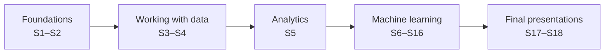

# Statistical Programming: Data Analytics and Machine Learning in Python

Learning hub for the MPMD elective **WP 5 Statistical Programming** at HTW Berlin, winter semester 2026/27 (5 ECTS).

The course takes you from Python and SQL through data preparation and applied statistics to machine learning, from regression to language models, and to deploying what you build. Every method is practised on a running case study and then applied in your team project.



**Where to find the details**

| What | Where |
|---|---|
| The full plan: learning outcomes, the content of every session, teaching days and times, datasets, assessment | [Curriculum](proposal/CURRICULUM.md) |
| Why the course is built this way (labour market, comparable courses, textbooks) | [Premise](proposal/PREMISE.md) |
| The final project: brief, milestones, rules and grading criteria | [Final project](sessions/17-18-final-presentations/final-project.md) |
| The case-study data: downloads, preparation, leaderboard scoring | [Case study](case-study/README.md) |

## Sessions

18 sessions on 14 teaching days between 22 October 2026 and 12 February 2027; a session is usually two blocks of 90 minutes. Dates, times and the teaching points of every block: [Curriculum, Section 1](proposal/CURRICULUM.md#1-overview).

| | Session |
|---|---|
| 1 | [Data careers, the final project challenge and Python for analysis](sessions/01-careers-and-python/) |
| 2 | [Software engineering for data work](sessions/02-software-engineering/) |
| 3 | [Relational databases and SQL with SQLite](sessions/03-sql/) |
| 4 | [Data quality and preparation](sessions/04-data-quality/) |
| 5 | [Exploratory analysis and statistics recap](sessions/05-eda-and-statistics/) |
| 6 | [Introduction to machine learning with regression](sessions/06-regression/) |
| 7 | [Validation and hyperparameter tuning](sessions/07-validation-and-tuning/) |
| 8 | [Classification and evaluation metrics](sessions/08-classification-and-metrics/) |
| 9 | [Advanced feature engineering](sessions/09-feature-engineering/) |
| 10 | [Tree-based models](sessions/10-tree-based-models/) |
| 11 | [Unsupervised learning](sessions/11-unsupervised-learning/) |
| 12 | [Time series forecasting](sessions/12-time-series/) |
| 13 | [Classical NLP](sessions/13-classical-nlp/) |
| 14 | [Large language models I: transformers and embeddings](sessions/14-llms-and-embeddings/) |
| 15 | [Large language models II: retrieval-augmented generation and agents](sessions/15-rag-and-agents/) |
| 16 | [Web APIs, deployment, monitoring and maintenance](sessions/16-deployment-and-monitoring/) |
| 17–18 | [Final project presentations](sessions/17-18-final-presentations/) |

## How to use the session pages

Every session works the same way, in class and at home:

- **Open the session README and read it from top to bottom.** It is the overview of the session: for each block it explains **why** the topic matters and **what** it covers, with one line per topic.
- **Every block lasts 90 minutes: 45 minutes of theory, 30 minutes of exercises, 15 minutes of debrief.** In the theory part the lecturer works through the ▶ **Lecture** notebook (the concepts with runnable code) and, if there is time, a ▶ **Worked example**. In the exercise part you solve short problems yourself, in pairs or teams, in the session's ▶ **Exercises** notebook (`workbooks/session-NN-exercises.ipynb`); the lecturer says which ones. In the debrief, two or three solutions are compared.
- **Follow the ▶ links.** A ▶ link means: switch to that notebook, work through it, then come back to the README and continue.
- **The numbers give the order.** The notebooks in a session's `workbooks/` folder are numbered in the order they are used, so the file list matches the README. The exercise notebook has no number; it is used in every block.
- **📖 Read more** pointers inside the lecture notebooks lead to `workbooks/extras/`: optional notebooks from established sources (scikit-learn, INRIA, ISLP, Hugging Face and others) that go deeper. They are for self-study and are not taught in class.
- **Sources and licences** of every file are listed at the end of each session README.

## Setup

You set up your laptop once, before Session 1. It takes about 20 minutes and about 5 GB of free disk space. Everyone uses the same tools: **VS Code** as the editor, **Git** to get the course material, and **uv**, which installs Python and all course packages for you. **Do not install Python yourself**, and do not use `pip` or Anaconda for this course: uv installs exactly the Python version and packages the course is tested with (Python 3.14).

**Supported computers:** a Mac with Apple silicon (M1 or newer) and macOS 14 or newer; a Windows 10 or 11 PC with an Intel or AMD processor; Linux (x86-64 or ARM64) such as Ubuntu 22.04 or newer. Intel Macs and Windows PCs with an ARM processor are not supported: the machine-learning packages of the course no longer publish versions for them.

A **terminal** is where you type the commands below: on macOS the app *Terminal*; on Windows *PowerShell* (Start menu → type "PowerShell"); on Linux your terminal app. Type or paste one command at a time and press Enter.

### Step 1 · Install VS Code

Download and install VS Code from **https://code.visualstudio.com/download**, the same on every system.

### Step 2 · Install Git and the system libraries

Git downloads and updates the course material. The gradient-boosting libraries XGBoost and LightGBM (Sessions 10 and 12) also need the OpenMP runtime, a small system library that the operating system does not always include.

<details open>
<summary><b>macOS</b></summary>

Install the package manager Homebrew from **https://brew.sh**: copy the command shown on that page into Terminal and press Enter (it asks for your password and takes a few minutes). At the end, Homebrew prints two or three commands under "Next steps" that add `brew` to your terminal; run them. Then install Git and OpenMP:

```bash
brew install git libomp
```
</details>

<details>
<summary><b>Windows</b></summary>

1. Download Git from **https://git-scm.com/downloads/win** and run the installer; the default options are fine.
2. Download and run the Microsoft Visual C++ Redistributable (X64), which contains the OpenMP runtime: **https://aka.ms/vc14/vc_redist.x64.exe**. If it says that a version is already installed, you are done.
</details>

<details>
<summary><b>Linux</b></summary>

```bash
sudo apt install git libgomp1     # Ubuntu, Debian
sudo dnf install git libgomp      # Fedora
```
</details>

Check that Git works (close and reopen the terminal first):

```bash
git --version
```

### Step 3 · Install uv

<details open>
<summary><b>macOS and Linux</b></summary>

```bash
curl -LsSf https://astral.sh/uv/install.sh | sh
```
</details>

<details>
<summary><b>Windows</b> (PowerShell)</summary>

```powershell
powershell -ExecutionPolicy ByPass -c "irm https://astral.sh/uv/install.ps1 | iex"
```
</details>

**Close the terminal and open a new one**, then check that uv is found:

```bash
uv --version
```

It prints a version number such as `uv 0.13.0`. If it says "command not found", restart the computer once. Source of these commands: [uv installation guide](https://docs.astral.sh/uv/getting-started/installation/).

### Step 4 · Get the course repository and create the environment

In the terminal, go to the folder where you keep your course work (for example your Documents folder), then download the repository and create the environment:

```bash
cd Documents
git clone https://github.com/khoadaniel/statistical-programming-mpmd-htw-ws-2026.git
cd statistical-programming-mpmd-htw-ws-2026
uv sync
```

`uv sync` downloads Python 3.14 and every package of the course into a folder `.venv` inside the repository (about 2.5 GB, a few minutes). This `.venv` is **the** course environment: every notebook and script in this repository runs in it. Check it:

```bash
uv run python -c "import sys, sklearn, pandas; print(sys.version.split()[0], 'OK')"
```

It prints `3.14.x OK`. Then download the case-study data (once; Sessions 13–16 data can wait until Session 13):

```bash
uv run python case-study/prepare_airbnb.py   # Inside Airbnb Berlin and Berlin weather, about 100 MB (Sessions 1–12)
uv run python case-study/prepare_data.py     # EBTI customs decisions, about 400 MB (Sessions 13–16)
```

### Step 5 · Open the repository in VS Code and run a notebook

1. Start VS Code, choose **File → Open Folder…** and select the folder `statistical-programming-mpmd-htw-ws-2026`. If VS Code asks whether you trust the authors, choose **Yes, I trust the authors**.
2. VS Code offers to install the **recommended extensions** (Python, Jupyter, Ruff, Markdown Mermaid for the diagrams) in a pop-up at the bottom right; choose **Install**. If you missed it: open the Extensions view (the four squares on the left), type `@recommended` and install the four listed under *Workspace Recommendations*.
3. Open `sessions/01-careers-and-python/workbooks/02-jupyter-introduction.ipynb` and run the first cell (▶ to its left, or Shift+Enter).
4. Look at the top right of the notebook: the kernel must read **.venv (Python 3.14…)**. VS Code picks the repository's `.venv` automatically. If it shows something else or asks you to choose, click it → **Python Environments…** → **.venv** (marked *Recommended*). You do this once; VS Code remembers it for the workspace.

The repository contains the VS Code settings for this ([`.vscode/settings.json`](.vscode/settings.json), [`.vscode/extensions.json`](.vscode/extensions.json)). Terminals opened inside VS Code use the `.venv` automatically, so `python` and `pytest` there are the course versions.

### Later in the course

- **Everything is in one environment.** `uv sync` installs all packages of the course at once, including PyTorch for the language-model sessions; there is nothing to add later. Four optional notebooks (Sessions 12 and 16) need older package versions and run in a temporary environment of their own; their session README gives the command.
- **Databases** (Session 3 onwards) use SQLite, which is part of Python: there is nothing to install. The deployment session (16) needs [Docker Desktop](https://www.docker.com/products/docker-desktop/); its README gives the commands.
- **Language models** (Sessions 14–15) work with a local model through [Ollama](https://ollama.com/) or with any OpenAI-compatible API; see the session READMEs.
- **Workspaces** (Sessions 2, 15, 16) are small projects with their own environment: `cd sessions/<session>/workspace`, then `uv sync` and `uv run pytest`.

### Keeping up to date

At the start of each session, in the repository folder:

```bash
git pull
uv sync
```

`git pull` fetches the new material; `uv sync` updates the environment if the course packages changed. If `git pull` complains about your changes in course files, keep your own work in copies (for example `my-notes.ipynb`) or in your team repository.

### Troubleshooting

| Problem | Fix |
|---|---|
| `uv: command not found` | Close and reopen the terminal; if that does not help, restart the computer. |
| The notebook asks for a kernel or shows another Python | Kernel picker (top right) → **Python Environments…** → **.venv**. Or press Ctrl+Shift+P (Cmd+Shift+P on a Mac), run **Python: Select Interpreter** and choose `.venv`. |
| `.venv` is not offered | In a terminal in the repository folder run `uv sync`, then in VS Code Ctrl+Shift+P → **Developer: Reload Window**. |
| `ModuleNotFoundError` in a notebook | The kernel is not `.venv` (see above), or your environment is outdated: run `uv sync`. |
| XGBoost or LightGBM: "OpenMP", `libomp`, `libgomp` or `vcomp140.dll` not found | The OpenMP runtime of step 2 is missing. |
| Windows: "running scripts is disabled on this system" in the VS Code terminal | In PowerShell run `Set-ExecutionPolicy -Scope CurrentUser RemoteSigned`, confirm with `Y`, reopen the terminal. |
| Anything else | Ask in the course forum with the full error message and the output of `uv --version` and `uv run python --version`. |

## Using AI coding assistants

AI assistants are allowed in this course. Use them to explain, not to replace your understanding: you must be able to explain and test every line you submit, and you document their use with the HTW declaration. Session 1 gives practical tips.

## Licences and attribution

Course-written material (lecture notebooks, own notebooks, workspaces) is licensed under CC BY 4.0. Third-party notebooks keep their original licences; each session README lists the source, licence and any change in its section *Sources and licences*. Some sources are licensed for non-commercial use only (CC BY-NC) or may only be shared unchanged (CC BY-NC-ND); this is noted per file. The case-study data come from the European Commission's EBTI database (reuse with acknowledgement of the source) and from Inside Airbnb (CC BY 4.0); each student downloads them with the provided scripts.

## Repository layout

```
sessions/NN-<topic>/
  README.md        teaching overview: why, topics, links to the notebooks in order, sources and licences
  workbooks/       notebooks numbered in teaching order (NN-lecture-*.ipynb are the lecture notebooks)
    extras/        optional notebooks for self-study
  workspace/       small Python project (Sessions 1, 2, 15 and 16)
  figures/         figures of the lecture notebooks and the script that makes them
case-study/        data preparation and scoring for the case studies
proposal/          curriculum and premise of the course
pyproject.toml     course environment (Python 3.14 and packages; uv.lock pins the exact versions)
.vscode/           editor settings and recommended extensions
```
