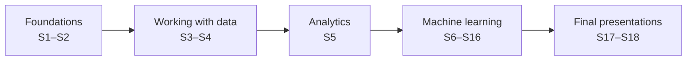

# Statistical Programming: Data Analytics and Machine Learning in Python

Learning hub for the MPMD elective **WP 5 Statistical Programming** at HTW Berlin, winter semester 2026/27 (5 ECTS).

The course takes you from Python and SQL through data preparation and applied statistics to machine learning, from regression to language models, and to deploying what you build. Every method is practised on a running case study and then applied in your team project.



**Where to find the details**

| What | Where |
|---|---|
| Setting up your laptop: VS Code, Git, uv, the course environment, the setup check | [Getting started](GETTING_STARTED.md) |
| The full plan: learning outcomes, the content of every session, teaching days and times, datasets, assessment | [Curriculum](proposal/CURRICULUM.md) |
| Why the course is built this way (labour market, comparable courses, textbooks) | [Premise](proposal/PREMISE.md) |
| The final project: brief, milestones, rules and grading criteria | [Final project](sessions/17-18-final-presentations/final-project.md) |
| The case-study data: download, folders, what was held back | [Case study](case-study/README.md) |

## Sessions

18 sessions on 14 teaching days between 22 October 2026 and 12 February 2027; a session usually has two blocks. Dates, times and the teaching points of every block: [Curriculum, Section 1](proposal/CURRICULUM.md#1-overview).

| | Session |
|---|---|
| 1 | [Data careers, the final project challenge, NumPy and pandas](sessions/01-careers-and-python/) |
| 2 | [Software engineering for data work](sessions/02-software-engineering/) |
| 3 | [Relational databases and SQL with SQLite](sessions/03-sql/) |
| 4 | [Data quality and preparation](sessions/04-data-quality/) |
| 5 | [Exploratory analysis and statistics recap](sessions/05-eda-and-statistics/) |
| 6 | [Introduction to machine learning with regression](sessions/06-regression/) |
| 7 | [Validation and hyperparameter tuning](sessions/07-validation-and-tuning/) |
| 8 | [Classification and evaluation metrics](sessions/08-classification-and-metrics/) |
| 9 | [Advanced feature engineering](sessions/09-feature-engineering/) |
| 10 | [Tree-based models](sessions/10-tree-based-models/) |
| 11 | [Unsupervised learning](sessions/11-unsupervised-learning/) |
| 12 | [Time series forecasting](sessions/12-time-series/) |
| 13 | [Classical NLP](sessions/13-classical-nlp/) |
| 14 | [Large language models I: transformers and embeddings](sessions/14-llms-and-embeddings/) |
| 15 | [Large language models II: retrieval-augmented generation and agents](sessions/15-rag-and-agents/) |
| 16 | [Web APIs, deployment, monitoring and maintenance](sessions/16-deployment-and-monitoring/) |
| 17–18 | [Final project presentations](sessions/17-18-final-presentations/) |

## How to use the session pages

Every session works the same way, in class and at home:

- **Open the session README and read it from top to bottom.** It is the overview of the session: for each block it explains **why** the topic matters and **what** it covers, with one line per topic.
- **Every block has three parts: theory, exercises and a debrief.** Each block has one ▶ **Lecture** notebook. In the theory part the lecturer works through it (the concepts with runnable code, then a worked example). In the exercise part you solve short problems yourself, in pairs or teams, in the **Exercises** section at the end of the same notebook; the lecturer says which ones. In the debrief, two or three solutions are compared.
- **Follow the ▶ links.** A ▶ link means: switch to that notebook, work through it, then come back to the README and continue.
- **The numbers give the order.** The notebooks in a session's `workbooks/` folder are numbered in the order of the blocks (`01-lecture-…` for block 1, `02-lecture-…` for block 2), so the file list matches the README.
- **📖 Read more** pointers inside the lecture notebooks lead to `workbooks/extras/`: optional notebooks from established sources (scikit-learn, INRIA, ISLP, Hugging Face and others) that go deeper. They are for self-study and are not taught in class.
- **Sources and licences** of every file are listed at the end of each session README.

## Get started

Set up your laptop once, before Session 1: about 20 minutes and 5 GB of free disk space. **[GETTING_STARTED.md](GETTING_STARTED.md)** walks you through it: VS Code, Git, a GitHub account, uv, and the course repository with `uv sync`. At the end, one command checks everything:

```bash
uv run check_setup
```

> [!IMPORTANT]
> **The course material changes during the semester.** Run `git pull` and `uv sync` in the repository folder often, and always before you start working on something. You also need a free [GitHub](https://github.com/signup) account from Session 2 on; the guide explains both.

## Using AI coding assistants

AI assistants are allowed in this course. Use them to explain, not to replace your understanding: you must be able to explain and test every line you submit, and you document their use with the HTW declaration. Session 1 gives practical tips.

## Licences and attribution

Course-written material (lecture notebooks, own notebooks, workspaces) is licensed under CC BY 4.0. Third-party notebooks keep their original licences. The page `workbooks/extras/README.md` of each session lists the source, licence and any change of every downloaded notebook. Some sources are licensed for non-commercial use only (CC BY-NC) or may only be shared unchanged (CC BY-NC-ND); this is noted per file. The case-study data come from the European Commission's EBTI database (reuse with acknowledgement of the source) and from Inside Airbnb (CC BY 4.0). Students download them from the course drive (see `case-study/README.md`).

## Repository layout

```
sessions/NN-<topic>/
  README.md        teaching overview: guiding question, topics and links to the notebooks in order
  workbooks/       notebooks numbered in teaching order (NN-lecture-*.ipynb are the lecture notebooks)
    extras/        downloaded third-party notebooks and their sources and licences
  workspace/       small Python project (Sessions 2, 15 and 16; Session 2 also has cli-workspace/)
  figures/         figures of the lecture notebooks and the script that makes them
case-study/        the two case studies: data description, figures and the API evaluation script
course_tools/      the setup check (uv run check_setup)
proposal/          curriculum and premise of the course
GETTING_STARTED.md how to set up your laptop
pyproject.toml     course environment (Python 3.14 and packages; uv.lock pins the exact versions)
.vscode/           editor settings and recommended extensions
```
