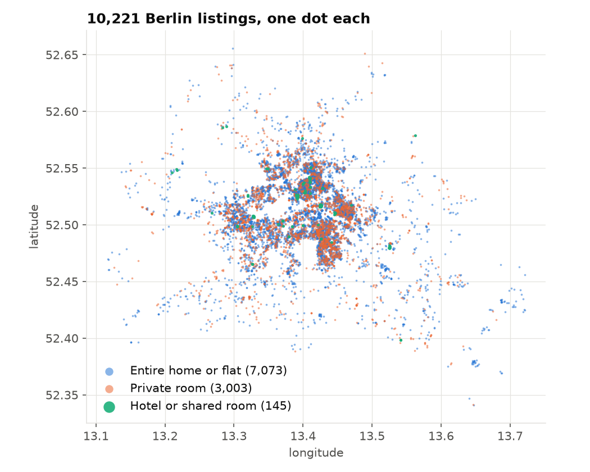
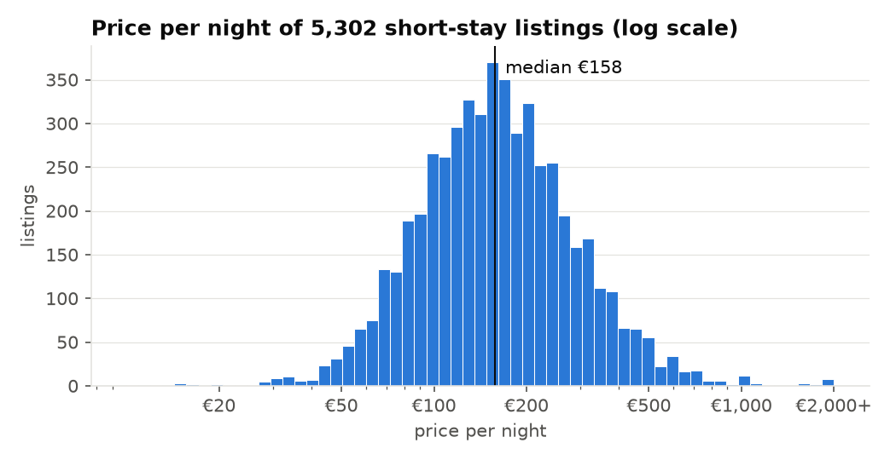
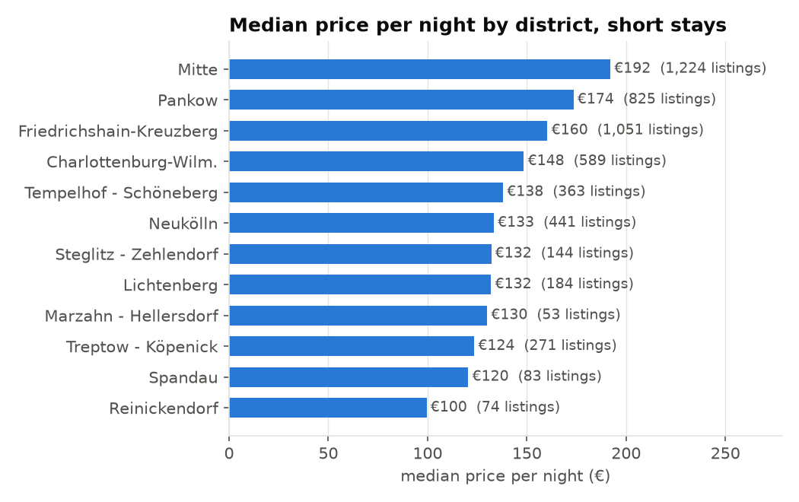
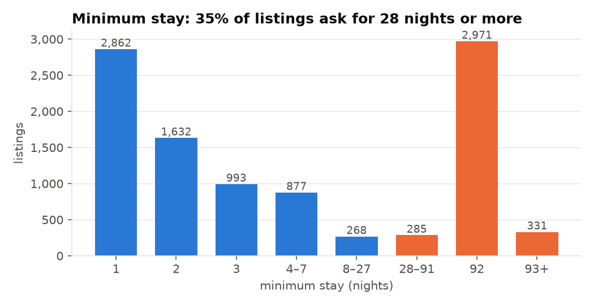
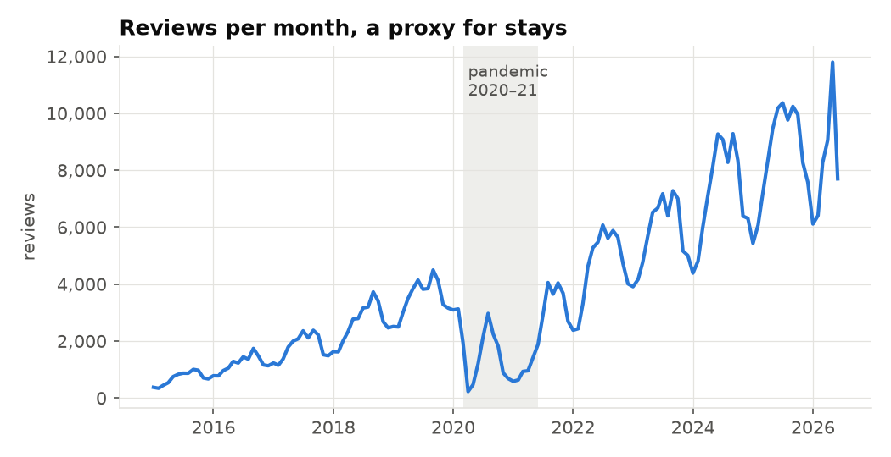

# Inside Airbnb, Berlin

The dataset of Sessions 1–12: the Airbnb listings of Berlin, with prices, locations, ratings and availability, plus the number of reviews per month since 2009 and the daily Berlin weather since 2016.

## Where the data come from

[Inside Airbnb](https://insideairbnb.com/) describes itself as "a mission driven project that provides data and advocacy about Airbnb's impact on residential communities"; it was founded in 2015 by Murray Cox. Several times a year it collects the public listing pages of many cities and publishes them as tables under the Creative Commons Attribution 4.0 licence. The course uses the Berlin snapshot of **26 June 2026**: the listings, the booking calendar for the following year and the date of every review.

The daily weather comes from the [Open-Meteo](https://open-meteo.com) historical weather archive (CC BY 4.0): mean temperature, rain and hours of sunshine in Berlin since 1 January 2016.

Before handing out the data, the lecturer removed personal data (host names, profile texts, photos, review texts, reviewer names, and names that hosts typed into the registration field) and held back 20 % of the listings as a test set (see [case-study/README.md](../README.md#inside-airbnb-berlin-sessions-112)). What you receive:

| File | Rows | One row is |
|---|---:|---|
| `listings.parquet` | 10,221 | a listing: location, property, price per night, minimum stay, availability, reviews and ratings, host facts, registration number |
| `calendar.parquet` | 3,759,500 | a listing on a day between 26 June 2026 and 2 July 2027: available or not, minimum stay |
| `reviews_monthly.parquet` | 180,656 | a listing in a month: number of reviews written |
| `weather_daily.parquet` | 3,830 | a day: temperature, rain, sunshine |
| `neighbourhoods.geojson` | | the boundaries of the districts and neighbourhoods |

## Why this dataset

- **It is real and it is local.** Everyone has an opinion about Airbnb in Berlin, and every result can be checked against what you know about the city.
- **It is messy in instructive ways.** A third of the listings show no price, minimum stays range from one night to a year, ratings cluster near the top, and the registration field contains numbers, company names and personal names. Sessions 3 and 4 work through these problems.
- **It supports the whole first half of the course.** Prices for statistics, regression and tree-based models; locations and amenities for clustering; reviews per month as a demand series for forecasting; the weather as a candidate input that turns out not to help (Session 12).

## A first look

### Where the listings are

Listings crowd into the inner city: Mitte, Friedrichshain-Kreuzberg and Pankow alone hold 58 % of them. **69 %** are entire homes or flats, **29 %** private rooms; hotel and shared rooms are rare (145 together). The 10,221 listings belong to 6,660 hosts, and 45 % of the listings belong to a host with more than one listing, which is why the held-back test set was split by host.

### What a night costs

Among the listings that rent for short stays (minimum stay under 28 nights) and show a price, the **median is €158** per night; 80 % cost between €77 and €334. The distribution is strongly skewed: on a log scale it looks almost symmetric, which is why the price models of Sessions 6–10 often work with the logarithm of the price. The highest price in the data is €10,025, a reminder that some prices are placeholders rather than offers.

The central districts are the most expensive: **Mitte €192**, Pankow €174 and Friedrichshain-Kreuzberg €160, against €100 in Reinickendorf. Part of this gap comes from what is offered (more entire flats in the centre), not only from where; Session 5 separates the two.

### Who rents for a night, and who for three months

The minimum stay splits the listings into two groups. **54 %** accept stays of three nights or less, but **35 %** require 28 nights or more, and 2,971 listings (29 %) ask for exactly **92 nights**, about three months. The data do not say why. One possible reason is regulation: since 1 August 2018 Berlin requires every offer of a holiday flat to show a registration number ([Senatsverwaltung für Stadtentwicklung](https://www.berlin.de/sen/wohnen/rechtliches/zweckentfremdungsverbot/)). In the data, 35 % of the listings show a registration number, 32 % show nothing, 19 % the name of a company and 13 % the name of a private host. The price analyses of the course therefore keep the short stays only.

### Reviews as a trace of demand

Airbnb publishes no bookings, but guests can review a stay, so the number of reviews per month is a common **proxy for demand**. It shows the summer peaks, the collapse during the pandemic (20,804 reviews in 2020 against 42,219 in 2019) and a strong recovery (102,810 in 2025). Read the long-term rise with care: the data contain only listings that were still online in June 2026, so listings that closed earlier, and their reviews, are missing (survivorship). Session 12 forecasts this series.

### Ratings and availability

- Ratings are high: the median is **4.86 out of 5**, 62 % of the rated listings score 4.8 or more, and 20 % of all listings have no rating yet. A rating mostly separates good from very good.
- 27 % of the listings are not available on a single day of the coming year (`availability_365` is 0): some are booked out, many are simply inactive.

## Things to keep in mind

- **Prices are asking prices** on the day of the snapshot, not what guests paid.
- **One snapshot.** Inside Airbnb publishes a new one every quarter; the course keeps the June 2026 snapshot so that everybody works with the same numbers.
- **Report in aggregate.** The listings come from public pages, but they describe real people's homes: do not single out or name hosts.

## Licence and citation

Inside Airbnb, Berlin, snapshot of 26 June 2026, [insideairbnb.com](https://insideairbnb.com/get-the-data/), CC BY 4.0. Open-Meteo historical weather API, [open-meteo.com](https://open-meteo.com), CC BY 4.0. The figures are drawn by [`case-study/make_dataset_figures.py`](../make_dataset_figures.py) from the student data.
