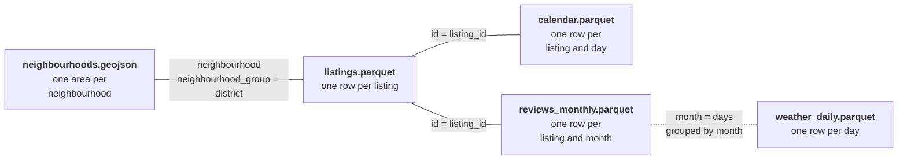

# Inside Airbnb Berlin: the files

Data version **v1**. If the lecturer corrects the data, a higher version is pushed to the course repository:
run `git pull` to get it.

| Version | Changes |
|---|---|
| v1 | first release |

## What is in this folder

Inside Airbnb visited every public Airbnb page of Berlin around **26 June 2026** and recorded what it showed.
Four files come from that visit, one file adds the weather:

| File | Rows | One row is |
|---|---:|---|
| `listings.parquet` | 10,221 | a listing (a flat or room offered on Airbnb), as it was on the day of the visit |
| `calendar.parquet` | 3,759,500 | a listing on one day of the following year: free or not |
| `reviews_monthly.parquet` | 180,656 | a listing in a month in which it received reviews |
| `weather_daily.parquet` | 3,830 | a day in Berlin: temperature, rain, sunshine |
| `neighbourhoods.geojson` | 140 areas | a neighbourhood of Berlin with its border, for maps |

The files link through these columns (`id` in the listings is `listing_id` in the other files):



A solid line joins on the named columns; the dashed line needs a step first: group the weather days by month.

### `listings.parquet`: one row per listing

What the listing page showed when Inside Airbnb visited it (`last_scraped`, between
26 June and 3 July 2026).

| Columns | Meaning |
|---|---|
| `id`, `name` | the listing's number on Airbnb (the key to the other files) and its title |
| `host_id`, `hosts_time_as_host_years`, `host_is_superhost`, `host_listings_count`, `calculated_host_listings_count`, `host_identity_verified` | the host: number, years on Airbnb, Superhost badge, number of listings, verified identity (no names) |
| `district`, `neighbourhood`, `latitude`, `longitude` | where the listing is: 12 districts (Bezirke), 137 neighbourhoods, coordinates (shifted by Airbnb by up to about 150 m) |
| `property_type`, `room_type`, `accommodates`, `bathrooms`, `bedrooms`, `beds`, `amenities` | the place: type, entire home or room, number of guests, rooms and beds, the list of amenities as text |
| `price` | price per night in euros on the day of the visit; empty for 3,467 listings that showed no price |
| `minimum_nights`, `maximum_nights` | shortest and longest stay a guest can book |
| `availability_30`, `availability_90`, `availability_365` | free nights in the next 30, 90 and 365 days |
| `estimated_occupancy_l365d`, `estimated_revenue_l365d` | Inside Airbnb's estimate of booked nights and revenue in the last 365 days |
| `number_of_reviews` | all reviews the listing has received; equal to the sum of `n_reviews` in `reviews_monthly.parquet` |
| `number_of_reviews_ltm` | reviews in the last twelve months before the visit ("ltm" = last twelve months) |
| `first_review`, `last_review` | date of the first and of the latest review |
| `reviews_per_month` | `number_of_reviews` divided by the number of months from `first_review` to the visit: a lifetime average, not the count of a recent month |
| `review_scores_rating` | the overall star rating shown on the listing page: the mean of the overall stars of **all** reviews, from `first_review` to `last_review`, not only the recent ones; from 0 to 5 |
| `review_scores_accuracy`, `_cleanliness`, `_checkin`, `_communication`, `_location`, `_value` | the means of the six category ratings over the same reviews. Guests give the overall rating separately, so it is not the mean of the six |
| `license`, `license_status` | the registration number that Berlin requires for short-term rentals, and the type of entry (registration number, missing, or a name, which was removed) |

All review columns describe the whole life of the listing up to the visit. 2,003 listings have no
review yet: their review dates, `reviews_per_month` and scores are empty. The scores do not show *when* a
listing was rated well; for counts over time, use `reviews_monthly.parquet`.

### `calendar.parquet`: one row per listing and day

The booking calendar of each listing for the 365 days after the visit, from 26 June 2026 to
2 July 2027, as it was on the day of the visit.

| Column | Meaning |
|---|---|
| `listing_id` | the listing (= `id` in `listings.parquet`) |
| `date` | the night |
| `available` | `True`: the night could still be booked. `False`: it was booked **or** blocked by the host; the data do not tell which |
| `minimum_nights` | the shortest stay for an arrival on this date |

The calendar has no price. To bring listing facts into the calendar, join on the listing:

```python
calendar = calendar.merge(listings[["id", "district", "room_type"]], left_on="listing_id", right_on="id")
```

To go the other way, first reduce the calendar to one row per listing, then join:

```python
share_free = calendar.groupby("listing_id")["available"].mean().rename("share_free")
listings = listings.merge(share_free, left_on="id", right_index=True, how="left")
```

The calendar covers 10,300 listings: 79 of them are not in `listings.parquet`, because Inside
Airbnb's calendar file includes a few listings that its listings file does not. A join on the listing drops them.

### `reviews_monthly.parquet`: one row per listing and month

How many reviews a listing received in a month, from June 2009 to July 2026. Guests can review only
after a stay, so reviews are a trace of past bookings.

`listings.parquet` gives only totals per listing (`number_of_reviews`, `number_of_reviews_ltm`) and
the dates of the first and latest review. This file shows *when* the reviews were written. Use it to:

- follow demand in Berlin over time: add up all listings per month, and you get a monthly time series
  with seasons, the drop in 2020 and the recovery;
- compare the reviews with the weather, month by month;
- build features up to a chosen date, for example "reviews in the 12 months before 1 January 2026", so
  that a model uses only information that was known on that date. The totals in `listings.parquet`
  were counted at the visit and include later reviews.

| Column | Meaning |
|---|---|
| `listing_id` | the listing (= `id` in `listings.parquet`) |
| `month` | the month, written as its first day (2026-05-01 is May 2026) |
| `n_reviews` | number of reviews written in that month |

A month **without** reviews has no row: fill the missing months with 0 before you compute averages or
plot a time series. The last two months, June and July 2026, are incomplete, because the visit
ended in the first days of July: stop a time series at the last full month. The file has no star ratings,
only counts. 57 listings in this file are not in `listings.parquet`, for the same reason as in the calendar.

### `weather_daily.parquet`: one row per day

The weather at one point in central Berlin, from 1 January 2016 to 26 June 2026.

| Column | Meaning |
|---|---|
| `date` | the day |
| `temperature_2m_mean` | mean air temperature of the day, in °C, measured 2 m above the ground |
| `precipitation_sum` | rain and snow of the day, in mm |
| `sunshine_hours` | hours of sunshine |

The weather ends on the day of the visit, while the calendar starts there: the two files do not overlap.
Combine the weather with `reviews_monthly.parquet` instead, after grouping the days by month.

### `neighbourhoods.geojson`: the map of the neighbourhoods

GeoJSON is a common text format for shapes on a map, written in JSON. This file holds 140 areas, one per
neighbourhood. Each area has

- a `geometry`: its border, as a list of (longitude, latitude) points;
- `properties`: `neighbourhood` (the same names as in `listings.parquet`) and `neighbourhood_group`
  (the district, `district` in `listings.parquet`).

Use it to colour a map by neighbourhood, for example the median price. Plotly reads it directly:

```python
import json
import plotly.express as px

with open("case-study/airbnb/data/neighbourhoods.geojson") as f:
    areas = json.load(f)
median_price = listings.groupby("neighbourhood", as_index=False)["price"].median()
px.choropleth_map(median_price, geojson=areas, locations="neighbourhood",
                  featureidkey="properties.neighbourhood", color="price",
                  center={"lat": 52.52, "lon": 13.40}, zoom=9)
```

### `airbnb.sqlite`

Not in the zip. Session 3 builds it from the Parquet files: the tables `listings`, `calendar` and `reviews`
in one database, for practising SQL.

## Where the files come from

| File | Source | Downloaded |
|---|---|---|
| `listings.parquet`, `calendar.parquet`, `reviews_monthly.parquet`, `neighbourhoods.geojson` | Inside Airbnb, Berlin, snapshot of 26 June 2026: `data/listings.csv.gz`, `data/calendar.csv.gz`, `data/reviews.csv.gz`, `visualisations/neighbourhoods.geojson` under <https://data.insideairbnb.com/germany/be/berlin/2026-06-26/> | 2 October 2026 |
| `weather_daily.parquet` | Open-Meteo historical weather API, <https://open-meteo.com/en/docs/historical-weather-api>, request `https://archive-api.open-meteo.com/v1/archive?latitude=52.52&longitude=13.41&start_date=2016-01-01&end_date=2026-06-26&timezone=Europe%2FBerlin&daily=temperature_2m_mean,precipitation_sum,sunshine_duration` | 15 October 2026 |

[Inside Airbnb](<https://insideairbnb.com/get-the-data/>) collects the public listing pages of Airbnb several times a year.

**What the lecturer changed:**

- Removed personal data: host names and profile texts, photos, listing descriptions, review texts and
  reviewers' names. Names that hosts typed into the registration field were replaced by the type of entry.
- Kept the listing columns used in the course, and only listing, date, availability and minimum stay
  in the calendar.
- Counted the reviews per listing and month instead of one row per review.
- Renamed `neighbourhood_cleansed` to `neighbourhood` and `neighbourhood_group_cleansed` to `district`,
  and in the weather `time` to `date`; converted the sunshine from seconds to hours.
- Stored prices as numbers, dates as dates and true/false as Booleans.
- Held back part of the listings, with their calendar and review rows, as a test set
  ([why and how](../../README.md#inside-airbnb-berlin-sessions-112)).

`neighbourhoods.geojson` is unchanged.

## Licence and citation

- Inside Airbnb, Berlin snapshot of 26 June 2026, Creative Commons Attribution 4.0 International (CC BY 4.0).
  The data come from public Airbnb pages: report results in aggregate and do not name hosts.
- Open-Meteo historical weather data, Creative Commons Attribution 4.0 International (CC BY 4.0).
