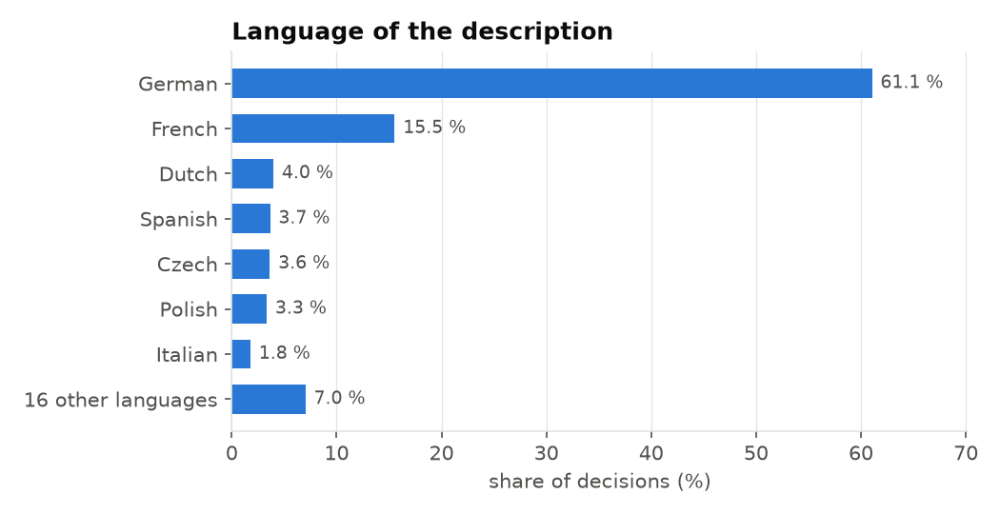
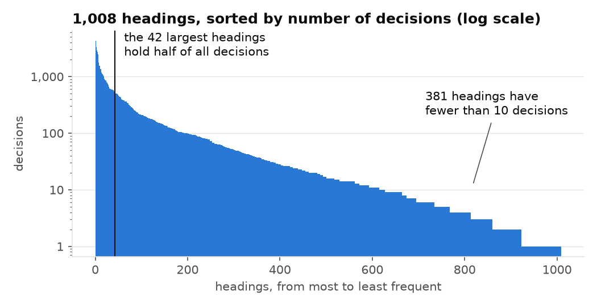
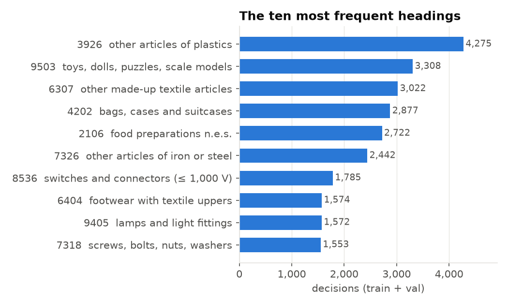
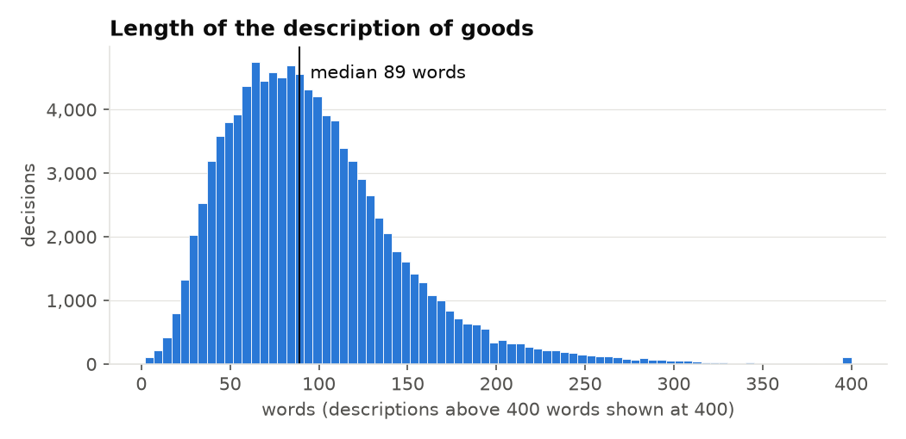

# EBTI: binding tariff decisions of the EU customs

The dataset of Sessions 13–16 and of the final project: about 120,000 decisions in which an EU customs authority states how a product is classified in the customs tariff. The task is to predict the four-digit **heading** of a product from its description.

## Where the data come from

Every product that crosses the border of the European Union must be classified in the customs nomenclature, and the classification decides the duty. When a trader is unsure, they can ask the customs authority of a member state for a **Binding Tariff Information (BTI)** decision: they describe the product, and customs states its code. According to the [European Commission](https://taxation-customs.ec.europa.eu/online-services/online-services-and-databases-customs/european-binding-tariff-information-ebti_en), a BTI decision is generally valid for three years throughout the EU, regardless of where it was issued, and binds all EU customs administrations and the holder. All decisions are entered into the **European Binding Tariff Information (EBTI)** database, which the Commission publishes; reuse is allowed with acknowledgement of the source (Commission Decision 2011/833/EU). The names of the holders are not published.

The course uses the decisions that are **binding on 1 October 2026**, from the full export of the database that the Commission generated on that day. The nomenclature extraction has the same reference date, so decisions and codes describe the same day (`PROVENANCE.md` explains this). The nomenclature, the list of all codes of the customs tariff, comes from the Commission's TARIC database. How many decisions you receive, what was held back for the evaluation, and the files: [case-study/README.md](../README.md#ebti-classifying-goods-in-the-eu-customs-tariff-sessions-1316).

## What a decision looks like

A shortened German decision of heading **6404** (footwear with outer soles of rubber or plastics and uppers of textile materials):

> Slipper, sog. Herren Freizeitschuhe, [...] Größe 42, Foto siehe Anlage,
> - mit Laufsohlen aus Kautschuk/Kunststoff,
> - mit Oberteil aus Spinnstoff (den größten Teil der Außenfläche bildend, damit keine Ware der Position 6402) und Kunststoff [...]
>
> keywords: OF PLASTICS, OF RUBBER, OF TEXTILE MATERIAL, OUTER SOLES, SHOES, UPPERS, FOOTWEAR

The heading is the first four digits of the code: `64` is the chapter (footwear), `6404` the heading. The description is written for an expert: it names the materials, which part forms the outer surface, and even rules out the neighbouring heading 6402. Learning to read such text, in many languages, is the task.

## Why this dataset

- **A real decision with real consequences.** The heading decides the duty a trader pays, and each decision is the judgement of a customs expert.
- **Text as data.** The input is free text, so Sessions 13–15 can compare word counts, embeddings and language models on the same task.
- **Many classes, a long tail, many languages.** Almost 1,000 headings, a few very frequent and hundreds rare, in 23 languages: accuracy alone is not enough, and the choice of method matters.
- **Leakage to find.** The training data contain columns that are written after the decision and name the answer (see below). A model that uses them shows data leakage: it uses information that a real request does not contain, so its score looks better than it is. Finding these columns is part of the work.

## A first look

### Many languages, one dominant

Each decision is written in the language of the issuing authority. Germany issues **60 %** of the valid decisions and France 15 %, so German and French descriptions dominate; the other 21 languages share the rest. The 28 issuing countries are the 27 member states plus Northern Ireland (code `XI`). Almost every training decision (99.7 %) also carries **English keywords**, which help you read a decision in a language you do not know.

### A long tail of headings

Your data use **1,015 headings**. The 42 largest hold half of all decisions, while 377 headings have fewer than ten decisions and 105 have exactly one. A model that learns only the frequent headings can reach a high accuracy and still fail most headings: that is why the course reports **macro-F1** (the average over headings) next to accuracy.

The most frequent headings are broad headings for everyday imported goods: plastic articles, toys, textile articles, bags, food preparations, steel articles. Together the ten largest account for 25 % of the decisions. Several are "not elsewhere specified" headings, which collect what fits nowhere else and are therefore hard to tell apart.

### Descriptions are short paragraphs

The median description has **89 words**; 80 % have between 41 and 159. Long enough to carry the deciding details (material, function, how it is used), short enough for every method of the course.

## Things to keep in mind

- **The justification is the answer.** `classification_justification` explains the decision and names the heading in most cases; it is written after classification and does not exist for a new request. The same holds for `keywords`, `cn_code`, `chapter` and the dates. Never use them as model inputs; Session 13 measures how much they raise a score.
- **Unseen headings.** A few headings of the evaluation set never occur in `decisions.parquet`; no model trained on the course data gets them right.
- **Data quality.** Some descriptions are database templates or test entries.
- **The nomenclature changes.** The Harmonized System is revised every five to six years: HS 2022 applies since 1 January 2022, and HS 2028 replaces it on 1 January 2028 ([World Customs Organization](https://www.wcoomd.org/en/topics/nomenclature/instrument-and-tools/hs-nomenclature-2028-edition.aspx)). A revision creates, splits and deletes headings, so the set of classes a model knows is valid only until the next one (Session 16).

## The nomenclature file

The folder `nomenclature/` holds the EU customs tariff of 1 October 2026 in English, German and French, as the European Commission publishes it: every line of the tariff with its code, its name and its validity dates. The files are raw: building a table of headings from them is part of your work. `PROVENANCE.md` in the data folder shows the first rows and how the codes link to the decisions.

## Licence and citation

The sources, their dates and their terms of use are listed in [case-study/README.md](../README.md#sources-and-terms-of-use) and, for each file, in `PROVENANCE.md`. The figures are drawn by [`case-study/make_dataset_figures.py`](../make_dataset_figures.py) from the student data.
