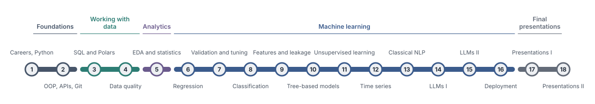
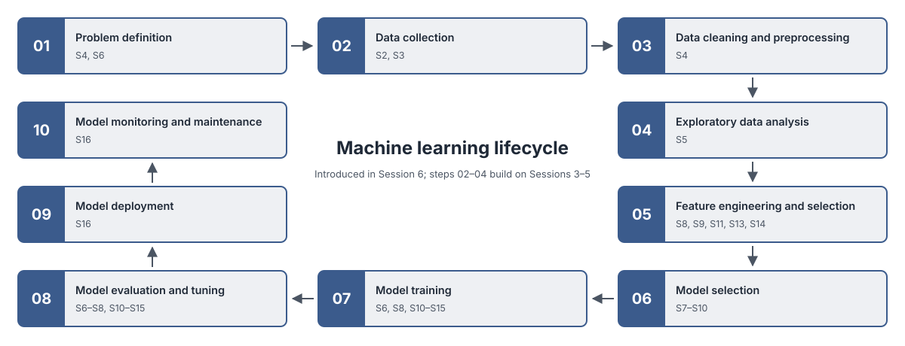
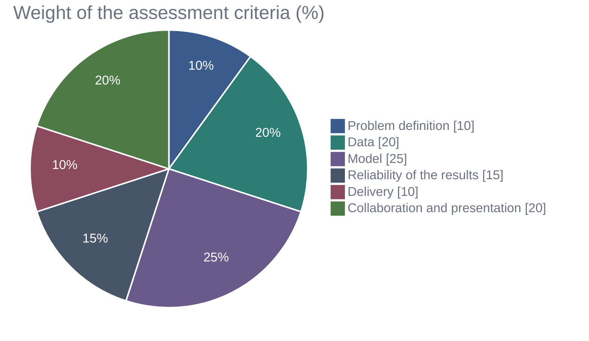
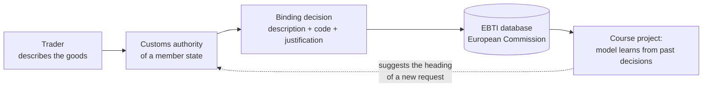
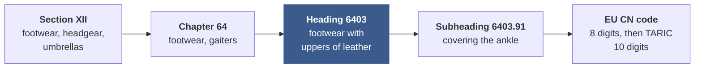
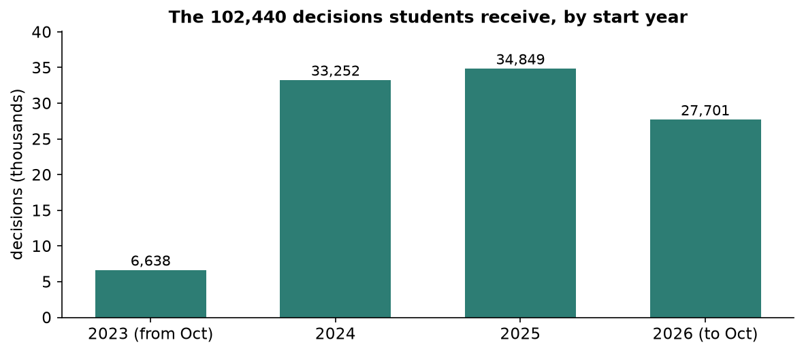
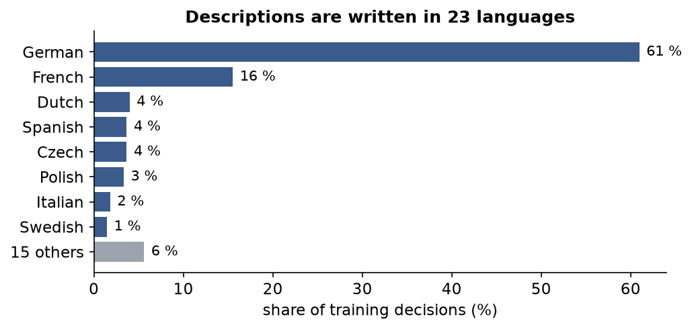
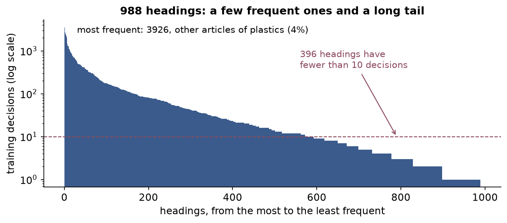

# Statistical Programming: Data Analytics and Machine Learning in Python

**Course proposal · MPMD elective WP 5 · HTW Berlin · Winter semester 2026/27 · Part 2 of 2: curriculum**

> [!NOTE]
> **Work in progress, open for review.** Last updated: 11 October 2026. Comments and suggestions are welcome.

The course prepares students for the analyst and the data science track of data work. All students first learn the shared foundations: Python, collaborative development, SQL and the preparation of data. They then learn to explore, report and test data as analysts do, and finally to build, validate and deploy machine learning models, from regression to language models. No prior knowledge of machine learning or NLP is assumed. All methods are practised on public, real-world datasets ([Section 4](#4-datasets-and-leaderboard)).

The analysis behind these decisions (curriculum, labour market, comparable courses, datasets and assessment) is in Part 1, [PREMISE.md](PREMISE.md).

| Item | Proposal |
|---|---|
| Module | Statistical Programming (elective WP 5), 5 ECTS; proposed subtitle *Data Analytics and Machine Learning in Python* |
| Recommended semester | Semester 2 (elective slot 2.4), alongside 2.2 Data Mining; semester 3 remains possible |
| Teaching time | 72 UE (4 weekly semester hours) in 18 sessions on 14 teaching days between 22 October 2026 and 12 February 2027; a session is usually 4 UE, taught as two 90-minute blocks with a 15-minute break; full teaching days hold two sessions ([Section 3](#3-sessions)) |
| Workload | 5 ECTS = 135 h: 54 h contact time (72 UE) and about 81 h self-study and project work |
| Participants | 22 students in seven teams (six of three, one of four) |
| Structure | Foundations (2 sessions), working with data (2), analytics (1), machine learning (11), final presentations (2) |
| Datasets | Inside Airbnb Berlin with the Open-Meteo weather API, IBM Telco customer churn, and EU customs decisions (EBTI); their use by session is listed in [Section 4](#4-datasets-and-leaderboard) |
| Leaderboard | In Sessions 13–16, teams submit predictions for a held-out test set whose correct answers stay hidden, so the ranking shows how well a model works on new data; the leaderboard task is also the final project |
| Assessment | One final project for all teams on the leaderboard task, graded in its presentation (100 %) |

## Contents

- [1. Overview](#1-overview)
- [2. Module learning outcomes](#2-module-learning-outcomes)
- [3. Sessions](#3-sessions)
- [4. Datasets and leaderboard](#4-datasets-and-leaderboard)
- [5. Final project](#5-final-project)
- [6. Assessment](#6-assessment)
- [Appendix. The final project at a glance](#appendix-the-final-project-at-a-glance)

## 1. Overview

Data roles share a common base and then divide: analysts work mainly with SQL, Python for reporting, visualisation and statistical tests; data scientists and ML engineers build, validate and operate models ([Premise, Section 3](PREMISE.md#3-labour-market-requirements)). The course follows this structure.

**Learning through practice.** The course is oriented towards professional practice. Statistical and data concepts that students have met in earlier modules are revisited where a task requires them, but the emphasis lies on their implementation in Python and on their application to realistic problems. Each 90-minute block combines 45 minutes of theory with live coding, 30 minutes of exercises and a 15-minute debrief, so that every method is learned by using it. Formal derivations are presented only as far as they are needed to apply a method correctly and to interpret its results; the lecture notebooks of each session and the further reading they list provide the full background for students who wish to study a topic in depth.

- **Shared base (Sessions 1–4).** Every role needs Python, both for analysis in notebooks and for building applications (object-oriented programming, tests, modules), collaborative development with Git, SQL and the preparation of data.
- **Analytics (Session 5).** Exploration and visualisation together with the statistics recap of the module description: descriptive statistics, tests, contingency tables and correlation, applied in Python. Correlation leads directly into regression, the first model of the next part.
- **Machine learning (Sessions 6–16).** Built up from the simplest model to the most complex: linear and logistic regression, validation and tuning, classification and its evaluation metrics, feature engineering, tree-based models, unsupervised learning, forecasting, classical NLP, two sessions on large language models (from transformer and embedding models to RAG and agents) and deployment. The machine learning lifecycle is introduced at the start of this part.
- **One project.** All teams work on the same project, the leaderboard task, so that they can follow, compare and discuss each other's solutions. Teams apply the general steps of each session to the project data from Session 3 onwards and build the text models from Session 13. The project is graded in its presentation ([Section 5](#5-final-project)); the exercises in the sessions are not graded.

<picture>
  <source media="(prefers-color-scheme: dark)" srcset="assets/course-structure-timeline-dark.svg">
  
</picture>

<table>
<thead>
<tr>
<th width="11%" align="left">Date</th>
<th width="9%" align="left">Time</th>
<th width="21%" align="left">Session</th>
<th width="6%" align="left">Blocks</th>
<th width="45%" align="left">Teaching points of each 90-minute block</th>
<th width="8%" align="left">Roles</th>
</tr>
</thead>
<tbody>
<tr><td valign="top"><b>Thu 22 Oct 2026</b></td><td valign="top">09:45–15:15</td><td valign="top"><b>S1</b> Introduction: data science careers, the final project challenge, NumPy and pandas</td><td align="center" valign="top">3</td><td valign="top"><b>1. Data careers, the course and the challenge</b> • Data roles: data analyst, data scientist, ML and AI engineer, data engineer • What Berlin job advertisements ask for, by role • Agentic engineering: how AI coding agents change data work and learning • Course organisation and assessment • The final project challenge: predicting the customs heading of a product from its description (EBTI dataset)  <b>2. Notebooks, a Python recap and NumPy</b> • The working environment: uv, VS Code and the course environment • Jupyter notebooks: cells, kernel, Markdown, order of execution • A short recap of Python: types, collections, conditions, loops and functions • NumPy arrays: creation, <code>dtype</code> and <code>shape</code>, indexing, slicing and Boolean masks • Vectorised operations, broadcasting and aggregation along an axis • Random numbers and simulation with NumPy  <b>3. pandas: Series and DataFrames, from basic to advanced</b> • Series and DataFrame: index, columns and <code>dtype</code>; reading a file • Selecting rows and columns with <code>loc</code>, <code>iloc</code> and Boolean masks; missing values • Creating and transforming columns: vectorised arithmetic, <code>.str</code> and <code>.dt</code>, <code>map</code> and <code>apply</code> • Sorting, <code>value_counts</code>, <code>groupby</code> with <code>agg</code>, and pivot tables • Combining tables with <code>merge</code> and <code>concat</code> • Method chaining, and tips for using AI coding assistants</td><td valign="top">All</td></tr>
<tr><td rowspan="2" valign="top"><b>Fri 30 Oct 2026</b></td><td valign="top">09:45–13:00</td><td valign="top"><b>S2</b> Software engineering for data work: object-oriented programming, testing, from notebook to application, Git and continuous integration</td><td align="center" valign="top">2</td><td valign="top"><b>1. Classes, errors and tests</b> • Classes and objects: attributes and methods • Composition, inheritance and dataclasses • Type hints and docstrings • Exceptions and error handling • Automated tests with pytest  <b>2. From notebook to application, Git and continuous integration</b> • From notebook to application: when to use which • Scripts, modules, packages and project structure • Git: commits, branches, merging and merge conflicts • GitHub: pull requests and code review • Continuous integration with GitHub Actions</td><td valign="top">All</td></tr>
<tr><td valign="top">13:45–17:00</td><td valign="top"><b>S3</b> Relational databases and SQL with SQLite</td><td align="center" valign="top">2</td><td valign="top"><b>1. Relational databases and first queries</b> • What a relational database is: tables, rows, columns and data types • Primary keys, foreign keys and relationships • SQLite: a database in one file; opening it from Python with <code>sqlite3</code> and in a database browser • Creating tables and loading data: <code>CREATE TABLE</code>, <code>INSERT</code>, <code>COPY</code> • Queries: <code>SELECT</code>, <code>WHERE</code>, <code>ORDER BY</code>, <code>LIMIT</code> • NULL values  <b>2. Aggregation, joins and SQL from Python</b> • Aggregation with <code>GROUP BY</code> and <code>HAVING</code> • Joins: <code>INNER JOIN</code> and <code>LEFT JOIN</code> • Subqueries and common table expressions • Window functions: ranking, running totals, comparison with the previous row • Running SQL from Python: <code>sqlite3</code> connections, cursors and parameters; query results as pandas DataFrames; a script that loads data and answers a question</td><td valign="top">All</td></tr>
<tr><td valign="top"><b>Fri 6 Nov 2026</b></td><td valign="top">15:30–18:45</td><td valign="top"><b>S4</b> Data quality and preparation: validation, missing values, outliers and transformations</td><td align="center" valign="top">2</td><td valign="top"><b>1. Data quality checks and missing values</b> • Dimensions of data quality: completeness, validity, uniqueness, consistency, accuracy and timeliness • Checks for types, ranges, duplicates and consistency • Validation rules written as automated tests (pytest, pandera) that stop the pipeline when new data break a rule • Missing data mechanisms (MCAR, MAR, MNAR) • Simple, KNN and iterative imputation  <b>2. Outliers, transformations and a cleaning pipeline</b> • Univariate outliers (IQR rule, z-score, median absolute deviation) • Multivariate outliers with the Mahalanobis distance (model-based detection follows in Session 11) • Transformations (logarithm, Box–Cox, Yeo–Johnson, scaling) • A documented cleaning pipeline</td><td valign="top">All</td></tr>
<tr><td valign="top"><b>Fri 13 Nov 2026</b></td><td valign="top">15:30–18:45</td><td valign="top"><b>S5</b> Exploratory analysis and statistics recap: descriptive statistics, visualisation, tests, contingency tables and correlation</td><td align="center" valign="top">2</td><td valign="top"><b>1. Exploring data: distributions, charts and relationships</b> • Describing data by variable type: distributions, centre and spread, robust summaries, frequency tables • Choosing and designing charts with matplotlib, seaborn and Plotly (perception, colour, accessibility, annotation) • Relationships between numerical variables: scatter plots, Pearson and Spearman correlation, confounding and Simpson's paradox  <b>2. Testing differences and communicating findings</b> • Comparing groups: t-test and Mann–Whitney test with confidence intervals and effect sizes • Categorical data: contingency tables, chi-square test and Cramér's V • A/B tests as an application • Choosing a test from a decision table • From correlation to the regression line (the bridge to Session 6) • Communicating findings in a short report or a Streamlit dashboard</td><td valign="top">Analysts; all</td></tr>
<tr><td valign="top"><b>Fri 20 Nov 2026</b></td><td valign="top">15:30–18:45</td><td valign="top"><b>S6</b> Introduction to machine learning with regression: linear and logistic regression, underfitting and overfitting</td><td align="center" valign="top">2</td><td valign="top"><b>1. The machine learning lifecycle and linear regression</b> • The machine learning lifecycle, from problem definition (target, metric, baseline) to monitoring and maintenance, and how Sessions 3–5 already covered data collection, cleaning and exploration • Supervised learning: features, target, training, prediction • The data split into training and test sets • Simple and multiple linear regression (least squares, coefficients, residuals) • Regression metrics (MAE, RMSE, R²) • Underfitting and overfitting: model complexity (polynomial degree), training versus test error, the bias–variance trade-off  <b>2. Other losses and other targets: robust and logistic regression</b> • Robust regression (Huber, quantile regression) for data with outliers • Logistic regression: from a linear model to probabilities (sigmoid), log-odds and the interpretation of coefficients • Fitting with statsmodels and scikit-learn • The scikit-learn pattern that every model follows: <code>fit</code>, <code>predict</code>, <code>score</code>, <code>transform</code>, pipelines • A first look at predicted classes</td><td valign="top">Data scientists</td></tr>
<tr><td valign="top"><b>Fri 27 Nov 2026</b></td><td valign="top">15:30–18:45</td><td valign="top"><b>S7</b> Validation and hyperparameter tuning: data splits, cross-validation, bootstrap and leakage</td><td align="center" valign="top">2</td><td valign="top"><b>1. An honest estimate: data splits, cross-validation and leakage</b> • Training, validation and test data and their roles • Why a single split is unreliable • k-fold and stratified cross-validation • Grouped and time-series splits • Bootstrap confidence interval of a metric • Data leakage: preprocessing outside the cross-validation, target leakage • Preprocessing inside a Pipeline  <b>2. Choosing settings: regularisation and tuning</b> • Parameters and hyperparameters • Regularisation with ridge and lasso, and the penalty as a hyperparameter • Validation curves and learning curves to diagnose underfitting and overfitting • Hyperparameter tuning with GridSearchCV and RandomizedSearchCV • Nested cross-validation • The final test on held-out data</td><td valign="top">Data scientists</td></tr>
<tr><td rowspan="2" valign="top"><b>Fri 11 Dec 2026</b></td><td valign="top">09:45–13:00</td><td valign="top"><b>S8</b> Classification and evaluation metrics: preprocessing pipelines, k-nearest neighbours, confusion matrix, ROC curves, decision thresholds and imbalanced classes</td><td align="center" valign="top">2</td><td valign="top"><b>1. Classifiers, pipelines and the confusion matrix</b> • Classification tasks: predicting a category; baselines (majority class, hand-made rule) • Preparing inputs: one-hot and ordinal encoding of categories, scaling of numerical features • Pipeline and ColumnTransformer, so that preprocessing is fitted on the training data only • k-nearest neighbours and the decision boundary; underfitting and overfitting with the number of neighbours • Evaluation metrics for classification: confusion matrix, accuracy, precision, recall, F1 and macro-F1  <b>2. Scores, thresholds and rare classes</b> • The ROC curve and AUC; the precision–recall curve • Decision thresholds from the costs of errors • Calibration of predicted probabilities • Class imbalance and why accuracy misleads; class weights • Random undersampling and oversampling, synthetic oversampling (SMOTE), applied inside the cross-validation only, with imbalanced-learn pipelines</td><td valign="top">Data scientists</td></tr>
<tr><td valign="top">13:45–15:15</td><td valign="top"><b>S9</b> Advanced feature engineering and leakage</td><td align="center" valign="top">1</td><td valign="top"><b>1. Feature construction without leakage</b> • Features from dates and times; interactions between features • High-cardinality categories: grouping rare categories, target encoding and its leakage risk • Aggregation features from related tables • Target leakage: inputs that are not known at the time of prediction • Custom transformers in scikit-learn pipelines</td><td valign="top">Data scientists</td></tr>
<tr><td rowspan="2" valign="top"><b>Tue 22 Dec 2026</b></td><td valign="top">09:45–13:00</td><td valign="top"><b>S10</b> Tree-based models: decision trees, random forests and gradient boosting</td><td align="center" valign="top">2</td><td valign="top"><b>1. From one tree to an ensemble</b> • Decision trees: splits, Gini impurity computed by hand • Tree depth as a hyperparameter, overfitting of deep trees and pruning • Bagging and random forests • Gradient boosting as fitting the remaining errors step by step  <b>2. Gradient boosting in practice and interpretation</b> • XGBoost, LightGBM and CatBoost • Categorical features, class weights, early stopping and tuning • Interpretation of tree-based models with feature importance, permutation importance and SHAP values • Comparing the performance of models</td><td valign="top">Data scientists</td></tr>
<tr><td valign="top">13:45–17:00</td><td valign="top"><b>S11</b> Unsupervised learning: clustering, dimensionality reduction and anomaly detection</td><td align="center" valign="top">2</td><td valign="top"><b>1. Clustering</b> • Supervised and unsupervised learning • Distance, similarity and scaling • k-means computed by hand on a small example; choosing the number of clusters (elbow method, silhouette) • Hierarchical clustering and dendrograms • Density-based clustering (DBSCAN) • Evaluating and interpreting clusters (silhouette, stability, cluster profiles)  <b>2. Dimensionality reduction and anomaly detection</b> • Principal component analysis (explained variance, loadings) • t-SNE and UMAP for visualisation • Model-based anomaly detection with Isolation Forest and local outlier factor, continuing the outliers of Session 4 • Clusters and components as features</td><td valign="top">Data scientists; analysts for segmentation</td></tr>
<tr><td valign="top"><b>Wed 6 Jan 2027</b></td><td valign="top">15:30–18:45</td><td valign="top"><b>S12</b> Time series forecasting</td><td align="center" valign="top">2</td><td valign="top"><b>1. Time series, baselines and exponential smoothing</b> • Time series: trend, seasonality, autocorrelation • Aggregating to regular time intervals with pandas • Baselines (naive, seasonal naive, moving average) • Exponential smoothing with prediction intervals • ARIMA as an outlook  <b>2. Machine learning forecasts and backtesting</b> • Machine learning with lag features (using the tree-based models of Session 10) • Rolling-origin backtesting • Forecast metrics: MAE and MASE</td><td valign="top">Data scientists</td></tr>
<tr><td valign="top"><b>Wed 13 Jan 2027</b></td><td valign="top">15:30–18:45</td><td valign="top"><b>S13</b> Classical NLP: bag-of-words, TF-IDF and text classification</td><td align="center" valign="top">2</td><td valign="top"><b>1. Text as data</b> • Documents, tokens and vocabulary • Preprocessing (lower-casing, stop words, stemming and lemmatisation) • Bag-of-words computed by hand; TF-IDF and n-grams • Sparse, high-dimensional matrices • Simple text statistics as features (length, digits, upper-case share)  <b>2. Text classification and error analysis</b> • The EBTI task: predict the customs heading of a product from its description, in 23 languages • Linear models for text classification • Metrics for more than 1,000 classes: accuracy and macro-F1, rare headings, validation by time • Error analysis of text models; the most informative n-grams per class • Leakage through the customs' justification, a text that exists only after the decision • Dimensionality reduction with truncated SVD • Limits of word counts (word order, synonyms) as the motivation for language models</td><td valign="top">Data scientists</td></tr>
<tr><td valign="top"><b>Wed 20 Jan 2027</b></td><td valign="top">15:30–18:45</td><td valign="top"><b>S14</b> Large language models I: transformer models, embeddings and their applications</td><td align="center" valign="top">2</td><td valign="top"><b>1. Embeddings: from words to vectors, and what they are good for</b> • From words to vectors: tokens, embeddings, attention and pre-training at a conceptual level • Encoder models (BERT type), decoder models (GPT type) and encoder–decoder models • The Hugging Face pattern: models from the Hub, tokenizer → model → outputs, <code>pipeline</code> • Embedding models (sentence-transformers) • Applications of embedding models: semantic search, clustering (with the methods of Session 11) and classification features compared with TF-IDF  <b>2. Generative models through an API</b> • Applications of generative models: prompts, temperature, context window and costs • Zero-shot and few-shot classification with structured output • Comparison with a trained model on quality, cost, latency and data protection • Abstention: route unsure cases to a customs officer</td><td valign="top">Data scientists, AI engineers</td></tr>
<tr><td valign="top"><b>Thu 28 Jan 2027</b></td><td valign="top">11:30–15:15</td><td valign="top"><b>S15</b> Large language models II: retrieval-augmented generation and agents</td><td align="center" valign="top">2</td><td valign="top"><b>1. Retrieval-augmented generation and its evaluation</b> • Why retrieval: knowledge cut-off, hallucination, sources • The components of RAG: chunking, embedding, vector search over stored embeddings (NumPy, with the decisions in SQLite), prompt assembly, answers with citations • Evaluating RAG: a test set of questions, recall@k, groundedness and human ratings • Improving retrieval (chunk size, hybrid search, re-ranking)  <b>2. Agents and guardrails</b> • Agents: tool calling, the loop of planning, acting and observing, function schemas • Risks (error propagation, costs, prompt injection) and guardrails</td><td valign="top">Data scientists, AI engineers</td></tr>
<tr><td valign="top"><b>Wed 3 Feb 2027</b></td><td valign="top">15:30–18:45</td><td valign="top"><b>S16</b> Web APIs, deployment, monitoring and maintenance</td><td align="center" valign="top">2</td><td valign="top"><b>1. Web APIs and a released service</b> • How web APIs work: HTTP requests and responses, JSON, authentication, pagination and rate limits • Requesting data from a web API with httpx • From notebook to service: saving pipelines, versioning, pinned dependencies • A prediction API with FastAPI and pydantic, and its tests • Containers with Docker • Continuous delivery with GitHub Actions  <b>2. Architecture in the cloud, monitoring and maintenance</b> • System design: a data application as front end (dashboard), back end (model API) and database • Cloud services for such an application on AWS: container registry, container hosting, managed database, file storage, monitoring • Monitoring: data drift (KS test, population stability index) and label shift • Retraining triggers and versioning • Documenting a model in a model card</td><td valign="top">ML engineers, data scientists; analysts for dashboards</td></tr>
<tr><td rowspan="2" valign="top"><b>Fri 12 Feb 2027</b></td><td valign="top">09:45–13:00</td><td valign="top"><b>S17</b> Final project presentations I</td><td align="center" valign="top">2</td><td valign="top"><b>1. Presentations of Teams 1–4</b> • Presentations with live demonstration and individual questions • Written peer feedback • Common observations</td><td valign="top"></td></tr>
<tr><td valign="top">13:45–17:00</td><td valign="top"><b>S18</b> Final project presentations II and course conclusion</td><td align="center" valign="top">2</td><td valign="top"><b>1. Presentations of Teams 5–7 and conclusion</b> • Presentations with live demonstration and individual questions • Leaderboard results • Course review and evaluation</td><td valign="top"></td></tr>
</tbody>
</table>

*Timetable MPMD 2, winter semester 2026/27, as of 6 October 2026.* 36 blocks of 90 minutes in total; Section 3 explains the format of a block.

## 2. Module learning outcomes

After completing the module, students are able to

| Sessions | Learning outcome |
|---|---|
| **S1–S2** Foundations: Python, software engineering and Git | write well-structured Python code for data tasks, check it with automated tests, and develop it in a team using Git, code review and continuous integration |
| **S3–S4** Working with data: SQL and data quality | load, query and prepare data from relational databases reproducibly, with SQL and pandas, and document its quality |
| **S5** Exploratory analysis and statistics recap | describe and compare data with suitable statistical methods and charts and report results with their uncertainty |
| **S6–S12** Machine learning: from regression to time series forecasting | build, validate and tune supervised and unsupervised models, from regression to tree-based models, without leakage |
| **S13–S15** Classical NLP and large language models | represent text for machine learning, use embedding and language models, including retrieval and agents, and evaluate them against baselines |
| **S16** Web APIs, deployment, monitoring and maintenance | request data from web APIs, serve a model in a container, explain how a data application is deployed in the cloud, and monitor and document the model |
| **S17–S18** Final presentations, prepared in the team project throughout the course | define a data problem with a stakeholder, and present and defend the results individually |

## 3. Sessions

For each session: the guiding question, the learning outcomes and the session plan.

**Format.** The module has 72 UE (4 weekly semester hours) on 14 teaching days. The timetable gives the module slots of 90 minutes, two, three or four of them on one day, so the course is planned in **blocks of 90 minutes** (2 UE). The slots are 09:45–11:15, 11:30–13:00, 13:45–15:15, 15:30–17:00 and 17:15–18:45; the lunch break is 13:00–13:45. A session is usually two blocks with a 15-minute break between them (on 28 January the lunch break). Each block follows the same rhythm: **45 minutes of theory** (concepts with live coding and short questions in which students predict a result), **30 minutes of exercises** in pairs or teams, and a **15-minute debrief** in which two or three solutions, one of them wrong, are compared. The exercises come from the course's exercise bank and from case studies on real data; the exercises of the second block of a session lead into the team project. On full teaching days (four blocks) two sessions follow each other, with the lunch break between them. The two three-block days are used for Session 1, which needs the extra block to teach Python from the start, and for Session 8 followed by a one-block Session 9. The date, time and blocks of every session are in the table in [Section 1](#1-overview).

**How the topics are grouped into blocks.** When the content of a session had to be regrouped into 90-minute blocks, the grouping follows the order of established textbooks and courses, so that students can read along:

| Sessions | Grouping in the blocks | Source of the order |
|---|---|---|
| S3 | The relational model, creating tables and first queries first; common table expressions, window functions and access from Python second | UC Berkeley, [Data 100 course notes](https://ds100.org/course-notes/) (pandas and SQL before exploration and modelling); PostgreSQL documentation, [tutorial](https://www.postgresql.org/docs/current/tutorial-sql.html) (queries and joins before window functions) |
| S4 | Quality checks with missing values first; univariate and multivariate outliers together with transformations | Kuhn & Johnson, [*Feature Engineering and Selection*](https://www.feat.engineering/) (2019): missing data and the engineering of numeric predictors as separate steps |
| S5 | Describe and relate variables first, then infer (tests, contingency tables) and lead into regression | Diez, Çetinkaya-Rundel & Barr, [*OpenIntro Statistics*](https://www.openintro.org/book/os/), 4th ed.; Çetinkaya-Rundel & Hardin, [*Introduction to Modern Statistics*](https://openintro-ims.netlify.app/) (exploration before inference) |
| S6 | Linear regression together with under- and overfitting; robust and logistic regression together as other losses and other targets | James et al., [*An Introduction to Statistical Learning with Applications in Python*](https://www.statlearning.com/) (ISLP), ch. 2–4 (the bias–variance trade-off with the first models); Géron, *Hands-On Machine Learning with Scikit-Learn, Keras and TensorFlow*, 3rd ed., ch. 4 (linear, polynomial and logistic regression in one chapter) |
| S7 | Splits, cross-validation, bootstrap and leakage as one block on honest estimates; regularisation, tuning and nested cross-validation as one block on choosing settings | ISLP ch. 5 (resampling: cross-validation and the bootstrap) before ch. 6 (regularisation); scikit-learn user guide, *Common pitfalls* (leakage and pipelines with cross-validation) |
| S8 | Classifiers, pipelines and the confusion matrix first; curves, thresholds, calibration and class imbalance together | Géron, ch. 2–3 (pipelines; classification metrics, the precision–recall trade-off and ROC curves in one chapter); He & Garcia (2009), [Learning from imbalanced data](https://doi.org/10.1109/TKDE.2008.239), *IEEE TKDE* 21(9) (imbalance treated with evaluation and costs) |
| S9 | Feature construction and leakage in one block; text statistics move to Session 13 | Kuhn & Johnson (2019) (encoding of categorical predictors, including supervised encodings, and their leakage risk) |
| S10 | Trees, bagging, random forests and the idea of boosting first; boosting libraries, tuning and interpretation second | ISLP ch. 8 (trees → bagging → random forests → boosting); Géron ch. 6–7 |
| S11 | All clustering methods in one block; dimensionality reduction and anomaly detection in the next | Géron ch. 8–9 (dimensionality reduction; clustering with anomaly detection); ISLP ch. 12 |
| S12 | Baselines and exponential smoothing first; machine learning with lag features and backtesting second | Hyndman & Athanasopoulos, [*Forecasting: Principles and Practice*](https://otexts.com/fpp3/), 3rd ed. (benchmark methods and accuracy before exponential smoothing and ARIMA) |
| S13–S15 | Text as data before classification; embeddings before generative models; retrieval with its evaluation before agents | Jurafsky & Martin, [*Speech and Language Processing*](https://web.stanford.edu/~jurafsky/slp3/), 3rd ed. draft (tokens and text classification → vector semantics and embeddings → transformers and large language models → retrieval-based question answering) |
| S16 | Web APIs, building and releasing the service first; architecture, monitoring and maintenance second | Huyen, *Designing Machine Learning Systems* (2022): deployment and prediction services before data distribution shifts, monitoring and continual learning |

Sessions 1 and 2 follow the start of the module: careers and the challenge, Python practice, then software engineering (classes and tests, then modules, Git and CI); the final presentations keep the grouping of the earlier plan; Section 5 of [PREMISE.md](PREMISE.md#5-order-of-topics-in-standard-texts) explains the order of the sessions themselves.

### Foundations (Sessions 1–2)

#### 📍 Session 1 · Introduction: data science careers, the final project challenge, NumPy and pandas

**Guiding question.** What do data professionals do, what will we build in this course, and how do we work with data in Python?

**Learning outcomes.** Students are able to

- describe the main data roles, their tasks and the skills they require, and how AI coding agents change them
- explain the task of the final project challenge
- work in Jupyter notebooks and compute with NumPy arrays instead of Python loops
- load, select, transform, combine and summarise tables with pandas Series and DataFrames

Students know the basics of Python from the first semester (module 1.2); Block 2 recaps them briefly.

**Session plan**

**Block 1 (90 min) · Data careers, the course and the challenge**

*Theory (45 min)*

- Data roles: data analyst, data scientist, ML and AI engineer, data engineer
- What Berlin job advertisements ask for, by role
- Agentic engineering: how AI coding agents change data work and learning
- Course organisation and assessment
- The final project challenge: predicting the customs heading of a product from its description (EBTI dataset)

*Exercises (30 min) and debrief (15 min)*

**Block 2 (90 min) · Notebooks, a Python recap and NumPy**

*Theory (45 min)*

- The working environment: uv, VS Code and the course environment
- Jupyter notebooks: cells, kernel, Markdown, order of execution
- A short recap of Python: types, collections, conditions, loops and functions
- NumPy arrays: creation, `dtype` and `shape`, indexing, slicing and Boolean masks
- Vectorised operations, broadcasting and aggregation along an axis
- Random numbers and simulation with NumPy

*Exercises (30 min) and debrief (15 min)*

**Block 3 (90 min) · pandas: Series and DataFrames, from basic to advanced**

*Theory (45 min)*

- Series and DataFrame: index, columns and `dtype`; reading a file
- Selecting rows and columns with `loc`, `iloc` and Boolean masks; missing values
- Creating and transforming columns: vectorised arithmetic, `.str` and `.dt`, `map` and `apply`
- Sorting, `value_counts`, `groupby` with `agg`, and pivot tables
- Combining tables with `merge` and `concat`
- Method chaining, and tips for using AI coding assistants

*Exercises (30 min) and debrief (15 min)*

**Team project until the next teaching day.** Teams of three are formed and read the project brief and the leaderboard rules.

#### 📍 Session 2 · Software engineering for data work: object-oriented programming, testing, from notebook to application, Git and continuous integration

**Guiding question.** How do we turn analysis code into code that others can use, test and develop together without breaking it?

**Learning outcomes.** Students are able to

- design and use classes for data tasks, handle errors explicitly and write automated tests
- turn a notebook analysis into a module and a structured project, and explain when to use a notebook and when an application
- work with Git branches and pull requests and set up a CI workflow that runs the tests

**Session plan**

**Block 1 (90 min) · Classes, errors and tests**

*Theory (45 min)*

- Classes and objects: attributes and methods
- Composition, inheritance and dataclasses
- Type hints and docstrings
- Exceptions and error handling
- Automated tests with pytest

*Exercises (30 min) and debrief (15 min)*

**Block 2 (90 min) · From notebook to application, Git and continuous integration**

*Theory (45 min)*

- From notebook to application: when to use which
- Scripts, modules, packages and project structure
- Git: commits, branches, merging and merge conflicts
- GitHub: pull requests and code review
- Continuous integration with GitHub Actions

*Exercises (30 min) and debrief (15 min)*

**Team project until the next teaching day** (together with the task of Session 3, which follows on the same day). Team repository from the template, with branch protection and CI.

### Working with data (Sessions 3–4)

#### 📍 Session 3 · Relational databases and SQL with SQLite

**Guiding question.** How do we store, query and combine data in a relational database?

**Learning outcomes.** Students are able to

- explain tables, keys and relationships in a relational database
- create tables in SQLite, load data and write SQL queries that filter, sort, aggregate and join
- use common table expressions and window functions, and query the database from Python

No prior knowledge of databases is assumed. The course uses SQLite: the whole database is one file, nothing has to be installed (Python includes it as `sqlite3`), and the SQL taught is standard SQL that runs the same way on PostgreSQL and other server databases. The focus is the SQL syntax and running queries from Python scripts and notebooks.

**Session plan**

**Block 1 (90 min) · Relational databases and first queries**

*Theory (45 min)*

- What a relational database is: tables, rows, columns and data types
- Primary keys, foreign keys and relationships
- SQLite: a database in one file; opening it from Python with `sqlite3` and in a database browser
- Creating tables and loading data: `CREATE TABLE`, `INSERT`, `COPY`
- Queries: `SELECT`, `WHERE`, `ORDER BY`, `LIMIT`
- NULL values

*Exercises (30 min) and debrief (15 min)*

**Block 2 (90 min) · Aggregation, joins and SQL from Python**

*Theory (45 min)*

- Aggregation with `GROUP BY` and `HAVING`
- Joins: `INNER JOIN` and `LEFT JOIN`
- Subqueries and common table expressions
- Window functions: ranking, running totals, comparison with the previous row
- Running SQL from Python: `sqlite3` connections, cursors and parameters; query results as pandas DataFrames; a script that loads data and answers a question

*Exercises (30 min) and debrief (15 min)*

**Team project until the next teaching day.** Download the customs decisions with the provided script, load them into the team's SQLite database and count them per year, language and member state in SQL.

#### 📍 Session 4 · Data quality and preparation: validation, missing values, outliers and transformations

**Guiding question.** Can we trust the data, and how do we prepare it for analysis?

**Learning outcomes.** Students are able to

- check data quality systematically and express the checks as code
- analyse missing values and choose an imputation method
- detect and treat outliers and apply suitable transformations, documenting each decision

**Session plan**

**Block 1 (90 min) · Data quality checks and missing values**

- Dimensions of data quality: completeness, validity, uniqueness, consistency, accuracy and timeliness
- Checks for types, ranges, duplicates and consistency
- Validation rules written as automated tests (pytest, pandera) that stop the pipeline when new data break a rule
- Missing data mechanisms (MCAR, MAR, MNAR)
- Simple, KNN and iterative imputation

*Practice:* Write a data quality report for the listings (prices stored as text, placeholder values, impossible minimum stays, names in the registration field, duplicates). A third of the Berlin Airbnb listings show no price: is a missing price related to reviews or availability? Recover hidden bedroom counts with several imputers

**Block 2 (90 min) · Outliers, transformations and a cleaning pipeline**

- Univariate outliers (IQR rule, z-score, median absolute deviation)
- Multivariate outliers with the Mahalanobis distance (model-based detection follows in Session 11)
- Transformations (logarithm, Box–Cox, Yeo–Johnson, scaling)
- A documented cleaning pipeline

*Practice:* Find outliers in price and minimum stay. Case study: produce the cleaned table of Berlin listings with a log of every cleaning decision

**Team project until the next teaching day.** Data quality report of the decisions and project charter: use of the suggestions, metric, baseline, validation by time, inputs that may not be used.

### Analytics (Session 5)

#### 📍 Session 5 · Exploratory analysis and statistics recap: descriptive statistics, visualisation, tests, contingency tables and correlation

**Guiding question.** What is in the data, which differences and relationships are real, and how do we show them?

**Learning outcomes.** Students are able to

- describe data by variable type with descriptive statistics and well-designed charts
- apply statistical tests and contingency tables in Python and report confidence intervals and effect sizes
- compute and interpret correlations as the starting point for regression

**Session plan**

**Block 1 (90 min) · Exploring data: distributions, charts and relationships**

- Describing data by variable type: distributions, centre and spread, robust summaries, frequency tables
- Choosing and designing charts with matplotlib, seaborn and Plotly (perception, colour, accessibility, annotation)
- Relationships between numerical variables: scatter plots, Pearson and Spearman correlation, confounding and Simpson's paradox

*Practice:* What does a night in Berlin cost, and where? Price by room type and district, reviews per month; improve a poorly designed chart; how strongly does the price rise with the number of guests?

**Block 2 (90 min) · Testing differences and communicating findings**

- Comparing groups: t-test and Mann–Whitney test with confidence intervals and effect sizes
- Categorical data: contingency tables, chi-square test and Cramér's V
- A/B tests as an application
- Choosing a test from a decision table
- From correlation to the regression line (the bridge to Session 6)
- Communicating findings in a short report or a Streamlit dashboard

*Practice:* How much more does an entire home cost than a private room, and Mitte than Neukölln (tests, confidence intervals, effect sizes)? Do hosts with several listings show a registration number more often (chi-square, Cramér's V)? Case study: do district price differences survive once room type and size are held fixed? A one-page report or a dashboard of prices by district

**Team project until the next teaching day.** Exploratory findings: decisions per heading, language, member state and year, and the long tail of rare headings, presented in a short team review.

### Machine learning (Sessions 6–16)

#### 📍 Session 6 · Introduction to machine learning with regression: linear and logistic regression, underfitting and overfitting

**Guiding question.** How does a model learn from data, and how do we know whether it has learned too little or too much?

**Learning outcomes.** Students are able to

- describe the stages of the machine learning lifecycle, from problem definition to monitoring, and relate them to the earlier sessions
- split data into training and test sets and fit, interpret and evaluate a linear regression
- recognise underfitting and overfitting and use robust regression for data with outliers
- fit and interpret a logistic regression for a binary outcome

<picture>
  <source media="(prefers-color-scheme: dark)" srcset="assets/ml-lifecycle-ten-steps-dark.svg">
  
</picture>

**Session plan**

**Block 1 (90 min) · The machine learning lifecycle and linear regression**

- The machine learning lifecycle, from problem definition (target, metric, baseline) to monitoring and maintenance, and how Sessions 3–5 already covered data collection, cleaning and exploration
- Supervised learning: features, target, training, prediction
- The data split into training and test sets
- Simple and multiple linear regression (least squares, coefficients, residuals)
- Regression metrics (MAE, RMSE, R²)
- Underfitting and overfitting: model complexity (polynomial degree), training versus test error, the bias–variance trade-off

*Practice:* What drives nightly prices in Berlin? Map a pricing aid for hosts to the stages of the lifecycle; fit and interpret a price model (guests, room type, distance to the centre, district) and report its error in euros; compare training and test error for increasing model complexity

**Block 2 (90 min) · Other losses and other targets: robust and logistic regression**

- Robust regression (Huber, quantile regression) for data with outliers
- Logistic regression: from a linear model to probabilities (sigmoid), log-odds and the interpretation of coefficients
- Fitting with statsmodels and scikit-learn
- The scikit-learn pattern that every model follows: `fit`, `predict`, `score`, `transform`, pipelines
- A first look at predicted classes

*Practice:* Compare least squares with Huber and quantile regression on prices with extreme asking prices. Case study: predict churn probability for the IBM Telco customers with logistic regression and interpret the coefficients

**Team project until the next teaching day.** Baselines on the project data: the most frequent heading and a simple rule.

#### 📍 Session 7 · Validation and hyperparameter tuning: data splits, cross-validation, bootstrap and leakage

**Guiding question.** How well will a model perform on data it has never seen, and how do we choose its settings?

**Learning outcomes.** Students are able to

- split data into training, validation and test sets and estimate performance with cross-validation
- diagnose underfitting and overfitting with validation and learning curves
- control model complexity with regularisation, tune hyperparameters with grid and randomised search and prevent data leakage

**Session plan**

**Block 1 (90 min) · An honest estimate: data splits, cross-validation and leakage**

- Training, validation and test data and their roles
- Why a single split is unreliable
- k-fold and stratified cross-validation
- Grouped and time-series splits
- Bootstrap confidence interval of a metric
- Data leakage: preprocessing outside the cross-validation, target leakage
- Preprocessing inside a Pipeline

*Practice:* How well would a price model work for a host listing a first flat in Berlin? Cross-validate the Airbnb price model with random and host-grouped folds and report the error in euros with a bootstrap interval; demonstrate two leaking workflows (preprocessing fitted outside the cross-validation; the same host in training and test), then fix them with a Pipeline and grouped folds and compare the scores

**Block 2 (90 min) · Choosing settings: regularisation and tuning**

- Parameters and hyperparameters
- Regularisation with ridge and lasso, and the penalty as a hyperparameter
- Validation curves and learning curves to diagnose underfitting and overfitting
- Hyperparameter tuning with GridSearchCV and RandomizedSearchCV
- Nested cross-validation
- The final test on held-out data

*Practice:* Tune the ridge and lasso penalties of the price model, read its validation and learning curves, and estimate the tuned model's error with nested cross-validation before the final test on held-out hosts

**Team project until the next teaching day.** Validation plan: split by time, metrics, uncertainty of the scores, inputs that may not be used.

#### 📍 Session 8 · Classification and evaluation metrics: preprocessing pipelines, k-nearest neighbours, confusion matrix, ROC curves, decision thresholds and imbalanced classes

**Guiding question.** Which customers will cancel, and how do we measure whether a classifier is good enough?

**Learning outcomes.** Students are able to

- prepare mixed numerical and categorical inputs in a preprocessing pipeline
- build classification models and compare them with baselines
- evaluate classifiers with the confusion matrix, precision, recall, F1, macro-F1, ROC curves and AUC, and set a decision threshold from the costs of errors
- handle class imbalance with class weights, undersampling and oversampling, applied only to the training data

**Session plan**

**Block 1 (90 min) · Classifiers, pipelines and the confusion matrix**

- Classification tasks: predicting a category; baselines (majority class, hand-made rule)
- Preparing inputs: one-hot and ordinal encoding of categories, scaling of numerical features
- Pipeline and ColumnTransformer, so that preprocessing is fitted on the training data only
- k-nearest neighbours and the decision boundary; underfitting and overfitting with the number of neighbours
- Evaluation metrics for classification: confusion matrix, accuracy, precision, recall, F1 and macro-F1

*Practice:* Build a preprocessing pipeline for the IBM Telco data, compare a churn rule, k-NN and logistic regression, and evaluate them with confusion matrices; explain which metric fits the business question

**Block 2 (90 min) · Scores, thresholds and rare classes**

- The ROC curve and AUC; the precision–recall curve
- Decision thresholds from the costs of errors
- Calibration of predicted probabilities
- Class imbalance and why accuracy misleads; class weights
- Random undersampling and oversampling, synthetic oversampling (SMOTE), applied inside the cross-validation only, with imbalanced-learn pipelines

*Practice:* Case study: choose the churn threshold from the cost of a retention offer against the value of a lost customer, check whether the predicted probabilities can be trusted, and compare class weights, undersampling, oversampling and SMOTE with a tuned threshold for catching churners

**Team project until the next teaching day** (together with the task of Session 9, which follows on the same day). A first classifier on simple features (language, member state, description length) in a pipeline, evaluated with accuracy and macro-F1 against the baselines.

#### 📍 Session 9 · Advanced feature engineering and leakage

**Guiding question.** Which additional inputs make a model better, and how do we build them without leakage?

**Learning outcomes.** Students are able to

- construct features from dates, interactions, high-cardinality categories and related tables
- implement feature construction in pipelines without leakage

**Session plan**

**Block 1 (90 min) · Feature construction without leakage**

- Features from dates and times; interactions between features
- High-cardinality categories: grouping rare categories, target encoding and its leakage risk
- Aggregation features from related tables
- Target leakage: inputs that are not known at the time of prediction
- Custom transformers in scikit-learn pipelines

*Practice:* Which constructed features help the Berlin price model? Build distance, amenity, date and interaction features and a target-encoded neighbourhood and measure each one. Case study: which listings will be busy next year? Build past-only demand features from the monthly reviews and detect the columns that leak the target, such as the revenue estimate

**Team project until the next teaching day.** How the team will deal with rare headings; inputs documented with the moment at which each is known.

#### 📍 Session 10 · Tree-based models: decision trees, random forests and gradient boosting

**Guiding question.** Can a more flexible model do better, and what does it cost?

**Learning outcomes.** Students are able to

- explain how decision trees, random forests and gradient boosting predict
- train, tune and compare XGBoost, LightGBM and CatBoost
- interpret a tree ensemble

**Session plan**

**Block 1 (90 min) · From one tree to an ensemble**

- Decision trees: splits, Gini impurity computed by hand
- Tree depth as a hyperparameter, overfitting of deep trees and pruning
- Bagging and random forests
- Gradient boosting as fitting the remaining errors step by step

*Practice:* Fit and visualise a decision tree on the churn data, then compare it with a random forest and a gradient boosting model on the same folds

**Block 2 (90 min) · Gradient boosting in practice and interpretation**

- XGBoost, LightGBM and CatBoost
- Categorical features, class weights, early stopping and tuning
- Interpretation of tree-based models with feature importance, permutation importance and SHAP values
- Comparing the performance of models

*Practice:* Train and tune gradient boosting models on the churn data. Case study: is a tree ensemble worth replacing the linear price model of Session 6? Compare a random forest and gradient boosting with it on host-grouped folds and interpret the winner

**Team project until the next teaching day** (together with the task of Session 11, which follows on the same day). Interim review (10 minutes per team): data, validation plan, baselines, plan for Sessions 13–16.

#### 📍 Session 11 · Unsupervised learning: clustering, dimensionality reduction and anomaly detection

**Guiding question.** What structure is in the data when there is no target to predict?

**Learning outcomes.** Students are able to

- distinguish unsupervised from supervised learning and explain why its evaluation is harder
- apply and evaluate k-means, hierarchical and density-based clustering
- reduce dimensionality with PCA, visualise high-dimensional data and detect anomalies

**Session plan**

**Block 1 (90 min) · Clustering**

- Supervised and unsupervised learning
- Distance, similarity and scaling
- k-means computed by hand on a small example; choosing the number of clusters (elbow method, silhouette)
- Hierarchical clustering and dendrograms
- Density-based clustering (DBSCAN)
- Evaluating and interpreting clusters (silhouette, stability, cluster profiles)

*Practice:* Segment the churn customers with k-means and describe the segments. What kinds of Airbnb offers exist in Berlin? Compare k-means, hierarchical clustering and DBSCAN on the listings and find the hot spots of listings on the map

**Block 2 (90 min) · Dimensionality reduction and anomaly detection**

- Principal component analysis (explained variance, loadings)
- t-SNE and UMAP for visualisation
- Model-based anomaly detection with Isolation Forest and local outlier factor, continuing the outliers of Session 4
- Clusters and components as features

*Practice:* Case study: summarise the listings' amenities with PCA and rank implausible listings (Isolation Forest, local outlier factor, price far from what size and location suggest)

**Team project until the next teaching day.** Open points from the interim review.

#### 📍 Session 12 · Time series forecasting

**Guiding question.** How much will happen next month, and how certain is the forecast?

**Learning outcomes.** Students are able to

- describe a time series and produce baseline forecasts
- fit an exponential smoothing model and a lag-feature model
- evaluate forecasts with backtesting and report prediction intervals

**Session plan**

**Block 1 (90 min) · Time series, baselines and exponential smoothing**

- Time series: trend, seasonality, autocorrelation
- Aggregating to regular time intervals with pandas
- Baselines (naive, seasonal naive, moving average)
- Exponential smoothing with prediction intervals
- ARIMA as an outlook

*Practice:* How busy is Airbnb in Berlin month by month? Build the monthly number of guest reviews, check its quality, compute the baseline forecasts, fit exponential smoothing and decide how to treat the pandemic months

**Block 2 (90 min) · Machine learning forecasts and backtesting**

- Machine learning with lag features (using the tree-based models of Session 10)
- Rolling-origin backtesting
- Forecast metrics: MAE and MASE

*Practice:* Case study: how many Airbnb stays should Berlin expect next year? Backtest the models, test whether the Berlin weather (fetched from the Open-Meteo API with the provided script) adds anything, and recommend one with its 12-month forecast and prediction interval

**Team project until the next teaching day.** Open points from the interim review.

#### 📍 Session 13 · Classical NLP: bag-of-words, TF-IDF and text classification

**Guiding question.** What can a model learn from the words themselves?

**Learning outcomes.** Students are able to

- represent text as word counts and TF-IDF vectors
- train and evaluate a text classifier on high-dimensional data
- analyse the errors of a text model

**Session plan**

**Block 1 (90 min) · Text as data**

- Documents, tokens and vocabulary
- Preprocessing (lower-casing, stop words, stemming and lemmatisation)
- Bag-of-words computed by hand; TF-IDF and n-grams
- Sparse, high-dimensional matrices
- Simple text statistics as features (length, digits, upper-case share)

*Practice:* Build the vocabulary of the descriptions of goods across languages and inspect the document-term matrix

**Block 2 (90 min) · Text classification and error analysis**

- The EBTI task: predict the customs heading of a product from its description, in 23 languages
- Linear models for text classification
- Metrics for more than 1,000 classes: accuracy and macro-F1, rare headings, validation by time
- Error analysis of text models; the most informative n-grams per class
- Leakage through the customs' justification, a text that exists only after the decision
- Dimensionality reduction with truncated SVD
- Limits of word counts (word order, synonyms) as the motivation for language models

*Practice:* Case study: first leaderboard submission (L1) with a TF-IDF classifier; analyse 20 misclassified decisions with their English keywords and heading texts, and improve the classifier

**Team project until the next teaching day.** TF-IDF classifier on the team's validation scheme, error analysis, leaderboard round L1.

#### 📍 Session 14 · Large language models I: transformer models, embeddings and their applications

**Guiding question.** How do language models represent and generate text, and what can we use them for?

**Learning outcomes.** Students are able to

- explain the transformer idea and the difference between encoder, decoder and encoder–decoder models
- use embedding models for semantic search, clustering and as features for classification
- use a generative model through an API for classification with structured output and compare it with a trained model

**Session plan**

**Block 1 (90 min) · Embeddings: from words to vectors, and what they are good for**

- From words to vectors: tokens, embeddings, attention and pre-training at a conceptual level
- Encoder models (BERT type), decoder models (GPT type) and encoder–decoder models
- The Hugging Face pattern: models from the Hub, tokenizer → model → outputs, `pipeline`
- Embedding models (sentence-transformers)
- Applications of embedding models: semantic search, clustering (with the methods of Session 11) and classification features compared with TF-IDF

*Practice:* Tokenise descriptions and compare token counts across languages; compute semantic similarity between descriptions of the same goods in different languages; embedding features versus TF-IDF on a subsample; nearest-neighbour search over decisions in several languages

**Block 2 (90 min) · Generative models through an API**

- Applications of generative models: prompts, temperature, context window and costs
- Zero-shot and few-shot classification with structured output
- Comparison with a trained model on quality, cost, latency and data protection
- Abstention: route unsure cases to a customs officer

*Practice:* Case study: compare an LLM, choosing among ten candidate headings, with the trained classifier on 200 decisions; second leaderboard submission (L2)

**Team project until the next teaching day.** Decide with evidence whether embeddings or a language model improve the model; leaderboard round L2.

#### 📍 Session 15 · Large language models II: retrieval-augmented generation and agents

**Guiding question.** How do we let a language model answer from our own data and use tools, and how do we evaluate the result?

**Learning outcomes.** Students are able to

- build a retrieval-augmented generation pipeline over a document collection
- evaluate retrieval and answers with a labelled test set
- build a simple agent with tool calling and assess its risks

**Session plan**

**Block 1 (90 min) · Retrieval-augmented generation and its evaluation**

- Why retrieval: knowledge cut-off, hallucination, sources
- The components of RAG: chunking, embedding, vector search over stored embeddings (NumPy, with the decisions in SQLite), prompt assembly, answers with citations
- Evaluating RAG: a test set of questions, recall@k, groundedness and human ratings
- Improving retrieval (chunk size, hybrid search, re-ranking)

*Practice:* Build semantic search over past decisions. Case study: a RAG classification assistant that proposes a heading from similar past decisions with cited BTI references, evaluated with heading hit@5 on labelled requests

**Block 2 (90 min) · Agents and guardrails**

- Agents: tool calling, the loop of planning, acting and observing, function schemas
- Risks (error propagation, costs, prompt injection) and guardrails

*Practice:* Build a small agent with three tools (an SQL query, the similar-decision search, a nomenclature look-up) and evaluate it on ten tasks, including a prompt injection inside a description

**Team project until the next teaching day.** Optional language-model component (for example a classification assistant with retrieval), with its evaluation.

#### 📍 Session 16 · Web APIs, deployment, monitoring and maintenance

**Guiding question.** How does a model or dashboard reach its users, and how does it stay useful?

**Learning outcomes.** Students are able to

- request data from a web API and serve a model as a tested web API in a container, released with CI/CD
- describe the architecture of a data application (front end, back end, database) and the cloud services used to deploy it
- monitor a deployed model for data drift and label shift, decide on retraining and document the model in a model card

**Session plan**

**Block 1 (90 min) · Web APIs and a released service**

*Theory (45 min)*

- How web APIs work: HTTP requests and responses, JSON, authentication, pagination and rate limits
- Requesting data from a web API with httpx
- From notebook to service: saving pipelines, versioning, pinned dependencies
- A prediction API with FastAPI and pydantic, and its tests
- Containers with Docker
- Continuous delivery with GitHub Actions

*Exercises (30 min) and debrief (15 min)*

**Block 2 (90 min) · Architecture in the cloud, monitoring and maintenance**

*Theory (45 min)*

- System design: a data application as front end (dashboard), back end (model API) and database
- Cloud services for such an application on AWS: container registry, container hosting, managed database, file storage, monitoring
- Monitoring: data drift (KS test, population stability index) and label shift
- Retraining triggers and versioning
- Documenting a model in a model card

*Exercises (30 min) and debrief (15 min)*

**Team project until the final presentations.** Service and dashboard run together with Docker Compose and are released through the CI/CD workflow. Release: tested service, monitoring plan and model card; retraining with the 2024 labels and final leaderboard round L3; repository tagged.

### Final presentations (Sessions 17–18)

#### 📍 Session 17 · Final project presentations I

**Session plan** (Blocks 1–2 of the last teaching day)

| Time | Activity |
|---|---|
| 0:00–0:05 | Opening: order of presentations, assessment criteria, rules for questions |
| 0:05–0:30 | Team 1: 15 minutes presentation with live demonstration, 10 minutes of questions, including individual questions to each member |
| 0:30–0:55 | Team 2: same format |
| 0:55–1:05 | Written peer feedback on Teams 1–2 |
| 1:05–1:30 | Team 3: same format |
| 1:30–1:45 | Break |
| 1:45–2:10 | Team 4: same format |
| 2:10–2:20 | Written peer feedback on Teams 3–4 |
| 2:20–2:50 | Common observations from the four presentations |
| 2:50–3:15 | Teams 5–7 test their live demonstrations in the room |

#### 📍 Session 18 · Final project presentations II and course conclusion

**Session plan** (Blocks 3–4 of the last teaching day, after the lunch break)

| Time | Activity |
|---|---|
| 0:00–0:05 | Opening: order of Teams 5–7 and assessment criteria |
| 0:05–0:30 | Team 5: 15 minutes presentation with live demonstration, 10 minutes of questions, including individual questions to each member |
| 0:30–0:55 | Team 6: same format |
| 0:55–1:05 | Written peer feedback on Teams 5–6 |
| 1:05–1:30 | Team 7: same format |
| 1:30–1:45 | Break |
| 1:45–1:55 | Written peer feedback on Team 7 |
| 1:55–2:25 | Leaderboard results on the 2025–2026 decisions: the leading teams explain features, model and validation |
| 2:25–2:55 | Course review |
| 2:55–3:15 | Course evaluation (anonymous, in class) |

## 4. Datasets and leaderboard

The course works with the following public datasets. Each session uses the one that fits its topic best.

| Dataset | What it is | Used for |
|---|---|---|
| **Inside Airbnb, Berlin** | About 12,800 Berlin listings with price, district, size, ratings, availability and registration number, the availability calendar and the number of reviews per month since 2009 | Sessions 1–12: Python, classes, SQL, data quality, statistics, regression, validation, features, tree-based models, clustering, time series |
| **Open-Meteo** (weather API) | Daily Berlin weather since 2016, fetched through a web API | Session 12 (weather as a factor in demand) and Session 16 (working with web APIs) |
| **IBM Telco churn** | 7,043 telecom customers and whether they cancelled their contract | Churn prediction (named in the module description): logistic regression, classification metrics and thresholds, imbalance, trees, segments |
| **EBTI** (EU customs decisions) | Binding tariff decisions published by the European Commission; the task is to predict the four-digit HS heading of a product from its description, written in 23 languages | Sessions 13–16: text classification, language models, retrieval, deployment; the leaderboard and the final project |

**Datasets by session**

| Session | Dataset | Topic it supports |
|---|---|---|
| 1 | Airbnb | First steps with Python and pandas |
| 2 | Airbnb | A price parser and its tests; the Session 1 analysis moved into a module and added through a pull request |
| 3 | Airbnb | Tables, keys and SQL in SQLite across listings, calendar and reviews, from Python |
| 4 | Airbnb | Quality checks; missing values, outliers and transformations; a cleaned listings table |
| 5 | Airbnb | Prices by district and room type: tests, effect sizes, contingency tables, a dashboard |
| 6 | Airbnb, Telco | What drives nightly prices (linear, robust and quantile regression); churn with logistic regression |
| 7 | Airbnb | Validation for new hosts, regularisation and tuning of the price model, two leakage examples |
| 8 | Telco | Classification metrics, ROC and PR curves, a threshold chosen from the costs of errors, imbalanced classes in churn |
| 9 | Airbnb | Features for the price model and leaking columns |
| 10 | Telco, Airbnb | Decision trees on churn; random forests, gradient boosting and their interpretation for price prediction |
| 11 | Telco, Airbnb | Customer segments; kinds of Airbnb offers and implausible listings |
| 12 | Airbnb, Open-Meteo | Forecasting monthly demand, with seasons, the COVID break and the weather |
| 13 | EBTI | Text classification across languages, metrics for many classes, leakage, first leaderboard round |
| 14 | EBTI | Multilingual embeddings, search across languages, a language model choosing among candidate headings, abstention, second leaderboard round |
| 15 | EBTI | A classification assistant that cites similar past decisions; an agent with tools |
| 16 | EBTI, Open-Meteo | Calling a web API; a service that suggests headings, drift and retraining, final leaderboard round |

**EBTI.** A trader asks the customs authority of a member state how a product is classified in the customs tariff; the authority states the code in a binding decision, and the Commission publishes all decisions. The prepared data contain 309,529 training decisions (2017–2023) and 113,188 test decisions (2024–2026), with 1,114 headings in the training data. Descriptions are written in the language of the issuing country: 57 % German, 16 % French and the rest in more than 20 other EU languages; each training decision also carries English keywords. Further tables hold the HS nomenclature in English and the monthly number of decisions since 2004. Why these datasets were chosen is set out in [Premise, Section 6](PREMISE.md#6-choice-of-the-course-dataset).

### Leaderboard

- **Task:** predict the heading of each test decision from its description, issuing country, language and date.
- **Split:** decisions of 2024 form the public leaderboard, decisions of 2025–2026 the private leaderboard. Test decisions whose description repeats a training description are removed.
- **Metric:** accuracy, with macro-F1 reported alongside. Reference values on the public leaderboard: always the most frequent heading 4 %; logistic regression on simple features 8 %; word TF-IDF with a linear model 81 % (50,000-decision sample) and 87 % (full training set); character TF-IDF 88 %. On the private years the same models score about three points lower, an effect of drift that Session 16 takes up.
- **Rounds:** L1 TF-IDF models (Session 13), L2 embeddings or language models (14), L3 final model after retraining with the released 2024 labels (16). The final ranking is presented in Session 18; the L3 submission is the team's final project solution.
- **Platform:** Codabench (free, open source, operated by Université Paris-Saclay; submission of a CSV file; hidden solution; public and private leaderboard). Students register with a pseudonym; alternatively the lecturer submits on behalf of a team.

> [!NOTE]
> **Licence and fairness.** The Commission permits reuse of the EBTI data with acknowledgement of the source; each student downloads them with the provided script. Because decisions can be looked up in the public database, the leaderboard score is not converted into marks; the final project is graded on the criteria of Section 6, and its submission must be reproducible from the team's repository.

## 5. Final project

All teams work on the same project: the leaderboard task of [Section 4](#4-datasets-and-leaderboard), predicting the four-digit customs heading of a binding tariff decision from its description of goods, as accurately as possible on the hidden test set. A single project lets teams follow and discuss each other's solutions, gives all of them the same workload, and makes the results comparable. Teams present their final solution in Sessions 17 and 18.

- **Task:** a model that suggests the heading of a new request to a customs officer, using only what exists when the request arrives (description, member state, language, date).
- **Deliverables:** a repository that reruns from the official export to the submission; a validated model compared with baselines; error analysis; a tested service that returns the top-3 headings, with a monitoring plan and a model card; the presentation.
- **Accuracy and grade:** teams aim for the highest accuracy they can reach, but the score is not converted into marks. The grade rewards how a team frames the problem, handles the data, builds and validates the model and explains the results ([Section 6](#6-assessment)).

**Timeline.** The challenge is introduced in Session 1. Teams first load, check and explore the data and set up baselines and a validation plan (Sessions 3–9), then build the text models in Sessions 13–16.

**Rules.** The final submission must be reproducible from the tagged repository; a submission that the repository cannot reproduce is not assessed. Looking up test decisions in the public EBTI database is not allowed. Columns that customs write with or after the decision (justification, keywords, CN code, chapter, status, end date, invalidation reason) must not be model inputs.

## 6. Assessment

**Final project with presentation · 100 % · Sessions 17 and 18**

> [!NOTE]
> The module is assessed by one examination component: the final project, graded in its presentation. The exercises in the sessions are not graded, and the leaderboard score is not converted into marks. The module page currently lists a quiz (30 %), a take-home coding assignment (40 %) and an oral examination in the form of a job-interview simulation (30 %). The change to a single graded project presentation must be approved and announced at the start of the semester (RStPO §§ 9–14); the reasons are set out in [Premise, Section 7](PREMISE.md#7-choice-of-the-assessment-format).

**What is assessed**

- **Repository**, frozen with a release tag the day before Session 17: code, a README that lets a reader rerun the work from the official export to the submitted file, documentation of data and decisions, and the history of reviewed pull requests.
- **Presentation**: 15 minutes per team with a live demonstration, followed by 10 minutes of questions. Every member presents a part and answers individual questions.

**How the grade is formed**

- The first five criteria (80 %) are assessed per team. *Collaboration and presentation* (20 %) is assessed per member, from the member's presented part, the answers to individual questions and the member's pull requests.
- Leaderboard accuracy is evidence for the criteria *Model* and *Reliability of the results*, not a grade in itself: a lower score that is well validated and well explained can earn a better grade than a higher score that the team cannot explain.
- The individual questions are recorded in a short protocol, so that individual grades can be justified.
- Use of AI tools is permitted and documented with the HTW declaration; members must be able to explain any part of the code they submitted.

**Assessment criteria**

| Criterion | Weight | Evidence | Expected for a very good grade |
|---|---|---|---|
| Problem definition | 10 % | Charter, presentation | The use of the suggestions is clear; metric, baseline and, if used, abstention are justified by that use |
| Data | 20 % | Repository | A pipeline that reruns from the official export to the submission; quality checked, with every cleaning decision recorded; inputs limited to what exists when a request arrives |
| Model | 25 % | Repository, presentation | Several approaches compared fairly with the baseline and with each other on the same validation scheme; the final choice justified |
| Reliability of the results | 15 % | Repository, questions | Validation by time without leakage; uncertainty of the differences between models; error analysis by language, heading frequency and chapter; validation and leaderboard scores compared and differences explained |
| Delivery | 10 % | Live demonstration | A tested service that returns the top-3 headings, with a monitoring plan and a model card |
| Collaboration and presentation (per member) | 20 % | Pull requests, presentation, questions | Own reviewed pull requests with passing CI; a clear presented part; correct and confident answers to individual questions |

## Appendix. The final project at a glance

This appendix gives a short overview of the final project: the task, the data, how hard it is, and why it is a suitable way to close the module.

### The task

Container Terminal Tollerort, Hamburg. Photo: Matti Blume, [CC BY-SA 4.0](https://creativecommons.org/licenses/by-sa/4.0/), via [Wikimedia Commons](https://commons.wikimedia.org/wiki/File:Container_Terminal_Tollerort,_Vorhafen,_Hamburg_(P1080405).jpg).

Every product that enters or leaves the EU needs a tariff code. The code determines the customs duty, import restrictions and trade statistics. When a trader is unsure about the code, they can ask the customs authority of a member state for a **Binding Tariff Information (BTI)** decision. The authority describes the goods, states the code and explains why. The decision binds all EU customs authorities for three years. The European Commission publishes all decisions in the **EBTI database**: about 40,000 to 50,000 per year.

The project asks: **given the description of goods, which four-digit heading will customs assign?** A model that answers this well can suggest headings to customs officers and help traders prepare their requests.

### What a heading is

The code follows the **Harmonized System (HS)** of the World Customs Organization, used by more than 200 countries. Each level refines the one above it. The project predicts the four-digit heading.

Small differences in the goods lead to a different heading: the same boot with **textile** uppers belongs to heading **6404**, not 6403. The model must learn such distinctions from the text.

### One decision

| Field | Example | Role in the project |
|---|---|---|
| Description of goods | *Botte de sécurité couvrant la cheville jusqu'à mi-mollet, comportant un dessus en cuir, une semelle extérieure en matière plastique (polyuréthane) …* | **Input** |
| Issuing country, language, date | France, French, January 2017 | **Input** |
| Heading | **6403**: footwear with outer soles of rubber, plastics or leather and uppers of leather | **Target** |
| Keywords, justification, CN code | *half boots, of leather, outer soles, protective toe caps …* | Written with the decision: **not allowed as input** |

The last row is the course's main leakage example (Session 13). Customs writes the justification together with the decision, and it names the heading in about 70 % of cases. A model that uses it scores 0.96 in a careless validation but only 0.71 on new requests, which have a description only.

### The data in three charts

**Size and split.** 309,529 decisions from 2017–2023 are used for training. The 113,188 decisions of 2024–2026 form the hidden test set: 2024 for the public leaderboard, 2025–2026 for the private one. Training on the past and testing on the future is how the model would be used.

**Many languages.** Each authority writes in its own language. German and French dominate, and many languages have only a few thousand decisions.

**Many classes and a long tail.** 1,114 headings occur in the training data. The most frequent one covers only 4 % of the decisions, while a quarter of the headings have fewer than ten examples. This is why the leaderboard reports macro-F1 next to accuracy.

### Testing for drift in the inputs

**Why drift matters in practice.** A model learns the patterns of the period it was trained on, but it is used later, on new data. When the new data differ, the model can become wrong without any error message: the service keeps answering, and the answers look as confident as before. In a customs office this means more wrong suggestions that officers must catch, slower work, and in the worst case wrong duties. What students need to know:

- **Accuracy is measured late.** The correct headings of new requests are known only weeks or months after the decision. Drift in the inputs is the earliest warning available.
- **Drift is not always harmful.** A change in the inputs is a reason to look, not proof that the model got worse. The real check is accuracy on new labelled data once it arrives.
- **Drift leads to a decision.** Monitoring exists to answer practical questions: keep the model, retrain it on newer data, route uncertain requests to a person, or add headings that the model cannot know yet.
- **Thresholds and checks are agreed in advance.** Which signals are watched, how often, and at which value someone acts are written down before the model goes live, for example in the model card.

A model trained on 2017–2023 is used on requests from 2024 onwards. Before the correct headings arrive, a team can only watch the inputs: do new requests still look like the training data? For a text classifier, practical angles are:

| Question | Signal to compare (training years against new requests) | Possible test |
|---|---|---|
| Do the requests come from the same places? | Shares of issuing member states and languages | Population stability index (PSI), chi-square test |
| Are the descriptions written in the same way? | Length of the description in characters and words | Kolmogorov–Smirnov (KS) test, PSI on deciles |
| Does the vocabulary change? | Share of words in a new description that the model has never seen (out-of-vocabulary rate); new frequent words | Trend over months; list of the most frequent unseen words |
| Is the model less certain? | Distribution of the top score; share of requests below the abstention threshold | KS test, share over time |
| Does the model predict differently? | Shares of predicted chapters and headings | PSI on chapters |
| Are there goods the model cannot know? | Headings created or changed in a revision of the nomenclature (HS 2022, next revision 2027) | List of headings with no training decisions |

Two of these shifts are already visible in the data: the United Kingdom issues no decisions after Brexit, so the mix of member states and languages changes; and the share of some chapters moves from year to year. Session 16 measures such signals, then uses the released 2024 headings to check whether accuracy has actually changed and whether retraining helps.

### How hard it is

The reference results leave room for every method of the course. A trivial model is almost always wrong. Simple text models already reach about 80 %, and better features and more data push this towards 90 %. The last points are hard to gain, and each team must show with validation that a gain is real.

TF-IDF is only the starting point. Teams are free to try other approaches, for example a fine-tuned multilingual encoder model (BERT type), nearest past decisions in an embedding space, a two-step model that predicts the chapter first, a language model that chooses among candidate headings, retrieval of similar decisions, an ensemble, or other designs. How well these work on this task is open; finding out is part of the project.

![Horizontal bar chart of public-leaderboard accuracy. Measured: most frequent heading 4 %, simple features 8 %, word TF-IDF on a sample of 50,000 decisions 81 %, character TF-IDF on the sample 82 %, TF-IDF plus embeddings on the sample 82 %, word TF-IDF on all 309,529 decisions 87 %, character TF-IDF on all decisions 88 %. Below, marked with a question mark as open for the teams: fine-tuned multilingual encoder, embeddings with nearest past decisions, chapter first then heading, language model choosing among candidates, retrieval of similar decisions, ensemble, and other designs](assets/final-project/reference-accuracy.png)

### A project in one picture

### Why this project closes the module

The project uses almost every part of the course on one realistic problem:

| Course part | Used in the project for |
|---|---|
| Python, testing, Git and CI (S1–S2) | A team repository with reviewed pull requests and a pipeline that anyone can rerun |
| SQL and data quality (S3–S4) | Loading about 420,000 decisions; placeholder dates, duplicates, columns that exist only after the decision |
| Exploration and statistics (S5) | Distributions over languages, member states and headings; uncertainty of the scores |
| Validation, metrics and imbalance (S7–S8) | Validation by time; accuracy and macro-F1 for more than 1,000 classes; rare headings; bootstrap intervals of the differences between models |
| Feature engineering and leakage (S9) | Grouping rare headings; target leakage |
| Classical NLP (S13) | TF-IDF models, error analysis, the first leaderboard round |
| Language models (S14–S15) | Multilingual embeddings, a language model that chooses among candidate headings, retrieval of similar past decisions |
| Deployment and monitoring (S16) | A service that suggests the top three headings; drift, retraining with new labels, a model card |

Further reasons for the choice:

- **A real task.** Customs authorities classify goods every day, and errors have legal and financial consequences.
- **Public and reusable.** The decisions are published by the European Commission and may be reused with acknowledgement of the source (Commission Decision 2011/833/EU). Each student downloads them with a script.
- **A fair, honest test.** The hidden test years show how well a model works on new data. Because the score is not converted into marks, teams gain nothing by gaming it.
- **Leakage and drift are built in.** Both are real features of the data, not constructed exercises.
- **One task for all teams.** Students can compare and discuss approaches, and the final ranking in Session 18 shows which ideas worked.

Figures: course team, computed from the EBTI data (European Commission) with [`assets/final-project/make_figures.py`](assets/final-project/make_figures.py).
