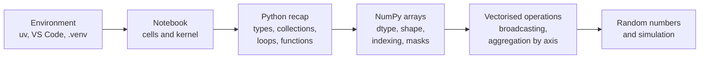
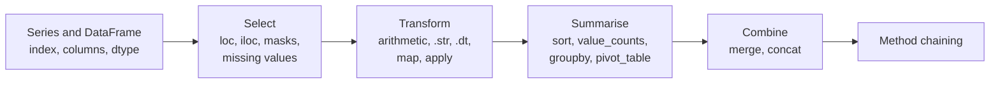

# Session 1 · Data careers, the final project challenge, NumPy and pandas

> **Guiding question.** What do data professionals do, what will we build in this course, and how do we work with data in Python?

**Learning outcomes.** After this session you are able to

- describe the main data roles, their tasks and the skills they require, and how AI coding agents change them
- explain the task of the final project challenge
- work in Jupyter notebooks and compute with NumPy arrays instead of Python loops
- load, select, transform, combine and summarise tables with pandas Series and DataFrames

## Why this session matters

Data work combines a question, evidence and a decision, and job titles describe that work only loosely. This session first separates the roles by their tasks and outputs, explains how the course and its assessment are organised, and introduces the challenge that every team works on until the final presentations: predicting the customs heading of a product from its description. It then builds on the Python you know from the first semester: after a short recap it teaches NumPy, computing with whole arrays instead of loops, and pandas, from the basic Series and DataFrame to grouping, pivot tables, merges and method chains on the Berlin Airbnb listings. Session 2 builds on this and turns analysis code into tested, shared software.

> This page is the teaching overview of the session. How to work with it (the ▶ links, the numbered notebooks, the extras) is explained once in the [course README](../../README.md#how-to-use-the-session-pages).

**Notes for this session**

- Session 1 has three blocks. Block 2 starts with a short third-party introduction to Jupyter before the lecture notebook.
- The job advertisements of the Block 1 exercise are handed out by the lecturer; they are not in the repository (see [Setup](#setup)).

## Block 1 · Data careers, the course and the challenge

### Theory (45 min)

**Why.** The same job title can mean different work in different organisations, and one person may cover several functions. Reading the tasks and outputs behind a title tells you which skills a role really needs and what to show in a project. This block also explains how the course moves through that work, how it is assessed, and which problem your team will solve.

**Topics**

- **Common data roles.** Data analyst, data scientist, data engineer, ML engineer and AI engineer differ in their main responsibility and typical outputs. They overlap, and the boundaries depend on the team and the product.
- **Skills shared across roles.** Technical, method, domain and communication skills. A strong result is more than code that runs: it needs a definition of the population, quality checks and a statement of its limits.
- **What Berlin job ads ask for.** A heat map of 238 Berlin advertisements shows the shared base (SQL, Python, communication) and the signature skills of each role. Knowing it helps you choose what to learn and what to show in a project.
- **Reading a job description.** Separating an advertisement into problem, deliverables, methods, tools, collaborators and requirements shows what the work is, not just which tools are listed.
- **Agentic engineering.** AI coding agents now write and run much of the code; the human work moves to framing the problem, specifying, checking and judging the result. The evidence on productivity is mixed, and delegating too much harms learning, so this course trains reading, testing and judging code rather than memorising syntax.
- **Course organisation and assessment.** 18 sessions in blocks of 45 minutes of theory, 30 minutes of exercises and 15 minutes of debrief. The final project, presented in Session 17 or 18, is the only graded component.
- **The final project challenge.** Predicting the four-digit customs heading of a product from its description, using EU binding tariff decisions (EBTI) in 23 languages, with a class leaderboard. A high leaderboard score alone does not determine the grade.

▶ **Lecture:** [01-lecture-data-careers.ipynb](workbooks/01-lecture-data-careers.ipynb)

### Exercises (30 min) and debrief (15 min)

▶ **Exercises:** [session-01-exercises.ipynb](workbooks/session-01-exercises.ipynb), part 1.

- **Five real advertisements per role** (Groups, Paper, 25 min). Each group takes one role and its five Berlin job advertisements (handed out by the lecturer, retrieved 11 October 2026), fills the six-heading table, marks the shared skills, compares them with the heat map and reports what the role does all day.
- **Be the classifier** (Pairs, Paper, 10 min). Choose the heading of four real shoe descriptions from three candidate headings and mark the deciding words.
- **Which inputs are allowed?** (Pairs, Paper, 5 min). Decide which fields of a customs decision a model may use for a new request.

**Debrief.** Each group reports its role in two minutes; compare where five ads differ from the heat map. For the classifier task, compare the answers to the descriptions that contain "leather" or "suede" but describe plastic.

## Block 2 · Notebooks, a Python recap and NumPy

### Theory (45 min)

**Why.** Every later session runs in notebooks, and a notebook result only counts if it survives a clean rerun in the course environment. Data arrive as thousands of numbers, and a Python loop over them is slow and long; NumPy computes with whole arrays at once, and pandas, scikit-learn and PyTorch are built on the same ideas. This block recaps the Python you know from the first semester in a few minutes and spends the rest on arrays.



**Topics**

- **The working environment: uv, VS Code and the course environment.** uv installs Python and the packages from a lock file into `.venv`, so the code runs the same on every laptop. The notebook's kernel must be `.venv`.
- **Jupyter notebooks: cells, kernel, Markdown, order of execution.** The kernel keeps every value in memory and runs cells in the order you run them, not the order on the page. Restart and run all before sharing a result.
- **A short recap of Python.** Types (a missing price is `None`, not zero), collections, conditions, loops and functions in one example. The self-study extras cover each topic for anyone who needs more.
- **NumPy arrays: creation, `dtype` and `shape`.** An array holds values of one type in a grid with a shape; a missing number is `NaN`. Checking `dtype` and `shape` first explains most surprises.
- **Indexing, slicing and Boolean masks.** Positions and slices per axis; a slice is a view, not a copy. A mask such as "a price is present and the minimum stay is below 28 nights" defines the population you report on.
- **Vectorised operations and broadcasting.** Arithmetic works element by element without a Python loop, and arrays of different shapes combine by broadcasting: a column of prices times a row of nights gives a whole price table.
- **Aggregation along an axis.** `sum`, `mean` and `argmax` with `axis` reduce a table to one value per row or per column, here per listing and per day of the booking calendar.
- **Random numbers and simulation.** A seeded generator makes simulations reproducible; rolling a die many times and drawing samples of listings shows how much a result computed from a sample varies.

▶ **Worked example (first):** [02-jupyter-introduction.ipynb](workbooks/02-jupyter-introduction.ipynb) (*Think Python*): what a notebook is, how to run cells, command and edit mode. For everyone who has not used Jupyter before.

▶ **Lecture:** [03-lecture-notebooks-python-recap-and-numpy.ipynb](workbooks/03-lecture-notebooks-python-recap-and-numpy.ipynb)

### Exercises (30 min) and debrief (15 min)

▶ **Exercises:** [session-01-exercises.ipynb](workbooks/session-01-exercises.ipynb), part 2.

- **Is 0.1 + 0.2 equal to 0.3?** (Predict, 3 min). Predict a comparison of floats, run it, and find NumPy's comparison with a tolerance.
- **The alias trap, with lists and arrays** (Predict, 5 min). Predict what happens to a list and to an array when a second name or a slice is changed.
- **Predict the shape** (Predict, 5 min). Shapes after aggregation, slicing and broadcasting, and the one that fails.
- **Dice simulation** (Code, 10 min). Roll one die 60,000 times and two dice 100,000 times without a loop; compare the sums with the exact probabilities.
- **Splitting the bill** (Code, 10 min). A price table per person for four flats and groups of one to six, built by broadcasting; find the smallest group within budget.
- **A year in the booking calendar** (Pairs, Code, 15 min). Slicing and aggregation along an axis on the 365-day availability calendar of the Berlin listings.
- *Stretch:* **Rice on a chessboard, NumPy edition** (Predict, then Code, 5 min). Why NumPy's sum of 64 doublings is −1.

**Debrief.** Compare the alias and view predictions before running the code. In the bill task, look for the solution whose `argmax` says "1 person" for the flat that no group can afford, and in the calendar task for `axis=0` where one value per listing was asked.

## Block 3 · pandas: Series and DataFrames, from basic to advanced

### Theory (45 min)

**Why.** Real data are tables with named columns of different types, and most questions about them are "per something": per district, per room type, per month. pandas answers them in a few readable lines: select the rows that count, add the columns you need, group, reshape and combine tables. The block ends with how to use AI coding assistants for this work without trusting them blindly.



**Topics**

- **Series and DataFrame: index, columns and `dtype`; reading a file.** A DataFrame is a set of columns that share an index of row labels. Check `shape` and `dtypes` right after reading a file, and define what one row is before calculating.
- **Selecting rows and columns with `loc`, `iloc` and Boolean masks; missing values.** Labels survive filtering and sorting, positions do not. Missing values are found with `isna()`; `count()` and `len()` differ by them.
- **Creating and transforming columns.** Vectorised arithmetic, `.str` for text, `.dt` for dates, `map` with a dictionary, and `apply` only where nothing vectorised exists.
- **Sorting, `value_counts`, `groupby` with `agg`, and pivot tables.** Split-apply-combine gives one row per group; named aggregation gives readable columns; a pivot table spreads one grouping across the columns. For skewed prices the median says more than the mean.
- **Combining tables with `merge` and `concat`.** A left merge keeps every listing; `validate` and `indicator` catch duplicated keys and unmatched rows, which an inner merge would drop silently.
- **Method chaining.** One step per line, from the raw table to the answer, with no intermediate names.
- **Tips for using AI coding assistants.** Generated code is a draft: specify inputs and edge cases, check on a table small enough to compute by hand, compare row counts, and document the use.

▶ **Lecture:** [04-lecture-pandas-series-and-dataframes.ipynb](workbooks/04-lecture-pandas-series-and-dataframes.ipynb)

▶ **Worked examples**

- [05-case-study-five-questions.ipynb](workbooks/05-case-study-five-questions.ipynb): five questions about the Berlin Airbnb listings (how many, where, of what type, at what price, with how many reviews), with worked answers and a reference solution. For self-study after the session if there is no time in class.

### Exercises (30 min) and debrief (15 min)

▶ **Exercises:** [session-01-exercises.ipynb](workbooks/session-01-exercises.ipynb), part 3.

- **Labels or positions?** (Predict, 5 min). `loc` and `iloc` on a small table after sorting.
- **Average price per room type, by hand and with pandas** (Code, 10 min). Ten listings with loops and dictionaries, then with `groupby`; one price is missing.
- **A weekend for two in Neukölln** (Code, 10 min). Masks, a new column, `.dt` and `.str` to find and rank affordable, well-rated listings.
- **A price list by group size** (Code, 10 min). A pivot table of median prices by number of guests and room type, its counts, and the price per guest.
- **Small hosts and large hosts** (Code, 10 min). Listings per host, three host classes, and a comparison with `groupby` and named aggregation.
- **Do guests come when it is warm?** (Pairs, Code, 15 min). Monthly reviews merged with monthly weather, 2023 to 2025, and what a correlation does not show.
- **One chain** (Code, 10 min). Rewrite six steps with intermediate tables as one method chain and check that the result is identical.
- *Stretch:* **The most common amenities** (Code, 15 min). Parse the amenity lists, count them with `explode`, and compare prices with and without air conditioning.

**Debrief.** In the price tasks, ask which rows were counted and what happened to missing prices; in the host task, look for shares of hosts reported as shares of listings. For the weather task, compare the merge keys (month and year, not month alone) and the reasons why a correlation is not a cause.

## Team project until the next session

Teams of three are formed and read the [project brief](../17-18-final-presentations/final-project.md) and the leaderboard rules. Each member creates a GitHub account before Session 2.

## Extras (optional, self-study)

The reference notebooks go deeper on individual topics; each lecture notebook links them with a 📖 **Read more** pointer. They are not a required run-all sequence.

| Notebook | Content | Block |
|---|---|---|
| [extras/01-python-variables.ipynb](workbooks/extras/01-python-variables.ipynb) | Variables, dynamic typing, object references (*Whirlwind Tour of Python*) | 2 |
| [extras/02-python-scalar-types.ipynb](workbooks/extras/02-python-scalar-types.ipynb) | `int`, `float`, `str`, `bool`, `None` | 2 |
| [extras/03-python-data-structures.ipynb](workbooks/extras/03-python-data-structures.ipynb) | Lists, tuples, dictionaries, sets | 2 |
| [extras/04-python-control-flow.ipynb](workbooks/extras/04-python-control-flow.ipynb) | `if`/`elif`/`else`, `for` and `while` loops, `break`/`continue` | 2 |
| [extras/05-python-functions.ipynb](workbooks/extras/05-python-functions.ipynb) | Defining functions, default and keyword arguments, `*args`/`**kwargs`, `lambda` | 2 |
| [extras/06-python-errors-and-exceptions.ipynb](workbooks/extras/06-python-errors-and-exceptions.ipynb) | Errors, `try`/`except`/`finally`, raising exceptions (prepares Session 2) | 2 |
| [extras/07-python-modules-and-packages.ipynb](workbooks/extras/07-python-modules-and-packages.ipynb) | `import` forms, standard library, third-party packages | 2 |
| [extras/08-numpy-array-basics.ipynb](workbooks/extras/08-numpy-array-basics.ipynb) | Array attributes, indexing, slicing, views and copies, reshaping, joining and splitting (PDSH 2.02). **ND** | 2 |
| [extras/09-numpy-ufuncs.ipynb](workbooks/extras/09-numpy-ufuncs.ipynb) | Universal functions: arithmetic, exponents and logarithms, special functions, aggregates (PDSH 2.03). **ND** | 2 |
| [extras/10-numpy-broadcasting.ipynb](workbooks/extras/10-numpy-broadcasting.ipynb) | The broadcasting rules with diagrams, centring an array, plotting a function of two variables (PDSH 2.05). **ND** | 2 |
| [extras/11-pandas-introduction.ipynb](workbooks/extras/11-pandas-introduction.ipynb) | Beginner pandas: Series, DataFrame, selection, filtering, grouping, time series. Some examples need updating for current pandas; use the lecture notebook and the case study as the first runnable path | 3 |
| [extras/12-pandas-indexing-and-selection.ipynb](workbooks/extras/12-pandas-indexing-and-selection.ipynb) | `loc`, `iloc`, Boolean masks (PDSH 3.02). **ND** | 3 |
| [extras/13-pandas-merge-and-join.ipynb](workbooks/extras/13-pandas-merge-and-join.ipynb) | Joining tables with `pd.merge`, US states case study (PDSH 3.07; prepares Session 3). Reads `data/state-*.csv`. **ND** | 3 |
| [extras/14-pandas-groupby.ipynb](workbooks/extras/14-pandas-groupby.ipynb) | Aggregation, split-apply-combine, `groupby` (PDSH 3.08). **ND** | 3 |

The Python notebooks 01–07 are for students who need more than the short recap of Block 2. **ND** marks notebooks that are shared unchanged (see the licences below); one cell of extras 10 stops with a broadcasting error on purpose, to show what an incompatible shape looks like.

Classes and objects are taught in Session 2; the *Think Python* chapters on classes are among its extras.

## Before the session and further reading

**Before.** Set up your laptop as described in the [course README](../../README.md#setup) (VS Code, Git, uv, the course repository and `uv sync`), then generate the case-study data of Sessions 1–12 once from the repository root (downloads the Berlin snapshot of Inside Airbnb, about 100 MB, and the Berlin weather from Open-Meteo; writes about 6 MB of Parquet files to `case-study/data/airbnb/`):

```bash
uv run python case-study/prepare_airbnb.py
```

The EBTI customs data of the final project are prepared before Session 3 with `case-study/prepare_data.py`.

**After.** Work through the [case study](workbooks/05-case-study-five-questions.ipynb), then repeat questions 4 and 5 for the district you live in or know best and compare it with the city as a whole. Finish the exercises you did not complete in class.

**Further reading (optional)**

- [The Python Tutorial](https://docs.python.org/3/tutorial/), sections 3–6 (Python Software Foundation)
- [NumPy: the absolute basics for beginners](https://numpy.org/doc/stable/user/absolute_beginners.html) (NumPy user guide)
- [Python for Data Analysis, 3rd edition](https://wesmckinney.com/book/), chapters 4–5, 7–8 and 10 (McKinney, open access): NumPy, pandas, data cleaning, joining and reshaping, group operations
- [Think Python, 3rd edition](https://allendowney.github.io/ThinkPython/), chapters 1–11 (Downey, free online), to refresh the Python basics
- [pandas getting-started tutorials](https://pandas.pydata.org/docs/getting_started/intro_tutorials/) and the [pandas user guide](https://pandas.pydata.org/docs/user_guide/index.html)
- [Good enough practices in scientific computing](https://doi.org/10.1371/journal.pcbi.1005510) (Wilson et al. 2017)
- [US Bureau of Labor Statistics: data scientists](https://www.bls.gov/ooh/math/data-scientists.htm) and [O*NET: data-warehousing specialists](https://www.onetonline.org/link/details/15-1243.01), task-based descriptions of US occupations

## Setup

All notebooks of this session run in the course environment: open them in VS Code with the `.venv` kernel (setup: [course README](../../README.md#setup)). Both lecture notebooks, the case study and the exercises of Parts 2 and 3 read the prepared case-study files in `case-study/data/airbnb/` (`listings.parquet`, `calendar.parquet`, `reviews_monthly.parquet`, `weather_daily.parquet`; see *Before* above).

The *Think Python* notebook (02-jupyter-introduction) downloads a small helper file (`thinkpython.py`, MIT) from the author's repository when its last cells run, which needs an internet connection; it was written for Google Colab, and its references to Colab buttons correspond to the notebook toolbar in VS Code. The merge notebook (extras 13) reads the US state tables in `workbooks/extras/data/state-*.csv`.

To regenerate the figures of the lecture notebooks, run `uv run python sessions/01-careers-and-python/figures/make_figures.py`. To refresh the skills heat map with today's job ads, first run `uv run --with trafilatura python sessions/01-careers-and-python/figures/job_ad_skills.py` (about 250 page requests to the Data Berlin board).

**Job advertisements for the Block 1 exercise.** The 25 PDFs (five per role) are kept outside the public repository because the texts belong to the employers; hand them out through the learning platform. Each PDF states the source, the original URL and the retrieval date; contact persons are removed.

## Sources and licences

Keep the attribution when you reuse or share a file. Course-written material is licensed CC BY 4.0. Third-party notebooks keep their original licence; "ND" means the file must be shared unchanged, "NC" means non-commercial use only and "SA" means adaptations must use the same licence.

**Course material (course team)**

| File | Content | Licence |
|---|---|---|
| [01-lecture-data-careers.ipynb](workbooks/01-lecture-data-careers.ipynb) | Data roles, skills, Berlin job ads, course organisation and assessment, the final project challenge | CC BY 4.0 |
| [03-lecture-notebooks-python-recap-and-numpy.ipynb](workbooks/03-lecture-notebooks-python-recap-and-numpy.ipynb) | uv, VS Code, Jupyter, a short Python recap, NumPy arrays, indexing and masks, vectorised operations and broadcasting, aggregation along an axis, random numbers and simulation | CC BY 4.0 |
| [04-lecture-pandas-series-and-dataframes.ipynb](workbooks/04-lecture-pandas-series-and-dataframes.ipynb) | Series and DataFrame, reading files, `loc`/`iloc` and masks, missing values, `.str`/`.dt`/`map`/`apply`, sorting and counting, `groupby` and `agg`, pivot tables, `merge` and `concat`, method chaining, AI coding assistants | CC BY 4.0 |
| [05-case-study-five-questions.ipynb](workbooks/05-case-study-five-questions.ipynb) | Worked example: five questions about the Berlin Airbnb listings (how many, where, what type, what price, how many reviews) | CC BY 4.0 |
| [session-01-exercises.ipynb](workbooks/session-01-exercises.ipynb) | Exercises of the three blocks: job advertisements and the challenge; Python recap and NumPy; pandas from selection to merges and method chains | CC BY 4.0 |
| [figures/make_figures.py](figures/make_figures.py) and its PNGs (`role_map.png`, `skills_by_role.png`, `price_by_room_type.png`, `listings_by_district.png`) | Roles along the path from data to product (course team's simplified view); skills named in Berlin job ads by role; short-stay prices by room type; listings and prices by district (Inside Airbnb data) | CC BY 4.0; data CC BY 4.0, Inside Airbnb |
| [figures/job_ad_skills.py](figures/job_ad_skills.py) and [figures/job_ad_skills.csv](figures/job_ad_skills.csv) | Downloads the open Berlin data and AI ads from the Data Berlin board and counts, per role, the share of ads naming each skill group; the CSV holds the aggregated shares of 11 October 2026 (no ad texts) | CC BY 4.0, course team |

The lecture notebooks are informed by the canonical references linked in each of them; their code examples use small fictional records or the prepared course dataset, and the language and library behaviour was checked against those references. Several exercises come from established sources named in their *Source* line.

**Third-party notebooks**

| File | Source | Licence | Downloaded | Changes |
|---|---|---|---|---|
| [02-jupyter-introduction.ipynb](workbooks/02-jupyter-introduction.ipynb) | [AllenDowney/ThinkPython](https://raw.githubusercontent.com/AllenDowney/ThinkPython/v3/chapters/jupyter_intro.ipynb) | [MIT (code) / CC BY-NC-SA 4.0 (text)](https://allendowney.github.io/ThinkPython/) **NC: non-commercial only** | 2026-10-01 | Renamed from `jupyter_intro.ipynb`; content unchanged |
| [extras/01-python-variables.ipynb](workbooks/extras/01-python-variables.ipynb) | [jakevdp/WhirlwindTourOfPython](https://raw.githubusercontent.com/jakevdp/WhirlwindTourOfPython/master/03-Semantics-Variables.ipynb) | [CC0-1.0](https://github.com/jakevdp/WhirlwindTourOfPython/blob/master/LICENSE) | 2026-09-26 | Renamed from `03-Semantics-Variables.ipynb`; content unchanged |
| [extras/02-python-scalar-types.ipynb](workbooks/extras/02-python-scalar-types.ipynb) | [jakevdp/WhirlwindTourOfPython](https://raw.githubusercontent.com/jakevdp/WhirlwindTourOfPython/master/05-Built-in-Scalar-Types.ipynb) | [CC0-1.0](https://github.com/jakevdp/WhirlwindTourOfPython/blob/master/LICENSE) | 2026-09-26 | Renamed from `05-Built-in-Scalar-Types.ipynb`; content unchanged |
| [extras/03-python-data-structures.ipynb](workbooks/extras/03-python-data-structures.ipynb) | [jakevdp/WhirlwindTourOfPython](https://raw.githubusercontent.com/jakevdp/WhirlwindTourOfPython/master/06-Built-in-Data-Structures.ipynb) | [CC0-1.0](https://github.com/jakevdp/WhirlwindTourOfPython/blob/master/LICENSE) | 2026-09-26 | Renamed from `06-Built-in-Data-Structures.ipynb`; content unchanged |
| [extras/04-python-control-flow.ipynb](workbooks/extras/04-python-control-flow.ipynb) | [jakevdp/WhirlwindTourOfPython](https://raw.githubusercontent.com/jakevdp/WhirlwindTourOfPython/master/07-Control-Flow-Statements.ipynb) | [CC0-1.0](https://github.com/jakevdp/WhirlwindTourOfPython/blob/master/LICENSE) | 2026-09-26 | Renamed from `07-Control-Flow-Statements.ipynb`; content unchanged |
| [extras/05-python-functions.ipynb](workbooks/extras/05-python-functions.ipynb) | [jakevdp/WhirlwindTourOfPython](https://raw.githubusercontent.com/jakevdp/WhirlwindTourOfPython/master/08-Defining-Functions.ipynb) | [CC0-1.0](https://github.com/jakevdp/WhirlwindTourOfPython/blob/master/LICENSE) | 2026-09-26 | Renamed from `08-Defining-Functions.ipynb`; content unchanged |
| [extras/06-python-errors-and-exceptions.ipynb](workbooks/extras/06-python-errors-and-exceptions.ipynb) | [jakevdp/WhirlwindTourOfPython](https://raw.githubusercontent.com/jakevdp/WhirlwindTourOfPython/master/09-Errors-and-Exceptions.ipynb) | [CC0-1.0](https://github.com/jakevdp/WhirlwindTourOfPython/blob/master/LICENSE) | 2026-09-26 | Renamed from `09-Errors-and-Exceptions.ipynb`; content unchanged |
| [extras/07-python-modules-and-packages.ipynb](workbooks/extras/07-python-modules-and-packages.ipynb) | [jakevdp/WhirlwindTourOfPython](https://raw.githubusercontent.com/jakevdp/WhirlwindTourOfPython/master/13-Modules-and-Packages.ipynb) | [CC0-1.0](https://github.com/jakevdp/WhirlwindTourOfPython/blob/master/LICENSE) | 2026-10-01 | Renamed from `13-Modules-and-Packages.ipynb`; content unchanged |
| [extras/08-numpy-array-basics.ipynb](workbooks/extras/08-numpy-array-basics.ipynb) | [jakevdp/PythonDataScienceHandbook](https://raw.githubusercontent.com/jakevdp/PythonDataScienceHandbook/master/notebooks/02.02-The-Basics-Of-NumPy-Arrays.ipynb) | [MIT (code) / CC-BY-NC-ND 3.0 (text)](https://github.com/jakevdp/PythonDataScienceHandbook/blob/master/LICENSE-CODE) **NC, ND** | 2026-10-12 | Renamed from `02.02-The-Basics-Of-NumPy-Arrays.ipynb`; content unchanged (ND: must stay unchanged) |
| [extras/09-numpy-ufuncs.ipynb](workbooks/extras/09-numpy-ufuncs.ipynb) | [jakevdp/PythonDataScienceHandbook](https://raw.githubusercontent.com/jakevdp/PythonDataScienceHandbook/master/notebooks/02.03-Computation-on-arrays-ufuncs.ipynb) | [MIT (code) / CC-BY-NC-ND 3.0 (text)](https://github.com/jakevdp/PythonDataScienceHandbook/blob/master/LICENSE-CODE) **NC, ND** | 2026-10-12 | Renamed from `02.03-Computation-on-arrays-ufuncs.ipynb`; content unchanged (ND: must stay unchanged) |
| [extras/10-numpy-broadcasting.ipynb](workbooks/extras/10-numpy-broadcasting.ipynb) | [jakevdp/PythonDataScienceHandbook](https://raw.githubusercontent.com/jakevdp/PythonDataScienceHandbook/master/notebooks/02.05-Computation-on-arrays-broadcasting.ipynb) | [MIT (code) / CC-BY-NC-ND 3.0 (text)](https://github.com/jakevdp/PythonDataScienceHandbook/blob/master/LICENSE-CODE) **NC, ND** | 2026-10-12 | Renamed from `02.05-Computation-on-arrays-broadcasting.ipynb`; content unchanged (ND: must stay unchanged) |
| [extras/11-pandas-introduction.ipynb](workbooks/extras/11-pandas-introduction.ipynb) | [microsoft/Data-Science-For-Beginners](https://raw.githubusercontent.com/microsoft/Data-Science-For-Beginners/main/2-Working-With-Data/07-python/notebook.ipynb) | [MIT](https://github.com/microsoft/Data-Science-For-Beginners/blob/main/LICENSE) | 2026-09-26 | Renamed from `notebook.ipynb` (lesson `2-Working-With-Data/07-python`); content unchanged |
| [extras/12-pandas-indexing-and-selection.ipynb](workbooks/extras/12-pandas-indexing-and-selection.ipynb) | [jakevdp/PythonDataScienceHandbook](https://raw.githubusercontent.com/jakevdp/PythonDataScienceHandbook/master/notebooks/03.02-Data-Indexing-and-Selection.ipynb) | [MIT (code) / CC-BY-NC-ND 3.0 (text)](https://github.com/jakevdp/PythonDataScienceHandbook/blob/master/LICENSE-CODE) **NC, ND** | 2026-09-26 | Renamed from `03.02-Data-Indexing-and-Selection.ipynb`; content unchanged (ND: must stay unchanged) |
| [extras/13-pandas-merge-and-join.ipynb](workbooks/extras/13-pandas-merge-and-join.ipynb) | [jakevdp/PythonDataScienceHandbook](https://raw.githubusercontent.com/jakevdp/PythonDataScienceHandbook/master/notebooks/03.07-Merge-and-Join.ipynb) | [MIT (code) / CC-BY-NC-ND 3.0 (text)](https://github.com/jakevdp/PythonDataScienceHandbook/blob/master/LICENSE-CODE) **NC, ND** | 2026-09-26 | Renamed from `03.07-Merge-and-Join.ipynb`; content unchanged (ND: must stay unchanged) |
| [extras/14-pandas-groupby.ipynb](workbooks/extras/14-pandas-groupby.ipynb) | [jakevdp/PythonDataScienceHandbook](https://raw.githubusercontent.com/jakevdp/PythonDataScienceHandbook/master/notebooks/03.08-Aggregation-and-Grouping.ipynb) | [MIT (code) / CC-BY-NC-ND 3.0 (text)](https://github.com/jakevdp/PythonDataScienceHandbook/blob/master/LICENSE-CODE) **NC, ND** | 2026-09-26 | Renamed from `03.08-Aggregation-and-Grouping.ipynb`; content unchanged (ND: must stay unchanged) |

The files `workbooks/extras/data/state-*.csv` belong to extras 13 and come from the same repository ([jakevdp/PythonDataScienceHandbook, notebooks/data](https://github.com/jakevdp/PythonDataScienceHandbook/tree/master/notebooks/data)).

> **Note.** The *Think Python* notebook (02-jupyter-introduction) is licensed CC BY-NC-SA 4.0 for the text: it may be shared and adapted for non-commercial teaching with attribution and under the same licence. The Python Data Science Handbook text (extras 08–10 and 12–14) is CC BY-NC-ND 3.0: shared unchanged only.

**Data**

| Dataset | Used in | Source | Licence |
|---|---|---|---|
| Inside Airbnb, Berlin snapshot of 26 June 2026 (listings, calendar, monthly review counts), prepared by `case-study/prepare_airbnb.py` | lecture notebooks 03 and 04, case study 05, exercises 2.6 and 3.3–3.8, figures | [insideairbnb.com](https://insideairbnb.com/get-the-data/) | [CC BY 4.0](https://creativecommons.org/licenses/by/4.0/); host names, texts and photos removed by the script |
| Open-Meteo historical weather, downloaded by the same script | exercise 3.6; later sessions | [open-meteo.com](https://open-meteo.com/) | [CC BY 4.0](https://creativecommons.org/licenses/by/4.0/) |
| EBTI binding tariff decisions (counts and examples in lecture notebook 01; four descriptions in exercise 1.2), prepared by `case-study/prepare_data.py` | lecture notebook 01, exercises 1.2 and 1.3 | [European Commission, EBTI database](https://ec.europa.eu/taxation_customs/dds2/ebti/ebti_consultation.jsp?Lang=en) | Reuse with acknowledgement of the source (Commission Decision 2011/833/EU) |
| Language shares chart (`proposal/assets/final-project/languages.png`) | lecture notebook 01 | course team, computed from the EBTI data | CC BY 4.0 |

The data are not stored in the repository; each student downloads them with the scripts.

<details>
<summary><b>References cited in the lecture notebooks</b></summary>

- Anthropic (2025). *How AI is transforming work at Anthropic*. https://www.anthropic.com/research/how-ai-is-transforming-work-at-anthropic
- Anthropic (2026). *Anthropic Economic Index report: Cadences* (June 2026). https://www.anthropic.com/research/economic-index-june-2026-report
- Anthropic (2026). *Best practices for Claude Code*. https://www.anthropic.com/engineering/claude-code-best-practices
- Astral (2026). *uv documentation: working on projects*. https://docs.astral.sh/uv/guides/projects/
- Bastani, H., Bastani, O., Sungu, A., Ge, H., Kabakcı, Ö., & Mariman, R. (2025). Generative AI without guardrails can harm learning: Evidence from high school mathematics. *PNAS*, 122(26). https://doi.org/10.1073/pnas.2422633122
- Beauchemin, M. (2017). *The Rise of the Data Engineer*. freeCodeCamp. https://www.freecodecamp.org/news/the-rise-of-the-data-engineer-91be18f1e603/
- Becker, J., Rush, N., Barnes, E., & Rein, D. (2025). *Measuring the impact of early-2025 AI on experienced open-source developer productivity*. METR. https://metr.org/blog/2025-07-10-early-2025-ai-experienced-os-dev-study/
- Becker, J., Rush, N., Cunningham, B., Rein, D., & Mahamud, A. (2026). *We are changing our developer productivity experiment design*. METR. https://metr.org/blog/2026-02-24-uplift-update/
- Bitkom (2026, 3 September). *IT-Fachkräftemangel in den letzten drei Jahren halbiert*. https://www.bitkom.org/Presse/Presseinformation/IT-Fachkraeftemangel-in-den-letzten-drei-Jahren-halbiert
- Bitkom Research (2026). *IT-Fachkräfte 2025: Studienbericht* (survey of 855 companies), p. 14. https://www.bitkom.org/sites/main/files/2026-01/bitkom-studienbericht-it-fachkraefte-2025.pdf
- Brynjolfsson, E., Chandar, B., & Chen, R. (2026). *Canaries in the coal mine? Six facts about the recent employment effects of artificial intelligence* (revised August 2026). Stanford Digital Economy Lab. https://digitaleconomy.stanford.edu/publications/canaries-in-the-coal-mine/
- Cui, Z. K., Demirer, M., Jaffe, S., Musolff, L., Peng, S., & Salz, T. (2026). The effects of generative AI on high-skilled work: Evidence from three field experiments with software developers. *Management Science*. https://doi.org/10.1287/mnsc.2025.00535
- Data Berlin (2026). *Jobs*, Berlin data and AI job board; source of the 238 advertisements of the skills heat map and of the 25 handed-out advertisements (retrieved 2026-10-11). https://databerlin.net/jobs
- Data Berlin (2026). *Skills Dictionary* and *Seniority insights*, live views of the Berlin data and AI job board (retrieved 2026-10-11). https://databerlin.net/skills, https://databerlin.net/insights/seniority/intern-student
- Denny, P., Prather, J., Becker, B. A., et al. (2024). Computing education in the era of generative AI. *Communications of the ACM*, 67(2), 56–67. https://doi.org/10.1145/3624720
- Dijkstra, E. W. (about 1978). *On the foolishness of "natural language programming"* (EWD 667). https://www.cs.utexas.edu/~EWD/transcriptions/EWD06xx/EWD667.html
- Downey, A. B. (2024). *Think Python*, 3rd edition. O'Reilly. https://allendowney.github.io/ThinkPython/
- European Commission (2026). *European Binding Tariff Information (EBTI) database*. https://ec.europa.eu/taxation_customs/dds2/ebti/ebti_consultation.jsp?Lang=en
- Gimbel, M., Kinder, M., Kendall, J., & Lee, M. (2025). *Evaluating the impact of AI on the labor market: Current state of affairs*. Yale Budget Lab. https://budgetlab.yale.edu/research/evaluating-impact-ai-labor-market-current-state-affairs
- Google Cloud / DORA (2025). *Announcing the 2025 DORA Report: State of AI-assisted software development*. https://cloud.google.com/blog/products/ai-machine-learning/announcing-the-2025-dora-report
- Grewal, E. (2018). *One Data Science Job Doesn't Fit All*. https://www.linkedin.com/pulse/one-data-science-job-doesnt-fit-all-elena-grewal/
- Indeed Hiring Lab (2026, 23 September). *Berufseinstieg: Stellenangebot sinkt*. https://hiringlab.indeed.com/de/blog/2026/09/23/berufseinstieg-stellenangebot-sinkt-ausbildungssystem-bietet-einen-anker/
- Inside Airbnb (2026). *Berlin, 26 June 2026 snapshot*; *About Inside Airbnb*. CC BY 4.0. https://insideairbnb.com/get-the-data/
- Karpathy, A. (2023, 24 January; 2025, 2 February; 2026, 4 February). Posts on X on English as a programming language, vibe coding and agentic engineering. https://x.com/karpathy/status/1617979122625712128, https://x.com/karpathy/status/1886192184808149383, https://x.com/karpathy/status/2019137879310836075
- Karpathy, A. (2025). *Software is changing (again)*. Keynote, YC AI Startup School, 17 June 2025. https://www.youtube.com/watch?v=LCEmiRjPEtQ
- McKinney, W. (2022). *Python for Data Analysis*, 3rd edition. O'Reilly. https://wesmckinney.com/book/
- Miao, Mu, Chen & Zou (2026). *Fisher-R1: Training LLM agents for reliable hypothesis testing*. arXiv:2608.07437 (preprint). https://arxiv.org/abs/2608.07437
- NumPy developers (2026). *NumPy: the absolute basics for beginners*; *Broadcasting*; *Random sampling*. https://numpy.org/doc/stable/
- pandas development team (2026). *Getting started tutorials*; *User guide* (indexing, missing data, text data, group by, reshaping, merge, Copy-on-Write). https://pandas.pydata.org/docs/
- Prather, J., Denny, P., Leinonen, J., Becker, B. A., et al. (2023). The robots are here: Navigating the generative AI revolution in computing education. *ITiCSE Working Group Reports*, 108–159. https://doi.org/10.1145/3623762.3633499
- Project Jupyter (2026). *JupyterLab documentation: notebooks*. https://jupyterlab.readthedocs.io/en/stable/user/notebook.html
- Python Software Foundation (2026). *The Python Tutorial*. https://docs.python.org/3/tutorial/
- Shen, J. H., & Tamkin, A. (2026). *How AI impacts skill formation*. arXiv:2601.20245; Anthropic, *How AI assistance impacts the formation of coding skills*. https://www.anthropic.com/research/AI-assistance-coding-skills
- Stack Overflow (2025). *2025 Developer Survey: AI*. https://survey.stackoverflow.co/2025/ai
- VanderPlas, J. (2016). *A Whirlwind Tour of Python*. O'Reilly. https://jakevdp.github.io/WhirlwindTourOfPython/
- VanderPlas, J. (2016). *Python Data Science Handbook*. O'Reilly. https://jakevdp.github.io/PythonDataScienceHandbook/
- Willison, S. (2026). *Agentic Engineering Patterns: What is agentic engineering?* https://simonwillison.net/guides/agentic-engineering-patterns/what-is-agentic-engineering/
- Wilson, G., Bryan, J., Cranston, K., Kitzes, J., Nederbragt, L., & Teal, T. K. (2017). Good enough practices in scientific computing. *PLOS Computational Biology*, 13(6), e1005510. https://doi.org/10.1371/journal.pcbi.1005510

</details>
