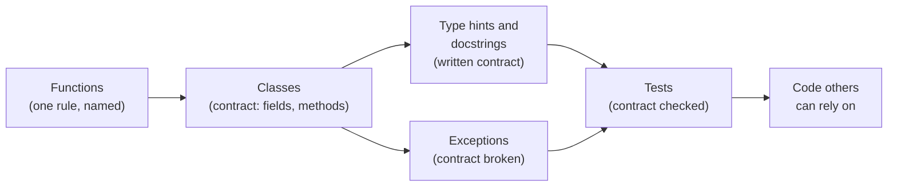
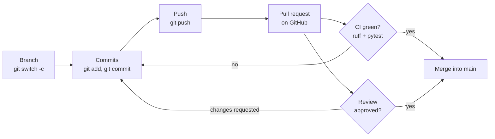

# Session 2 · Software engineering for data work

> **Guiding question.** How do we turn analysis code into code that others can use, test and develop together without breaking it?

**Learning outcomes.** After this session you are able to

- design and use classes for data tasks, handle errors explicitly and write automated tests
- turn a notebook analysis into a module and a structured project, and explain when to use a notebook and when an application
- work with Git branches and pull requests and set up a CI workflow that runs the tests

## Why this session matters

Session 1 answered questions about the Berlin listings in a notebook. Code that teammates, scheduled jobs and other programs rely on needs more: functions and classes with a clear contract, explicit errors, tests that run on every change, a project structure that others can install, and a way to change shared code without breaking it. This session builds that toolkit in one small project, the [workspace](workspace/README.md). From Session 3 on, all team work on the final project is submitted as reviewed pull requests with passing CI, and the same practices carry the model service of Session 16.

> This page is the teaching overview of the session. How to work with it (the ▶ links, the numbered notebooks, the extras) is explained once in the [course README](../../README.md#how-to-use-the-session-pages).

**Notes for this session**

- This is a workspace session: several exercises are solved in the files of [`workspace/`](workspace/README.md), a small Python project with its own environment (`cd sessions/02-software-engineering/workspace`, then `uv run pytest -q`). The exercise notebook lists them with their hand-outs.
- Block 2 has two lecture notebooks: from notebook to application, then Git, GitHub and CI.
- The lecture notebooks contain Mermaid diagrams (class diagrams, Git graphs, flowcharts). VS Code shows them with the recommended extension *Markdown Mermaid* (`bierner.markdown-mermaid`), which it offers to install when the repository is opened; JupyterLab 4.1 and newer renders them without an extension.
- Exercises 2.4 and 2.5 need a GitHub account.

## Block 1 · Classes, errors and tests

### Theory (45 min)

**Why.** Session 1 used functions briefly; a class is built from them, so this block starts there. The raw Inside Airbnb file stores the price as text, and nothing stops a row from having coordinates outside Berlin or an unknown room type. A class that checks every listing once, when it is created, protects all code that uses it, and tests check that it keeps its promises.



**Topics**

- **Functions: parameters, return values and side effects.** Default and keyword arguments, docstrings, and the difference between a pure function and one that changes its arguments. Pure functions are the easiest code to test and reuse.
- **Classes and objects: attributes and methods.** A class is the blueprint, an object one instance with its own data. A method is a function defined in a class and called on an object, which Python passes as `self`.
- **Composition, inheritance and dataclasses.** "Has a" and "is a"; composition keeps classes small and replaceable, and dataclasses make data-holding classes short enough to read at a glance.
- **Type hints and docstrings.** They tell a teammate, or an AI assistant, how to call the code without reading its body. Type checkers catch some bugs before any test runs.
- **Exceptions and error handling.** A clear error where the problem occurs saves hours compared with a wrong number found weeks later in a chart. Silent failures are worse than crashes because they produce plausible results.
- **Automated tests with pytest.** Tests turn "it worked when I tried it" into a check that runs on every change and every computer, and document the expected behaviour by example.

▶ **Lecture:** [01-lecture-oop-errors-and-tests.ipynb](workbooks/01-lecture-oop-errors-and-tests.ipynb), ending with the worked example `ListingRecord` from the workspace.

### Exercises (30 min) and debrief (15 min)

▶ **Exercises:** [session-02-exercises.ipynb](workbooks/session-02-exercises.ipynb), part 1.

- **Rock, paper, scissors** (Code, 15 min). A function `winner(a, b)` with three tests; decide what happens for `"lizard"`.
- **Break your neighbour's password checker** (Pairs, 20 min). Write a checker, then find passwords that your neighbour's checker judges wrongly.
- **A shopping cart** (Code, 15 min). A class `Cart` with a discount code and errors for unknown codes and items; two carts that must not share their items.
- **A bank account that says no** (Code, 15 min). A custom exception `InsufficientFunds`, tests written first.
- **Animals that speak** (Code, 15 min, then Discussion, 5 min). Inheritance and one loop over different subclasses.
- **A listing that validates itself** (Pairs, Code, 20 min, workspace). Complete the `maximum_nights` rule of `ListingRecord`, activate its tests and add two tests of your own.
- *Stretch:* **Fractions that add up** (Code, 20 min) and **A deck of cards** (Code, 20 min).

**Debrief.** Compare a `winner` written as nine `if` branches with one that looks up "what beats what" in a dictionary. In the cart, look for `items` defined on the class instead of in `__init__`: the second customer then pays for the first. In the bank account, ask which test checks that the balance is unchanged after a refused withdrawal.

## Block 2 · From notebook to application, Git and continuous integration

### Theory (45 min)

**Why.** A notebook is good for exploring and explaining; code that others rely on needs an interface, a project structure and checks. Data work is also team work: several people change the same code, and nobody wants to break what the others rely on. A history with meaningful messages replaces numbered copies such as `analysis_final_v3.ipynb`, pull requests put a second person between a change and `main`, and continuous integration runs the same checks for everyone.



**Topics**

- **From notebook to application: when to use which.** A notebook can succeed only because of hidden state; reusable code needs explicit inputs, a documented environment and checks. A notebook still states the question, calls tested functions and interprets the result.
- **Scripts, modules, packages and project structure.** The same `.py` file can be run or imported; program-only work goes into `main()`. `pyproject.toml`, `uv.lock`, a `src/` package and `tests/` each have one role.
- **Git: commits, branches, merging and merge conflicts.** The working directory, the staging area and the repository; branches as labels on commits; fast-forward and merge commits; a conflict when two branches change the same lines, resolved by people, not by Git.
- **GitHub: pull requests and code review.** A second person checks purpose, correctness, tests, readability and safety before code reaches `main`. Each member's pull requests and reviews are part of the assessment of the final project.
- **Continuous integration with GitHub Actions.** ruff and pytest run on every pull request on a fresh machine that has only what the lock file specifies. With branch protection, broken code cannot reach `main`.

▶ **Lectures:** [02-lecture-notebook-to-application.ipynb](workbooks/02-lecture-notebook-to-application.ipynb), then [03-lecture-git-github-and-ci.ipynb](workbooks/03-lecture-git-github-and-ci.ipynb), including the section "Exercise: a merge conflict step by step" (15 minutes on your own computer, if time allows).

▶ **Worked examples**

- [workspace/notebooks/explore_listings.py](workspace/notebooks/explore_listings.py) and [workspace/src/listingtools/listings.py](workspace/src/listingtools/listings.py): the listing analysis of the Session 1 case study as notebook cells and as a package with the class `ListingTable`. Compare them side by side.

### Exercises (30 min) and debrief (15 min)

▶ **Exercises:** [session-02-exercises.ipynb](workbooks/session-02-exercises.ipynb), part 2.

- **The shared shopping list** (Pairs, on one laptop, 15 min). Two branches change the same line; draw the graph and predict the file before merging.
- **Notebook against module** (Pairs, Paper, 10 min, workspace). Three differences between the two versions of the analysis, and where the short-stay rule would change.
- **Price by district and reviews** (Code, 20 min, workspace). Implement two methods of `ListingTable`, activate their tests and complete `summary()`.
- **A pull request with a merge conflict** (Pairs, GitHub, 30 min, workspace). Two features of listing titles on two branches, two reviewed pull requests, one conflict to resolve.
- **The team repository** (Teams, GitHub, 20 min). Repository from the template with CI and a ruleset for `main`; a deliberately failing pull request that cannot be merged.
- *Stretch:* **Price per guest** (Code, 15 min, workspace). A new method of `ListingTable` with a test computed by hand.

**Debrief.** Compare the drawn commit graphs with `git log --oneline --graph --all`, and look for a resolved file that still contains a conflict marker. For the workspace, ask why the median number of reviews is so much lower than the mean.

## Team project until the next session

Team repository from the template, with branch protection and CI (exercise 2.5). Each member opens at least one reviewed pull request. Session 3 follows on the same day.

## Extras (optional, self-study)

| Notebook | Content | Block |
|---|---|---|
| [extras/01-classes-and-functions.ipynb](workbooks/extras/01-classes-and-functions.ipynb) | Programmer-defined types, attributes, objects as return values, copying, pure functions (*Think Python* ch. 14) | 1 |
| [extras/02-classes-and-methods.ipynb](workbooks/extras/02-classes-and-methods.ipynb) | Methods, `__init__`, `__str__`, operator overloading (*Think Python* ch. 15) | 1 |
| [extras/03-classes-and-objects.ipynb](workbooks/extras/03-classes-and-objects.ipynb) | Points, lines and rectangles: objects inside objects (composition), equivalence and identity, deep copy, polymorphism (*Think Python* ch. 16) | 1 |
| [extras/04-inheritance.ipynb](workbooks/extras/04-inheritance.ipynb) | Cards and decks: class attributes, parent and child classes, specialisation (*Think Python* ch. 17) | 1 |

## Before the session and further reading

**Before.** Create a free [GitHub account](https://github.com/signup) (students can apply for the [GitHub Student Developer Pack](https://education.github.com/pack)) and set your name and e-mail in Git (`git config --global user.name ...`, `git config --global user.email ...`). Run the workspace tests once: `cd sessions/02-software-engineering/workspace && uv run pytest -q`. Optional: work through [Learn Git Branching](https://learngitbranching.js.org/) (first four levels).

**After.** Finish the exercises you did not complete in class. Each team member opens at least one reviewed pull request in the team repository.

**Further reading (optional)**

- [Software Carpentry: Version Control with Git](https://swcarpentry.github.io/git-novice/) (CC-BY 4.0) and [CodeRefinery: Collaborative distributed version control](https://coderefinery.github.io/git-collaborative/) (CC-BY 4.0)
- [Carpentries Incubator: Intermediate Research Software Development in Python](https://carpentries-incubator.github.io/python-intermediate-development/) (CC-BY 4.0): testing, design, collaboration around one project
- [MIT Missing Semester 2026: Version control; Code quality](https://missing.csail.mit.edu/2026/version-control/) (CC BY-NC-SA 4.0; linked, not copied)
- [Pro Git, 2nd edition](https://git-scm.com/book/en/v2), chapters 2, 3 and 6 (CC BY-NC-SA 3.0)
- [Google Engineering Practices: Code review](https://google.github.io/eng-practices/review/)
- [Python Packaging User Guide: src layout vs flat layout](https://packaging.python.org/en/latest/discussions/src-layout-vs-flat-layout/)
- [GitHub Skills](https://github.com/skills/review-pull-requests): self-checking exercises on pull requests and merge conflicts

## Setup

All notebooks of this session run in the course environment: open them in VS Code with the `.venv` kernel (setup: [course README](../../README.md#setup)). The *Think Python* extras download two helper files on first run.

The workspace is its own uv project with `pandas` and `pyarrow`, and `pytest` and `ruff` as development tools:

```bash
cd sessions/02-software-engineering/workspace
uv run pytest -q
uv run ruff check . && uv run ruff format --check .
```

The command `listing-summary` and exercise 2.3 read `case-study/data/airbnb/listings.parquet` (`uv run python case-study/prepare_airbnb.py`, Session 1); the tests use invented listings and need no data.

## Sources and licences

Keep the attribution when you reuse or share a file. Course-written material is licensed CC BY 4.0. Third-party notebooks keep their original licence; "NC" means non-commercial use only and "SA" means adaptations must use the same licence.

**Course material (course team)**

| File | Content | Licence |
|---|---|---|
| [01-lecture-oop-errors-and-tests.ipynb](workbooks/01-lecture-oop-errors-and-tests.ipynb) | Functions, classes and objects, composition, inheritance, dataclasses, type hints, exceptions, pytest | CC BY 4.0 |
| [02-lecture-notebook-to-application.ipynb](workbooks/02-lecture-notebook-to-application.ipynb) | Notebook and application, scripts, modules, packages, project structure | CC BY 4.0 |
| [03-lecture-git-github-and-ci.ipynb](workbooks/03-lecture-git-github-and-ci.ipynb) | Git, merge-conflict exercise, pull requests, review, GitHub Actions | CC BY 4.0 |
| [session-02-exercises.ipynb](workbooks/session-02-exercises.ipynb) | Exercises of the two blocks: functions, classes, errors and tests; workspace, Git and CI tasks | CC BY 4.0 |
| [workspace/](workspace/README.md) | Project `listingtools` (validated listing records, `ListingTable` with a command-line summary, title features, tests, CI, solutions) | CC BY 4.0 (text), MIT (code) |

Several exercises come from established sources named in their *Source* line.

**Third-party notebooks**

| File | Source | Licence | Downloaded | Changes |
|---|---|---|---|---|
| [extras/01-classes-and-functions.ipynb](workbooks/extras/01-classes-and-functions.ipynb) | [AllenDowney/ThinkPython](https://raw.githubusercontent.com/AllenDowney/ThinkPython/v3/chapters/chap14.ipynb) | [MIT (code) / CC BY-NC-SA 4.0 (text)](https://allendowney.github.io/ThinkPython/) **NC: non-commercial only** | 2026-10-01 | Renamed from `chap14.ipynb` (moved from Session 1); content unchanged |
| [extras/02-classes-and-methods.ipynb](workbooks/extras/02-classes-and-methods.ipynb) | [AllenDowney/ThinkPython](https://raw.githubusercontent.com/AllenDowney/ThinkPython/v3/chapters/chap15.ipynb) | [MIT (code) / CC BY-NC-SA 4.0 (text)](https://allendowney.github.io/ThinkPython/) **NC: non-commercial only** | 2026-10-01 | Renamed from `chap15.ipynb` (moved from Session 1); content unchanged |
| [extras/03-classes-and-objects.ipynb](workbooks/extras/03-classes-and-objects.ipynb) | [AllenDowney/ThinkPython](https://raw.githubusercontent.com/AllenDowney/ThinkPython/v3/chapters/chap16.ipynb) | [MIT (code) / CC BY-NC-SA 4.0 (text)](https://allendowney.github.io/ThinkPython/) **NC: non-commercial only** | 2026-10-01 | Renamed from `chap16.ipynb`; content unchanged |
| [extras/04-inheritance.ipynb](workbooks/extras/04-inheritance.ipynb) | [AllenDowney/ThinkPython](https://raw.githubusercontent.com/AllenDowney/ThinkPython/v3/chapters/chap17.ipynb) | [MIT (code) / CC BY-NC-SA 4.0 (text)](https://allendowney.github.io/ThinkPython/) **NC: non-commercial only** | 2026-10-01 | Renamed from `chap17.ipynb`; content unchanged |

> **Note.** The *Think Python* notebooks may be shared and adapted for non-commercial teaching with attribution and under the same licence. On first run they download the helper files `thinkpython.py` and `diagram.py` (MIT) from the author's repository.

**Linked, not copied**

| Resource | Covers | Licence | Why linked |
|---|---|---|---|
| [Software Carpentry: Version Control with Git](https://swcarpentry.github.io/git-novice/) | Git basics, step by step | CC-BY 4.0 | Lesson website (Markdown episodes), not notebooks |
| [CodeRefinery: Collaborative distributed version control](https://coderefinery.github.io/git-collaborative/) | Pull requests, review, forks | CC-BY 4.0 | Lesson website |
| [Carpentries Incubator: Intermediate Research Software Development](https://carpentries-incubator.github.io/python-intermediate-development/) | Testing, design, CI, review around one project | CC-BY 4.0 | Lesson website |
| [MIT Missing Semester 2026](https://missing.csail.mit.edu/) | Version control, code quality, agentic coding | CC BY-NC-SA 4.0 | Non-commercial licence; linked only |
| [Pro Git, 2nd edition](https://git-scm.com/book/en/v2) | Git reference | CC BY-NC-SA 3.0 | Book |
| [Learn Git Branching](https://learngitbranching.js.org/) | Interactive branching exercises | MIT | Web application |
| [GitHub Skills](https://github.com/skills/review-pull-requests) | Self-checking exercises on pull requests and merge conflicts | MIT | Run on GitHub |

**Data**

| Data | Used in | Source | Licence |
|---|---|---|---|
| Inside Airbnb, Berlin snapshot of 26 June 2026 (listings), prepared by `case-study/prepare_airbnb.py`; example titles and listings in the lecture notebooks | workspace (`listing-summary`, `explore_listings.py`), lecture notebooks 01–02, exercise 2.3 | [insideairbnb.com](https://insideairbnb.com/get-the-data/) | [CC BY 4.0](https://creativecommons.org/licenses/by/4.0/) |

No data are stored in the repository; the listings in the tests are invented or shortened.

<details>
<summary><b>References cited in the lecture notebooks</b></summary>

- BBC News (2020, 5 October). *Covid: Test error should never have happened – Hancock*. https://www.bbc.com/news/uk-54422505
- Chacon, S., & Straub, B. (2014). *Pro Git*, 2nd edition. Apress. https://git-scm.com/book/en/v2
- CodeRefinery (2025). *Collaborative distributed version control*. https://coderefinery.github.io/git-collaborative/
- Downey, A. B. (2024). *Think Python*, 3rd edition. O'Reilly. https://allendowney.github.io/ThinkPython/
- Google (2026). *Google Engineering Practices: Code review*. https://google.github.io/eng-practices/review/
- Herndon, T., Ash, M., & Pollin, R. (2014). Does high public debt consistently stifle economic growth? A critique of Reinhart and Rogoff. *Cambridge Journal of Economics*, 38(2), 257–279. https://doi.org/10.1093/cje/bet075
- Inside Airbnb (2026). *Berlin, 26 June 2026 snapshot*. CC BY 4.0. https://insideairbnb.com/get-the-data/
- Lehtosalo, J. et al. (2019). *Our journey to type checking 4 million lines of Python*. Dropbox Tech Blog. https://dropbox.tech/application/our-journey-to-type-checking-4-million-lines-of-python
- MIT CSAIL (2026). *The Missing Semester of Your CS Education*. https://missing.csail.mit.edu/
- Python Packaging Authority (2026). *src layout vs flat layout*. https://packaging.python.org/en/latest/discussions/src-layout-vs-flat-layout/
- Python Software Foundation (2026). *dataclasses — Data Classes*. https://docs.python.org/3/library/dataclasses.html
- Smith, E. V. (2017). *PEP 557 – Data Classes*. https://peps.python.org/pep-0557/
- Software Carpentry (2024). *Version Control with Git*. https://swcarpentry.github.io/git-novice/
- The Carpentries Incubator (2024). *Intermediate Research Software Development in Python*. https://carpentries-incubator.github.io/python-intermediate-development/
- Wilson, G., Bryan, J., Cranston, K., Kitzes, J., Nederbragt, L., & Teal, T. K. (2017). Good enough practices in scientific computing. *PLOS Computational Biology*, 13(6), e1005510. https://doi.org/10.1371/journal.pcbi.1005510

</details>
