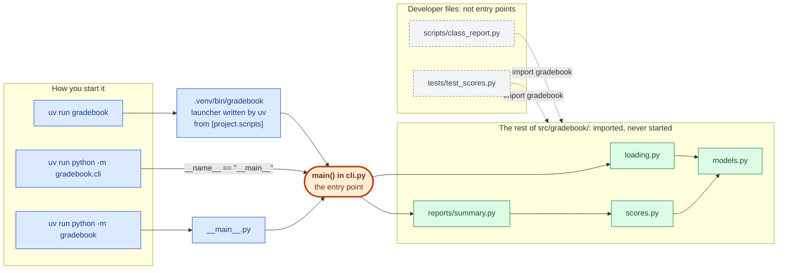
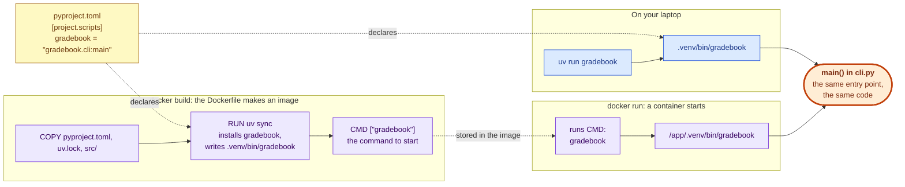

# Python module guide · Session 2: how the files of a project import each other

When a project grows from one file into several, each file has to import the others. This guide shows one way to write those imports that works everywhere: in the package, in tests, in scripts, and with every way of starting the program. It uses **uv**, the tool the course uses to create projects and run code.

The guide continues Steps 4 and 5 of the section [Scripts, modules, packages and project structure](../workbooks/02-lecture-notebook-to-application-git-and-ci.ipynb) in block 2: packages, dotted names and `python -m`.

## Creating the project: `uv init`

A project starts with one command. It creates the folder, `pyproject.toml` and the package folder inside `src/`:

```bash
uv init --package gradebook   # create a new folder "gradebook" and set up a project in it
uv init --package             # set up a project in the current folder; it takes the folder's name
```

**The name you give here is the name of the project, and with it the name you import.** `uv init --package gradebook` writes `name = "gradebook"` into `pyproject.toml`, creates the package folder `src/gradebook/`, and declares a command `gradebook`. From then on, every file imports the code with `import gradebook` or `from gradebook... import ...`. Choose the name with care: changing it later means changing the folder, `pyproject.toml` and every import line.

A name with a dash is written two ways. `uv init --package my-gradebook` gives the project name `my-gradebook` (in `pyproject.toml` and as the command), but the folder `src/my_gradebook/` and the import `import my_gradebook`, because a Python name cannot contain a dash.

`--package` asks for the layout this guide uses: the code in `src/<name>/`, installed into the project's environment. Recent versions of uv do this by default; `--package` makes it explicit. `uv init --no-package` creates a single `main.py` instead, which is enough for a one-file script.

This folder was created that way and then filled with the example below. Its [pyproject.toml](pyproject.toml) explains every line in comments.

## The example project

A small gradebook: each row is one student's score in one subject.

```
python-module-guide/             the project folder: open the terminal here
├── pyproject.toml               the project's name, its dependencies and its entry point
├── src/gradebook/               the app: everything that is installed and given to users
│   ├── __init__.py              runs on `import gradebook`; re-exports the main names
│   ├── models.py                the class Student; imports nothing from the package
│   ├── loading.py               load_students(): reads the CSV file
│   ├── scores.py                average_score(), best_student()
│   ├── reports/                 a subpackage: a folder inside the package
│   │   ├── __init__.py
│   │   └── summary.py           subject_report(): one line per subject
│   ├── cli.py                   the entry point: main() reads the terminal and prints the report
│   ├── __main__.py              runs on `python -m gradebook`; calls the same main()
│   ├── mistake_relative.py      a relative import, to see its error
│   └── mistake_bare.py          an import without the package name, to see its error
├── data/students.csv            the example data: name, subject, score
├── scripts/class_report.py      a helper script for the developers, not part of the app
└── tests/test_scores.py         tests of the calculations, not part of the app
```

**Everything that belongs to the app lives in `src/gradebook/`.** That folder is what uv installs and what a user of the package receives. The other folders (`data/`, `scripts/`, `tests/`) are for the people who develop the project and are not installed. They still import the app, in the same way as any user would.

Some terms used below:

- A **module** is one `.py` file. A **package** is a folder of modules with one import name. A **subpackage** is a package inside a package.
- The **project folder** is the folder that contains `pyproject.toml`.
- The **entry point** is the one place where the app is designed to start: here the function `main()` in `cli.py`.

## Three rules to remember

1. **The app lives in `src/<package>/`.** Here: `src/gradebook/`. This is the layout that `uv init --package` creates.
2. **Every import of your own code starts with the package name.** In every file, at every folder depth, in tests and in scripts: `from gradebook.scores import average_score`.
3. **Open the terminal in the project folder and start everything with `uv run`.** Here: `cd sessions/02-software-engineering/python-module-guide`, then `uv run ...`.

The rest of this guide explains why these three rules work and what happens when one of them is broken.

## Why the rules work: uv installs your package

The first `uv run` in the project folder creates the folder `.venv` (the project's virtual environment) and **installs the project into it**, in editable mode. Editable means that `.venv` only points to `src/`, so a change to a file takes effect at once, without reinstalling.

After that, `gradebook` is an installed package, like `pandas`. Every Python started with `uv run` can import it, no matter which file was started. This is why one import style works everywhere.

Python looks for modules in the folders of the list `sys.path`, in order. You can print it:

```bash
uv run python -c "import sys; print(*sys.path, sep='\n')"
```

The list contains the installed packages of `.venv`, and with them `src/`. Without uv (or another tool that installs the project), `src/` is not on the list, and `import gradebook` fails.

## How to write the imports

Every file in the project uses the same form: the package name, then the dotted path to the module, then the name you need.

| File | Its import | Why it works |
|---|---|---|
| `src/gradebook/loading.py` | `from gradebook.models import Student` | `gradebook` is installed |
| `src/gradebook/reports/summary.py` | `from gradebook.scores import average_score, best_student` | same form, one folder deeper |
| `src/gradebook/cli.py` | `from gradebook.reports.summary import subject_report` | a subpackage adds one name to the path |
| `scripts/class_report.py` | `from gradebook import average_score, load_students` | outside the package: the same form |
| `tests/test_scores.py` | `from gradebook import Student, average_score, best_student` | the tests use the package like any user |

Two short forms come from `__init__.py`. It runs when the package is first imported, and it imports the main names, so users can write `from gradebook import Student` instead of `from gradebook.models import Student`. Both lines give the same class. Inside the package, prefer the full path (`gradebook.models`): it says in which file the name is defined.

**Let imports go in one direction.** `models.py` imports nothing from the package; `scores.py` imports `models`; `summary.py` imports `scores`; `cli.py` imports everything. If two modules import each other (`scores.py` imports `summary.py` and `summary.py` imports `scores.py`), Python stops with an error about a *partially initialized module*. This is called a **circular import**. The usual fix is to move the shared code into a third module that both import.

## What to avoid

### Relative imports

A **relative import** starts with a dot: `from .models import Student` means "the module `models` in the package this file is in"; two dots (`from ..scores import ...`) mean the package one level up. They are valid Python, and many libraries use them. This course does not, for four reasons:

1. **They fail when the file is started by its path.** Started that way, the file is not part of a package, so Python cannot resolve the dot:

   ```bash
   uv run python -m gradebook.mistake_relative      # works
   uv run python src/gradebook/mistake_relative.py  # ImportError: attempted relative import with no known parent package
   ```

2. **They only work inside a package.** Tests, scripts and notebooks are not part of the package and need absolute imports anyway. With relative imports, the project uses two styles; with absolute imports, one.
3. **They change when a file moves.** Move `summary.py` one folder up, and every `..` in it must become `.`. An absolute import stays the same as long as the imported module stays where it is.
4. **They are harder to read.** To understand `from ..scores import x`, the reader must know where the file sits. `from gradebook.scores import x` says it directly. The Python style guide, PEP 8, recommends absolute imports for the same reason.

### Imports without the package name

`models.py` and `loading.py` sit in the same folder, so it seems natural to write this in `loading.py`:

```python
from models import Student            # ❌ looks for a module called "models" at the top level
from gradebook.models import Student  # ✅ the module "models" inside the package "gradebook"
```

Python does not look for `models` next to the file that contains the import. It looks for a module called `models` in the folders of `sys.path`. In an installed project, the only name of yours at that level is the package, `gradebook`, and `models` is inside it. So `from models import ...` fails with `No module named 'models'`: in the installed command, in the tests, in scripts and with `python -m`.

The mistake is hard to notice because one way of starting the file hides it. When you start a file by its path, Python puts that file's own folder (`src/gradebook/`) on `sys.path`, and then `models` is found. The file `mistake_bare.py` contains this import, so you can see both results:

```bash
uv run python src/gradebook/mistake_bare.py      # works, only because src/gradebook/ was put on sys.path
uv run python -m gradebook.mistake_bare          # ModuleNotFoundError: No module named 'models'
```

If an import works when you start the file directly but fails everywhere else, check that it starts with the package name.

### A module with the name of a library

A module called `statistics.py`, `csv.py` or `random.py` inside your package can hide the standard-library module of the same name when a file is started by its path, because that file's folder comes first on `sys.path`. Give modules names of their own: `scores.py`, `loading.py`.

## How to start the code

### The entry point: the front door of the app

An app is designed with **one entry point**: the place where it starts and reads its input. For a command-line program, that is a function, by convention `main()` in `cli.py`. It reads what the user typed, calls the rest of the package and prints the result. No other module reads the terminal, so the calculations can be imported and tested on their own.

`pyproject.toml` declares the entry point under `[project.scripts]`:

```toml
[project.scripts]
gradebook = "gradebook.cli:main"   # the command `gradebook` calls main() in the module gradebook.cli
```

When uv installs the project, it writes a small launcher file, `.venv/bin/gradebook`, that makes this call. So the app gets **one command with one name**, and everybody starts it the same way: you, a teammate, a test of the whole program, and later a server.

The diagram shows every way into the app. All arrows from the left end in the same function, `main()`; only `main()` calls the rest of the package. Scripts and tests do not go through `main()`: they import the modules they need.



Colours: **blue**, the ways to start the app; **orange**, the entry point; **green**, the modules of the app, which are only imported; **grey with a dashed border**, developer files that import the app but are not part of it. Solid arrows are calls and imports on the way from the start; dashed arrows are imports from outside the app.

### Three ways to reach the entry point

All three end in the same `main()`, so they print the same report. The right column gives the equivalent without uv. It needs the environment that uv created (`uv sync` creates it without running anything).

| With uv | Without uv (after `uv sync`) | What it starts | When to use it |
|---|---|---|---|
| `uv run gradebook` | `.venv/bin/gradebook` | the command from `[project.scripts]` | **the normal way**: for users, in a Dockerfile, in documentation |
| `uv run python -m gradebook.cli` | `.venv/bin/python -m gradebook.cli` | the module `cli.py`, by its dotted name; its `if __name__ == "__main__":` line calls `main()` | while you develop, or when the command is not declared |
| `uv run python -m gradebook` | `.venv/bin/python -m gradebook` | the package's `__main__.py`, which calls `main()` | when the package itself should behave like a program |

Instead of typing `.venv/bin/` each time, you can **activate** the environment: `source .venv/bin/activate` (on Windows `.venv\Scripts\activate`). After that, `gradebook` and `python -m gradebook.cli` work in this terminal, until you type `deactivate`. `uv run` does the same for one command, and it also checks first that `.venv` matches `pyproject.toml`.

### From the entry point to Docker

**Docker** packs an app with everything it needs (Python, the libraries, the code) into an **image**: a file that runs in the same way on every computer and server. A running copy of an image is a **container**. A text file called `Dockerfile` lists the steps that build the image, and its last line, `CMD`, says which command a container runs when it starts.

That command is the entry point. Because the app already has one declared command, the `Dockerfile` does not need to know which file or function starts the app. It installs the project with uv, as you do on your laptop, and names the command:

```dockerfile
COPY pyproject.toml uv.lock README.md ./
COPY src ./src
RUN uv sync --frozen --no-dev            # install gradebook and write .venv/bin/gradebook, as on your laptop
ENV PATH="/app/.venv/bin:$PATH"          # make the commands in .venv/bin/ available by name
CMD ["gradebook"]                        # the entry point: what the container runs when it starts
```

These are the main lines only; Session 16 builds a complete `Dockerfile` step by step. Only `src/` is copied into the image: `scripts/` and `tests/` stay on the developer's laptop. The program then reads the data file `data/students.csv` relative to the container's current folder, so the image must provide it there too. This is the same rule as in the section "Where you open the terminal matters".



Colours: **blue**, starting the app on your laptop; **purple**, building the image and running a container; **orange**, the entry point, the same in both places; **yellow**, the line in `pyproject.toml` that declares it. Both paths end in the same `main()`. If you rename or move the entry point, you change one line in `pyproject.toml`, and the laptop command and the `Dockerfile` both stay the same.

Session 16's web service follows the same idea: its `Dockerfile` ends in `CMD ["uvicorn", "tariff_service.app:app", ...]`, where `tariff_service.app:app` uses the same `module:object` form as `gradebook.cli:main`.

### Other files you can start

| Command | What it starts | Why it works |
|---|---|---|
| `uv run python scripts/class_report.py` | a helper script | `gradebook` is installed, so the script can import it |
| `uv run pytest -q` | the tests | the same reason |
| `uv run python src/gradebook/cli.py` | the entry point's file, by its path | the same reason; works, but use one of the three ways above |

`scripts/class_report.py` is **not an entry point**. Nobody designed the app to start there, it is not declared in `pyproject.toml`, and it is not installed with the package. It is a file a developer wrote to answer one question with the package: a report for one class, a data check, a one-time conversion. Such a script uses the app in the same way as a notebook would: it imports `gradebook` by its name. It runs because uv installed `gradebook` into `.venv`, not because of where the script is. If a script becomes something users need, it moves into the package and gets its own command in `[project.scripts]`.

### With `-m` or with a file path?

- **`python path/to/file.py`** starts a file. Python puts **the folder of that file** at the start of `sys.path` and sets `__name__` to `"__main__"`. The file is not treated as part of a package, so relative imports fail.
- **`python -m package.module`** starts a module by its dotted name. Python puts **the current folder** at the start of `sys.path`, imports the package first, and then runs the module with `__name__` set to `"__main__"`. Relative imports work, because Python knows the package.

With uv and absolute imports, both work, because `gradebook` is installed. The guideline is: **a file path for a helper script** (`scripts/class_report.py`), **`-m` and the dotted name for a module inside the package** (`gradebook.cli`), and **the declared command** (`uv run gradebook`) for the app.

### Plain `python`, without uv and without `.venv`

Plain `python` is the Python of whatever environment is active in the terminal, and `gradebook` is not installed there. So all of these fail with `ModuleNotFoundError: No module named 'gradebook'`:

```bash
python src/gradebook/cli.py
python -m gradebook.cli
python scripts/class_report.py
```

Some tutorials then suggest `cd src` followed by `python -m gradebook.cli`. It works, because `-m` puts the current folder (`src/`) on `sys.path`, but now every relative path changes too: the data file becomes `../data/students.csv`. Use `uv run`, or the `.venv` commands above, from the project folder instead.

## Where you open the terminal matters

The **current folder** (also called the working directory) is the folder your terminal is in; `pwd` prints it, and `cd` changes it. Two things depend on it.

**1 · Which project uv uses.** `uv run` looks for a `pyproject.toml` in the current folder, then in each parent folder, and uses the first one it finds. The course repository has its own `pyproject.toml` at the top, so from the repository root uv uses the course environment, where `gradebook` is not installed:

```bash
cd ~/path/to/the/repository                       # the repository root
uv run gradebook                                  # error: Failed to spawn: gradebook
uv run python -m gradebook.cli                    # ModuleNotFoundError: No module named 'gradebook'
```

**2 · Relative file paths.** A path such as `data/students.csv` is read from the current folder, not from the folder of the Python file. From a subfolder of the project, uv finds the right project, but the file is not there:

```bash
cd src/gradebook
uv run gradebook                                  # FileNotFoundError: 'data/students.csv'
```

The fix for both: `cd` into the project folder first, then run.

```bash
cd sessions/02-software-engineering/python-module-guide
uv run gradebook
```

`uv run --directory sessions/02-software-engineering/python-module-guide gradebook` does the same without `cd`: it changes into that folder first. (`--project` only chooses the project; the current folder stays the same, so the data file is still not found.)

In VS Code, check the folder shown in the terminal prompt before you run anything. If uv prints the warning `VIRTUAL_ENV=... does not match the project environment path .venv`, another environment (here the course environment) is active in the terminal. uv ignores it and uses the project's own `.venv`, which is what you want; `deactivate` removes the warning.

## Summary

| Question | Answer |
|---|---|
| How do I create the project? | `uv init --package <name>`; the name becomes the import name (a dash becomes an underscore) |
| Where does the app go? | `src/<name>/`; scripts, tests and data stay outside |
| How do I import my own code? | `from <name>.<module> import <thing>`, in every file |
| Relative imports? | No: they fail when a file is started by its path, and tests and scripts cannot use them |
| What is the entry point? | `main()` in `cli.py`, declared as a command in `[project.scripts]` |
| Where do I open the terminal? | In the project folder, the folder with `pyproject.toml` |
| How do I start the app? | `uv run <name>`; while developing also `uv run python -m <name>.cli` |

## Exercises

1. Add a module `src/gradebook/ranking.py` with a function `rank_students(students, subject)` that returns the names sorted from the highest score to the lowest. Import it in `reports/summary.py` and add one test. Which import lines did you write, and do they depend on the folder of the file?
2. Move `summary.py` from `reports/` into `src/gradebook/`. Which import lines must change, and in which files? Would a relative import in `summary.py` have changed as well?
3. Turn `scripts/class_report.py` into a second entry point: move its code into a function `main()` in `src/gradebook/class_report.py` and declare a command `gradebook-overall` in `[project.scripts]`. Run `uv sync`, then `uv run gradebook-overall`. What appeared in `.venv/bin/`?
4. Open a terminal at the repository root and try to run the gradebook in three ways: with `cd`, with `--directory` and with `--project`. Explain each result with the two points of the section "Where you open the terminal matters".
5. In a scratch folder outside the repository, run `uv init --package my-gradebook`. Look at `pyproject.toml` and the folder `src/`. Where does the name appear with a dash, and where with an underscore?
