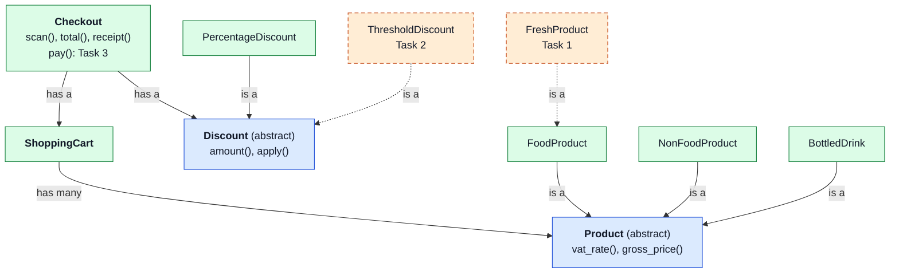

# HTW Markt · the code challenge of Session 2

## What this software does

HTW Markt is the program behind the till of a small shop on campus. A customer brings a basket; the program finds each product, adds up the prices with VAT, lowers the total with a voucher, prints a receipt and works out the change.

You are the new developer. The program already works for most customers, and the owner has three wishes. Each wish practises one idea of this session:

| Task | The owner asks | You practise |
|---|---|---|
| [1](#task-1--sell-sandwiches-cheaper-on-their-last-day) | "Sell sandwiches 30 % cheaper on their last day." | inheritance and `super()` |
| [2](#task-2--5-euros-off-from-30-euros) | "Next week: 5 euros off for everyone who spends 30 euros." | an abstract class and polymorphism |
| [3](#task-3--tell-the-cashier-how-much-change-to-give) | "Tell the cashier how much change to give." | your own exception |

You do not start from an empty file. You continue code that someone else wrote, as most developers do, so read it before you change it.

## Run it

Run every command from this folder. The first `uv run` creates `.venv` here and installs the project.

```bash
cd sessions/02-software-engineering/supermarket-challenge
uv run htw-checkout ana     # Ana's basket, from data/baskets/ana.yaml
uv run pytest -q            # 19 passed, 11 skipped: the skipped tests are your three tasks
```

```
HTW Markt · Ana · discount: 10 % off

Qty   Product              Price   Amount
  1 x Bread                 3.00     3.00
  2 x Milk 1 l              1.17     2.34
  6 x Mineral water         0.83     4.98
  1 x Dish soap             2.32     2.32
-----------------------------------------
Subtotal                            12.64
Discount                            -1.26
Total EUR                           11.38

Paid      : 20.00
Change    : not available yet (Task 3)
```

*Price* is the shelf price of one item: bread costs 2.80 EUR net, plus 7 % VAT, so 3.00. Mineral water costs 0.49 net, plus 19 % VAT, plus the 0.25 deposit: 0.83.

## The code you inherit

The data lives in YAML files, plain text that Python reads into dictionaries, so the owner can change a price without touching the code:

```
supermarket-challenge/
├── data/
│   ├── catalogue.yaml      what the shop sells: name, kind, net price
│   └── baskets/            one file per customer: ana.yaml, cem.yaml
├── src/supermarket/
│   ├── products.py         Product (abstract), FoodProduct, NonFoodProduct, BottledDrink
│   ├── cart.py             ShoppingCart: the items in a list
│   ├── discounts.py        Discount (abstract), NoDiscount, PercentageDiscount
│   ├── checkout.py         Checkout, and the shop's exceptions
│   └── cli.py              the command htw-checkout: reads the files, prints the receipt
└── tests/                  one test file per module
```



Blue boxes are abstract classes, green ones work now, the dashed orange ones are yours. **is a** is inheritance; **has a** is composition. The [practice notebook](../workbooks/03-practice-python-classes.ipynb) builds smaller versions of these classes step by step.

**Before you start**, read `products.py` and answer: which method must every subclass of `Product` write, and what does `BottledDrink.gross_price` add to the price of its parent?

## Tasks

Work in pairs, one task after the other. For each task:

1. Open the file named in the task. The place is marked `Task N`; the docstrings there number the steps.
2. Replace each `raise NotImplementedError("Task N")` with your code.
3. Run `uv run pytest -q`. The tests of a task you have not started are listed as **not started yet**; once you write code, they run and pass or fail.
4. Try the command in *Try it*: the line that said `not available yet (Task N)` now shows your result.

You never need to edit the test files. When all three tasks are done, `uv run pytest -q` reports 30 passed.

### When a test fails

A failing test is not a grade; it tells you what to fix. Read it from the bottom up:

```
>       assert ThresholdDiscount(minimum_subtotal=30, amount_off=5).apply(subtotal) == expected_total
E       AssertionError: assert 30.0 == 25.0
tests/test_discounts.py:33: AssertionError
```

The test spent exactly 30 EUR and expected 25.00 after the discount, but got 30.0: no discount came off. Here the cause was `>` instead of `>=` in `amount()`: "from 30 euros" includes 30 itself. The values on the line `E` are always *what your code gave == what the test expected*.

### Task 1 · "Sell sandwiches cheaper on their last day."

*"Our sandwiches have a use-by date. On that day and the day before, they are 30 % cheaper, so that we sell them instead of throwing them away. After the date, we must not sell them at all."*

In `products.py`, the class `FreshProduct` is started for you: it already inherits from `FoodProduct`, because a fresh product **is a** food product. Fill in its three methods:

1. `__init__` takes `name`, `net_price` and `days_until_use_by` (0 is the use-by day itself; below 0, the date has passed).
2. `gross_price()` is 30 % lower than the food price when `days_until_use_by` is 1 or less.
3. `is_sellable()` returns `False` once the date has passed.
4. Put it on the shelves: add `"fresh": FreshProduct` to `PRODUCT_CLASSES` in `cli.py`, and this line to `data/catalogue.yaml`:

  ```yaml
  - {name: Cheese sandwich, kind: fresh, net_price: 3.00, days_until_use_by: 1}
  ```

Check: `uv run pytest -q tests/test_products.py`. Try it: add `Cheese sandwich: 2` to a basket; each sandwich costs 2.25 (3.00 plus 7 % VAT is 3.21, minus 30 %).

### Task 2 · "5 euros off from 30 euros."

*"Next week, everybody who spends 30 euros or more gets 5 euros off. The week after, it may be 10 off from 50, so I must be able to change the numbers."*

In `discounts.py`, the class `ThresholdDiscount` is started for you: it **is a** `Discount`. Fill in its two methods:

1. `__init__` stores `minimum_subtotal` and `amount_off`.
2. `amount(subtotal)` returns `amount_off` when the subtotal is at least `minimum_subtotal`, otherwise 0.

Do not change `checkout.py`: the checkout already works with every kind of discount. That is the point of the abstract class.

Check: `uv run pytest -q tests/test_discounts.py`. Try it: `uv run htw-checkout cem` gives Subtotal 37.96, Discount -5.00, Total EUR 32.96.

### Task 3 · "Tell the cashier how much change to give."

*"The program must say how much change to give back. If the money is not enough, it must say so clearly."*

In `checkout.py`:

1. Write the exception class `PaymentError`, a subclass of `SupermarketError`. This one you write from scratch: it needs two lines.
2. Write `Checkout.pay(amount_given)`: return the change, rounded to cents. If `amount_given` is less than the total, raise `PaymentError` with a message that names both amounts.

Check: `uv run pytest -q tests/test_checkout.py`. Try it: `uv run htw-checkout ana` ends with `Change : 8.62`; `uv run htw-checkout cem` ends with `Not enough money: 30.00 EUR given, 32.96 EUR to pay`.

### Stretch · if you finish early

Write the test first, watch it fail, then the code. Choose one:

- The checkout refuses a sandwich past its use-by date: a product that `is_sellable()` says cannot be sold. Give `Product` an `is_sellable()` that returns `True`, so that `scan` never needs to ask which kind of product it has.
- A new class `BuyTwoPayOne` for one product name: every second item of it is free.

## Hints

Read a hint only when you are stuck.

**Task 1.** The first line of `__init__` is `super().__init__(name, net_price)`: the parent sets and checks the name and the price, you store only `days_until_use_by`. In `gross_price`, start from `super().gross_price()`, use the constant `FRESH_DISCOUNT_RATE`, and round to cents. `is_sellable` can return the comparison itself: `return self.days_until_use_by >= 0`. In `cli.py`, also import `FreshProduct`.

**Task 2.** `PercentageDiscount`, just above, is the example to follow: store the numbers on `self`, then compare in `amount`. "From 30 euros" includes 30 itself, so use `>=`.

**Task 3.** An exception class needs only a docstring: `class PaymentError(SupermarketError):` and a line `"""..."""` below it, like `UnknownProductError` above it. Compare with `self.total()`, not `self.subtotal()`: the customer pays the price after the discount. You do not need to change `cli.py`: it catches every `SupermarketError`, and your `PaymentError` is one.

## Rules for your code

The code you add should read like the code that is already there.

- **Names say what a thing is**: `days_until_use_by`, not `d`. True-or-false methods start with `is_`.
- **No magic numbers**: a number with a meaning gets a constant in capital letters, as `STANDARD_VAT_RATE = 0.19`.
- **Refuse bad input with an exception** that names the problem; never return `None` or a message string.
- **Every class and method has a docstring and type hints.**
- **Classes return values; only `cli.py` prints**, so that the tests can check every result.

Before you finish, run `uv run ruff check . && uv run ruff format .`.

## Appendix · Running it from somewhere else

This folder is its own uv project, with its own `pyproject.toml` and `.venv`; the course repository has another one at the top. `uv run` uses the nearest `pyproject.toml` above the current folder, so run the commands from this folder. From the repository root, add `--directory sessions/02-software-engineering/supermarket-challenge` after `uv run`.

The warning `VIRTUAL_ENV=... does not match the project environment path .venv` means the course environment is active in this terminal. uv ignores it and the commands still work; type `deactivate` once to remove the warning. In VS Code, choose `.venv/bin/python` of this folder as the interpreter (*Python: Select Interpreter*).

Every import of this project starts with the package name: `from supermarket.products import Product`. Never write `from src.supermarket...` or a path.
