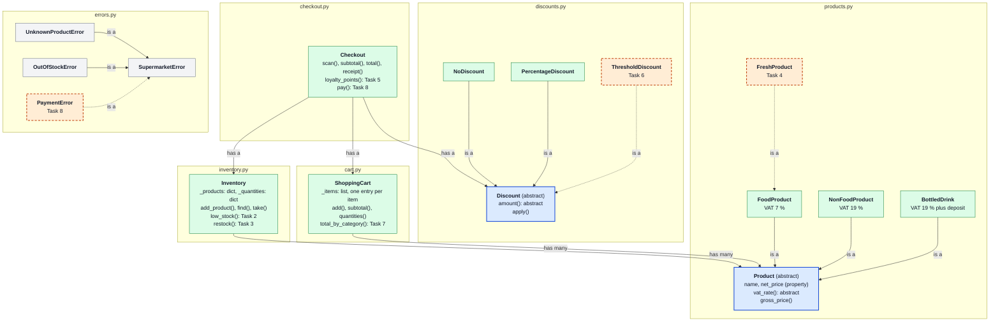

# HTW Markt · the code challenge of Session 2

## Your first week at HTW Markt

Imagine you started this week as a junior developer at *HTW Markt*, a small supermarket on campus. The shop has one checkout counter, and the counter runs a Python program. The developer before you wrote the basics and then moved to another job. The program can already:

- know every product on the shelves, its price before VAT, and the VAT rate for food (7 %) and for everything else (19 %);
- add the bottle deposit to drinks;
- read a customer's basket, scan the products at the checkout counter, take them out of the stock, apply a voucher and print a receipt.

On your first morning, the owner gives you a list of wishes. Each wish is one task:

| Task | The owner asks | You practise |
|---|---|---|
| [1](#task-1--get-to-know-the-program-before-you-change-it) | "Get to know the program before you change it." | reading code, the four principles |
| [2](#task-2--show-me-which-products-are-running-low) | "Before I order from the wholesaler, show me which products are running low." | dictionary, loop, list |
| [3](#task-3--when-a-delivery-arrives-put-it-on-the-shelves) | "When a delivery arrives, put it on the shelves, but never a wrong amount." | encapsulation, errors |
| [4](#task-4--sell-strawberries-cheaper-on-their-last-day) | "Sell strawberries 30 % cheaper on their last day, and never after it." | inheritance, `super()` |
| [5](#task-5--give-member-card-holders-loyalty-points) | "Give member card holders loyalty points: twice as many from 50 euros." | nested `if` |
| [6](#task-6--next-week-5-euros-off-from-30-euros) | "Next week: 5 euros off for everyone who spends 30 euros or more." | abstraction, polymorphism |
| [7](#task-7--how-much-do-customers-spend-on-food-drinks-and-the-rest) | "How much do customers spend on food, drinks and the rest?" | dictionary |
| [8](#task-8--tell-the-cashier-how-much-change-to-give) | "Tell the cashier how much change to give." | a new exception, imports between modules |
| [9](#task-9--stretch-your-own-improvement) | Stretch: your own improvement, with your own tests. | test-driven development |

Most work as a developer looks like this: you seldom start from an empty file. You continue code that someone else wrote, so it must be clear to read and safe to change. The code uses plain Python: classes, lists, dictionaries and `if` statements, with the four principles of object-oriented programming from block 1 (encapsulation, inheritance, abstraction, polymorphism) and composition.

## Run it

Run every command from this folder. The first `uv run` creates `.venv` in this folder and installs the project into it.

```bash
cd sessions/02-software-engineering/supermarket-challenge
uv run htw-shelves                           # what the shop sells: prices and stock
uv run htw-checkout ana                      # one customer at the checkout counter: Ana's basket
uv run pytest -q                             # 30 passed, 24 skipped: the skipped tests are your tasks
```

To run the commands from the repository root, to use VS Code, or if you see a warning about `VIRTUAL_ENV`, see [Appendix A](#appendix-a--a-uv-project-inside-a-folder-of-the-repository).

### Where the numbers come from

The program reads two kinds of input:

- **The shelves** are written in [`src/supermarket/catalogue.py`](src/supermarket/catalogue.py): eight products, each with its net price (before VAT) and its stock. `uv run htw-shelves` prints them, with the shelf price that the program computes: net price plus VAT, plus 0.25 EUR deposit for a bottle.
- **A basket** is a YAML file in [`data/baskets/`](data/baskets/): who the customer is, whether they have a member card and a voucher, what they buy, and how much money they hand over. YAML is a plain text format for data: `Bread: 1` means "the key Bread has the value 1", and Python reads the file into a dictionary.

This is Ana's basket, [`data/baskets/ana.yaml`](data/baskets/ana.yaml):

```yaml
customer: Ana
has_member_card: true
discount:              # a voucher; leave the three lines out for a customer without one
  kind: percentage
  percent: 10
items:                 # product name: quantity
  Bread: 1
  Milk 1 l: 2
  Mineral water: 6
  Dish soap: 1
paid: 20.00            # the money the customer hands over (Task 8)
```

And this is what `uv run htw-checkout ana` prints before you start:

```
HTW Markt · checkout counter
Basket file : ana.yaml
Customer    : Ana, with member card
Discount    : 10 % off

Qty   Product              Price   Amount
  1 x Bread                 3.00     3.00
  2 x Milk 1 l              1.17     2.34
  6 x Mineral water         0.83     4.98
  1 x Dish soap             2.32     2.32
-----------------------------------------
Subtotal                            12.64
Discount                            -1.26
Total EUR                           11.38

Spent per category : not available yet (Task 7)
Loyalty points     : not available yet (Task 5)
Paid               : 20.00
Change             : not available yet (Task 8)
```

*Price* is the shelf price of one item, *Amount* is quantity times price. Bread costs 2.80 EUR net, plus 7 % VAT: 3.00. Mineral water costs 0.49 EUR net, plus 19 % VAT, plus the deposit: 0.83. The discount is 10 % of the subtotal 12.64. Each line `not available yet (Task N)` shows your result once you have completed that task.

| Basket | What it shows |
|---|---|
| [`ana.yaml`](data/baskets/ana.yaml) | a member with a 10 % voucher |
| [`ben.yaml`](data/baskets/ben.yaml) | a member who spends more than 50 EUR (Task 5) |
| [`cem.yaml`](data/baskets/cem.yaml) | next week's promotion (Task 6), and too little money (Task 8) |
| [`dana.yaml`](data/baskets/dana.yaml) | more Cola than the shelves hold: the checkout counter refuses the basket |

`uv run htw-checkout ana` looks for the file `data/baskets/ana.yaml`. Write your own baskets too: copy a file in `data/baskets/`, change it, and run `uv run htw-checkout` with its name, without `.yaml`. A basket in another folder works with its path, for example `uv run htw-checkout my_baskets/eva.yaml`.

## The design

The files you inherited:

```
supermarket-challenge/
├── pyproject.toml              project name, dependencies, the commands htw-checkout and htw-shelves
├── data/
│   ├── baskets/                one YAML file per customer: ana, ben, cem, dana
│   └── delivery.yaml           a delivery from the wholesaler (Task 3)
├── src/supermarket/            the package: a folder of modules with one import name, supermarket
│   ├── __init__.py             runs on `import supermarket`; re-exports the main classes
│   ├── errors.py               SupermarketError and its subclasses
│   ├── products.py             Product (abstract) and FoodProduct, NonFoodProduct, BottledDrink
│   ├── inventory.py            Inventory: products and quantities in stock, in two dictionaries
│   ├── cart.py                 ShoppingCart: a list with one entry per item
│   ├── discounts.py            Discount (abstract) and NoDiscount, PercentageDiscount
│   ├── checkout.py             Checkout: has an Inventory, a ShoppingCart and a Discount
│   ├── catalogue.py            build_sample_inventory(): the shelves, eight products
│   ├── cli.py                  the commands: read the YAML files, call the classes, print
│   └── __main__.py             runs on `python -m supermarket`, the same as htw-checkout
└── tests/                      pytest tests; conftest.py holds the shared sample shop
```

In the diagram, each box is a class, and each grey frame is the module (file) the class lives in. The colours show the kind of class:

- **blue**: an abstract class. It writes down what its subclasses can do, and you cannot create an object of it.
- **green**: a class that is complete and works now.
- **orange, dashed**: a class or a method that you write in one of the tasks.
- **grey**: an exception class.

A solid arrow marked **is a** is inheritance: `FoodProduct` is a `Product`. An arrow marked **has a** or **has many** is composition: a `Checkout` has a `ShoppingCart`, and the cart has many `Product` objects in a list.



`Checkout`, `Inventory` and `ShoppingCart` are green although they contain task methods: the classes work now, and the tasks add methods to them. The task methods are named in the boxes.

`cli.py` has no classes and is not in the diagram. It reads the files, calls the classes and prints. Every calculation happens in the classes, so that the tests can check it without the command line.

## How the modules import each other

**The rule to remember.** Every import of this project's own code starts at the package name `supermarket`, followed by the file name without `.py`:

```python
from supermarket.products import Product  # from supermarket.<file> import <Name>
```

The line is the same in every file: in `inventory.py`, in `checkout.py`, in `tests/test_cart.py` and in a notebook that uses this project's `.venv`. It does not depend on where the importing file is. Never write `from src.supermarket...`, `from products import ...` or a path.

| You need | In the file | You write |
|---|---|---|
| `Product` | `src/supermarket/inventory.py` | `from supermarket.products import Product` |
| `OutOfStockError` | `src/supermarket/checkout.py` | `from supermarket.errors import OutOfStockError` |
| `Checkout` | `tests/test_checkout.py` | `from supermarket.checkout import Checkout` |
| `Checkout`, short form | anywhere | `from supermarket import Checkout` (re-exported by `__init__.py`) |

Every file can import every module in `src/supermarket/`. The files in `tests/` are not part of the package: no file imports them. pytest finds them by their names `test_*.py`, and it passes the fixtures of `conftest.py` to the tests itself.

### The import map

The arrows show which module imports which. Every arrow points down: modules at the bottom need nothing from the package, and only the modules at the top bring everything together. No two modules import each other, which keeps Python from a circular import (two files that each wait for the other to finish loading). The colours mark three layers: **purple** starts the program and reads the files, **green** combines the parts, **blue** holds the basic building blocks. The dashed orange arrow is the import you add in Task 8.

```mermaid
flowchart TD
    main["__main__.py"] --> cli["cli.py<br/>the two commands"]
    cli --> catalogue["catalogue.py"]
    cli --> checkout["checkout.py"]
    cli --> discounts["discounts.py"]
    cli --> errors["errors.py"]
    checkout --> cart["cart.py"]
    checkout --> discounts
    checkout --> inventory["inventory.py"]
    catalogue --> inventory
    catalogue --> products["products.py"]
    inventory --> products
    inventory --> errors
    cart --> products
    checkout -.->|Task 8| errors

    classDef entry fill:#ede9fe,stroke:#6d28d9,stroke-width:2px,color:#111827
    classDef combine fill:#dcfce7,stroke:#15803d,color:#111827
    classDef base fill:#dbeafe,stroke:#1d4ed8,color:#111827
    class main,cli entry
    class checkout,catalogue,inventory,cart combine
    class products,discounts,errors base
    linkStyle 13 stroke:#c2410c,stroke-width:2px
```



Why the package sits in `src/`, how to choose another folder, and the other form of import are in [Appendix B](#appendix-b--why-the-code-is-a-package), [Appendix C](#appendix-c--where-the-name-supermarket-and-the-folder-src-come-from) and [Appendix D](#appendix-d--relative-imports).

## Tasks

Work in pairs and take the tasks in order. For each task:

1. Read what the owner needs and find the place in the code. It is marked with `NotImplementedError("Task N")` or a comment `# Task N`, and the docstring there repeats the rules.
2. In the test file, delete the line `@pytest.mark.skip(reason="Task N: ...")` above each test of the task.
3. Write the code. If you are stuck, read the task's part in [Hints](#hints).
4. **Check it in two ways.** `uv run pytest -q tests/<file>` runs the tests until they all pass. The *Try it* command shows the result as the owner would see it.
5. Run `uv run ruff check . && uv run ruff format .` before you move on.

When all tasks are done, `uv run pytest -q` reports 54 passed.

### Task 1 · "Get to know the program before you change it."

Run both commands and the tests, then answer in writing, with the file and the line:

- *Abstraction.* `Product` and `Discount` are abstract classes. Which method must each subclass write? What happens on `Product("Mystery", 1.00)`, and why?
- *Encapsulation.* `Product` stores the price in `self._net_price`, behind a property. Try `FoodProduct("Bread", -1.00)` and `bread.net_price = -1.00` in `uv run python`. Which lines refuse the price? Why does `Inventory` keep its two dictionaries behind a leading underscore?
- *Inheritance.* `BottledDrink.gross_price` calls `super().gross_price()`. What does the parent's method compute, and what does the child add?
- *Polymorphism.* `Checkout.total` calls `self.discount.apply(...)` without knowing which kind of discount it has. Which `amount()` runs for Ana? Why does `Checkout` store a `NoDiscount()` instead of `None` when no discount is given?
- *Composition.* Name the three objects a `Checkout` has. Is a checkout a cart (inheritance) or does it have one (composition)?
- *Input.* Follow one line of `ana.yaml`, `Milk 1 l: 2`, from the file to the receipt: which functions and methods does it pass through?

### Task 2 · "Show me which products are running low."

*"Before I order from the wholesaler, I want a list of the products that will soon be sold out."*

- Write `Inventory.low_stock(threshold=5)` in `inventory.py`.
- A product is running low when **fewer than** `threshold` items are in stock. With 5 items it is not low.
- Return the product names as a list, in alphabetical order. If no product is low, return an empty list.

Check: `uv run pytest -q tests/test_inventory.py`. Try it:

```bash
uv run htw-shelves                  # last line: Running low (fewer than 5): ['Cheese', 'Cola', 'Toothpaste']
uv run htw-shelves --threshold 3    # last line: Running low (fewer than 3): ['Toothpaste']
```

### Task 3 · "When a delivery arrives, put it on the shelves."

*"The wholesaler delivers on Mondays. The stock must go up by exactly what arrived, and the program must refuse a delivery line that makes no sense."*

- Write `Inventory.restock(product_name, quantity)` in `inventory.py`: add `quantity` items to the stock of a product.
- Refuse a `quantity` below 1 with `ValueError`.
- Refuse a product the shop does not sell with `UnknownProductError`. The shop adds new products with `add_product`, not with a delivery.
- After this task, `restock` and `add_product` are the only ways to raise a stock.

Check: `uv run pytest -q tests/test_inventory.py`. Try it:

```bash
uv run htw-shelves --delivery data/delivery.yaml    # Cheese 14, Cola 27, Toothpaste 14; nothing runs low
```

Then change a line of `data/delivery.yaml` to `Caviar: 5` or `Cola: 0` and run it again: the program prints `Delivery line refused` with your error message.

### Task 4 · "Sell strawberries cheaper on their last day."

*"Fresh products have a best-before date. On the last day, and the day before, they are 30 % cheaper. After the date, we must not sell them at all."*

- Write a class `FreshProduct` in `products.py`. A fresh product **is a** food product, so it inherits from `FoodProduct` and keeps its VAT rate and category.
- The constructor takes `name`, `net_price` and `days_until_best_before` (0 is the last day; below 0 means the date has passed).
- `gross_price()` is 30 % lower than the food price when `days_until_best_before` is 1 or less.
- `is_sellable()` returns `False` once the date has passed, otherwise `True`.
- Put strawberries on the shelves: in `catalogue.py`, add `FreshProduct("Strawberries 500 g", 3.00, days_until_best_before=1)` with `quantity=10`.

Check: `uv run pytest -q tests/test_products.py`. Try it:

```bash
uv run htw-shelves    # a new row: Strawberries 500 g  FreshProduct  3.00  7%  2.25  10
```

The shelf price 2.25 is 3.00 + 7 % VAT = 3.21, minus 30 %. Add `Strawberries 500 g: 2` to a basket and check the receipt.

### Task 5 · "Give member card holders loyalty points."

*"Customers with our member card collect points. Big shops are worth more: from 50 euros, the points count double."*

- Write `Checkout.loyalty_points()` in `checkout.py`. The points count the total **after** the discount, in full euros:

| Customer | Total after the discount | Points |
|---|---|---|
| without a member card | any | 0 |
| with a member card | below 50 EUR | 1 point per full euro |
| with a member card | 50 EUR or more | 2 points per full euro |

Check: `uv run pytest -q tests/test_checkout.py`. Try it:

```bash
uv run htw-checkout ana    # Loyalty points     : 11   (total 11.38)
uv run htw-checkout ben    # Loyalty points     : 102  (total 51.17, so 2 x 51)
```

### Task 6 · "Next week: 5 euros off from 30 euros."

*"Next week we run a promotion: everybody who spends 30 euros or more gets 5 euros off. The week after, it may be 10 euros off from 50. Make it so that I can change the numbers."*

- Write a class `ThresholdDiscount` in `discounts.py`. It **is a** `Discount`, so it inherits from it.
- The constructor takes `minimum_subtotal` and `amount_off`.
- `amount(subtotal)` returns `amount_off` when the subtotal is at least `minimum_subtotal`, otherwise 0.
- Do not change `checkout.py`: the checkout must work with the new discount as it is.
- Optional: write `__str__`, so that the header shows `5.00 EUR off from 30.00 EUR` instead of the class name.

Check: `uv run pytest -q tests/test_discounts.py`. Try it:

```bash
uv run htw-checkout cem    # Subtotal 37.96, Discount -5.00, Total EUR 32.96
```

Before this task, the command prints `This basket uses a threshold discount: not available yet (Task 6)`. Cem's last line, `Change`, waits for Task 8.

### Task 7 · "How much do customers spend on food, drinks and the rest?"

*"I want to know which part of the shop brings the money: food, drinks or the other products."*

- Write `ShoppingCart.total_by_category()` in `cart.py`.
- Return a dictionary from each category in the cart to the money spent on it, rounded to cents.
- Only categories that are in the cart appear. An empty cart gives `{}`.

Check: `uv run pytest -q tests/test_cart.py`. Try it:

```bash
uv run htw-checkout ana    # Spent per category : {'food': 5.34, 'drinks': 4.98, 'non-food': 2.32}
```

### Task 8 · "Tell the cashier how much change to give."

*"The cashier types in the money the customer hands over, and the program says how much change to give back. If it is not enough, it must say so clearly."*

- In `errors.py`, write a new exception class `PaymentError`, a subclass of `SupermarketError`.
- In `checkout.py`, import it and write `Checkout.pay(amount_given)`. It returns the change, rounded to cents.
- If `amount_given` is less than the total, raise `PaymentError` with a message that says both amounts.

Check: `uv run pytest -q tests/test_checkout.py`. Try it:

```bash
uv run htw-checkout ana    # Change             : 8.62
uv run htw-checkout cem    # Payment refused    : 30.00 EUR given, 32.96 EUR to pay
```

### Task 9 · Stretch: your own improvement

Choose one. Write the test first, watch it fail, then write the code.

- The checkout counter refuses a product that `is_sellable()` says cannot be sold, with a new exception in `errors.py`. Give `Product` a method `is_sellable()` that returns `True`, so that `scan` does not need to ask which kind of product it has.
- The receipt shows the loyalty points under the total, for customers with a member card.
- A new basket field `returned_bottles: 6` pays back 0.25 EUR deposit per bottle.

## Hints

Read the hint of a task when you are stuck, not before: the tasks are written so that the code and its docstrings are enough.

**Task 2.** `self._quantities.items()` gives each product name together with its quantity: `for product_name, quantity in self._quantities.items():`. Start with an empty list, `append` the names of low products, and return `sorted(...)` of the list. Compare with `<`, not `<=`: 5 items with `threshold=5` is not low.

**Task 3.** Check the quantity first, then the name. `self.find(product_name)` already raises `UnknownProductError` for a wrong name, so call it and ignore what it returns. Then raise the value in the dictionary with `+=`. The test `test_restock_refuses_an_unknown_product` fails if you add an unknown name to `_quantities` by accident.

**Task 4.** Start with `class FreshProduct(FoodProduct):`. In `__init__`, the first line is `super().__init__(name, net_price)`: the parent sets and checks the name and the price, you only store `days_until_best_before`. In `gross_price`, take the food price from `super().gross_price()` and lower it when needed; keep 0.30 in a constant `FRESH_DISCOUNT_RATE` and round to cents. `is_sellable` can return the comparison itself: `return self.days_until_best_before >= 0`. To add the strawberries, also import `FreshProduct` in `catalogue.py`.

**Task 5.** Call `self.total()` once and store it in a variable. `int(24.80)` is `24`, the number of full euros. The shape of a nested `if`:

```python
if condition_about_the_card:
    if condition_about_the_total:
        ...
    else:
        ...
else:
    ...
```

**Task 6.** Write only `__init__` and `amount`: `apply` is inherited from `Discount` and already subtracts the amount and keeps the total above zero. `cli.py` already turns `kind: threshold` in a basket file into a `ThresholdDiscount`; look at `make_discount` to see which constructor arguments it passes. `PercentageDiscount` is the example to follow, including its `__str__`.

**Task 7.** `quantities()` in the same file builds a dictionary with the same pattern: it counts items, your method adds prices. Each product knows its category as `product.category`. Before `+=` on a key, check that the key is in the dictionary (`if category in totals:`); otherwise Python raises `KeyError`. Round each total at the end, not after every addition.

**Task 8.** An exception class needs no code, only a docstring: `class PaymentError(SupermarketError):` and a line `"""..."""` below it. Import it at the top of `checkout.py` with the other imports: `from supermarket.errors import PaymentError`. Compare with `self.total()`, not `self.subtotal()`: the customer pays the price after the discount. You do not need to change `cli.py`: it catches every `SupermarketError`, and a `PaymentError` is one, because it inherits from it.

## Rules for your code

The code you add should read like the code that is already there.

- **Names say what a thing is.** `quantity_in_stock`, `product_name`, `low_stock_names`; not `q`, `x`, `data` or `temp`. Methods start with a verb (`restock`, `scan`) or name what they return (`subtotal`, `low_stock`). True-or-false names start with `is_` or `has_` (`is_sellable`, `has_member_card`).
- **No magic numbers.** A number with a meaning gets a constant in capital letters at the top of the module, as `STANDARD_VAT_RATE = 0.19`.
- **One method, one job.** If a method needs a comment to explain its steps, split it into two methods.
- **Classes return values; they do not print.** Only `__main__.py` prints. A method that prints cannot be tested with `assert`.
- **Refuse bad input with an exception.** Raise `ValueError` or a subclass of `SupermarketError` with a message that names the problem; do not return `None`, `-1` or a message string.
- **Every module, class and method has a docstring.** The first line says what it is or what it returns. Then, where they help, the sections `Args:`, `Returns:`, `Raises:`, `Example:` (Google style, as in the given code). Every method has type hints.
- **A comment says why, not what.** `# reuse find() for its check` helps the reader; `# add 1 to x` repeats the code.
- **Change data only through methods.** Outside a class, do not write to names that start with an underscore, such as `inventory._quantities`.

## Appendix A · A uv project inside a folder of the repository

The course repository has its own `pyproject.toml` at the top, and this folder has a second one. Each `pyproject.toml` describes one project: its own name, its own dependencies and its own `.venv`. Neither project knows about the other.

**How uv chooses the project.** `uv run` starts in the current folder and looks for a `pyproject.toml`. If there is none, it looks in the parent folder, then in that folder's parent, and so on. The first one it finds is the project. Inside `supermarket-challenge/` that is this project; at the repository root it is the course project, which does not contain the package `supermarket`:

```bash
# at the repository root
uv run python -c "import supermarket"      # ModuleNotFoundError: the course environment is used
```

**Running it without `cd`.** Two options tell uv which project to use:

```bash
# at the repository root
uv run --project sessions/02-software-engineering/supermarket-challenge htw-checkout ana
uv run --directory sessions/02-software-engineering/supermarket-challenge htw-checkout ana
uv run --directory sessions/02-software-engineering/supermarket-challenge pytest -q
```

| Option | Project used | Folder the command runs in |
|---|---|---|
| none | the nearest `pyproject.toml` above the current folder | the current folder |
| `--project <folder>` | the one in `<folder>` | the current folder (relative paths start here) |
| `--directory <folder>` | the one in `<folder>` | `<folder>`, as if you had typed `cd <folder>` first |

A basket name such as `ana` works with both options. A path, such as `data/delivery.yaml` or your own basket file, starts at the repository root with `--project`, and in this folder with `--directory`, as in the rest of this README. Use `--directory` for `pytest` and `ruff` too, because they look for `tests/` and `pyproject.toml` in the folder they run in.

**The warning `VIRTUAL_ENV=... does not match the project environment path .venv`.** It means that the course environment of the repository root is activated in this terminal (its name in brackets before the prompt). uv ignores it and uses this project's own `.venv`, so the commands work as described. To remove the warning, type `deactivate` once in this terminal.

**In VS Code**, choose the interpreter of this project for the editor and the debugger: *Python: Select Interpreter*, then `sessions/02-software-engineering/supermarket-challenge/.venv/bin/python` (on Windows `.venv\Scripts\python.exe`).

## Appendix B · Why the code is a package

The same classes would also run as loose `.py` files in one folder, or as one long file. A package is a folder of modules with one import name, here `supermarket`, that is installed into the project's `.venv`. That gives you five things that loose files do not:

| Loose `.py` files in one folder | The package `supermarket` |
|---|---|
| `from products import Product` works only when Python starts in that folder. A notebook in another folder gets `ModuleNotFoundError: No module named 'products'`. | `from supermarket.products import Product` works from every folder, because the package is installed into `.venv`. |
| Tests must sit next to the code, or change Python's search path by hand. | The tests live in their own folder `tests/` and import the code the same way as any user. |
| You start the program with `python main.py`, and you must know which file to run. | You start it with a command, `uv run htw-checkout ana`, or with `uv run python -m supermarket ana`. The command is declared once, in `pyproject.toml`. |
| A file name can hide a module of Python itself: a file `statistics.py` makes `import statistics` load your file instead of Python's module, so `statistics.mean` is not found. | Every module has the package name in front, `supermarket.errors`, so it cannot hide another module. |
| To share the code, you copy files. | `uv build` makes one file, `dist/supermarket-0.1.0-py3-none-any.whl` (a *wheel*), and another project installs it with `uv add`. |

**Does uv need the package?** No: uv also runs a single script. But uv installs your own code into `.venv` only when `pyproject.toml` has a `[build-system]` table, and a build tool can install only a package, a folder with a name. Without `[build-system]`, uv still creates `.venv` and installs the dependencies, but `import supermarket` fails. So the package is what makes the commands, the imports from every folder and the tests work.

## Appendix C · Where the name `supermarket` and the folder `src/` come from

From a default of the build tool, not from a setting in this folder. Two parts of `pyproject.toml` matter:

```toml
[project]
name = "supermarket"          # the project name, and also the import name by default

[build-system]
requires = ["uv_build>=0.13,<0.14"]
build-backend = "uv_build"    # the build tool: it turns the folder of code into an installable package
```

The build tool has to know which folder holds the code. `uv_build` looks for `src/<project name>/__init__.py`, here `src/supermarket/__init__.py`, unless you tell it otherwise. This default is called the *src layout*. No line in this folder says "src": if the folder is missing or has another name, `uv run` stops with `Expected a Python module at: src/supermarket/__init__.py`.

**A different layout.** Two settings in a table `[tool.uv.build-backend]` of `pyproject.toml` change the default. `module-root` says in which folder to look; `module-name` says the name of the package folder, which is also the import name.

| You want | Folder of the code | Add to `pyproject.toml` | Import |
|---|---|---|---|
| the default (this project) | `src/supermarket/` | nothing | `from supermarket.products import Product` |
| no `src/` folder | `supermarket/`, next to `pyproject.toml` | `[tool.uv.build-backend]`<br>`module-root = ""` | `from supermarket.products import Product` |
| another folder | `code/supermarket/` | `[tool.uv.build-backend]`<br>`module-root = "code"` | `from supermarket.products import Product` |
| another import name | `src/shop/` | `[tool.uv.build-backend]`<br>`module-name = "shop"` | `from shop.products import Product` |

The folder does not change the imports; the import name does. With `module-name = "shop"` every `from supermarket.` in the code must become `from shop.`, otherwise the package fails with `ModuleNotFoundError: No module named 'supermarket'`. The course project at the repository root uses `module-root = ""`, because its package `course_tools` is not in a `src/` folder. Run `uv sync` after a change of these settings, so that uv installs the project again.

**How Python finds the installed package.** `uv run` installs the project into `.venv` in *editable* mode. It writes one file, `.venv/lib/python3.14/site-packages/supermarket.pth`, whose only line is the full path of the folder that holds the package (`src/`). Python reads that file at start-up and adds the path to its search path, so it finds `src/supermarket/` under the name `supermarket`. *Editable* means that Python reads your files where they are: a change in `src/` takes effect on the next run, without installing again.

Why the extra `src/` folder? Python cannot find the package by accident from the current folder; it finds it only through the install. The tests therefore use the code the same way as anyone who installs the project.

## Appendix D · Relative imports

A leading dot means "the package this file belongs to":

```python
from .products import Product  # the same as: from supermarket.products import Product
```

It works only when Python loads the file as part of the package. Try it with a small file `src/supermarket/relative_demo.py` that contains `from .products import FoodProduct` and `print(FoodProduct("Bread", 2.80).gross_price())`:

| Command | Result |
|---|---|
| `uv run python -m supermarket.relative_demo` | `3.0`: the file is loaded as the module `supermarket.relative_demo` |
| `uv run python src/supermarket/relative_demo.py` | `ImportError: attempted relative import with no known parent package`: the file is loaded as a script, outside any package |

This project uses absolute imports everywhere, because they read the same in every file and work with both commands. Delete `relative_demo.py` after the test.
