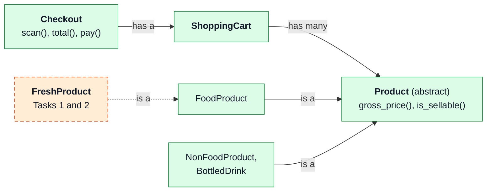

# HTW Markt · the code challenge of Session 2

## The story

It is Friday, 18:00, at HTW Markt, the small shop on campus. Every evening the shop throws away the sandwiches it did not sell. The owner wants to change this with two new rules:

1. **On its last day, a sandwich costs 30 % less**, so that someone buys it.
2. **A sandwich past its use-by date is never sold**, because that is not allowed.

The till, the program at the checkout, does not know these rules yet. Lina, the last customer of the day, is waiting with two cheese sandwiches that must be eaten today, one egg sandwich from yesterday, a bottle of water and a bag of apples. She pays with a 10-euro note.

**Your goal: teach the till the two rules, so that it can serve Lina.** You are the new developer: the program was written by someone else, and you add three small pieces to it.

## Step 1 · See the problem

Open a terminal in this folder and ask the till to serve Lina:

```bash
cd sessions/02-software-engineering/workspace/supermarket_challenge
uv run htw-checkout lina
```

The first `uv run` creates `.venv` in this folder and installs the project. The till answers:

```
HTW Markt · Friday, 18:00 · customer: Lina

The till cannot start: the shelf has sandwiches, and the class FreshProduct
cannot create them yet (Task 1).
```

The shelf (`data/catalogue.yaml`) has sandwiches on it, and the program does not know how to handle a product with a use-by date. Lina's basket is in `data/baskets/lina.yaml`: open both files and look at them.

## Step 2 · See the goal

When your three tasks are done, the same command prints this:

```
HTW Markt · Friday, 18:00 · customer: Lina

Not sold: Egg sandwich is past its use-by date          ← Task 2

Qty   Product              Price   Amount
  2 x Cheese sandwich       2.25     4.50               ← Task 1
  1 x Mineral water         0.83     0.83
  1 x Apples 1 kg           2.45     2.45
-----------------------------------------
Total EUR                            7.78

Paid      : 10.00
Change    : 2.22                                         ← Task 3
```

Each task makes one more line of this screen right, and each one practises one idea of this session:

| Task | The till learns to … | You practise |
|---|---|---|
| [1](#task-1--sandwiches-cost-less-on-their-last-day) | create sandwiches and lower their price on the last day | inheritance and `super()` |
| [2](#task-2--never-sell-a-sandwich-past-its-date) | refuse the egg sandwich from yesterday | overriding a method, and your own exception |
| [3](#task-3--give-lina-her-change) | tell the cashier how much change to give | raising an exception for bad input |

## Step 3 · Find your way in the code

You only need four files. They are in `src/supermarket/`:

| File | What it holds | You change it in |
|---|---|---|
| `products.py` | the kinds of product and their prices: `FoodProduct`, `BottledDrink`, … and `FreshProduct` | Tasks 1 and 2 |
| `cart.py` | `ShoppingCart`: the list of items a customer has chosen | (nothing to change) |
| `checkout.py` | `Checkout`: finds a product, puts it in the cart, takes the payment; the shop's errors | Tasks 2 and 3 |
| `cli.py` | the command `htw-checkout`: reads the files and prints the screen above | (nothing to change) |

The classes fit together like this. Green ones work already; the dashed orange one is yours.



**is a** means inheritance: a fresh product *is a* food product. **has a** means composition: a checkout *has a* cart. The [practice notebook](../../workbooks/03-practice-python-classes.ipynb) builds smaller versions of these classes step by step.

**Before you start**, open `products.py` and find `BottledDrink`. Its `gross_price()` calls `super().gross_price()`: what does that call return, and what does `BottledDrink` add to it? You write the same pattern in Task 1.

## How to work on a task

Work in pairs, one task after the other.

1. Open the file named in the task. Each place to change is marked `Task N, step k`.
2. Replace each `raise NotImplementedError("Task N")`, or the comment that marks the place, with your code.
3. Run the tests: `uv run pytest -q`. At the start you see `13 passed, 12 skipped`. The skipped tests check your tasks: they are listed as **not started yet** until you write code, and then they pass or fail.
4. Run `uv run htw-checkout lina` and compare the screen with the goal above.

You never need to edit the test files. When all three tasks are done, `uv run pytest -q` reports `25 passed`.

### Task 1 · Sandwiches cost less on their last day

> *The owner: "A sandwich is a food product like bread, with 7 % VAT. The difference is its use-by date. On that day and on the day before, it costs 30 % less."*

In `products.py`, the class `FreshProduct` is started for you. It already inherits from `FoodProduct`, because a fresh product **is a** food product. Write two methods:

1. `__init__(name, net_price, days_until_use_by)`: let the parent class store the name and the price, then store `days_until_use_by`. This number counts days from today: 0 means "use by today", -1 means "use by yesterday".
2. `gross_price()`: the normal food price, but 30 % lower when `days_until_use_by` is 1 or less.

Check: `uv run pytest -q tests/test_products.py`.

Run `uv run htw-checkout lina`. The till starts now, and a cheese sandwich costs 2.25 instead of 3.21. But look at the receipt: the egg sandwich from yesterday is on it. The till sells it, and the screen says `Use-by dates are not checked yet (Task 2)`.

### Task 2 · Never sell a sandwich past its date

> *The owner: "The till must refuse a sandwich after its use-by date, and tell the cashier why."*

Every product answers the question `is_sellable()`. `Product` already says `True` for all products. A fresh product needs its own answer, and the checkout needs a clear error when the answer is no.

1. In `checkout.py`, write the class `ExpiredProductError`, a subclass of `SupermarketError`. Look at `UnknownProductError` above it: yours needs two lines.
2. In `products.py`, write `FreshProduct.is_sellable()`: `False` once the use-by date has passed, otherwise `True`.
3. In `checkout.py`, in `Checkout.scan()`: if the product is not sellable, raise `ExpiredProductError` with a message that names the product, before the product goes into the cart.

Check: `uv run pytest -q`.

Run `uv run htw-checkout lina`. The screen now says `Not sold: Egg sandwich is past its use-by date`, and the egg sandwich is no longer on the receipt. You did not change `cli.py`: it catches every `SupermarketError`, and your new error is one.

### Task 3 · Give Lina her change

> *The owner: "The till must say how much change to give back. If the money is not enough, it must say so."*

In `checkout.py`, write `Checkout.pay(amount_given)`:

- If `amount_given` is less than `total()`, raise `PaymentError` (already written at the top of the file) with a message that names both amounts.
- Otherwise, return the change, rounded to cents.

Check: `uv run pytest -q`: `25 passed`.

Run `uv run htw-checkout lina`. The last line says `Change    : 2.22`. Lina is served, and the shop has sold two sandwiches it would otherwise have thrown away.

Now try the other case: change `paid: 10.00` to `paid: 5.00` in `data/baskets/lina.yaml` and run the command again. The till prints `Not enough money: 5.00 EUR given, 7.78 EUR to pay`. Change it back afterwards.

## When a test fails

A failing test is not a grade: it tells you what to fix. Read it from the bottom up:

```
>       assert sandwich.gross_price() == 2.25
E       AssertionError: assert 3.21 == 2.25
tests/test_products.py:70: AssertionError
```

The line `E` reads *what your code gave == what the test expected*. Here the test created a sandwich with one day left and expected the lower price, 2.25, but got the normal price, 3.21. The cause was `< 1` instead of `<= 1` in `gross_price()`: "on that day and on the day before" includes the day before, so 1 must count, too.

## Hints

Open a hint only when you are stuck.

<details>
<summary>Task 1</summary>

The first line of `__init__` is `super().__init__(name, net_price)`: the parent stores and checks the name and the price. After it, you store only the new attribute: `self.days_until_use_by = days_until_use_by`.

In `gross_price()`, start from `super().gross_price()`, which is the food price with VAT. Multiply it by `1 - FRESH_DISCOUNT_RATE` when the days are 1 or less, and round to cents with `round(..., 2)`. `BottledDrink.gross_price()` is an example of the same pattern.

</details>

<details>
<summary>Task 2</summary>

An exception class needs only a line and a docstring:

```python
class ExpiredProductError(SupermarketError):
    """Raised when ..."""
```

`is_sellable()` can return the comparison itself: `return self.days_until_use_by >= 0`. Use-by day 0 is today, so it can still be sold.

In `scan()`, the variable `product` already holds the product. Write `if not product.is_sellable():` and, below it, `raise ExpiredProductError(f"{product.name} is past its use-by date")`. Put it before `self.cart.add(...)`, so that a refused product never reaches the cart. `scan()` does not ask which kind of product it has: bread answers `True` from `Product`, a sandwich answers from `FreshProduct`. That is polymorphism.

</details>

<details>
<summary>Task 3</summary>

Store `self.total()` in a variable first, so that you compute it only once. Compare with `<`: a customer who pays exactly the total gets 0.00 back. A message with both amounts: `f"{amount_given:.2f} EUR given, {total:.2f} EUR to pay"`.

</details>

## If you finish early

Write the test first, watch it fail, then write the code. Choose one:

- At closing time, the staff take every expired product off the shelf. Write a function `expired_products(catalogue)` in `checkout.py` that returns the names of all products that are not sellable. For tonight's shelf it returns `["Egg sandwich"]`.
- After 20:00, the owner wants 50 % off on the last day instead of 30 %. Where would you change the code, and how would a test check it?

## Rules for your code

The code you add should read like the code that is already there.

- **Names say what a thing is**: `days_until_use_by`, not `d`. Methods that answer yes or no start with `is_`.
- **No magic numbers**: a number with a meaning gets a constant in capital letters, as `FRESH_DISCOUNT_RATE = 0.30`.
- **Refuse bad input with an exception** that names the problem; never return `None` or a message string.
- **Every class and method has a docstring and type hints.**
- **Classes return values; only `cli.py` prints**, so that the tests can check every result.

Before you finish, run `uv run ruff check . && uv run ruff format .`.

## Appendix · Running it from somewhere else

This folder is its own uv project, with its own `pyproject.toml` and `.venv`; the course repository has another one at the top. `uv run` uses the nearest `pyproject.toml` above the current folder, so run the commands from this folder. From the repository root, add `--directory sessions/02-software-engineering/workspace/supermarket_challenge` after `uv run`.

The warning `VIRTUAL_ENV=... does not match the project environment path .venv` means the course environment is active in this terminal. uv ignores it and the commands still work; type `deactivate` once to remove the warning. In VS Code, choose `.venv/bin/python` of this folder as the interpreter (*Python: Select Interpreter*).

Every import of this project starts with the package name: `from supermarket.products import Product`. Never write `from src.supermarket...` or a path.
