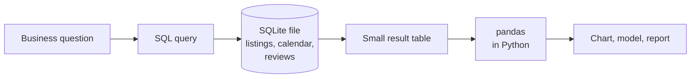
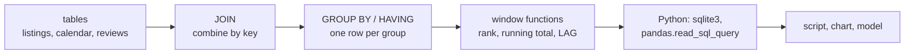

# Session 3 · Relational databases and SQL with SQLite

> **Guiding question.** How do we store, query and combine data in a relational database?

**Learning outcomes.** After this session you are able to

- explain tables, keys and relationships in a relational database
- create tables in SQLite, load data and write SQL queries that filter, sort, aggregate and join
- use common table expressions and window functions, and query the database from Python

## Why this session matters

In Session 1 the listings came as one prepared file. Real questions are spread over several linked tables: the listings, their availability for every night of the coming year, and their monthly reviews. This session shows how a relational database keeps such tables linked by keys, how SQL gets answers out of them, and how a Python script loads data into a database and answers a question from it. No prior knowledge of databases is assumed. The course uses SQLite, where the whole database is one file and nothing has to be installed; the SQL is standard SQL that also runs on server databases such as PostgreSQL. The team project starts with exactly this step: loading the customs decisions into the team's SQLite database.

> This page is the teaching overview of the session. How to work with it (the ▶ links, the numbered notebooks, the extras) is explained once in the [course README](../../README.md#how-to-use-the-session-pages).

**Notes for this session**

- All notebooks query the course database `case-study/data/airbnb.sqlite`. It is built from the case-study Parquet files by [`workbooks/make_airbnb_sqlite.py`](workbooks/make_airbnb_sqlite.py) (a few seconds); the notebooks run the script themselves if the file is missing (see [Setup](#setup)).
- The longer queries of block 2 are kept as files in [`workbooks/sql/`](workbooks/sql/).

## Block 1 · Relational databases and first queries

### Theory (45 min)

**Why.** A housing analyst asks how many listings there are in each district, what a night costs there and which listings are actually booked. The answers are spread over several tables. A relational database keeps such tables linked by keys and checks every row that is written; SQL is the language analysts use to get answers out of it, in almost every organisation that keeps data.



**Topics**

- **What a relational database is: tables, rows, columns and data types.** Named, typed columns are a contract that every program reading the table can rely on. SQLite has five storage classes and stores dates as text `'YYYY-MM-DD'` and true/false as 1/0.
- **Primary keys, foreign keys and relationships.** Keys make the links between tables explicit, and the database uses them to reject invalid rows at the moment they are written instead of months later in an analysis. Following a key from one table to another is a join (inner, left, cross), introduced on paper here.
- **SQLite: a database in one file.** No server and nothing to install: Python opens the file with `sqlite3`, and DB Browser for SQLite shows it graphically. The same SQL runs on server databases.
- **Creating tables and loading data: `CREATE TABLE`, `INSERT`, `COPY`.** Constraints (`PRIMARY KEY`, `NOT NULL`, `CHECK`, `REFERENCES`) turn silent data problems into errors. Bulk loading uses `executemany` or pandas `to_sql` in SQLite and `COPY` in PostgreSQL.
- **Queries: `SELECT`, `WHERE`, `ORDER BY`, `LIMIT`.** Filtering in the database moves only the rows you need into Python, and writing the condition out makes the question precise. The logical order of the clauses explains several surprises.
- **NULL values.** A third of the prices are missing. Comparisons with NULL are unknown, `COUNT(column)` and `AVG` skip NULLs, and only `IS NULL` finds them.

▶ **Lecture:** [01-lecture-relational-databases-and-first-queries.ipynb](workbooks/01-lecture-relational-databases-and-first-queries.ipynb)

▶ **Worked examples**

- [02-case-study-first-queries.ipynb](workbooks/02-case-study-first-queries.ipynb): the three tables of the course database, their keys checked in SQL, filters on numbers, text and text dates, and what the missing prices mean.

### Exercises (30 min) and debrief (15 min)

▶ **Exercises:** [session-03-exercises.ipynb](workbooks/session-03-exercises.ipynb), part 1.

- **Warm-ups: predict the output** (Predict, 10 min). Integer division, `NULL = NULL`, text with NULL, and `COUNT(*)` against `COUNT(price)`.
- **Fermi estimate** (Paper, 5 min). How many rows does the calendar have?
- **Count the rows of each join** (Paper, 10 min). Inner, left and cross join of two small tables with a duplicated key.
- **Why can't `WHERE` use a `SELECT` alias?** (Paper, 5 min). The logical order of evaluation, and a dialect difference.
- **First queries on the listings** (Code, 10 min). Minimum stays, a cheap room in Pankow, and two ways to find listings without reviews.
- **Create and fill a table** (Code, 10 min). A small table with constraints, three invalid rows and their error messages.
- **Airbnb detective** (Code, 30 min, teams). A chain of four queries, each answer needed for the next; clues 1 and 2 use the `GROUP BY` pattern given in the hand-out.
- *Stretch:* **How does the database find a row?** (Predict, then SQL, 15 min). `EXPLAIN QUERY PLAN` before and after an index.

**Debrief.** For the joins on paper, compare an answer of 2 rows for the inner join (wrong: the duplicated key multiplies rows) with 4. For the warm-ups, ask why `NULL = NULL` is not true and what `COUNT(price)` counts.

## Block 2 · Aggregation, joins and SQL from Python

### Theory (45 min)

**Why.** The analyst now asks questions that need many rows at once: listings and average price per district, reviews per district once the review table is combined with the listings, the most expensive districts for each room type, and the development of reviews month by month. Aggregation, joins, common table expressions and window functions answer them in one readable query each. Python then runs such queries in notebooks and scripts, which is how the team project's database is filled and used.



**Topics**

- **Aggregation with `GROUP BY` and `HAVING`.** Almost every business question is an aggregate. `HAVING` with a minimum count prevents tiny groups from topping a ranking by chance. SQLite has no median function.
- **Joins: `INNER JOIN` and `LEFT JOIN`.** The join type decides which rows survive and therefore which population a number describes. An unintended inner join drops unmatched rows silently; a one-to-many join repeats rows and weights averages.
- **Subqueries and common table expressions.** Named steps (`WITH ... AS`) turn a long question into readable parts, for example "first one row per listing, then join".
- **Window functions: ranking, running totals, comparison with the previous row.** `RANK`, `ROW_NUMBER`, `SUM ... OVER` and `LAG` compute a value per row from related rows without collapsing them; a filter on them goes one query level up.
- **Running SQL from Python.** `sqlite3` connections, cursors, parameters (`?`) and transactions (`commit`); query results as pandas DataFrames with `read_sql_query`; parameters protect against SQL injection; a script that loads data ([`make_airbnb_sqlite.py`](workbooks/make_airbnb_sqlite.py)) and one that answers a question from the command line ([`district_prices.py`](workbooks/district_prices.py)).

▶ **Lecture:** [03-lecture-aggregation-joins-and-sql-from-python.ipynb](workbooks/03-lecture-aggregation-joins-and-sql-from-python.ipynb)

▶ **Worked examples**

- [04-case-study-district-questions.ipynb](workbooks/04-case-study-district-questions.ipynb): districts ranked by price within each room type, reviews per district and year, available summer nights, running totals of reviews, and the listings without any review; the longer queries come from [`sql/02-rank-districts-by-price.sql`](workbooks/sql/02-rank-districts-by-price.sql) and [`sql/03-reviews-running-total.sql`](workbooks/sql/03-reviews-running-total.sql).

### Exercises (30 min) and debrief (15 min)

▶ **Exercises:** [session-03-exercises.ipynb](workbooks/session-03-exercises.ipynb), part 2.

- **Warm-up: `NOT IN` and NULL** (Predict, 5 min). What `NOT IN` returns when the subquery contains a NULL, and a correct alternative.
- **Top three per district** (SQL, 15 min). The three most expensive listings of each district with a window function.
- **Listings without a review in 2025** (SQL, 10 min). A left join with the condition in the right place, per district.
- **The busiest night in Berlin** (Predict, then SQL, 15 min). The date with the lowest share of available listings, and what the calendar really measures.
- **When did Berlin pass 100,000 reviews?** (SQL, 15 min). A running total, and who is missing from the review table.
- **The COVID cliff** (SQL, 10 min). The largest drop against the same month a year earlier with `LAG`.
- **Are hosts concentrated?** (SQL, 15 min). The share of listings of the top 10 % of hosts with `NTILE`.
- **A safe query function** (Code, 10 min). A Python function with parameters, tested with an injection attempt.
- **A script that loads data and answers a question** (Pairs, 20 min). Load the daily weather into the database with a primary key and find the warmest month and its reviews.
- *Stretch:* **The median, by hand** (SQL, 15 min), **Longest booked streak** (gaps and islands, SQL, 20 min) and **Collatz in SQL** (recursive CTE).

**Debrief.** Compare a solution of the busiest night that reports 26 June 2026 (correct SQL, wrong meaning: the snapshot day) with one that looks at the dates first. For the share of hosts, look for the result 0 (integer division). For the left join, compare the condition in `WHERE` with the condition in `ON`.

## Team project until the next session

Download the customs decisions with the provided script (`uv run python case-study/prepare_data.py`, see [case-study/README.md](../../case-study/README.md)), write a small loading script that stores them in the team's SQLite database (one file, for example `data/ebti.sqlite`, not committed to Git), and count the decisions per year, language and member state in SQL. Use the patterns of block 2: create the table with a primary key first, load with `to_sql(..., if_exists="append")` or `executemany`, check the row count against the source, and keep the counting queries in a `.sql` file or a script in the team repository.

## Extras (optional, self-study)

| Notebook | Content | Block |
|---|---|---|
| [extras/01-case-study-loading-with-constraints.ipynb](workbooks/extras/01-case-study-loading-with-constraints.ipynb) | A strict version of the course database: the schema of [`sql/01-schema.sql`](workbooks/sql/01-schema.sql) with keys and checks, foreign keys switched on, the rows the rules reject, documented loading decisions, counts against the source files. A model for the team project's loader. Writes only to a temporary folder | 1, 2 |

More practice outside the course material: [SQLBolt](https://sqlbolt.com/) (interactive lessons), the [SQL Murder Mystery](https://mystery.knightlab.com/) of Knight Lab (a crime to solve with SQL in a SQLite database, in the browser or as a download), and [Software Carpentry: Databases and SQL](https://swcarpentry.github.io/sql-novice-survey/).

## Before the session and further reading

**Before.**

- Run `uv run python case-study/prepare_airbnb.py` once so that `case-study/data/airbnb/` exists (see [case-study/README.md](../../case-study/README.md)), then `uv run python sessions/03-sql/workbooks/make_airbnb_sqlite.py` to build the course database.
- Optional: install [DB Browser for SQLite](https://sqlitebrowser.org/) and open `case-study/data/airbnb.sqlite` with it.
- Work through the first lessons of [SQLBolt](https://sqlbolt.com/) (lessons 1–6), about 45 minutes.

**Further reading (optional)**

- SQLite documentation: [Datatypes](https://www.sqlite.org/datatype3.html), [SELECT](https://www.sqlite.org/lang_select.html), [Window functions](https://www.sqlite.org/windowfunctions.html), [The WITH clause](https://www.sqlite.org/lang_with.html), [Quirks, caveats and gotchas](https://www.sqlite.org/quirks.html).
- Python documentation: [sqlite3](https://docs.python.org/3/library/sqlite3.html) (tutorial and how-to guides).
- [pandas: Comparison with SQL](https://pandas.pydata.org/docs/getting_started/comparison/comparison_with_sql.html).
- [PostgreSQL tutorial](https://www.postgresql.org/docs/current/tutorial.html), Part I: the same SQL on a server database.

## Setup

Everything runs in the course environment from the repository root (`uv sync`, then `uv run jupyter lab`). SQLite needs no installation: the module `sqlite3` is part of Python, and the notebooks use pandas to show results.

Build the course database once (it is written to `case-study/data/airbnb.sqlite`, which is not committed):

```bash
uv run python case-study/prepare_airbnb.py                       # once, if case-study/data/airbnb/ is missing
uv run python sessions/03-sql/workbooks/make_airbnb_sqlite.py    # about 130 MB, a few seconds
uv run python sessions/03-sql/workbooks/make_airbnb_sqlite.py --force   # rebuild, for example after exercise 2.9
```

The database contains the tables `listings` (19 columns, primary key `id`), `calendar` (`listing_id`, `date`, `available`) and `reviews` (`listing_id`, `month`, `n_reviews`). Dates are text `'YYYY-MM-DD'`; `available` is 1 or 0.

Try the question script: `uv run python sessions/03-sql/workbooks/district_prices.py Neukölln`.

To regenerate the figures of the lecture notebooks, run `uv run python sessions/03-sql/figures/make_figures.py`.

## Sources and licences

Keep the attribution when you reuse or share a file. Course-written material is licensed CC BY 4.0.

**Course material (CC BY 4.0, course team)**

| File | Content |
|---|---|
| [01-lecture-relational-databases-and-first-queries.ipynb](workbooks/01-lecture-relational-databases-and-first-queries.ipynb) | Block 1: tables and data types, keys and relationships, SQLite, `CREATE TABLE` and `INSERT`, `SELECT`/`WHERE`/`ORDER BY`/`LIMIT`, NULL |
| [02-case-study-first-queries.ipynb](workbooks/02-case-study-first-queries.ipynb) | Worked example block 1: the course database, keys checked in SQL, first filters, missing prices |
| [03-lecture-aggregation-joins-and-sql-from-python.ipynb](workbooks/03-lecture-aggregation-joins-and-sql-from-python.ipynb) | Block 2: `GROUP BY`/`HAVING`, inner and left joins, subqueries and CTEs, window functions, `sqlite3` and pandas, SQL injection, scripts |
| [04-case-study-district-questions.ipynb](workbooks/04-case-study-district-questions.ipynb) | Worked example block 2: district rankings, reviews per district and year, summer availability, running totals, listings without reviews |
| [session-03-exercises.ipynb](workbooks/session-03-exercises.ipynb) | Exercises of both blocks (hand-outs and starter code) |
| [extras/01-case-study-loading-with-constraints.ipynb](workbooks/extras/01-case-study-loading-with-constraints.ipynb) | Schema-first loading with keys and checks, documented decisions |
| [make_airbnb_sqlite.py](workbooks/make_airbnb_sqlite.py) | Builds `case-study/data/airbnb.sqlite` from the case-study Parquet files |
| [district_prices.py](workbooks/district_prices.py) | Command-line script: short-stay listings and average price per room type in one district |
| [sql/01-schema.sql](workbooks/sql/01-schema.sql), [02-rank-districts-by-price.sql](workbooks/sql/02-rank-districts-by-price.sql), [03-reviews-running-total.sql](workbooks/sql/03-reviews-running-total.sql) | Schema with keys and constraints; districts ranked by price; running totals of reviews |
| [figures/make_figures.py](figures/make_figures.py) | Script for `join-types.png` and `reviews-per-year-window.png` (Inside Airbnb Berlin reviews) |

Data used by the material: the Inside Airbnb Berlin snapshot of 26 June 2026 in `case-study/data/airbnb/` (CC BY 4.0) and the daily Berlin weather from the Open-Meteo archive (CC BY 4.0, exercise 2.9), both prepared by `case-study/prepare_airbnb.py` and not stored in this folder. The session uses no third-party notebooks.

<details>
<summary><b>References cited in the lecture notebooks</b></summary>

- Codd, E. F. (1970). A relational model of data for large shared data banks. *Communications of the ACM*, 13(6), 377–387. https://doi.org/10.1145/362384.362685
- Inside Airbnb (2026). *Berlin, Germany*, snapshot of 26 June 2026 (listings, calendar, reviews). CC BY 4.0 (course dataset; personal data removed by `case-study/prepare_airbnb.py`). https://insideairbnb.com/get-the-data/
- Inside Airbnb. *Data assumptions*. https://insideairbnb.com/data-assumptions/
- Library of Congress. *Recommended formats statement: datasets*. https://www.loc.gov/preservation/resources/rfs/data.html
- Open-Meteo. *Historical weather API* (daily Berlin weather). CC BY 4.0. https://open-meteo.com/en/docs/historical-weather-api
- OWASP. *SQL injection prevention cheat sheet*. https://cheatsheetseries.owasp.org/cheatsheets/SQL_Injection_Prevention_Cheat_Sheet.html
- Python Software Foundation. *sqlite3: DB-API 2.0 interface for SQLite databases*. https://docs.python.org/3/library/sqlite3.html
- SQLite. *Datatypes in SQLite*; *Window functions*; *The WITH clause*; *Most widely deployed and used database engine*. https://www.sqlite.org/docs.html
- Software Carpentry. *Databases and SQL*. https://swcarpentry.github.io/sql-novice-survey/
- The PostgreSQL Global Development Group. *PostgreSQL documentation*. https://www.postgresql.org/docs/current/

</details>
