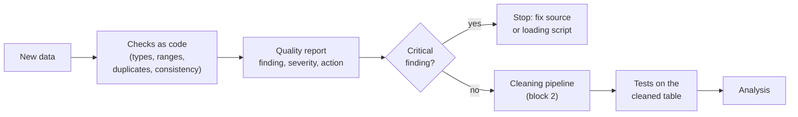
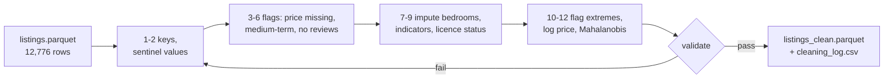

# Session 4 · Data quality and preparation

> **Guiding question.** Can we trust the data, and how do we prepare it for analysis?

**Learning outcomes.** After this session you are able to

- check data quality systematically and express the checks as code
- analyse missing values and choose an imputation method
- detect and treat outliers and apply suitable transformations, documenting each decision

## Why this session matters

In Session 3 you loaded the Berlin Airbnb listings, calendar and reviews into a database and queried them. Before any number from these tables is reported, we need to know whether the data can be trusted: prices stored as text, placeholder stays of two billion nights, duplicated listings and a third of the prices missing would all distort the result. This session turns those checks into code and tests, handles missing values and outliers, and ends with a cleaned table and a log of every cleaning decision. Sessions 5 and 6 analyse exactly that cleaned table, and your team project needs the same kind of documented decisions.

> This page is the teaching overview of the session. How to work with it (the ▶ links, the numbered notebooks, the extras) is explained once in the [course README](../../README.md#how-to-use-the-session-pages).

## Block 1 · Data quality checks and missing values

### Theory (45 min)

**Why.** A number computed from a table in which prices are text, some stays last three years and some listings appear twice is a number nobody can defend. Checks written as code can be rerun after every data update, and tests catch a change in the data at the moment it happens. Missing values are the most common data quality problem, and how to handle them depends on *why* they are missing: dropping rows or filling in the mean is harmless when values are missing completely at random and misleading otherwise. This block has two lecture notebooks: checks first, then missing values.



**Topics**

- **Dimensions of data quality.** Completeness, validity, uniqueness, consistency, accuracy and timeliness. Naming the dimension tells you how to look for a problem and what to do about it.
- **Checks for types, ranges, duplicates and consistency.** Each check returns a count of failing rows, which shows whether a problem is an exception or a pattern. This includes keys across tables and personal data typed into the registration field.
- **Validation rules as tests.** pytest tests and pandera schemas stop the pipeline when new data break a rule. The test file is the written contract for what "valid data" means.
- **Missing data mechanisms (MCAR, MAR, MNAR).** The mechanism decides which treatment is valid. The data cannot prove MCAR, but they can show that it is implausible.
- **Simple, KNN and iterative imputation.** Most scikit-learn models refuse missing values. An imputer that uses related columns can remove much of the bias that dropping rows introduces; an indicator keeps the fact that a value was missing.

▶ **Lectures:** [01-lecture-data-quality-checks.ipynb](workbooks/01-lecture-data-quality-checks.ipynb) (dimensions, checks, validation rules as tests), then [02-lecture-missing-values.ipynb](workbooks/02-lecture-missing-values.ipynb) (mechanisms and imputation)

▶ **Worked examples**

- [03-case-study-quality-report.ipynb](workbooks/03-case-study-quality-report.ipynb): a data quality report for the Berlin Airbnb listings (prices stored as text, placeholder values, impossible minimum stays, names in the registration field, listings of the same host, keys across tables). The same rules as pytest tests are in [quality/test_listings_quality.py](workbooks/quality/test_listings_quality.py).
- [04-case-study-airbnb-missing-and-outliers.ipynb](workbooks/04-case-study-airbnb-missing-and-outliers.ipynb), sections 1–3: is a missing price related to reviews or to availability, why the review score is missing by design, and three imputers compared on hidden bedroom counts.

### Exercises (30 min) and debrief (15 min)

▶ **Exercises:** [session-04-exercises.ipynb](workbooks/session-04-exercises.ipynb), part 1.

- **Parse ten messy prices** (Code, 15 min). Decide for ten price strings whether to fix, mark as missing or flag.
- **Sort the missingness cards** (Class, 10 min). Classify six scenarios as MCAR, MAR or MNAR.
- **What does mean imputation do?** (Predict, then Code, 10 min). Predict the effect on variance and correlation, then check it on the bedrooms of entire homes.
- **The same flat twice** (Code, 15 min). Find likely duplicates: same host, coordinates within about 20 metres, similar title.
- **Minimum stays in the calendar** (Code, 10 min). How often does the calendar's minimum stay differ from the listing's, and is that a contradiction?
- **Are beds and bathrooms missing at random?** (Code, 15 min). Profile the missing values by room type, availability and price, and decide whether to impute.

**Debrief.** Compare two price parsers and two missingness profiles. Look for the parser that turns `"80,50"` into 8,050 and for a claim of MCAR that rests on a single comparison.

## Block 2 · Outliers, transformations and a cleaning pipeline

### Theory (45 min)

**Why.** Extreme values change means, standard deviations and regression lines, but they are often also the interesting cases, so a flag is a question, not a verdict. Some observations are unusual only in the combination of their values, and univariate rules miss them. Many methods work better with roughly symmetric variables on similar scales, and transforming often turns "outliers" into ordinary tail values. Cleaning decisions change results, so they must be code that runs in one go and records every decision.



**Topics**

- **Univariate outliers (IQR rule, z-score, median absolute deviation).** Three rules to flag extreme values in one variable, so that data errors can be corrected and genuine extremes handled by the method. The z-score can be masked by the outliers it is meant to find.
- **Multivariate outliers with the Mahalanobis distance.** It measures distance from the centre while taking spread and correlation into account. The robust MCD version still works when a group of anomalies would otherwise stretch the ellipse. Model-based detection follows in Session 11.
- **Transformations (logarithm, Box–Cox, Yeo–Johnson, scaling).** They make skewed variables more symmetric and bring variables to a common scale, which linear regression (Session 6), distance-based methods and PCA (Session 11) need.
- **A documented cleaning pipeline.** All decisions combined into one script that writes a log of every step, so that results can be reproduced, reviewed and defended.

▶ **Lecture:** [05-lecture-outliers-transformations-pipeline.ipynb](workbooks/05-lecture-outliers-transformations-pipeline.ipynb)

▶ **Worked examples**

- [04-case-study-airbnb-missing-and-outliers.ipynb](workbooks/04-case-study-airbnb-missing-and-outliers.ipynb), part B (section 4): the IQR, z and MAD rules on price and minimum stay; the medium-term listings as a separate population.
- [06-mahalanobis-and-robust-covariance.ipynb](workbooks/06-mahalanobis-and-robust-covariance.ipynb): classical versus robust (MCD) Mahalanobis distances.
- [07-case-study-airbnb-cleaned-listings.ipynb](workbooks/07-case-study-airbnb-cleaned-listings.ipynb): the cleaned table of Berlin listings that Sessions 5 and 6 analyse, with a log of every cleaning decision. Afterwards the tests in [quality/test_listings_quality.py](workbooks/quality/test_listings_quality.py) on the cleaned table must pass.

### Exercises (30 min) and debrief (15 min)

▶ **Exercises:** [session-04-exercises.ipynb](workbooks/session-04-exercises.ipynb), part 2.

- **The z-score that can never fire** (Paper, 10 min). Ten prices, one of them extreme: can its z-score exceed 3?
- **`log(0)`** (Predict, 3 min). What happens to free listings when the price is log-transformed?
- **The last digit of prices** (Predict, then Code, 10 min). How often should a price end in 0, 5 or 9?
- **How many reviews per month is too many?** (Code, 15 min). The three univariate rules on `reviews_per_month`, raw and after `log1p`; errors or genuine values?
- **An unusual price for the location** (Code, 15 min). Classical and robust Mahalanobis distance on log price and log distance to the centre for entire homes.
- **One more step for the cleaning pipeline** (Code, 15 min, stretch). A logged step that flags listings with more bedrooms than guests.

**Debrief.** Compare the flag rates of two pairs on the raw and the log scale. Look for a solution that deletes every flagged row instead of inspecting it, and for a robust distance computed on unscaled, skewed variables.

## Team project until the next session

Data quality report of the decisions and project charter: use of the suggestions, metric, baseline, validation by time, inputs that may not be used.

## Extras (optional, self-study)

| Notebook | Content | Block |
|---|---|---|
| [extras/01-data-cleaning-missing-and-duplicates.ipynb](workbooks/extras/01-data-cleaning-missing-and-duplicates.ipynb) | Microsoft Data Science for Beginners: missing values and duplicates in pandas. The first `.sum()` error is intended: it shows that `None` cannot be summed | 1 |
| [extras/02-try-pandera.ipynb](workbooks/extras/02-try-pandera.ipynb) | pandera: schemas, runtime validation and failure cases | 1 |
| [extras/03-missing-values-in-pandas.ipynb](workbooks/extras/03-missing-values-in-pandas.ipynb) | Python Data Science Handbook: `None` and `NaN`, `isnull`, `dropna`, `fillna`. With pandas 3, the three cells with `fillna(method=...)` fail; write `data.ffill()` and `data.bfill()` when you run them; the file itself must stay unchanged (licence ND). The first `.sum()` error is intended | 1 |
| [extras/04-imputation-methods-compared.ipynb](workbooks/extras/04-imputation-methods-compared.ipynb) | scikit-learn: zero, mean, KNN and iterative imputation compared | 1 |
| [extras/05-iterative-imputer-variants.ipynb](workbooks/extras/05-iterative-imputer-variants.ipynb) | scikit-learn: IterativeImputer with different estimators | 1 |
| [extras/06-distributions-and-outliers.ipynb](workbooks/extras/06-distributions-and-outliers.ipynb) | Think Stats ch. 2: distributions, spotting outliers. Needs `empiricaldist` and `statadict` | 2 |
| [extras/07-scalers-and-transformers.ipynb](workbooks/extras/07-scalers-and-transformers.ipynb) | scikit-learn: all scalers and transformers on data with outliers | 2 |
| [extras/08-box-cox-and-yeo-johnson.ipynb](workbooks/extras/08-box-cox-and-yeo-johnson.ipynb) | scikit-learn: Box–Cox, Yeo–Johnson and quantile transformation | 2 |
| [extras/09-transforming-the-target.ipynb](workbooks/extras/09-transforming-the-target.ipynb) | scikit-learn: transforming the target of a regression | 2 |
| [extras/10-why-scaling-matters.ipynb](workbooks/extras/10-why-scaling-matters.ipynb) | scikit-learn: effect of scaling on k-nearest neighbours and PCA | 2 |

## Before the session and further reading

**Before.** Prepare the Airbnb data with `uv run python case-study/prepare_airbnb.py` (downloads about 100 MB once and keeps the raw files in `case-study/data/raw/airbnb/`, which section 6 of [03-case-study-quality-report.ipynb](workbooks/03-case-study-quality-report.ipynb) reads; see [case-study/README.md](../../case-study/README.md)). Read the [pandas user guide on missing data](https://pandas.pydata.org/docs/user_guide/missing_data.html) (about 20 minutes). Look at the data quality findings you noticed in Session 3 and bring them along.

**Further reading (optional)**

- van Buuren, S. (2018). *Flexible Imputation of Missing Data*, chapters 1–2: mechanisms and why simple fixes fail. https://stefvanbuuren.name/fimd/
- scikit-learn: *Imputation of missing values* and *Preprocessing data*. https://scikit-learn.org/stable/modules/impute.html, https://scikit-learn.org/stable/modules/preprocessing.html
- NIST/SEMATECH *e-Handbook of Statistical Methods*: *Detection of outliers*. https://www.itl.nist.gov/div898/handbook/eda/section3/eda35h.htm
- Kuhn, M. & Johnson, K. (2019). *Feature Engineering and Selection*, chapters 6 and 8. https://feat.engineering/

## Setup

The lecture notebooks, the case-study notebooks and the tests run in the course environment from the repository root (`uv sync`, then `uv run jupyter lab`); pandera is part of it. Data for the case studies:

```bash
uv run python case-study/prepare_airbnb.py    # Inside Airbnb Berlin (workbooks 03, 04 and 07)
```

Extra packages for one extra:

```bash
uv run --with empiricaldist --with statadict jupyter lab
# empiricaldist, statadict: extras/06
```

Run the validation tests from the repository root:

```bash
uv run --with pytest pytest sessions/04-data-quality/workbooks/quality -v
```

Before workbook 07 has been run, the tests on the cleaned table are skipped; afterwards they must pass. Workbook 07 writes `case-study/data/airbnb/listings_clean.parquet` and `cleaning_log.csv` next to it (small; not part of the repository); set `AIRBNB_CLEAN_OUT=/some/path/listings_clean.parquet` to write elsewhere (the tests read the same variable).

To regenerate the figures of the lecture notebooks, run `uv run python sessions/04-data-quality/figures/make_figures.py`.

## Sources and licences

Keep the attribution when you reuse or share a file. Course-written material is licensed CC BY 4.0. Third-party notebooks keep their original licence; "ND" means the file must be shared unchanged, and "NC" means non-commercial use only.

**Course material (CC BY 4.0, course team)**

| File | Content |
|---|---|
| [01-lecture-data-quality-checks.ipynb](workbooks/01-lecture-data-quality-checks.ipynb), [02-lecture-missing-values.ipynb](workbooks/02-lecture-missing-values.ipynb), [05-lecture-outliers-transformations-pipeline.ipynb](workbooks/05-lecture-outliers-transformations-pipeline.ipynb) | Lecture notebooks: dimensions of data quality, checks for types/ranges/duplicates/consistency, validation rules as tests; MCAR/MAR/MNAR, simple/KNN/iterative imputation (block 1); IQR/z-score/MAD, Mahalanobis distance (classical and MCD), log/Box–Cox/Yeo–Johnson/scaling, documented cleaning pipeline (block 2) |
| [figures/make_figures.py](figures/make_figures.py) and its PNGs (`missingness-pattern.png`, `univariate-outliers.png`, `box-cox-before-after.png` from the Inside Airbnb Berlin listings; `mahalanobis-ellipses.png` simulated) | Figures of the lecture notebooks |
| [03-case-study-quality-report.ipynb](workbooks/03-case-study-quality-report.ipynb) | Worked example, block 1 (Inside Airbnb Berlin): data quality report for listings, calendar and monthly reviews (completeness and empty columns, placeholders, impossible stays, listings of the same host, foreign keys across tables, prices as text and names in the registration field of the raw file, counted without being shown); checks as code; pandera schema |
| [quality/test_listings_quality.py](workbooks/quality/test_listings_quality.py) | Validation rules as pytest tests (prepared tables, privacy rule for the registration field, known problems as `xfail`, cleaned table of workbook 07) |
| [04-case-study-airbnb-missing-and-outliers.ipynb](workbooks/04-case-study-airbnb-missing-and-outliers.ipynb) | Worked example, blocks 1 and 2 (Inside Airbnb Berlin): missing prices vs recent reviews and availability, chi-square test, missingness model; structural missingness of review scores; imputation of bedrooms compared on hidden values; IQR/z/MAD on price and minimum stay; medium-term listings; sentinel values |
| [07-case-study-airbnb-cleaned-listings.ipynb](workbooks/07-case-study-airbnb-cleaned-listings.ipynb) | Worked example, block 2 (Inside Airbnb Berlin): cleaning pipeline with a log (sentinel values, price and availability indicators, medium-term flag, bedrooms imputed, licence status without the raw text, extreme-price and robust Mahalanobis flags), validation and export |
| [session-04-exercises.ipynb](workbooks/session-04-exercises.ipynb) | Exercises of both blocks (hand-outs and starter code) |

**Third-party notebooks**

| File | Source | Licence | Downloaded | Changes |
|---|---|---|---|---|
| [06-mahalanobis-and-robust-covariance.ipynb](workbooks/06-mahalanobis-and-robust-covariance.ipynb) | [scikit-learn example gallery 1.9](https://raw.githubusercontent.com/scikit-learn/scikit-learn.github.io/main/1.9/_downloads/83d33d2afcbf708f386433bb1abb0785/plot_mahalanobis_distances.ipynb) | [BSD-3-Clause](https://github.com/scikit-learn/scikit-learn/blob/main/COPYING) | 2026-09-26 | Renamed from `plot_mahalanobis_distances.ipynb`; content unchanged |
| [extras/01-data-cleaning-missing-and-duplicates.ipynb](workbooks/extras/01-data-cleaning-missing-and-duplicates.ipynb) | [microsoft/Data-Science-For-Beginners](https://raw.githubusercontent.com/microsoft/Data-Science-For-Beginners/main/2-Working-With-Data/08-data-preparation/notebook.ipynb) | [MIT](https://github.com/microsoft/Data-Science-For-Beginners/blob/main/LICENSE) | 2026-09-26 | Renamed from `notebook.ipynb` (lesson 08, data preparation). 2026-10-01: `fillna(method='ffill')` / `fillna(method='bfill')` (removed in pandas 3) replaced by `ffill()` / `bfill()` in 3 code cells and 1 code comment. The cell `example1.sum()` raises a `TypeError` on purpose |
| [extras/02-try-pandera.ipynb](workbooks/extras/02-try-pandera.ipynb) | [unionai-oss/pandera, docs/source/notebooks](https://raw.githubusercontent.com/unionai-oss/pandera/main/docs/source/notebooks/try_pandera.ipynb) | [MIT](https://github.com/unionai-oss/pandera/blob/main/LICENSE.txt) | 2026-10-01 | Renamed from `try_pandera.ipynb`; content unchanged |
| [extras/03-missing-values-in-pandas.ipynb](workbooks/extras/03-missing-values-in-pandas.ipynb) | [jakevdp/PythonDataScienceHandbook](https://raw.githubusercontent.com/jakevdp/PythonDataScienceHandbook/master/notebooks/03.04-Missing-Values.ipynb) | [MIT (code)](https://github.com/jakevdp/PythonDataScienceHandbook/blob/master/LICENSE-CODE) / [CC-BY-NC-ND 3.0 (text)](https://github.com/jakevdp/PythonDataScienceHandbook/blob/master/LICENSE-TEXT) **NC, ND** | 2026-09-26 | Renamed from `03.04-Missing-Values.ipynb`; content unchanged (ND: the text licence does not allow changes). With pandas 3, the three `fillna(method=...)` cells fail; use `ffill()` / `bfill()` instead. `vals1.sum()` raises a `TypeError` on purpose |
| [extras/04-imputation-methods-compared.ipynb](workbooks/extras/04-imputation-methods-compared.ipynb) | [scikit-learn example gallery 1.9](https://raw.githubusercontent.com/scikit-learn/scikit-learn.github.io/main/1.9/_downloads/a440a8b10138c855100ed5820fdb36b6/plot_missing_values.ipynb) | [BSD-3-Clause](https://github.com/scikit-learn/scikit-learn/blob/main/COPYING) | 2026-09-26 | Renamed from `plot_missing_values.ipynb`; content unchanged |
| [extras/05-iterative-imputer-variants.ipynb](workbooks/extras/05-iterative-imputer-variants.ipynb) | [scikit-learn example gallery 1.9](https://raw.githubusercontent.com/scikit-learn/scikit-learn.github.io/main/1.9/_downloads/067cd5d39b097d2c49dd98f563dac13a/plot_iterative_imputer_variants_comparison.ipynb) | [BSD-3-Clause](https://github.com/scikit-learn/scikit-learn/blob/main/COPYING) | 2026-09-26 | Renamed from `plot_iterative_imputer_variants_comparison.ipynb`; content unchanged |
| [extras/06-distributions-and-outliers.ipynb](workbooks/extras/06-distributions-and-outliers.ipynb) | [AllenDowney/ThinkStats (3e)](https://raw.githubusercontent.com/AllenDowney/ThinkStats/v3/nb/chap02.ipynb) | [MIT (code) / CC-BY-NC-SA 4.0 (text)](https://github.com/AllenDowney/ThinkStats/blob/v3/LICENSE) **NC** | 2026-09-26 | Renamed from `chap02.ipynb`; content unchanged. Downloads its data and helper modules on first run; needs `empiricaldist` and `statadict` |
| [extras/07-scalers-and-transformers.ipynb](workbooks/extras/07-scalers-and-transformers.ipynb) | [scikit-learn example gallery 1.9](https://raw.githubusercontent.com/scikit-learn/scikit-learn.github.io/main/1.9/_downloads/e60e99adef360baabc49b925646a39d9/plot_all_scaling.ipynb) | [BSD-3-Clause](https://github.com/scikit-learn/scikit-learn/blob/main/COPYING) | 2026-09-26 | Renamed from `plot_all_scaling.ipynb`; content unchanged |
| [extras/08-box-cox-and-yeo-johnson.ipynb](workbooks/extras/08-box-cox-and-yeo-johnson.ipynb) | [scikit-learn example gallery 1.9](https://raw.githubusercontent.com/scikit-learn/scikit-learn.github.io/main/1.9/_downloads/fc26dc0b9d906466315a49a860435409/plot_map_data_to_normal.ipynb) | [BSD-3-Clause](https://github.com/scikit-learn/scikit-learn/blob/main/COPYING) | 2026-09-26 | Renamed from `plot_map_data_to_normal.ipynb`; content unchanged |
| [extras/09-transforming-the-target.ipynb](workbooks/extras/09-transforming-the-target.ipynb) | [scikit-learn example gallery 1.9](https://raw.githubusercontent.com/scikit-learn/scikit-learn.github.io/main/1.9/_downloads/ea57d7ab1588de8f5bd1afc68f20de2f/plot_transformed_target.ipynb) | [BSD-3-Clause](https://github.com/scikit-learn/scikit-learn/blob/main/COPYING) | 2026-09-26 | Renamed from `plot_transformed_target.ipynb`; content unchanged |
| [extras/10-why-scaling-matters.ipynb](workbooks/extras/10-why-scaling-matters.ipynb) | [scikit-learn example gallery 1.9](https://raw.githubusercontent.com/scikit-learn/scikit-learn.github.io/main/1.9/_downloads/c9688d36cfbf43a68f3613b58110ceaa/plot_scaling_importance.ipynb) | [BSD-3-Clause](https://github.com/scikit-learn/scikit-learn/blob/main/COPYING) | 2026-09-26 | Renamed from `plot_scaling_importance.ipynb`; content unchanged |

**Case-study data.** Inside Airbnb (2026), *Berlin, Germany*, snapshot of 26 June 2026, CC BY 4.0, in `case-study/data/airbnb/` and its raw files in `case-study/data/raw/airbnb/` (workbooks 03, 04 and 07), prepared with `case-study/prepare_airbnb.py`. The data are not stored in this folder. The Airbnb data come from public listing pages; the materials report them in aggregate and never name hosts.

<details>
<summary><b>References cited in the lecture notebooks</b></summary>

- Bantilan, N. (2020). pandera: Statistical data validation of pandas dataframes. *Proceedings of the 19th Python in Science Conference*, 116–124.
- Box, G. E. P., & Cox, D. R. (1964). An analysis of transformations. *Journal of the Royal Statistical Society: Series B*, 26(2), 211–252.
- Breck, E., Polyzotis, N., Roy, S., Whang, S. E., & Zinkevich, M. (2019). Data validation for machine learning. *MLSys 2019*.
- Downey, A. B. *Think Stats* (3rd ed.). O'Reilly. https://allendowney.github.io/ThinkStats/
- European Medicines Agency (2010). *Guideline on missing data in confirmatory clinical trials* (EMA/CPMP/EWP/1776/99 Rev. 1).
- Herndon, T., Ash, M., & Pollin, R. (2014). Does high public debt consistently stifle economic growth? A critique of Reinhart and Rogoff. *Cambridge Journal of Economics*, 38(2), 257–279.
- Iglewicz, B., & Hoaglin, D. C. (1993). *How to Detect and Handle Outliers*. ASQC Quality Press.
- Inside Airbnb (2026). *Berlin, Germany*, snapshot of 26 June 2026 (listings, calendar, reviews). CC BY 4.0 (course dataset; personal data removed by `case-study/prepare_airbnb.py`). https://insideairbnb.com/get-the-data/
- Inside Airbnb. *Data assumptions*. https://insideairbnb.com/data-assumptions/
- ISO/IEC 25012:2008. *Software engineering — Software product Quality Requirements and Evaluation (SQuaRE) — Data quality model*.
- Kuhn, M., & Johnson, K. (2019). *Feature Engineering and Selection*. CRC Press. https://feat.engineering/
- NIST/SEMATECH. *e-Handbook of Statistical Methods*. https://www.itl.nist.gov/div898/handbook/
- Regulation (EU) 2016/679 (General Data Protection Regulation), Article 5(1)(c): data minimisation. https://eur-lex.europa.eu/eli/reg/2016/679/oj
- Regulation (EU) 2024/1028 of the European Parliament and of the Council of 11 April 2024 on data collection and sharing relating to short-term accommodation rental services. https://eur-lex.europa.eu/eli/reg/2024/1028/oj
- Rousseeuw, P. J. (1984). Least median of squares regression. *Journal of the American Statistical Association*, 79(388), 871–880.
- Rousseeuw, P. J., & Van Driessen, K. (1999). A fast algorithm for the minimum covariance determinant estimator. *Technometrics*, 41(3), 212–223. https://doi.org/10.1080/00401706.1999.10485670
- Rubin, D. B. (1976). Inference and missing data. *Biometrika*, 63(3), 581–592. https://doi.org/10.1093/biomet/63.3.581
- Schelter, S., Lange, D., Schmidt, P., Celikel, M., Biessmann, F., & Grafberger, A. (2018). Automating large-scale data quality verification. *PVLDB*, 11(12), 1781–1794.
- Sterne, J. A. C., White, I. R., Carlin, J. B., et al. (2009). Multiple imputation for missing data in epidemiological and clinical research: potential and pitfalls. *BMJ*, 338, b2393. https://doi.org/10.1136/bmj.b2393
- van Buuren, S. (2018). *Flexible Imputation of Missing Data* (2nd ed.). Chapman & Hall/CRC. https://stefvanbuuren.name/fimd/
- VanderPlas, J. (2016). *Python Data Science Handbook*. O'Reilly. https://jakevdp.github.io/PythonDataScienceHandbook/
- Yeo, I.-K., & Johnson, R. A. (2000). A new family of power transformations to improve normality or symmetry. *Biometrika*, 87(4), 954–959. https://doi.org/10.1093/biomet/87.4.954

</details>
