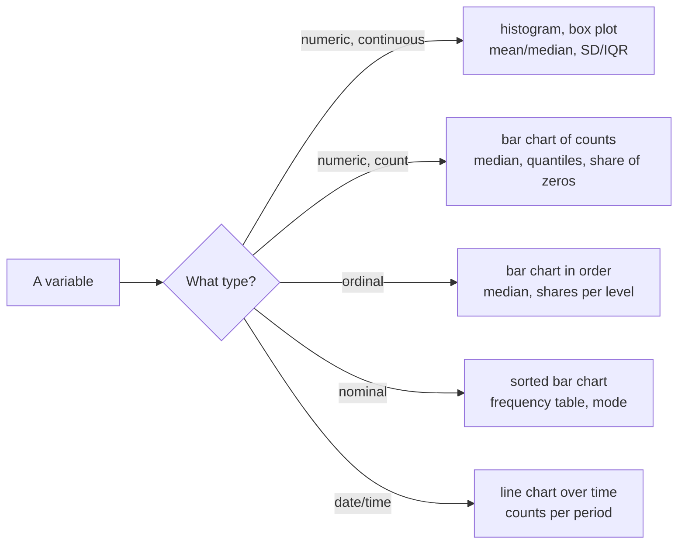
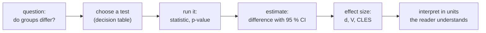

# Session 5 · Exploratory analysis and statistics recap

> **Guiding question.** What is in the data, which differences and relationships are real, and how do we show them?

**Learning outcomes.** After this session you are able to

- describe data by variable type with descriptive statistics and well-designed charts
- apply statistical tests and contingency tables in Python and report confidence intervals and effect sizes
- compute and interpret correlations as the starting point for regression

## Why this session matters

In Session 4 you produced a cleaned table of Berlin Airbnb listings. This session takes the first look at what is in it: which values occur, which differences between groups are real rather than noise, and which variables move together. It recaps the statistics of your first-semester module as tools to choose, run and interpret in Python, and adds chart design, effect sizes, A/B tests, confounding and communicating a finding. The regression line at the end is the bridge to Session 6, where the same listings feed the first machine learning model.

> This page is the teaching overview of the session. How to work with it (the ▶ links, the numbered notebooks, the extras) is explained once in the [course README](../../README.md#how-to-use-the-session-pages).

**Notes for this session**

- Block 1 has three short lecture notebooks: describing data, chart design and relationships between variables.
- The Streamlit dashboard [dashboard_app.py](workbooks/dashboard_app.py) is a Python script, not a notebook. Start it from the repository root with `uv run streamlit run sessions/05-eda-and-statistics/workbooks/dashboard_app.py`.

## Block 1 · Exploring data: distributions, charts and relationships

### Theory (45 min)

**Why.** Exploratory data analysis is the first look at a dataset before any test or model. The type of a variable decides which summaries and charts make sense, and very different datasets can share the same mean and standard deviation. A chart is an argument made with position, length and colour: one that fits the question makes the answer visible in seconds. A correlation summarises a scatter plot in one number, and a third variable can create, hide or reverse a relationship, so before acting on one we ask what else differs between the groups.



**Topics**

- **Variable types.** Software computes a mean for any column of numbers, including IDs and postal codes. The type tells you whether the result means anything and which test you choose later.
- **Distributions, centre and spread.** A histogram shows what summaries hide: impossible values, gaps, spikes at default values or a second population.
- **Robust summaries and frequency tables.** Median, IQR and quantiles describe skewed data without being pulled by a few extreme prices. Shares make groups comparable; counts show what a share rests on.
- **Choosing a chart and perception.** The question decides the chart type, and some visual encodings (position, length) are read more accurately than others (angle, area, colour).
- **matplotlib, seaborn and Plotly; colour and accessibility.** Full control with labels and annotation, statistical plots and small multiples from a DataFrame, interactive charts for exploration and dashboards, and palettes that readers with a colour vision deficiency can decode.
- **Scatter plots, Pearson and Spearman correlation.** Without the plot you cannot tell whether a correlation describes a straight line, a curve or two outliers; choosing the wrong coefficient can make a clear relationship look weak.
- **Confounding and Simpson's paradox.** A third variable behind a relationship is the reason randomised experiments exist and the reason regression adds control variables.

▶ **Lectures:** [01-lecture-describing-data.ipynb](workbooks/01-lecture-describing-data.ipynb), [02-lecture-chart-design.ipynb](workbooks/02-lecture-chart-design.ipynb), then [03-lecture-relationships.ipynb](workbooks/03-lecture-relationships.ipynb)

▶ **Worked examples**

- [04-case-study-airbnb-exploration.ipynb](workbooks/04-case-study-airbnb-exploration.ipynb), part A and sections 3.1–3.2 of part C: what does a night in Berlin cost, and where (price by room type and district, reviews per month since 2015); price against the number of guests; a €10 district gap that vanishes within each type of stay.
- [05-matplotlib-quick-start.ipynb](workbooks/05-matplotlib-quick-start.ipynb): Figures, Axes, labels and the object-oriented interface of matplotlib.

### Exercises (30 min) and debrief (15 min)

▶ **Exercises:** [session-05-exercises.ipynb](workbooks/session-05-exercises.ipynb), part 1.

- **Mean of means** (Predict, 5 min). Is the average of the district averages the average of all listings?
- **Fix the ugliest chart** (Paper, 10 min). Redraw a bar chart with a truncated axis and a pie chart with twelve slices.
- **Build Simpson's paradox yourself** (Paper, 15 min). Eight invented listings where district A is cheaper for every room type but more expensive overall.
- **Correlation zero, perfect relationship** (Code, 5 min). Correlate x with x² for x = −3, …, 3.
- **How full is the calendar?** (Code, 15 min). Describe `availability_365` by room type with a fitting chart and robust summaries.
- **Does the price fall with the distance to the centre?** (Code, 15 min). Scatter plot, Pearson and Spearman, overall and within room types; possible confounders.

**Debrief.** Compare two redrawn charts and two descriptions of the availability. Look for a mean reported for a variable with spikes at 0 and 365, and for a correlation interpreted as an effect of distance.

## Block 2 · Testing differences and communicating findings

### Theory (45 min)

**Why.** Many analytical questions compare groups: do entire homes cost more than private rooms, do hosts with several listings fill in their registration details more often, does a new listing page lead to more bookings? With thousands of listings almost any difference becomes "significant", so every test result is reported with a confidence interval and an effect size. The regression line turns "these variables move together" into "how much y changes per unit of x", the bridge to Session 6. Most analyses reach decision makers as one chart and a few sentences, and a finding that is correct but not understood has no effect.



**Topics**

- **The logic of a test.** What a p-value answers and what it does not, and why estimates with intervals are asked for instead of "significant / not significant".
- **t-test and Mann–Whitney test with confidence intervals and effect sizes.** Two tests for numeric outcomes that answer slightly different questions; running both is a robustness check.
- **Contingency tables, chi-square test and Cramér's V.** Most business, health and social data are categorical, and a 2 × 2 table is exactly the shape of an A/B test on a conversion rate.
- **A/B tests as an application.** Experiments are where data roles use statistics most often. Peeking and a sample-ratio mismatch are two common errors that invalidate results.
- **Choosing a test from a decision table.** A wrong test can give a wrong answer; a decision table makes the choice explicit and reviewable.
- **From correlation to the regression line.** The slope in units of y per unit of x, R² = r² in simple regression, and the step to Session 6.
- **Communicating findings: a short report or a Streamlit dashboard.** A one-page finding for a non-technical reader (finding, number, meaning, limitation), or a dashboard that avoids repeated one-off requests.

▶ **Lecture:** [06-lecture-testing-and-communicating.ipynb](workbooks/06-lecture-testing-and-communicating.ipynb)

▶ **Worked examples**

- [04-case-study-airbnb-exploration.ipynb](workbooks/04-case-study-airbnb-exploration.ipynb), part B and section 3.3: entire home vs private room, Mitte vs Neukölln and superhost comparisons (Welch, Mann–Whitney, CI, Cohen's d, CLES); multi-listing host × licence entry and district × room type (chi-square, Cramér's V); a simulated A/B test of a listing page; a one-page finding.
- [07-hypothesis-testing.ipynb](workbooks/07-hypothesis-testing.ipynb): hypothesis testing and t-tests on NHANES data, and simulated p-values.
- [08-contingency-tables-and-chi-square.ipynb](workbooks/08-contingency-tables-and-chi-square.ipynb): chi-square, Fisher's exact test, McNemar and Cochran's Q.
- [dashboard_app.py](workbooks/dashboard_app.py): a Streamlit dashboard of short-stay prices and listings by district, with exercises in its docstring.

### Exercises (30 min) and debrief (15 min)

▶ **Exercises:** [session-05-exercises.ipynb](workbooks/session-05-exercises.ipynb), part 2.

- **The p-hacking machine** (Code, 10 min). Run 20 t-tests on pure random noise and count the "significant" ones.
- **The German tank problem** (Paper, 10 min). Estimate N from five numbers drawn from a hat.
- **Is a registration number worth money?** (Code, 15 min). Entire homes with a registration number vs those with a company name in the field: tests, CI, d and CLES, one sentence for an analyst.
- **Licence entries by room type** (Code, 10 min). Room type × licence status: chi-square, Cramér's V and a check of the expected counts.
- **Plan and check an A/B test** (Code, 10 min). Sample size for a rise from 10 % to 10.5 %, and a 50,600 to 49,400 split.
- **A one-page finding or a dashboard** (Pairs, 20 min, stretch). Write the four-part finding for one result, or extend [dashboard_app.py](workbooks/dashboard_app.py).

**Debrief.** Compare two reports of the registration comparison. Look for a causal reading ("registering lowers the price") and for a chi-square test reported without its effect size or with cells whose expected count is below 5.

## Team project until the next session

Exploratory findings: decisions per heading, language, member state and year, and the long tail of rare headings, presented in a short team review.

## Extras (optional, self-study)

| Notebook | Content | Block |
|---|---|---|
| [extras/01-exploratory-data-analysis.ipynb](workbooks/extras/01-exploratory-data-analysis.ipynb) | Think Stats ch. 1, a first look at a dataset. Needs `empiricaldist` and `statadict` (installed by the notebook) | 1 |
| [extras/02-descriptive-statistics-and-t-test.ipynb](workbooks/extras/02-descriptive-statistics-and-t-test.ipynb) | Descriptive statistics, confidence intervals and a t-test on baseball players (the t-test part belongs to block 2). Reads `data/SOCR_MLB.tsv` next to it | 1–2 |
| [extras/03-seaborn-distributions.ipynb](workbooks/extras/03-seaborn-distributions.ipynb) | Histograms, KDE and ECDF with seaborn | 1 |
| [extras/04-seaborn-categorical.ipynb](workbooks/extras/04-seaborn-categorical.ipynb) | Box, violin, bar and point plots by category | 1 |
| [extras/05-seaborn-color-palettes.ipynb](workbooks/extras/05-seaborn-color-palettes.ipynb) | Qualitative, sequential and diverging palettes | 1 |
| [extras/06-matplotlib-colormaps.ipynb](workbooks/extras/06-matplotlib-colormaps.ipynb) | Choosing colour maps; perceptual uniformity; greyscale. Needs `colorspacious` | 1 |
| [extras/07-plotly-express.ipynb](workbooks/extras/07-plotly-express.ipynb) | A gallery of interactive charts with Plotly Express. One image cell needs `scikit-image` | 1 |
| [extras/08-plotly-express-styling.ipynb](workbooks/extras/08-plotly-express-styling.ipynb) | Labels, colours, templates and hover text in Plotly | 1 |
| [extras/09-correlation.ipynb](workbooks/extras/09-correlation.ipynb) | Think Stats ch. 7, scatter plots, Pearson, Spearman and causation | 1 |
| [extras/10-correlation-and-simple-regression.ipynb](workbooks/extras/10-correlation-and-simple-regression.ipynb) | Pearson, Spearman, Kendall and simple regression | 1–2 |
| [extras/11-hypothesis-testing-by-simulation.ipynb](workbooks/extras/11-hypothesis-testing-by-simulation.ipynb) | Think Stats ch. 9, permutation tests and "there is only one test" | 2 |
| [extras/12-one-way-anova.ipynb](workbooks/extras/12-one-way-anova.ipynb) | Levene test and one-way ANOVA (three or more groups) | 2 |
| [extras/13-categorical-relationships.ipynb](workbooks/extras/13-categorical-relationships.ipynb) | Chi-square tests on NHANES data. Needs `nhanes` (installed by the notebook) | 2 |
| [extras/14-seaborn-regression.ipynb](workbooks/extras/14-seaborn-regression.ipynb) | `regplot`, `lmplot`, residual plots in seaborn | 2 |

## Before the session and further reading

**Before.** Revise mean, median, standard deviation, confidence interval and p-value from your first-semester statistics module. Prepare the Airbnb data once with `uv run python case-study/prepare_airbnb.py` (downloads about 100 MB) and run the first two cells of [04-case-study-airbnb-exploration.ipynb](workbooks/04-case-study-airbnb-exploration.ipynb) to check that the data load. Optional: read chapter 1 of Healy, *Data Visualization* (link below).

**Further reading (optional, free)**

- Wilke, C. O. (2019). *Fundamentals of Data Visualization*. https://clauswilke.com/dataviz/
- Downey, A. B. (2025). *Think Stats* (3rd ed.). https://allendowney.github.io/ThinkStats/
- Poldrack, R. A. (2023). *Statistical Thinking for the 21st Century* (Python companion). https://statsthinking21.github.io/statsthinking21-python/
- Healy, K. (2018). *Data Visualization: A Practical Introduction*, chapter 1. https://socviz.co/lookatdata.html
- Streamlit documentation: *Get started*. https://docs.streamlit.io/get-started/tutorials

## Setup

The course environment (root `pyproject.toml`) contains everything needed for the lecture notebooks, the case study and the dashboard: pandas, pyarrow, matplotlib, seaborn, plotly, scipy, statsmodels, streamlit. From the repository root:

```bash
uv run python case-study/prepare_airbnb.py   # Inside Airbnb Berlin, once (case study, figures, dashboard)
uv run jupyter lab                       # notebooks
uv run streamlit run sessions/05-eda-and-statistics/workbooks/dashboard_app.py   # dashboard
uv run python sessions/05-eda-and-statistics/figures/make_figures.py            # regenerate figures
```

Additional packages for single third-party notebooks (the notebooks install some of them themselves with `%pip install`):

| Notebook | Extra packages |
|---|---|
| extras/01, 09, 11 (Think Stats) | `empiricaldist`, `statadict` (installed by the notebook); data downloaded on first use |
| extras/06 (colour maps) | `colorspacious` |
| extras/07 (Plotly Express), one image cell | `scikit-image` |
| 07, extras/13 (statsthinking21) | `nhanes` (installed by the notebook); data downloaded on first use |

Example: `uv run --with colorspacious --with scikit-image --with empiricaldist --with statadict --with nhanes jupyter lab`. The seaborn tutorials download their example datasets from the internet on first use. The extras notebook 02 reads `data/SOCR_MLB.tsv` relative to `workbooks/extras/`.

## Sources and licences

Keep the attribution when you reuse or share a file. Course-written material is licensed CC BY 4.0. Third-party notebooks keep their original licence; "NC" means non-commercial use only. The notebooks under CC-BY-NC (statsthinking21) and the Think Stats text (CC-BY-NC-SA) may be used for non-commercial teaching only; the Think Stats code is MIT.

**Course material (CC BY 4.0, course team)**

| File | Content |
|---|---|
| [01-lecture-describing-data.ipynb](workbooks/01-lecture-describing-data.ipynb), [02-lecture-chart-design.ipynb](workbooks/02-lecture-chart-design.ipynb), [03-lecture-relationships.ipynb](workbooks/03-lecture-relationships.ipynb), [06-lecture-testing-and-communicating.ipynb](workbooks/06-lecture-testing-and-communicating.ipynb) | Lecture notebooks (three for block 1, one for block 2) |
| [figures/make_figures.py](figures/make_figures.py) and its PNGs (`skewed-distribution.png`, `good-vs-poor-chart.png`, `simpsons-paradox.png`, `regression-line.png`) | Figures of the lecture notebooks |
| [04-case-study-airbnb-exploration.ipynb](workbooks/04-case-study-airbnb-exploration.ipynb) | Worked example of both blocks (Inside Airbnb Berlin): price distribution by room type and district, reviews per month, chart redesign, entire home vs private room, Mitte vs Neukölln and superhost comparisons (t-test/Mann–Whitney, CI, effect sizes), multi-listing host × licence entry and district × room type (chi-square, Cramér's V), simulated A/B test with sample-ratio check and peeking exercise, price vs guests, confounding by stay type, room type and size |
| [dashboard_app.py](workbooks/dashboard_app.py) | Streamlit dashboard of short-stay prices and listings by district (Inside Airbnb Berlin) |
| [session-05-exercises.ipynb](workbooks/session-05-exercises.ipynb) | Exercises of both blocks (hand-outs and starter code) |

**Third-party notebooks**

| File | Source | Licence | Downloaded | Changes |
|---|---|---|---|---|
| [05-matplotlib-quick-start.ipynb](workbooks/05-matplotlib-quick-start.ipynb) | [matplotlib documentation, Quick start guide](https://matplotlib.org/stable/_downloads/19637872c4a7dbe872e23f74038df260/quick_start.ipynb) | [Matplotlib License (PSF-style, BSD-compatible)](https://matplotlib.org/stable/project/license.html) | 2026-10-01 | Renamed from `quick_start.ipynb`; content unchanged |
| [07-hypothesis-testing.ipynb](workbooks/07-hypothesis-testing.ipynb) | [statsthinking21/statsthinking21-python](https://raw.githubusercontent.com/statsthinking21/statsthinking21-python/master/notebooks/08-HypothesisTesting.ipynb) | [CC-BY-NC-4.0](https://github.com/statsthinking21/statsthinking21-python/blob/master/LICENSE.md) **NC** | 2026-09-26 | Renamed from `08-HypothesisTesting.ipynb`; content unchanged |
| [08-contingency-tables-and-chi-square.ipynb](workbooks/08-contingency-tables-and-chi-square.ipynb) | [thomas-haslwanter/statsintro_python](https://raw.githubusercontent.com/thomas-haslwanter/statsintro_python/master/ipynb/9_testsCategorical.ipynb) | [CC-BY-SA-4.0](https://github.com/thomas-haslwanter/statsintro_python/blob/master/LICENSE.txt) | 2026-09-26 | Renamed from `9_testsCategorical.ipynb`; content unchanged |
| [extras/01-exploratory-data-analysis.ipynb](workbooks/extras/01-exploratory-data-analysis.ipynb) | [AllenDowney/ThinkStats (3e)](https://raw.githubusercontent.com/AllenDowney/ThinkStats/v3/nb/chap01.ipynb) | [MIT (code) / CC-BY-NC-SA 4.0 (text)](https://github.com/AllenDowney/ThinkStats/blob/v3/LICENSE) **NC** | 2026-09-26 | Renamed from `chap01.ipynb`; content unchanged |
| [extras/02-descriptive-statistics-and-t-test.ipynb](workbooks/extras/02-descriptive-statistics-and-t-test.ipynb) | [microsoft/Data-Science-For-Beginners](https://raw.githubusercontent.com/microsoft/Data-Science-For-Beginners/main/1-Introduction/04-stats-and-probability/notebook.ipynb) | [MIT](https://github.com/microsoft/Data-Science-For-Beginners/blob/main/LICENSE) | 2026-09-26 | Renamed from `notebook.ipynb` (lesson 04, statistics and probability); data path patched from `../../data/SOCR_MLB.tsv` to `data/SOCR_MLB.tsv` (2026-10-01); otherwise unchanged. Moved to `extras/` with its data folder (2026-10-11) |
| [extras/03-seaborn-distributions.ipynb](workbooks/extras/03-seaborn-distributions.ipynb) | [mwaskom/seaborn, doc/_tutorial](https://raw.githubusercontent.com/mwaskom/seaborn/master/doc/_tutorial/distributions.ipynb) | [BSD-3-Clause](https://github.com/mwaskom/seaborn/blob/master/LICENSE.md) | 2026-10-01 | Renamed from `distributions.ipynb`; content unchanged |
| [extras/04-seaborn-categorical.ipynb](workbooks/extras/04-seaborn-categorical.ipynb) | [mwaskom/seaborn, doc/_tutorial](https://raw.githubusercontent.com/mwaskom/seaborn/master/doc/_tutorial/categorical.ipynb) | [BSD-3-Clause](https://github.com/mwaskom/seaborn/blob/master/LICENSE.md) | 2026-10-01 | Renamed from `categorical.ipynb`; content unchanged |
| [extras/05-seaborn-color-palettes.ipynb](workbooks/extras/05-seaborn-color-palettes.ipynb) | [mwaskom/seaborn, doc/_tutorial](https://raw.githubusercontent.com/mwaskom/seaborn/master/doc/_tutorial/color_palettes.ipynb) | [BSD-3-Clause](https://github.com/mwaskom/seaborn/blob/master/LICENSE.md) | 2026-10-01 | Renamed from `color_palettes.ipynb`; content unchanged |
| [extras/06-matplotlib-colormaps.ipynb](workbooks/extras/06-matplotlib-colormaps.ipynb) | [matplotlib documentation, Choosing Colormaps](https://matplotlib.org/stable/_downloads/a58dec1c9a88487f9b1de45f0eb2443c/colormaps.ipynb) | [Matplotlib License (PSF-style, BSD-compatible)](https://matplotlib.org/stable/project/license.html) | 2026-10-01 | Renamed from `colormaps.ipynb`; content unchanged |
| [extras/07-plotly-express.ipynb](workbooks/extras/07-plotly-express.ipynb) | [plotly/plotly.py, doc/python/plotly-express.md](https://raw.githubusercontent.com/plotly/plotly.py/main/doc/python/plotly-express.md) | [MIT](https://github.com/plotly/plotly.py/blob/main/LICENSE.txt) | 2026-10-01 | Converted from Jupytext Markdown `plotly-express.md` to `.ipynb` with `jupytext --to ipynb` (format change only); content unchanged |
| [extras/08-plotly-express-styling.ipynb](workbooks/extras/08-plotly-express-styling.ipynb) | [plotly/plotly.py, doc/python/styling-plotly-express.md](https://raw.githubusercontent.com/plotly/plotly.py/main/doc/python/styling-plotly-express.md) | [MIT](https://github.com/plotly/plotly.py/blob/main/LICENSE.txt) | 2026-10-01 | Converted from Jupytext Markdown `styling-plotly-express.md` to `.ipynb` with `jupytext --to ipynb` (format change only); content unchanged |
| [extras/09-correlation.ipynb](workbooks/extras/09-correlation.ipynb) | [AllenDowney/ThinkStats (3e)](https://raw.githubusercontent.com/AllenDowney/ThinkStats/v3/nb/chap07.ipynb) | [MIT (code) / CC-BY-NC-SA 4.0 (text)](https://github.com/AllenDowney/ThinkStats/blob/v3/LICENSE) **NC** | 2026-09-26 | Renamed from `chap07.ipynb`; content unchanged |
| [extras/10-correlation-and-simple-regression.ipynb](workbooks/extras/10-correlation-and-simple-regression.ipynb) | [thomas-haslwanter/statsintro_python](https://raw.githubusercontent.com/thomas-haslwanter/statsintro_python/master/ipynb/11_correlationRegression.ipynb) | [CC-BY-SA-4.0](https://github.com/thomas-haslwanter/statsintro_python/blob/master/LICENSE.txt) | 2026-09-26 | Renamed from `11_correlationRegression.ipynb`; content unchanged |
| [extras/11-hypothesis-testing-by-simulation.ipynb](workbooks/extras/11-hypothesis-testing-by-simulation.ipynb) | [AllenDowney/ThinkStats (3e)](https://raw.githubusercontent.com/AllenDowney/ThinkStats/v3/nb/chap09.ipynb) | [MIT (code) / CC-BY-NC-SA 4.0 (text)](https://github.com/AllenDowney/ThinkStats/blob/v3/LICENSE) **NC** | 2026-09-26 | Renamed from `chap09.ipynb`; content unchanged |
| [extras/12-one-way-anova.ipynb](workbooks/extras/12-one-way-anova.ipynb) | [thomas-haslwanter/statsintro_python](https://raw.githubusercontent.com/thomas-haslwanter/statsintro_python/master/ipynb/8_anovaOneway.ipynb) | [CC-BY-SA-4.0](https://github.com/thomas-haslwanter/statsintro_python/blob/master/LICENSE.txt) | 2026-09-26 | Renamed from `8_anovaOneway.ipynb`; content unchanged |
| [extras/13-categorical-relationships.ipynb](workbooks/extras/13-categorical-relationships.ipynb) | [statsthinking21/statsthinking21-python](https://raw.githubusercontent.com/statsthinking21/statsthinking21-python/master/notebooks/11-ModelingCategoricalRelationships.ipynb) | [CC-BY-NC-4.0](https://github.com/statsthinking21/statsthinking21-python/blob/master/LICENSE.md) **NC** | 2026-09-26 | Renamed from `11-ModelingCategoricalRelationships.ipynb`; content unchanged |
| [extras/14-seaborn-regression.ipynb](workbooks/extras/14-seaborn-regression.ipynb) | [mwaskom/seaborn, doc/_tutorial](https://raw.githubusercontent.com/mwaskom/seaborn/master/doc/_tutorial/regression.ipynb) | [BSD-3-Clause](https://github.com/mwaskom/seaborn/blob/master/LICENSE.md) | 2026-10-01 | Renamed from `regression.ipynb`; content unchanged |

**Data used by the third-party notebooks**

| File | Used by | Source | Licence | Downloaded | Changes |
|---|---|---|---|---|---|
| [extras/data/SOCR_MLB.tsv](workbooks/extras/data/SOCR_MLB.tsv) | extras/02 (MLB heights and weights) | [microsoft/Data-Science-For-Beginners](https://github.com/microsoft/Data-Science-For-Beginners/tree/main/data); originally SOCR, UCLA | [MIT](https://github.com/microsoft/Data-Science-For-Beginners/blob/main/LICENSE) | 2026-09-26 | Unchanged |

**Figures and case-study data.** The figure `simpsons-paradox.png` uses the published Berkeley admission counts (Bickel et al., 1975; R dataset `UCBAdmissions`) in its left panel. All other figures and panels use the Inside Airbnb Berlin data (snapshot of 26 June 2026, CC BY 4.0, prepared with `case-study/prepare_airbnb.py`) or simulated data.

<details>
<summary><b>References cited in the lecture notebooks</b></summary>

- Bickel, P. J., Hammel, E. A., & O'Connell, J. W. (1975). Sex bias in graduate admissions: Data from Berkeley. *Science*, 187(4175), 398–404. https://doi.org/10.1126/science.187.4175.398
- Charig, C. R., Webb, D. R., Payne, S. R., & Wickham, J. E. (1986). Comparison of treatment of renal calculi by open surgery, percutaneous nephrolithotomy, and extracorporeal shockwave lithotripsy. *BMJ*, 292(6524), 879–882. https://doi.org/10.1136/bmj.292.6524.879
- Cleveland, W. S., & McGill, R. (1984). Graphical perception. *Journal of the American Statistical Association*, 79(387), 531–554. https://doi.org/10.1080/01621459.1984.10478080
- Downey, A. B. (2025). *Think Stats: Exploratory Data Analysis in Python* (3rd ed.). O'Reilly. https://allendowney.github.io/ThinkStats/
- Galton, F. (1886). Regression towards mediocrity in hereditary stature. *Journal of the Anthropological Institute*, 15, 246–263.
- Government Analysis Function (2023). *Data visualisation: charts*. https://analysisfunction.civilservice.gov.uk/policy-store/data-visualisation-charts/
- Haslwanter, T. (2022). *An Introduction to Statistics with Python* (2nd ed.). Springer. Code: https://github.com/thomas-haslwanter/statsintro_python
- Healy, K. (2018). *Data Visualization: A Practical Introduction*. Princeton University Press. https://socviz.co/
- Inside Airbnb (2026). *Berlin, Germany*, snapshot of 26 June 2026 (listings and reviews). CC BY 4.0 (second course dataset; personal data removed by `case-study/prepare_airbnb.py`). https://insideairbnb.com/get-the-data/
- Inside Airbnb. *Data assumptions*. https://insideairbnb.com/data-assumptions/
- Kohavi, R., Tang, D., & Xu, Y. (2020). *Trustworthy Online Controlled Experiments*. Cambridge University Press.
- Matejka, J., & Fitzmaurice, G. (2017). Same stats, different graphs. *Proceedings of CHI 2017*.
- Microsoft (2021). *Data Science for Beginners*. https://github.com/microsoft/Data-Science-For-Beginners
- Miller, E. (2010). *How not to run an A/B test*. https://www.evanmiller.org/how-not-to-run-an-ab-test.html
- Overgoor, J. (2014). *Experiments at Airbnb*. Airbnb Engineering & Data Science blog.
- Pearl, J., Glymour, M., & Jewell, N. P. (2016). *Causal Inference in Statistics: A Primer*. Wiley.
- Poldrack, R. A. (2023). *Statistical Thinking for the 21st Century*. https://statsthinking21.github.io/statsthinking21-core-site/
- Regulation (EU) 2024/1028 of the European Parliament and of the Council of 11 April 2024 on data collection and sharing relating to short-term accommodation rental services. https://eur-lex.europa.eu/eli/reg/2024/1028/oj
- Thomke, S. H. (2020). *Experimentation Works: The Surprising Power of Business Experiments*. Harvard Business Review Press.
- Tufte, E. R. (2001). *The Visual Display of Quantitative Information* (2nd ed.). Graphics Press.
- Wasserstein, R. L., & Lazar, N. A. (2016). The ASA statement on p-values. *The American Statistician*, 70(2), 129–133. https://doi.org/10.1080/00031305.2016.1154108
- Waskom, M. L. (2021). seaborn: statistical data visualization. *Journal of Open Source Software*, 6(60), 3021. https://doi.org/10.21105/joss.03021
- Wilke, C. O. (2019). *Fundamentals of Data Visualization*. O'Reilly. https://clauswilke.com/dataviz/

</details>
