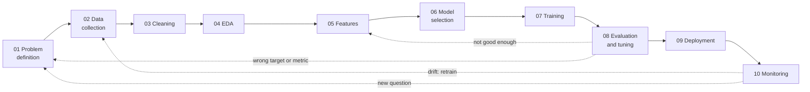
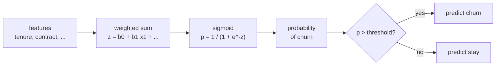

# Session 6 · Introduction to machine learning with regression

> **Guiding question.** How does a model learn from data, and how do we know whether it has learned too little or too much?

**Learning outcomes.** After this session you are able to

- describe the stages of the machine learning lifecycle, from problem definition to monitoring, and relate them to the earlier sessions
- split data into training and test sets and fit, interpret and evaluate a linear regression
- recognise underfitting and overfitting and use robust regression for data with outliers
- fit and interpret a logistic regression for a binary outcome

## Why this session matters

This session opens the machine learning part of the course. Sessions 3–5 already covered data collection, cleaning and exploration of the Berlin listings; now we place them in the machine learning lifecycle and fit the first models. Linear regression answers a question with a real use, what drives the nightly price of a listing, and logistic regression predicts a yes/no outcome such as a customer cancelling. Every more flexible model in the course is compared with these two, and the gap between training and test error introduced here is the first diagnostic in every later session. Session 7 then makes the evaluation reliable with cross-validation.

> This page is the teaching overview of the session. How to work with it (the ▶ links, the numbered notebooks, the extras) is explained once in the [course README](../../README.md#how-to-use-the-session-pages).

**Notes for this session**

- Block 1 has three short lecture notebooks (lifecycle and linear regression, the scikit-learn pattern, underfitting and overfitting), block 2 has two (robust regression, logistic regression).

## Block 1 · The machine learning lifecycle and linear regression

### Theory (45 min)

**Why.** Most failed machine learning projects fail outside the training step: a target that does not match the business decision, data that are not available at prediction time, or a model nobody maintains. Naming the stages of the lifecycle makes these risks visible early. Linear regression is the reference model for numeric targets: fast, interpretable and often hard to beat with small data. A host who wants to price a new flat needs its answer in euros. A model can also fail in two opposite ways, too simple to capture the pattern or so flexible that it learns the noise; the gap between training and test error is the first diagnostic in every later session.



**Topics**

- **The machine learning lifecycle.** From problem definition (target, metric, baseline) to monitoring and maintenance, and how Sessions 3–5 already covered data collection, cleaning and exploration.
- **Supervised learning: features, target, training, prediction.** The vocabulary shared by every library and paper. Being precise about what counts as a feature also prevents leakage (Session 7).
- **The data split into training and test sets.** Without a held-out test set, a more complex model always looks better, whether it has learned a pattern or memorised the data.
- **Simple and multiple linear regression.** Least squares, coefficients and residuals. The coefficients answer "how much does y change with x, holding the rest fixed?".
- **Regression metrics (MAE, RMSE, R²).** The metric defines what "good" means; always compare it with a baseline.
- **scikit-learn in one pattern.** Every model is constructed with its hyperparameters, then `fit`, `predict` and `score`; transformers `fit` and `transform`; pipelines and column transformers combine them into one estimator. Knowing the pattern makes every later model a change of one line.
- **Underfitting and overfitting: model complexity.** Training versus test error for increasing polynomial degree, with many and with few training listings.
- **The bias–variance trade-off.** It explains why "use the most flexible model" is not a strategy, and why underfitting and overfitting need different remedies. Regularisation follows in Session 7.

▶ **Lectures:** [01-lecture-lifecycle-and-linear-regression.ipynb](workbooks/01-lecture-lifecycle-and-linear-regression.ipynb), [02-lecture-scikit-learn-in-one-pattern.ipynb](workbooks/02-lecture-scikit-learn-in-one-pattern.ipynb), then [03-lecture-underfitting-and-overfitting.ipynb](workbooks/03-lecture-underfitting-and-overfitting.ipynb)

▶ **Worked examples**

- [04-case-study-airbnb-price-and-churn.ipynb](workbooks/04-case-study-airbnb-price-and-churn.ipynb), part A: what drives nightly prices in Berlin? Split the Inside Airbnb listings, fit and interpret a price model (guests, room type, distance to the centre, district), report its error in euros against the median-price baseline, and compare training and test error for increasing complexity.
- [05-underfitting-overfitting.ipynb](workbooks/05-underfitting-overfitting.ipynb): polynomial degree 1, 4 and 15 on a cosine curve.

### Exercises (30 min) and debrief (15 min)

▶ **Exercises:** [session-06-exercises.ipynb](workbooks/session-06-exercises.ipynb), part 1.

- **A pricing aid along the lifecycle** (Pairs, 10 min). One sentence per lifecycle stage for a price model for new hosts.
- **The same five lines, a model you have not seen** (Code, 10 min). Swap in a new regressor, read its learned attributes, wrap it in a pipeline.
- **Which line fails?** (Predict, 5 min). Four scikit-learn calls: which raise an error, and which?
- **Fit a line by hand** (Paper, 10 min). Least squares for three points.
- **The coefficient of log price** (Paper, 5 min). What does +0.1 in a model of `log(price)` mean?
- **Ten points, a polynomial of degree 9** (Predict, 5 min). Training and test R².
- **A price model for private rooms** (Code, 15 min). Split, fit and report the test MAE in euros against the baseline.

**Debrief.** Compare two lifecycle tables and two private-room models. Look for features that a new host would not have (reviews, `estimated_revenue_l365d`) and for an error reported on the log scale instead of in euros.

## Block 2 · Other losses and other targets: robust and logistic regression

### Theory (45 min)

**Why.** Least squares is pulled off course by a few extreme values; robust regression shows what the bulk of the data says, and quantile regression answers questions about a typical case or a tail directly. Many targets are not numbers but yes/no outcomes: does a customer cancel, does a listing show a registration number? Logistic regression is the standard first model for such binary targets. It gives probabilities rather than labels, and its coefficients can be read as odds ratios.



**Topics**

- **Robust regression: Huber.** Comparing a robust fit with least squares reveals how much a few points drive the conclusion.
- **Robust regression: quantile regression.** Many decisions concern a typical case or a tail rather than the average, such as the 90th-percentile price.
- **From a linear model to probabilities: the sigmoid.** The weighted sum of linear regression passed through the sigmoid gives a probability between 0 and 1.
- **Log-odds and the interpretation of coefficients.** Reading odds ratios correctly prevents treating a log-odds coefficient as a change in probability.
- **Fitting with statsmodels and scikit-learn.** The two libraries answer different questions about the same model: which effects are reliable, and how well it predicts new customers.
- **A first look at predicted classes.** Turning probabilities into classes needs a threshold, and the right threshold depends on the cost of each error. Evaluation of classifiers in depth follows in Session 8.

▶ **Lectures:** [06-lecture-robust-regression.ipynb](workbooks/06-lecture-robust-regression.ipynb), then [07-lecture-logistic-regression.ipynb](workbooks/07-lecture-logistic-regression.ipynb)

▶ **Worked examples**

- [04-case-study-airbnb-price-and-churn.ipynb](workbooks/04-case-study-airbnb-price-and-churn.ipynb), part B: least squares, Huber and quantile regression on prices with extreme asking prices (the median and the 90th-percentile price for a comparable listing); churn probability for the IBM Telco customers with logistic regression, odds ratios and thresholds.
- [08-robust-fit-compared.ipynb](workbooks/08-robust-fit-compared.ipynb): least squares, Theil–Sen, RANSAC and Huber under outliers in X and y.
- [09-logistic-regression.ipynb](workbooks/09-logistic-regression.ipynb): logistic regression in scikit-learn, decision boundary and `predict_proba` (penguins).

### Exercises (30 min) and debrief (15 min)

▶ **Exercises:** [session-06-exercises.ipynb](workbooks/session-06-exercises.ipynb), part 2.

- **One number for everyone** (Paper, 5 min). Which single prediction minimises the MAE, and which the MSE?
- **Log-odds in your head** (Paper, 5 min). What does a coefficient of 0.69 mean for the odds?
- **Perfect separation** (Predict, then Code, 10 min). What happens to the age coefficient when age separates the classes perfectly?
- **How wide is the price range for a given size?** (Code, 15 min). Quantile regressions (q = 0.1, 0.5, 0.9) of the price of entire homes on the number of guests.
- **Who shows a registration number?** (Code, 15 min). Logistic regression on room type, multi-listing host and guests; odds ratios with confidence intervals.
- **Huber's ε** (Code, 10 min, stretch). How the per-km coefficient moves from robust to least squares as ε grows.

**Debrief.** Compare two interpretations of the multi-listing host coefficient. Look for an odds ratio read as a change in probability, and for a quantile line interpreted as a prediction for every listing.

## Team project until the next session

Baselines on the project data: the most frequent heading and a simple rule.

## Extras (optional, self-study)

| Notebook | Content | Block |
|---|---|---|
| [extras/01-linear-regression-without-sklearn.ipynb](workbooks/extras/01-linear-regression-without-sklearn.ipynb) | A linear model by hand; slope, intercept and fitting by eye (penguins) | 1 |
| [extras/02-linear-regression-in-sklearn.ipynb](workbooks/extras/02-linear-regression-in-sklearn.ipynb) | `LinearRegression`, coefficients, MSE and MAE (penguins) | 1 |
| [extras/03-regression-metrics.ipynb](workbooks/extras/03-regression-metrics.ipynb) | MSE, R², MAE, median and percentage errors, prediction-error plots (Ames housing) | 1 |
| [extras/04-islp-linear-regression-lab.ipynb](workbooks/extras/04-islp-linear-regression-lab.ipynb) | ISLP Lab 3: simple and multiple regression, diagnostics, interactions, qualitative predictors. Needs `ISLP` | 1 |
| [extras/05-polynomial-features.ipynb](workbooks/extras/05-polynomial-features.ipynb) | Non-linear relationships with `PolynomialFeatures`, binning, splines and kernel approximation | 1 |
| [extras/06-statsmodels-robust-models-intro.ipynb](workbooks/extras/06-statsmodels-robust-models-intro.ipynb) | statsmodels `RLM` with Huber's T and Andrew's wave, compared with OLS | 2 |
| [extras/07-quantile-regression-sklearn.ipynb](workbooks/extras/07-quantile-regression-sklearn.ipynb) | `QuantileRegressor` with heteroscedastic and asymmetric noise | 2 |
| [extras/08-huber-vs-ridge.ipynb](workbooks/extras/08-huber-vs-ridge.ipynb) | Huber regression with strong outliers; effect of ε (ridge is only the comparison) | 2 |
| [extras/09-statsmodels-m-estimators.ipynb](workbooks/extras/09-statsmodels-m-estimators.ipynb) | M-estimators, norms, robust scale (MAD) | 2 |
| [extras/10-quantile-regression-statsmodels.ipynb](workbooks/extras/10-quantile-regression-statsmodels.ipynb) | `QuantReg` on Engel's food-expenditure data | 2 |
| [extras/11-ransac.ipynb](workbooks/extras/11-ransac.ipynb) | RANSAC inliers and outliers | 2 |
| [extras/12-theil-sen.ipynb](workbooks/extras/12-theil-sen.ipynb) | Theil–Sen versus least squares and RANSAC | 2 |
| [extras/13-islp-classification-lab.ipynb](workbooks/extras/13-islp-classification-lab.ipynb) | ISLP Lab 4: logistic regression on stock-market data; sections on LDA, QDA, naive Bayes and KNN are beyond this session. Needs `ISLP` | 2 |

## Before the session and further reading

**Before.** Re-read the section "From correlation to the regression line" of Session 5 in [06-lecture-testing-and-communicating.ipynb](../05-eda-and-statistics/workbooks/06-lecture-testing-and-communicating.ipynb). Prepare the Airbnb data once (`uv run python case-study/prepare_airbnb.py`) and run the first cell of [04-case-study-airbnb-price-and-churn.ipynb](workbooks/04-case-study-airbnb-price-and-churn.ipynb). Optional: ISLP sections 2.1–2.2 (link below).

**Further reading (optional, free)**

- James, G., Witten, D., Hastie, T., Tibshirani, R. & Taylor, J. (2023). *An Introduction to Statistical Learning with Applications in Python*, chapters 2–4. https://www.statlearning.com/
- INRIA *scikit-learn MOOC*, modules "The predictive modeling pipeline" and "Linear models". https://inria.github.io/scikit-learn-mooc/
- scikit-learn User Guide: *Linear models*. https://scikit-learn.org/stable/modules/linear_model.html
- Gelman, A., Hill, J. & Vehtari, A. (2020). *Regression and Other Stories* (free PDF). https://avehtari.github.io/ROS-Examples/

## Setup

The course environment (root `pyproject.toml`) covers the lecture notebooks, the case study, the exercises, all taught workbooks and the extras. From the repository root:

```bash
uv run jupyter lab
uv run python sessions/06-regression/figures/make_figures.py   # regenerate figures
```

The case study, the lecture notebooks and the figures read the Inside Airbnb Berlin listings from `case-study/data/airbnb/`, created by `uv run python case-study/prepare_airbnb.py` (see [case-study/README.md](../../case-study/README.md)). The Telco part of the case study and the logistic-regression code in lecture 07 download the IBM Telco data (about 1 MB) from GitHub. Workbook 09 and extras 01–03 read their data from `workbooks/data/` (`data/` from workbook 09, `../data/` from the extras).

The two ISLP labs (extras 04 and 13) use the `ISLP` package, which is part of the course environment.

Alternatively, open them in Google Colab with the badge at the top of each notebook.

## Sources and licences

Keep the attribution when you reuse or share a file. Course-written material is licensed CC BY 4.0. Third-party notebooks keep their original licence.

**Course material (CC BY 4.0, course team)**

| File | Content |
|---|---|
| [01-lecture-lifecycle-and-linear-regression.ipynb](workbooks/01-lecture-lifecycle-and-linear-regression.ipynb), [02-lecture-scikit-learn-in-one-pattern.ipynb](workbooks/02-lecture-scikit-learn-in-one-pattern.ipynb), [03-lecture-underfitting-and-overfitting.ipynb](workbooks/03-lecture-underfitting-and-overfitting.ipynb), [06-lecture-robust-regression.ipynb](workbooks/06-lecture-robust-regression.ipynb), [07-lecture-logistic-regression.ipynb](workbooks/07-lecture-logistic-regression.ipynb) | Lecture notebooks (three for block 1, two for block 2) |
| [figures/make_figures.py](figures/make_figures.py) and its PNGs (`residual-plot.png`, `under-overfitting.png`, `robust-vs-ols.png`, `sigmoid.png`) | Figures of the lecture notebooks |
| [04-case-study-airbnb-price-and-churn.ipynb](workbooks/04-case-study-airbnb-price-and-churn.ipynb) | Worked example of both blocks: lifecycle mapping of a price model for Berlin hosts, regression of the log nightly price on guests, room type, distance to Alexanderplatz and district (metrics in euros against a median baseline, residuals), complexity curves with 5,360 and 60 training listings, OLS vs Huber vs quantile regression (median and 90th percentile) on prices with extreme values, Telco churn logistic regression with odds ratios and thresholds |
| [session-06-exercises.ipynb](workbooks/session-06-exercises.ipynb) | Exercises of both blocks (hand-outs and starter code) |

**Third-party notebooks**

| File | Source | Licence | Downloaded | Changes |
|---|---|---|---|---|
| [05-underfitting-overfitting.ipynb](workbooks/05-underfitting-overfitting.ipynb) | [scikit-learn example gallery 1.9](https://scikit-learn.org/stable/_downloads/3b25b9158f1c0a1564eb0f4c9e531d46/plot_underfitting_overfitting.ipynb) | [BSD-3-Clause](https://github.com/scikit-learn/scikit-learn/blob/main/COPYING) | 2026-10-01 | Renamed from `plot_underfitting_overfitting.ipynb`; content unchanged |
| [08-robust-fit-compared.ipynb](workbooks/08-robust-fit-compared.ipynb) | [scikit-learn example gallery 1.9](https://raw.githubusercontent.com/scikit-learn/scikit-learn.github.io/main/1.9/_downloads/c93b4e0b422f79bfcb544a032cebe455/plot_robust_fit.ipynb) | [BSD-3-Clause](https://github.com/scikit-learn/scikit-learn/blob/main/COPYING) | 2026-09-26 | Renamed from `plot_robust_fit.ipynb`; content unchanged |
| [09-logistic-regression.ipynb](workbooks/09-logistic-regression.ipynb) | [INRIA/scikit-learn-mooc](https://raw.githubusercontent.com/INRIA/scikit-learn-mooc/main/notebooks/logistic_regression.ipynb) | [CC-BY-4.0](https://github.com/INRIA/scikit-learn-mooc/blob/main/LICENSE) | 2026-10-01 | Renamed from `logistic_regression.ipynb`; data path patched from `../datasets/` to `data/`; otherwise unchanged |
| [extras/01-linear-regression-without-sklearn.ipynb](workbooks/extras/01-linear-regression-without-sklearn.ipynb) | [INRIA/scikit-learn-mooc](https://raw.githubusercontent.com/INRIA/scikit-learn-mooc/main/notebooks/linear_regression_without_sklearn.ipynb) | [CC-BY-4.0](https://github.com/INRIA/scikit-learn-mooc/blob/main/LICENSE) | 2026-10-01 | Renamed from `linear_regression_without_sklearn.ipynb`; data path patched from `../datasets/` to `data/` (2026-10-01) and to `../data/` after the move to `extras/` (2026-10-11); otherwise unchanged |
| [extras/02-linear-regression-in-sklearn.ipynb](workbooks/extras/02-linear-regression-in-sklearn.ipynb) | [INRIA/scikit-learn-mooc](https://raw.githubusercontent.com/INRIA/scikit-learn-mooc/main/notebooks/linear_regression_in_sklearn.ipynb) | [CC-BY-4.0](https://github.com/INRIA/scikit-learn-mooc/blob/main/LICENSE) | 2026-10-01 | Renamed from `linear_regression_in_sklearn.ipynb`; data path patched from `../datasets/` to `data/` (2026-10-01) and to `../data/` after the move to `extras/` (2026-10-11); otherwise unchanged |
| [extras/03-regression-metrics.ipynb](workbooks/extras/03-regression-metrics.ipynb) | [INRIA/scikit-learn-mooc](https://raw.githubusercontent.com/INRIA/scikit-learn-mooc/main/notebooks/metrics_regression.ipynb) | [CC-BY-4.0](https://github.com/INRIA/scikit-learn-mooc/blob/main/LICENSE) | 2026-10-01 | Renamed from `metrics_regression.ipynb`; data path patched from `../datasets/` to `data/` (2026-10-01) and to `../data/` after the move to `extras/` (2026-10-11); otherwise unchanged |
| [extras/04-islp-linear-regression-lab.ipynb](workbooks/extras/04-islp-linear-regression-lab.ipynb) | [intro-stat-learning/ISLP_labs](https://raw.githubusercontent.com/intro-stat-learning/ISLP_labs/main/Ch03-linreg-lab.ipynb) | [BSD-2-Clause](https://github.com/intro-stat-learning/ISLP_labs/blob/main/LICENSE) | 2026-10-01 | Renamed from `Ch03-linreg-lab.ipynb`; content unchanged |
| [extras/05-polynomial-features.ipynb](workbooks/extras/05-polynomial-features.ipynb) | [INRIA/scikit-learn-mooc](https://raw.githubusercontent.com/INRIA/scikit-learn-mooc/main/notebooks/linear_regression_non_linear_link.ipynb) | [CC-BY-4.0](https://github.com/INRIA/scikit-learn-mooc/blob/main/LICENSE) | 2026-10-01 | Renamed from `linear_regression_non_linear_link.ipynb`; content unchanged |
| [extras/06-statsmodels-robust-models-intro.ipynb](workbooks/extras/06-statsmodels-robust-models-intro.ipynb) | [statsmodels/statsmodels](https://raw.githubusercontent.com/statsmodels/statsmodels/main/examples/notebooks/robust_models_0.ipynb) | [BSD-3-Clause](https://github.com/statsmodels/statsmodels/blob/main/LICENSE.txt) | 2026-09-26 | Renamed from `robust_models_0.ipynb`; content unchanged |
| [extras/07-quantile-regression-sklearn.ipynb](workbooks/extras/07-quantile-regression-sklearn.ipynb) | [scikit-learn example gallery 1.9](https://raw.githubusercontent.com/scikit-learn/scikit-learn.github.io/main/1.9/_downloads/10754505339af88c10b8a48127535a4a/plot_quantile_regression.ipynb) | [BSD-3-Clause](https://github.com/scikit-learn/scikit-learn/blob/main/COPYING) | 2026-09-26 | Renamed from `plot_quantile_regression.ipynb`; content unchanged |
| [extras/08-huber-vs-ridge.ipynb](workbooks/extras/08-huber-vs-ridge.ipynb) | [scikit-learn example gallery 1.9](https://raw.githubusercontent.com/scikit-learn/scikit-learn.github.io/main/1.9/_downloads/c6a456b2390718e4dc79945608262e0b/plot_huber_vs_ridge.ipynb) | [BSD-3-Clause](https://github.com/scikit-learn/scikit-learn/blob/main/COPYING) | 2026-09-26 | Renamed from `plot_huber_vs_ridge.ipynb`; content unchanged |
| [extras/09-statsmodels-m-estimators.ipynb](workbooks/extras/09-statsmodels-m-estimators.ipynb) | [statsmodels/statsmodels](https://raw.githubusercontent.com/statsmodels/statsmodels/main/examples/notebooks/robust_models_1.ipynb) | [BSD-3-Clause](https://github.com/statsmodels/statsmodels/blob/main/LICENSE.txt) | 2026-09-26 | Renamed from `robust_models_1.ipynb`; content unchanged |
| [extras/10-quantile-regression-statsmodels.ipynb](workbooks/extras/10-quantile-regression-statsmodels.ipynb) | [statsmodels/statsmodels](https://raw.githubusercontent.com/statsmodels/statsmodels/main/examples/notebooks/quantile_regression.ipynb) | [BSD-3-Clause](https://github.com/statsmodels/statsmodels/blob/main/LICENSE.txt) | 2026-09-26 | Renamed from `quantile_regression.ipynb`; content unchanged |
| [extras/11-ransac.ipynb](workbooks/extras/11-ransac.ipynb) | [scikit-learn example gallery 1.9](https://raw.githubusercontent.com/scikit-learn/scikit-learn.github.io/main/1.9/_downloads/99ccb624369d00fa81b6030937f80b04/plot_ransac.ipynb) | [BSD-3-Clause](https://github.com/scikit-learn/scikit-learn/blob/main/COPYING) | 2026-09-26 | Renamed from `plot_ransac.ipynb`; content unchanged |
| [extras/12-theil-sen.ipynb](workbooks/extras/12-theil-sen.ipynb) | [scikit-learn example gallery 1.9](https://raw.githubusercontent.com/scikit-learn/scikit-learn.github.io/main/1.9/_downloads/16260993c16a6d249d6df4cb11cf8174/plot_theilsen.ipynb) | [BSD-3-Clause](https://github.com/scikit-learn/scikit-learn/blob/main/COPYING) | 2026-09-26 | Renamed from `plot_theilsen.ipynb`; content unchanged |
| [extras/13-islp-classification-lab.ipynb](workbooks/extras/13-islp-classification-lab.ipynb) | [intro-stat-learning/ISLP_labs](https://raw.githubusercontent.com/intro-stat-learning/ISLP_labs/main/Ch04-classification-lab.ipynb) | [BSD-2-Clause](https://github.com/intro-stat-learning/ISLP_labs/blob/main/LICENSE) | 2026-10-01 | Renamed from `Ch04-classification-lab.ipynb`; content unchanged |

**Data used by the INRIA notebooks** (copied unchanged from [INRIA/scikit-learn-mooc/datasets](https://github.com/INRIA/scikit-learn-mooc/tree/main/datasets), downloaded 2026-10-01)

| File | Used by | Origin | Licence |
|---|---|---|---|
| [data/penguins_regression.csv](workbooks/data/penguins_regression.csv), [data/penguins_classification.csv](workbooks/data/penguins_classification.csv) | extras 01, 02; 09 | Subset of Palmer penguins, Gorman et al. (2014) | [CC-BY-4.0](https://github.com/INRIA/scikit-learn-mooc/blob/main/LICENSE) (repository); palmerpenguins data [CC0](https://github.com/allisonhorst/palmerpenguins/blob/main/LICENSE.md) |
| [data/house_prices.csv](workbooks/data/house_prices.csv) | extras 03 (Ames housing, 460 KB) | De Cock (2011) | [CC-BY-4.0](https://github.com/INRIA/scikit-learn-mooc/blob/main/LICENSE) (repository); original published for educational use in the *Journal of Statistics Education* |

**Case-study data.** The case study, the lecture notebooks and the figures use the Inside Airbnb Berlin listings in `case-study/data/airbnb/` (snapshot of 26 June 2026, CC BY 4.0, collected from public listing pages; reported in aggregate, hosts never named). The IBM Telco customer churn data are downloaded at run time from [IBM/telco-customer-churn-on-icp4d](https://github.com/IBM/telco-customer-churn-on-icp4d) (Apache-2.0) and are not stored in the repository.

<details>
<summary><b>References cited in the lecture notebooks</b></summary>

- Bailey, D. H., Borwein, J. M., López de Prado, M., & Zhu, Q. J. (2014). Pseudo-mathematics and financial charlatanism: The effects of backtest overfitting on out-of-sample performance. *Notices of the AMS*, 61(5), 458–471.
- Buitinck, L., Louppe, G., Blondel, M., et al. (2013). API design for machine learning software: experiences from the scikit-learn project. *ECML PKDD Workshop: Languages for Data Mining and Machine Learning*, 108–122. https://arxiv.org/abs/1309.0238
- Chapman, P., et al. (2000). *CRISP-DM 1.0: Step-by-step data mining guide*. SPSS.
- De Cock, D. (2011). Ames, Iowa: Alternative to the Boston housing data as an end of semester regression project. *Journal of Statistics Education*, 19(3).
- Engle, R. F., & Manganelli, S. (2004). CAViaR: Conditional autoregressive value at risk by regression quantiles. *Journal of Business & Economic Statistics*, 22(4), 367–381.
- Fischler, M. A., & Bolles, R. C. (1981). Random sample consensus. *Communications of the ACM*, 24(6), 381–395.
- Gelman, A., Hill, J., & Vehtari, A. (2020). *Regression and Other Stories*. Cambridge University Press.
- Gorman, K. B., Williams, T. D., & Fraser, W. R. (2014). Ecological sexual dimorphism and environmental variability within a community of Antarctic penguins (genus *Pygoscelis*). *PLoS ONE*, 9(3), e90081.
- Huber, P. J., & Ronchetti, E. M. (2009). *Robust Statistics* (2nd ed.). Wiley.
- IBM (2019). *Telco customer churn on ICP4D* (sample data). https://github.com/IBM/telco-customer-churn-on-icp4d
- Inside Airbnb (2026). *Berlin, Germany*, snapshot of 26 June 2026 (listings). CC BY 4.0 (second course dataset; personal data removed by `case-study/prepare_airbnb.py`). https://insideairbnb.com/get-the-data/
- INRIA (2024). *scikit-learn MOOC: Machine learning in Python with scikit-learn*. https://inria.github.io/scikit-learn-mooc/
- James, G., Witten, D., Hastie, T., Tibshirani, R., & Taylor, J. (2023). *An Introduction to Statistical Learning with Applications in Python*. Springer. https://www.statlearning.com/
- Koenker, R., & Bassett, G. (1982). Robust tests for heteroscedasticity based on regression quantiles. *Econometrica*, 50(1), 43–61.
- Koenker, R., & Hallock, K. F. (2001). Quantile regression. *Journal of Economic Perspectives*, 15(4), 143–156.
- Lazer, D., Kennedy, R., King, G., & Vespignani, A. (2014). The parable of Google Flu: Traps in big data analysis. *Science*, 343(6176), 1203–1205.
- McMahan, H. B., et al. (2013). Ad click prediction: A view from the trenches. *Proceedings of KDD 2013*.
- Pedregosa, F., et al. (2011). Scikit-learn: Machine learning in Python. *Journal of Machine Learning Research*, 12, 2825–2830.
- Sculley, D., et al. (2015). Hidden technical debt in machine learning systems. *NeurIPS 28*.
- Seabold, S., & Perktold, J. (2010). statsmodels: Econometric and statistical modeling with Python. *Proceedings of the 9th Python in Science Conference*.
- Wei, Y., Pere, A., Koenker, R., & He, X. (2006). Quantile regression methods for reference growth charts. *Statistics in Medicine*, 25(8), 1369–1382.
- Zinkevich, M. (2017). *Rules of Machine Learning: Best Practices for ML Engineering*. Google. https://developers.google.com/machine-learning/guides/rules-of-ml

</details>
