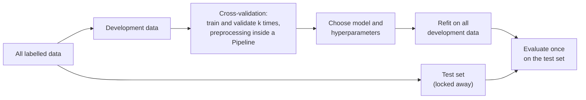
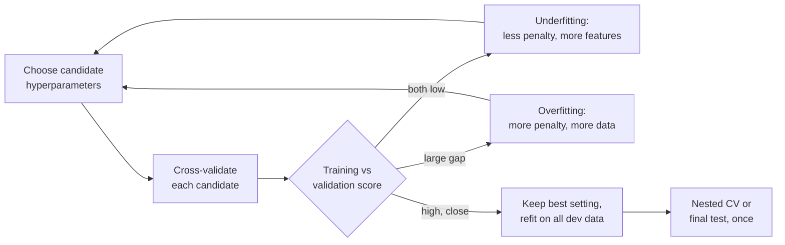

# Session 7 · Validation and hyperparameter tuning

> **Guiding question.** How well will a model perform on data it has never seen, and how do we choose its settings?

**Learning outcomes.** After this session you are able to

- split data into training, validation and test sets and estimate performance with cross-validation
- diagnose underfitting and overfitting with validation and learning curves
- control model complexity with regularisation, tune hyperparameters with grid and randomised search and prevent data leakage

## Why this session matters

In Session 6 you split the data once and reported one test score. Another split gives another number, so that score answers "how well will the model do on new data?" only roughly. This session builds the tools that make the answer reliable, shows how leakage silently breaks them, and shows how to choose a model's settings without fooling yourself. Every later model in the course, and your leaderboard submissions, are judged with these tools.

> This page is the teaching overview of the session. How to work with it (the ▶ links, the numbered notebooks, the extras) is explained once in the [course README](../../README.md#how-to-use-the-session-pages).

**Notes for this session**

- The Airbnb case study [04-case-study-airbnb-price-validation.ipynb](workbooks/04-case-study-airbnb-price-validation.ipynb) is used in both blocks: parts A and C in Block 1, part B in Block 2.

## Block 1 · An honest estimate: data splits, cross-validation and leakage

### Theory (45 min)

**Why.** A score is only meaningful if it was measured on data the model has not seen, and if we know how much it would change with other data. Each part of the data needs one clear role, the split must imitate how the model will be used, and no information from the validation rows may slip into training. Leakage is one of the most common reasons why models fail after deployment.

**Topics**

- **Training, validation and test data.** Fitting, choosing and reporting are three different questions. Using one set for two of them makes the reported score too optimistic.
- **Why a single split is unreliable.** The same model gets a different score on another random split. One number hides that spread.
- **k-fold and stratified cross-validation.** Every row is used for validation exactly once, which gives a mean and a spread instead of a single number.
- **Grouped and time-series splits.** Listings of the same host, or future dates, must not leak into training. Otherwise the score describes a situation that never occurs in practice.
- **Bootstrap confidence interval.** It states how uncertain a score is, which we need before claiming that one model beats another.
- **Data leakage: preprocessing outside the cross-validation, target leakage.** A step that learns from all rows, or a feature that contains the answer, makes the validation score too good to be true. Steps that look at the target do the most damage.
- **Preprocessing inside a Pipeline.** The standard remedy: every fitted step is refitted inside each training fold, so the validation fold never influences it.

▶ **Lecture:** [01-lecture-splits-cross-validation-and-leakage.ipynb](workbooks/01-lecture-splits-cross-validation-and-leakage.ipynb)

▶ **Worked examples**

- [02-cross-validation-splitters.ipynb](workbooks/02-cross-validation-splitters.ipynb): KFold, StratifiedKFold, GroupKFold and TimeSeriesSplit side by side (scikit-learn gallery).
- [03-data-leakage-feature-selection.ipynb](workbooks/03-data-leakage-feature-selection.ipynb): feature selection outside versus inside the pipeline (INRIA MOOC).
- [04-case-study-airbnb-price-validation.ipynb](workbooks/04-case-study-airbnb-price-validation.ipynb), parts A and C: random against host-grouped folds with a bootstrap interval in euros; two leaking workflows on the price model and their fix.

### Exercises (30 min) and debrief (15 min)

▶ **Exercises:** [session-07-exercises.ipynb](workbooks/session-07-exercises.ipynb), part 1.

- **Who is left out of a bootstrap sample?** (Paper, 10 min). The probability that a row is never drawn, and its limit.
- **The same host on both sides** (Paper, 5 min). What random folds do to the score when one host owns 40 near-identical flats.
- **Which of these workflows leak?** (Predict, 10 min). Four preprocessing choices, ranked by how much they inflate the score.
- **Perfect accuracy on pure noise** (Code, 20 min). Feature selection on all rows, then cross-validation, on random data.
- **Is gradient boosting really better for new hosts?** (Code, 25 min, stretch). A paired cluster bootstrap of the difference in MAE between two models on held-out hosts.

**Debrief.** For the noise exercise, compare a solution that selects features once on all rows with one that selects inside each fold; the first one is wrong and scores far above 50 %. For the bootstrap, check that both models were resampled with the same hosts.

## Block 2 · Choosing settings: regularisation and tuning

### Theory (45 min)

**Why.** Most models have settings that are not learned from the data but chosen by us: a penalty, a number of neighbours, a tree depth. Chosen badly, they make a model underfit or overfit. This block shows how to diagnose which of the two is happening, how to search for good settings systematically instead of by trial and error, and how to report a score that is still honest after all these choices.

**Topics**

- **Parameters and hyperparameters.** Knowing what the model learns and what we choose tells us what has to be validated.
- **Ridge and lasso regularisation.** With 480 input columns, the price model needs a penalty that controls its complexity with a single number. Lasso also selects features.
- **Validation and learning curves.** Comparing the training and validation scores tells us whether to add data, add features or add penalty.
- **GridSearchCV and RandomizedSearchCV.** A reproducible search over settings replaces manual guessing. Random search covers large search spaces more cheaply.
- **Nested cross-validation.** Tuning on the same folds you report on inflates the score. Nested CV estimates how well the whole tuning procedure does on new data.
- **The final test on held-out data.** The test set is used once, at the end, to close a project.

▶ **Lecture:** [05-lecture-regularisation-and-tuning.ipynb](workbooks/05-lecture-regularisation-and-tuning.ipynb)

▶ **Worked examples**

- [06-grid-search.ipynb](workbooks/06-grid-search.ipynb): GridSearchCV in a pipeline on the adult census data (INRIA MOOC).
- [07-nested-cross-validation.ipynb](workbooks/07-nested-cross-validation.ipynb): nested cross-validation step by step (INRIA MOOC).
- [04-case-study-airbnb-price-validation.ipynb](workbooks/04-case-study-airbnb-price-validation.ipynb), part B: ridge and lasso on 480 columns, validation and learning curves, grid and randomised search with random and grouped folds.

### Exercises (30 min) and debrief (15 min)

▶ **Exercises:** [session-07-exercises.ipynb](workbooks/session-07-exercises.ipynb), part 2.

- **Ridge as λ → ∞** (Predict, 5 min). What happens to the coefficients, and why the lasso reaches exactly zero.
- **Sketch the learning curves** (Paper, 10 min). Training and validation error against training size, for an underfitting and an overfitting model.
- **The public leaderboard trap** (Code, 15 min). The best of 100 random submissions on a public half, scored on the private half.
- **The test set used fifty times** (Class, 5 min). Is it still a test set?
- **How many neighbours for a price?** (Code, 25 min, stretch). Tune k-NN on the Berlin price data with grouped folds and estimate it with nested cross-validation.

**Debrief.** Compare two sketches of learning curves, one with the validation error below the training error (wrong). For the leaderboard, ask why the best public score is far above 50 % and the private one is not.

## Team project until the next session

Write a validation plan: how you split by time, which metrics you use, the uncertainty of the scores, and which inputs may not be used.

## Extras (optional, self-study)

| Notebook | Content | Block |
|---|---|---|
| [extras/01-model-validation.ipynb](workbooks/extras/01-model-validation.ipynb) | PDSH 5.03: holdout, k-fold, validation and learning curves, grid search. With current matplotlib, change `plt.style.use('seaborn-whitegrid')` to `'seaborn-v0_8-whitegrid'` when you run it; the file itself must stay unchanged (licence ND) | 1–2 |
| [extras/02-train-test-and-cross-validation.ipynb](workbooks/extras/02-train-test-and-cross-validation.ipynb) | One split versus repeated splits on the California housing data; how much the score varies (INRIA) | 1 |
| [extras/03-stratified-cross-validation.ipynb](workbooks/extras/03-stratified-cross-validation.ipynb) | KFold versus StratifiedKFold | 1 |
| [extras/04-grouped-cross-validation.ipynb](workbooks/extras/04-grouped-cross-validation.ipynb) | GroupKFold on handwritten digits written by the same people | 1 |
| [extras/05-islp-resampling-lab.ipynb](workbooks/extras/05-islp-resampling-lab.ipynb) | ISLP Lab 5: validation set, LOOCV, k-fold CV, bootstrap | 1 |
| [extras/06-bootstrap-and-simulation.ipynb](workbooks/extras/06-bootstrap-and-simulation.ipynb) | Simulation and the bootstrap | 1 |
| [extras/07-honest-validation-practice.ipynb](workbooks/extras/07-honest-validation-practice.ipynb) | Six synthetic listings: random versus unseen-host validation | 1 |
| [extras/08-ridge-regularisation.ipynb](workbooks/extras/08-ridge-regularisation.ipynb) | Ridge on Ames housing, why scaling matters, choosing alpha with RidgeCV (INRIA) | 2 |
| [extras/09-islp-ridge-lasso-lab.ipynb](workbooks/extras/09-islp-ridge-lasso-lab.ipynb) | ISLP Lab 6: subset selection, ridge, lasso, PCR and PLS with a cross-validated penalty. A few cells of the upstream lab fail with NumPy 2 and current scikit-learn (`np.Inf`, an `ElasticNetCV` argument); the rest runs | 2 |
| [extras/10-validation-curve.ipynb](workbooks/extras/10-validation-curve.ipynb) | The validation curve of a tree (INRIA) | 2 |
| [extras/11-learning-curve.ipynb](workbooks/extras/11-learning-curve.ipynb) | Does more data help? A learning curve (INRIA) | 2 |
| [extras/12-learning-curve-sklearn.ipynb](workbooks/extras/12-learning-curve-sklearn.ipynb) | Learning curves and scalability of naive Bayes and SVM | 2 |
| [extras/13-randomized-search.ipynb](workbooks/extras/13-randomized-search.ipynb) | RandomizedSearchCV with log-uniform distributions (INRIA) | 2 |
| [extras/14-grid-search-custom-refit.ipynb](workbooks/extras/14-grid-search-custom-refit.ipynb) | Grid search with several metrics and a custom refit rule | 2 |
| [extras/15-nested-cv-sklearn.ipynb](workbooks/extras/15-nested-cv-sklearn.ipynb) | Nested versus non-nested CV on iris | 2 |
| [extras/16-case-study-churn-validation.ipynb](workbooks/extras/16-case-study-churn-validation.ipynb) | The Telco churn model of Session 6: CV with a bootstrap CI of ROC AUC, tuning `C` and `class_weight`, nested CV | 1–2 |

## Before the session and further reading

**Before.** Re-run your Session 6 notebooks (the price regression and the logistic regression for Telco churn). Check that the case-study data exist: `uv run python case-study/prepare_airbnb.py`. Read the first section of [01-lecture-splits-cross-validation-and-leakage.ipynb](workbooks/01-lecture-splits-cross-validation-and-leakage.ipynb).

**Further reading (optional)**

- James et al. (2023). *An Introduction to Statistical Learning with Applications in Python*, Chapters 5 and 6. https://www.statlearning.com/
- scikit-learn: *Common pitfalls and recommended practices*. https://scikit-learn.org/stable/common_pitfalls.html
- INRIA scikit-learn MOOC, Modules 2 and 3. https://inria.github.io/scikit-learn-mooc/
- Kapoor & Narayanan (2023). Leakage and the reproducibility crisis in ML-based science. https://doi.org/10.1016/j.patter.2023.100804

## Setup

The lecture notebooks, the worked examples and the exercises need only the course environment (`uv sync`) and the case-study data (`uv run python case-study/prepare_airbnb.py`). Some extras need more packages:

| Package | Needed by |
|---|---|
| `seaborn` | 06-grid-search |
| `ISLP`, `statsmodels` (optionally `l0bnb`) | extras 05 and 09 (ISLP labs); in the course environment |
| `nhanes` | extras 06 |

The INRIA notebooks read `../datasets/` and `../figures/` relative to `workbooks/` (`../../` from `extras/`). To regenerate the figures of the lecture notebooks, run `uv run python sessions/07-validation-and-tuning/figures/make_figures.py`.

## Sources and licences

Keep the attribution when you reuse or share a file. Course-written material is licensed CC BY 4.0. Third-party notebooks keep their original licence; "ND" means the file must be shared unchanged, and "NC" means non-commercial use only.

**Course material (CC BY 4.0, course team)**

| File | Content |
|---|---|
| [01-lecture-splits-cross-validation-and-leakage.ipynb](workbooks/01-lecture-splits-cross-validation-and-leakage.ipynb), [05-lecture-regularisation-and-tuning.ipynb](workbooks/05-lecture-regularisation-and-tuning.ipynb) | Lecture notebooks of the two blocks |
| [session-07-exercises.ipynb](workbooks/session-07-exercises.ipynb) | Exercises of both blocks |
| [figures/make_figures.py](figures/make_figures.py) and its PNGs (`cv_splits.png`, `validation_curve.png`, `learning_curve.png`) | Figures of the lecture notebooks |
| [04-case-study-airbnb-price-validation.ipynb](workbooks/04-case-study-airbnb-price-validation.ipynb) | Case study on the Inside Airbnb Berlin listings: random versus host-grouped CV, held-out hosts with listing and cluster bootstrap intervals, ridge and lasso, validation and learning curves, grid and randomised search, two leaking workflows and their fix |
| [extras/07-honest-validation-practice.ipynb](workbooks/extras/07-honest-validation-practice.ipynb) | Random versus unseen-host validation on six synthetic listings |
| [extras/16-case-study-churn-validation.ipynb](workbooks/extras/16-case-study-churn-validation.ipynb) | Validation of the IBM Telco churn model |

**Third-party notebooks**

| File | Source | Licence | Downloaded | Changes |
|---|---|---|---|---|
| [02-cross-validation-splitters.ipynb](workbooks/02-cross-validation-splitters.ipynb) | [scikit-learn example gallery 1.9](https://raw.githubusercontent.com/scikit-learn/scikit-learn.github.io/main/1.9/_downloads/49cd91d05440a1c88b074430761aeb76/plot_cv_indices.ipynb) | [BSD-3-Clause](https://github.com/scikit-learn/scikit-learn/blob/main/COPYING) | 2026-09-26 | Renamed from `plot_cv_indices.ipynb`; content unchanged |
| [03-data-leakage-feature-selection.ipynb](workbooks/03-data-leakage-feature-selection.ipynb) | [INRIA/scikit-learn-mooc](https://raw.githubusercontent.com/INRIA/scikit-learn-mooc/main/notebooks/feature_selection_sol_01.ipynb) | [CC BY 4.0](https://github.com/INRIA/scikit-learn-mooc/blob/main/LICENSE) | 2026-10-01 | Renamed from `feature_selection_sol_01.ipynb`; content unchanged |
| [06-grid-search.ipynb](workbooks/06-grid-search.ipynb) | [INRIA/scikit-learn-mooc](https://raw.githubusercontent.com/INRIA/scikit-learn-mooc/main/notebooks/parameter_tuning_grid_search.ipynb) | [CC BY 4.0](https://github.com/INRIA/scikit-learn-mooc/blob/main/LICENSE) | 2026-10-01 | Renamed from `parameter_tuning_grid_search.ipynb`; content unchanged |
| [07-nested-cross-validation.ipynb](workbooks/07-nested-cross-validation.ipynb) | [INRIA/scikit-learn-mooc](https://raw.githubusercontent.com/INRIA/scikit-learn-mooc/main/notebooks/cross_validation_nested.ipynb) | [CC BY 4.0](https://github.com/INRIA/scikit-learn-mooc/blob/main/LICENSE) | 2026-09-26 | Renamed from `cross_validation_nested.ipynb`; content unchanged |
| [extras/01-model-validation.ipynb](workbooks/extras/01-model-validation.ipynb) | [jakevdp/PythonDataScienceHandbook](https://raw.githubusercontent.com/jakevdp/PythonDataScienceHandbook/master/notebooks/05.03-Hyperparameters-and-Model-Validation.ipynb) | [MIT (code) / CC BY-NC-ND 3.0 (text)](https://github.com/jakevdp/PythonDataScienceHandbook/blob/master/LICENSE-CODE) **NC, ND** | 2026-09-26 | Renamed from `05.03-Hyperparameters-and-Model-Validation.ipynb`; content unchanged (ND: must stay unchanged) |
| [extras/02-train-test-and-cross-validation.ipynb](workbooks/extras/02-train-test-and-cross-validation.ipynb) | [INRIA/scikit-learn-mooc](https://raw.githubusercontent.com/INRIA/scikit-learn-mooc/main/notebooks/cross_validation_train_test.ipynb) | [CC BY 4.0](https://github.com/INRIA/scikit-learn-mooc/blob/main/LICENSE) | 2026-09-26 | Renamed from `cross_validation_train_test.ipynb`; image path changed from `../figures/` to `../../figures/` for the `extras/` folder; its missing image `figures/shufflesplit_diagram.png` was added |
| [extras/03-stratified-cross-validation.ipynb](workbooks/extras/03-stratified-cross-validation.ipynb) | [INRIA/scikit-learn-mooc](https://raw.githubusercontent.com/INRIA/scikit-learn-mooc/main/notebooks/cross_validation_stratification.ipynb) | [CC BY 4.0](https://github.com/INRIA/scikit-learn-mooc/blob/main/LICENSE) | 2026-09-26 | Renamed from `cross_validation_stratification.ipynb`; content unchanged |
| [extras/04-grouped-cross-validation.ipynb](workbooks/extras/04-grouped-cross-validation.ipynb) | [INRIA/scikit-learn-mooc](https://raw.githubusercontent.com/INRIA/scikit-learn-mooc/main/notebooks/cross_validation_grouping.ipynb) | [CC BY 4.0](https://github.com/INRIA/scikit-learn-mooc/blob/main/LICENSE) | 2026-10-01 | Renamed from `cross_validation_grouping.ipynb`; content unchanged |
| [extras/05-islp-resampling-lab.ipynb](workbooks/extras/05-islp-resampling-lab.ipynb) | [intro-stat-learning/ISLP_labs](https://raw.githubusercontent.com/intro-stat-learning/ISLP_labs/main/Ch05-resample-lab.ipynb) | [BSD-2-Clause](https://github.com/intro-stat-learning/ISLP_labs/blob/main/LICENSE) | 2026-09-26 | Renamed from `Ch05-resample-lab.ipynb`; content unchanged |
| [extras/06-bootstrap-and-simulation.ipynb](workbooks/extras/06-bootstrap-and-simulation.ipynb) | [statsthinking21/statsthinking21-python](https://raw.githubusercontent.com/statsthinking21/statsthinking21-python/master/notebooks/07-ResamplingAndSimulation.ipynb) | [CC BY-NC 4.0](https://github.com/statsthinking21/statsthinking21-python/blob/master/LICENSE.md) **NC** | 2026-09-26 | Renamed from `07-ResamplingAndSimulation.ipynb`; content unchanged |
| [extras/08-ridge-regularisation.ipynb](workbooks/extras/08-ridge-regularisation.ipynb) | [INRIA/scikit-learn-mooc](https://raw.githubusercontent.com/INRIA/scikit-learn-mooc/main/notebooks/linear_models_regularization.ipynb) | [CC BY 4.0](https://github.com/INRIA/scikit-learn-mooc/blob/main/LICENSE) | 2026-10-01 | Renamed from `linear_models_regularization.ipynb`; data path changed from `../datasets/` to `../../datasets/` for the `extras/` folder |
| [extras/09-islp-ridge-lasso-lab.ipynb](workbooks/extras/09-islp-ridge-lasso-lab.ipynb) | [intro-stat-learning/ISLP_labs](https://raw.githubusercontent.com/intro-stat-learning/ISLP_labs/main/Ch06-varselect-lab.ipynb) | [BSD-2-Clause](https://github.com/intro-stat-learning/ISLP_labs/blob/main/LICENSE) | 2026-10-01 | Renamed from `Ch06-varselect-lab.ipynb`; content unchanged |
| [extras/10-validation-curve.ipynb](workbooks/extras/10-validation-curve.ipynb) | [INRIA/scikit-learn-mooc](https://raw.githubusercontent.com/INRIA/scikit-learn-mooc/main/notebooks/cross_validation_validation_curve.ipynb) | [CC BY 4.0](https://github.com/INRIA/scikit-learn-mooc/blob/main/LICENSE) | 2026-10-01 | Renamed from `cross_validation_validation_curve.ipynb`; content unchanged |
| [extras/11-learning-curve.ipynb](workbooks/extras/11-learning-curve.ipynb) | [INRIA/scikit-learn-mooc](https://raw.githubusercontent.com/INRIA/scikit-learn-mooc/main/notebooks/cross_validation_learning_curve.ipynb) | [CC BY 4.0](https://github.com/INRIA/scikit-learn-mooc/blob/main/LICENSE) | 2026-10-01 | Renamed from `cross_validation_learning_curve.ipynb`; content unchanged |
| [extras/12-learning-curve-sklearn.ipynb](workbooks/extras/12-learning-curve-sklearn.ipynb) | [scikit-learn example gallery 1.9](https://scikit-learn.org/1.9/_downloads/ca0bfe2435d9b3fffe21c713e63d3a6f/plot_learning_curve.ipynb) | [BSD-3-Clause](https://github.com/scikit-learn/scikit-learn/blob/main/COPYING) | 2026-10-01 | Renamed from `plot_learning_curve.ipynb`; content unchanged |
| [extras/13-randomized-search.ipynb](workbooks/extras/13-randomized-search.ipynb) | [INRIA/scikit-learn-mooc](https://raw.githubusercontent.com/INRIA/scikit-learn-mooc/main/notebooks/parameter_tuning_randomized_search.ipynb) | [CC BY 4.0](https://github.com/INRIA/scikit-learn-mooc/blob/main/LICENSE) | 2026-10-01 | Renamed from `parameter_tuning_randomized_search.ipynb`; data and figure paths changed from `../datasets/`, `../figures/` to `../../datasets/`, `../../figures/` for the `extras/` folder |
| [extras/14-grid-search-custom-refit.ipynb](workbooks/extras/14-grid-search-custom-refit.ipynb) | [scikit-learn example gallery 1.9](https://scikit-learn.org/1.9/_downloads/f4a89bf823d814fee03a693df158d83a/plot_grid_search_digits.ipynb) | [BSD-3-Clause](https://github.com/scikit-learn/scikit-learn/blob/main/COPYING) | 2026-10-01 | Renamed from `plot_grid_search_digits.ipynb`; content unchanged |
| [extras/15-nested-cv-sklearn.ipynb](workbooks/extras/15-nested-cv-sklearn.ipynb) | [scikit-learn example gallery 1.9](https://raw.githubusercontent.com/scikit-learn/scikit-learn.github.io/main/1.9/_downloads/45916745bb89ca49be3a50aa80e65e3f/plot_nested_cross_validation_iris.ipynb) | [BSD-3-Clause](https://github.com/scikit-learn/scikit-learn/blob/main/COPYING) | 2026-09-26 | Renamed from `plot_nested_cross_validation_iris.ipynb`; content unchanged |

**Data and figures used by the INRIA notebooks** (copied unchanged from [INRIA/scikit-learn-mooc](https://github.com/INRIA/scikit-learn-mooc))

| File | Used by | Origin | Licence |
|---|---|---|---|
| `datasets/adult-census.csv` | 06, extras 13 | Becker & Kohavi (1996), UCI Adult | [CC BY 4.0](https://github.com/INRIA/scikit-learn-mooc/blob/main/datasets/README.md) |
| `datasets/ames_housing_no_missing.csv` | extras 08 | De Cock (2011) | Public domain (per the INRIA datasets README) |
| `figures/shufflesplit_diagram.png` | extras 02 | INRIA/scikit-learn-mooc figures | CC BY 4.0 |
| `figures/cross_validation_train_test_diagram.png` | 06 | INRIA/scikit-learn-mooc figures | CC BY 4.0 |
| `figures/grid_vs_random_search.svg`, `figures/randomized_search_results.csv` | extras 13 | INRIA/scikit-learn-mooc figures | CC BY 4.0 |

Extras 02, 10 and 11 download the California housing data with `fetch_california_housing` on first use. The INRIA notebook `cross_validation_time.ipynb` was not added because its `financial-data` files carry no stated licence. Time-based validation is covered in lecture notebook 01 and worked example 02.

**Case-study data.** Inside Airbnb (2026), *Berlin, Germany*, snapshot of 26 June 2026, CC BY 4.0, prepared with `case-study/prepare_airbnb.py`; IBM (2019), *Telco customer churn sample data*.

<b>References cited in the lecture notebooks</b>

- Banko, M. & Brill, E. (2001). Scaling to very very large corpora for natural language disambiguation. *Proceedings of ACL 2001*, 26–33. https://aclanthology.org/P01-1005/
- Becker, B. & Kohavi, R. (1996). Adult [Dataset]. UCI Machine Learning Repository. https://doi.org/10.24432/C5XW20
- Bergstra, J. & Bengio, Y. (2012). Random search for hyper-parameter optimization. *JMLR*, 13, 281–305. https://jmlr.org/papers/v13/bergstra12a.html
- Board of Governors of the Federal Reserve System (2011). *SR 11-7: Guidance on Model Risk Management*. https://www.federalreserve.gov/supervisionreg/srletters/sr1107.htm
- Cawley, G. C. & Talbot, N. L. C. (2010). On over-fitting in model selection and subsequent selection bias in performance evaluation. *JMLR*, 11, 2079–2107. https://jmlr.org/papers/v11/cawley10a.html
- Collins, G. S., Reitsma, J. B., Altman, D. G. & Moons, K. G. M. (2015). Transparent reporting of a multivariable prediction model for individual prognosis or diagnosis (TRIPOD). *BMJ*, 350, g7594. https://doi.org/10.1136/bmj.g7594
- De Cock, D. (2011). Ames, Iowa: Alternative to the Boston housing data. *Journal of Statistics Education*, 19(3). https://doi.org/10.1080/10691898.2011.11889627
- Efron, B. (1979). Bootstrap methods: another look at the jackknife. *Annals of Statistics*, 7(1), 1–26. https://doi.org/10.1214/aos/1176344552
- Feurer, M. et al. (2015). Efficient and robust automated machine learning. *NeurIPS 28*. https://papers.nips.cc/paper/5872-efficient-and-robust-automated-machine-learning
- Hoerl, A. E. & Kennard, R. W. (1970). Ridge regression: biased estimation for nonorthogonal problems. *Technometrics*, 12(1), 55–67. https://doi.org/10.1080/00401706.1970.10488634
- IBM (2019). *Telco customer churn sample data*. https://github.com/IBM/telco-customer-churn-on-icp4d
- Inside Airbnb (2026). *Berlin, Germany: listings, calendar and reviews*, snapshot of 26 June 2026, CC BY 4.0. https://insideairbnb.com/get-the-data/
- INRIA (2024). *scikit-learn MOOC*. https://inria.github.io/scikit-learn-mooc/
- James, G., Witten, D., Hastie, T., Tibshirani, R. & Taylor, J. (2023). *An Introduction to Statistical Learning with Applications in Python*. Springer. https://www.statlearning.com/
- Kapoor, S. & Narayanan, A. (2023). Leakage and the reproducibility crisis in machine-learning-based science. *Patterns*, 4(9), 100804. https://doi.org/10.1016/j.patter.2023.100804
- Kaufman, S., Rosset, S., Perlich, C. & Stitelman, O. (2012). Leakage in data mining: formulation, detection, and avoidance. *ACM TKDD*, 6(4), 15. https://doi.org/10.1145/2382577.2382579
- Koehn, P. (2004). Statistical significance tests for machine translation evaluation. *Proceedings of EMNLP 2004*, 388–395. https://aclanthology.org/W04-3250/
- Poldrack, R. A. (2023). *Statistical Thinking for the 21st Century* (Python companion). https://statsthinking21.github.io/statsthinking21-python/
- Rajpurkar, P. et al. (2017). CheXNet: radiologist-level pneumonia detection on chest X-rays with deep learning. arXiv:1711.05225. https://arxiv.org/abs/1711.05225
- Raschka, S. (2018). Model evaluation, model selection, and algorithm selection in machine learning. arXiv:1811.12808. https://arxiv.org/abs/1811.12808
- Recht, B., Roelofs, R., Schmidt, L. & Shankar, V. (2019). Do ImageNet classifiers generalize to ImageNet? *ICML 2019*. https://arxiv.org/abs/1902.10811
- scikit-learn developers (2025). *User guide: cross-validation, tuning hyperparameters, validation curves, common pitfalls*. https://scikit-learn.org/stable/user_guide.html
- Tibshirani, R. (1996). Regression shrinkage and selection via the lasso. *Journal of the Royal Statistical Society B*, 58(1), 267–288. https://doi.org/10.1111/j.2517-6161.1996.tb02080.x
- VanderPlas, J. (2016). *Python Data Science Handbook*. O'Reilly. https://jakevdp.github.io/PythonDataScienceHandbook/
- Varma, S. & Simon, R. (2006). Bias in error estimation when using cross-validation for model selection. *BMC Bioinformatics*, 7, 91. https://doi.org/10.1186/1471-2105-7-91
- Zinkevich, M. (n.d.). *Rules of Machine Learning: Best Practices for ML Engineering*. Google for Developers. https://developers.google.com/machine-learning/guides/rules-of-ml

