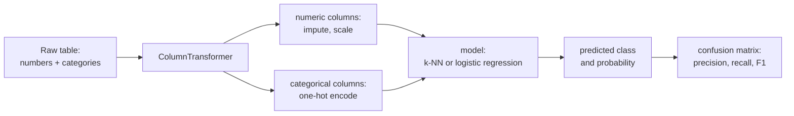
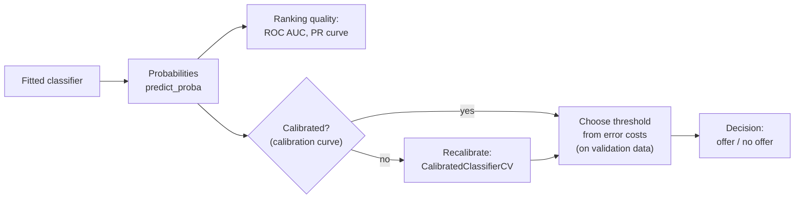

# Session 8 · Classification and evaluation metrics

> **Guiding question.** Which customers will cancel, and how do we measure whether a classifier is good enough?

**Learning outcomes.** After this session you are able to

- prepare mixed numerical and categorical inputs in a preprocessing pipeline
- build classification models and compare them with baselines
- evaluate classifiers with the confusion matrix, precision, recall, F1, macro-F1, ROC curves and AUC, and set a decision threshold from the costs of errors
- handle class imbalance with class weights, undersampling and oversampling, applied only to the training data

## Why this session matters

In Session 6 you fitted a logistic regression for churn, and in Session 7 you learned to validate models honestly. This session treats classification systematically: which baselines a model must beat, how a real table with text categories and numbers becomes model input without leakage, and how to judge a classifier by the errors it makes rather than by accuracy alone. It ends where the business starts: turning predicted probabilities into a decision, such as who receives a retention offer, from the costs of the two kinds of error, also when the customers we want to find are the minority. The pipelines built here are reused in Session 9 and later deployed in Session 16, and your team project gets its first classifier.

> This page is the teaching overview of the session. How to work with it (the ▶ links, the numbered notebooks, the extras) is explained once in the [course README](../../README.md#how-to-use-the-session-pages).

**Notes for this session**

- Session 8 (two blocks) and Session 9 (one block) are taught on the same teaching day.
- Block 2 covers thresholds, calibration and class imbalance in one lecture notebook. The imbalance part is condensed to two sections; the full treatment of the earlier course version is the optional [extras/10-class-imbalance-in-depth.ipynb](workbooks/extras/10-class-imbalance-in-depth.ipynb).

## Block 1 · Classifiers, pipelines and the confusion matrix

### Theory (45 min)

**Why.** Without a baseline a number such as "79 % accuracy" means nothing, and real tables mix numbers, categories and missing values that a model cannot use directly. A pipeline keeps the preparation and the model together, so that the same steps are applied to training data, test data and new customers, and leakage is prevented by construction. k-nearest neighbours adds a second classifier whose decision boundary makes underfitting and overfitting visible. Accuracy then hides *which* errors a classifier makes; the confusion matrix and the metrics derived from it show them.

**Topics**

- **Classification tasks and baselines.** A classifier predicts a category. The majority class and a hand-made rule set the bar it must clear; in imbalanced problems a model can look good while only predicting the majority class.
- **One-hot and ordinal encoding, scaling.** Encoding choices change what a model can learn, and unscaled features let the one with the largest numbers dominate a distance. A category seen only in new data must not crash the encoder.
- **Pipeline and ColumnTransformer.** Different preparation for different columns, fitted on the training data only. The whole workflow becomes one estimator that cross-validation and tuning can refit inside every fold.
- **k-nearest neighbours and the decision boundary.** The simplest model that can draw any boundary. The number of neighbours moves it from overfitting (k = 1) to underfitting (very large k), so k is chosen by cross-validation.
- **Confusion matrix and accuracy.** The four outcomes of a binary prediction show false positives and false negatives separately. Every other metric of the session is derived from it.
- **Precision, recall and F1.** Precision asks how much of our effort is well spent, recall how many cases we find. They answer different business questions; F1 is a compromise when both matter and no costs are known.
- **Macro-F1 for several classes.** Every class counts equally, however rare, so a model that ignores the rare classes cannot hide behind a good accuracy.

▶ **Lecture:** [01-lecture-classifiers-pipelines-and-confusion-matrix.ipynb](workbooks/01-lecture-classifiers-pipelines-and-confusion-matrix.ipynb)

▶ **Worked examples**

- [02-column-transformer.ipynb](workbooks/02-column-transformer.ipynb): ColumnTransformer for mixed numerical and categorical columns on the adult census data (INRIA MOOC).
- [03-case-study-churn-pipelines.ipynb](workbooks/03-case-study-churn-pipelines.ipynb): the Telco pipeline; a churn rule, k-NN (k chosen by cross-validation) and logistic regression compared with cross-validated scores, confusion matrices, ROC and precision–recall curves on the test set.

### Exercises (30 min) and debrief (15 min)

▶ **Exercises:** [session-08-exercises.ipynb](workbooks/session-08-exercises.ipynb), part 1.

- **k-NN on graph paper** (Paper, 10 min). Classify a point with k = 1 and k = 3, and explain why the training accuracy of 1-NN is suspicious.
- **Fill the confusion matrix from a story** (Paper, 10 min). 100 customers, 20 churners, 25 flagged: precision, recall and F1.
- **The 99 % accurate medical test** (Paper, 10 min). How likely is a positive result right when the disease is rare?
- **Does k-NN need the scaler?** (Code, 20 min). The same Telco k-NN pipeline with and without scaling, compared by recall and macro-F1.

**Debrief.** Compare two confusion matrices filled from the story; a common mistake swaps the 5 false negatives and the 10 false positives. For the scaler, ask which column dominated the distances.

## Block 2 · Scores, thresholds and rare classes

### Theory (45 min)

**Why.** The churn model produces probabilities; the retention team needs a list of names. Curves over all thresholds compare models before the business has decided, the default threshold of 0.5 assumes that both kinds of error cost the same, and churners are the minority, so a model trained on the raw data flags too few of them. This block chooses the threshold from costs, compares class weights and resampling with simply moving the threshold, and checks whether the probabilities behind the decision can be trusted.

**Topics**

- **The ROC curve and AUC.** They evaluate the ranking over all thresholds, which lets us compare models before the business has chosen a threshold.
- **The precision–recall curve.** It focuses on the positive class. When positives are rare and the business works through a ranked list, precision at a given recall is the number that matters.
- **Decision thresholds from the costs of errors.** The threshold turns a score into a decision that can be justified to the business. It is chosen on validation data from the cost of an offer and the cost of a lost customer, and checked once on the test set.
- **Class imbalance and class weights.** "Nobody churns" is right for 73.5 % of the Telco customers. Class weights make an error on a rare row count more, without extra rows or a new library; random undersampling, oversampling and SMOTE change the training data instead.
- **Resampling inside the cross-validation only, with imbalanced-learn pipelines.** Oversampling before the split puts copies of a row in training and validation folds; imbalanced-learn's `Pipeline` resamples only during `fit`. On the Telco data every correction raises recall at the price of precision, and a lower threshold reaches the same point.
- **Calibration of predicted probabilities.** A calibration curve and the Brier score show whether a probability of 0.3 really means 30 %. Cost rules and forecasts rely on it, a model trained with class weights is miscalibrated, and `CalibratedClassifierCV` repairs it on held-out data.

▶ **Lecture:** [04-lecture-scores-thresholds-and-rare-classes.ipynb](workbooks/04-lecture-scores-thresholds-and-rare-classes.ipynb)

▶ **Worked examples**

- [05-tuned-decision-threshold.ipynb](workbooks/05-tuned-decision-threshold.ipynb): `TunedThresholdClassifierCV` on the diabetes (Pima) data (scikit-learn gallery).
- [06-case-study-churn-threshold-and-calibration.ipynb](workbooks/06-case-study-churn-threshold-and-calibration.ipynb): the churn threshold from the cost of a retention offer against the value of a lost customer, its sensitivity to the cost assumptions, and the calibration of four churn models.
- [07-case-study-imbalance.ipynb](workbooks/07-case-study-imbalance.ipynb): undersampling, oversampling, SMOTE, class weights and a tuned threshold for catching Telco churners, judged by precision, recall, PR AUC and the cost of a retention campaign.

### Exercises (30 min) and debrief (15 min)

▶ **Exercises:** [session-08-exercises.ipynb](workbooks/session-08-exercises.ipynb), part 2.

- **99 % accuracy** (Paper, 5 min). Is a fraud model that never flags fraud a good model?
- **AUC by counting pairs** (Paper, 10 min). Six scores; the share of correctly ranked churner–stayer pairs is the AUC.
- **Threshold from money** (Paper, 10 min). From which churn probability is a €20 offer worth it?
- **How calibrated are you?** (Class, 15 min). Ten questions about Berlin with stated confidence, and the class's calibration curve.
- **Half-balanced, and a more valuable customer** (Code, 25 min). Partial against full oversampling, and which strategy wins when a lost customer costs €1,000.
- **Say what the correction does** (Pairs, 5 min, stretch). One sentence per strategy for the retention team.

**Debrief.** For the threshold, compare a solution that forgets the 50 % success rate of the offer (and gets 0.1) with the correct one. For the code task, check that the sampler sits inside the pipeline and that costs were computed on out-of-fold predictions.

## Team project until the next teaching day

Together with the task of Session 9, which follows on the same day: a first classifier on simple features (language, member state, description length) in a pipeline, evaluated with accuracy and macro-F1 against the baselines.

## Extras (optional, self-study)

| Notebook | Content | Block |
|---|---|---|
| [extras/01-categorical-encoding.ipynb](workbooks/extras/01-categorical-encoding.ipynb) | OrdinalEncoder and OneHotEncoder on the adult census data (INRIA) | 1 |
| [extras/02-scaling-in-pipelines.ipynb](workbooks/extras/02-scaling-in-pipelines.ipynb) | StandardScaler, fit and transform, a first pipeline and `cross_validate` (INRIA) | 1 |
| [extras/03-knn-decision-boundary.ipynb](workbooks/extras/03-knn-decision-boundary.ipynb) | k-NN decision boundaries on iris, uniform versus distance weights | 1 |
| [extras/04-confusion-matrix.ipynb](workbooks/extras/04-confusion-matrix.ipynb) | Confusion matrix with and without normalisation | 1 |
| [extras/05-classification-metrics.ipynb](workbooks/extras/05-classification-metrics.ipynb) | Accuracy, confusion matrix, precision, recall, ROC and PR curves on the blood transfusion data (INRIA) | 1–2 |
| [extras/06-roc-curve.ipynb](workbooks/extras/06-roc-curve.ipynb) | ROC curves, one-vs-rest and one-vs-one for several classes | 2 |
| [extras/07-precision-recall-curve.ipynb](workbooks/extras/07-precision-recall-curve.ipynb) | Precision–recall curves, average precision, multiclass | 2 |
| [extras/08-cost-sensitive-learning.ipynb](workbooks/extras/08-cost-sensitive-learning.ipynb) | Cost-sensitive thresholds on credit and fraud data. Loads the credit-card fraud data from OpenML (about 285,000 rows), which takes a while | 2 |
| [extras/09-calibration-curve.ipynb](workbooks/extras/09-calibration-curve.ipynb) | Calibration curves, Brier score, sigmoid and isotonic calibration | 2 |
| [extras/10-class-imbalance-in-depth.ipynb](workbooks/extras/10-class-imbalance-in-depth.ipynb) | Class imbalance in depth on the Telco data: sampling ratios, SMOTE and its variants, class weights, resampling inside the cross-validation (course notebook) | 2 |
| [extras/11-imbalanced-classes-impact.ipynb](workbooks/extras/11-imbalanced-classes-impact.ipynb) | The effect of imbalance and of each remedy on the adult census data | 2 |
| [extras/12-imblearn-pipeline.ipynb](workbooks/extras/12-imblearn-pipeline.ipynb) | A sampler inside an imbalanced-learn `Pipeline` | 2 |
| [extras/13-smote-sample-generation.ipynb](workbooks/extras/13-smote-sample-generation.ipynb) | How SMOTE generates one new sample | 2 |
| [extras/14-over-sampling-comparison.ipynb](workbooks/extras/14-over-sampling-comparison.ipynb) | Random oversampling, SMOTE, ADASYN and variants compared | 2 |
| [extras/15-under-sampling-comparison.ipynb](workbooks/extras/15-under-sampling-comparison.ipynb) | Undersampling methods compared | 2 |

## Before the session and further reading

**Before.** Re-run your Session 6 logistic regression for Telco churn. Think about one decision in your own work that is taken from a score (a credit limit, a reminder, an inspection): what does each kind of error cost?

**Further reading (optional)**

- Google Machine Learning Crash Course: Classification. https://developers.google.com/machine-learning/crash-course/classification
- MLU-Explain (Amazon): precision and recall, ROC and AUC, interactive. https://mlu-explain.github.io/
- scikit-learn: Metrics and scoring. https://scikit-learn.org/stable/modules/model_evaluation.html
- imbalanced-learn: Common pitfalls and recommended practices. https://imbalanced-learn.org/stable/common_pitfalls.html
- INRIA scikit-learn MOOC, Module 1 and "Evaluating model performance". https://inria.github.io/scikit-learn-mooc/

## Setup

All notebooks of this session run in the course environment: open them in VS Code with the `.venv` kernel (setup: [course README](../../README.md#setup)). The environment includes `imbalanced-learn`.

The lecture notebooks, the figures, the case studies, extras 10 and the exercises download the IBM Telco churn data from GitHub. 05-tuned-decision-threshold and extras 08 and 11 download data from OpenML on first use (internet needed).

The INRIA notebooks read `../datasets/` and `../figures/` relative to `workbooks/` (`../../` from `extras/`). To regenerate the figures of the lecture notebooks, run `uv run python sessions/08-classification-and-metrics/figures/make_figures.py`.

## Sources and licences

Keep the attribution when you reuse or share a file. Course-written material is licensed CC BY 4.0. Third-party notebooks keep their original licence.

**Course material (CC BY 4.0, course team)**

| File | Content |
|---|---|
| [01-lecture-classifiers-pipelines-and-confusion-matrix.ipynb](workbooks/01-lecture-classifiers-pipelines-and-confusion-matrix.ipynb), [04-lecture-scores-thresholds-and-rare-classes.ipynb](workbooks/04-lecture-scores-thresholds-and-rare-classes.ipynb) | Lecture notebooks of the two blocks |
| [session-08-exercises.ipynb](workbooks/session-08-exercises.ipynb) | Exercises of both blocks |
| [figures/make_figures.py](figures/make_figures.py) and its PNGs (`confusion_matrix.png`, `roc_pr_curves.png`, `knn_boundaries.png`, `calibration_curve.png`, `cost_threshold.png`, `smote_illustration.png`, `resampling_precision_recall.png`) | Figures of the lecture notebooks (Telco data; the SMOTE sketch uses simulated points) |
| [03-case-study-churn-pipelines.ipynb](workbooks/03-case-study-churn-pipelines.ipynb) | Telco pipeline; churn rule versus k-NN versus logistic regression; confusion matrices, ROC and PR curves |
| [06-case-study-churn-threshold-and-calibration.ipynb](workbooks/06-case-study-churn-threshold-and-calibration.ipynb) | Telco retention offers: out-of-fold cost curve, TunedThresholdClassifierCV with a cost scorer, sensitivity to the cost assumptions, calibration of four churn models, recalibration with CalibratedClassifierCV |
| [07-case-study-imbalance.ipynb](workbooks/07-case-study-imbalance.ipynb) | Imbalance strategies and a cost-tuned threshold for Telco churn |
| [extras/10-class-imbalance-in-depth.ipynb](workbooks/extras/10-class-imbalance-in-depth.ipynb) | Class imbalance in depth (the former imbalance lecture of Session 9) |

**Third-party notebooks**

| File | Source | Licence | Downloaded | Changes |
|---|---|---|---|---|
| [02-column-transformer.ipynb](workbooks/02-column-transformer.ipynb) | [INRIA/scikit-learn-mooc](https://raw.githubusercontent.com/INRIA/scikit-learn-mooc/main/notebooks/03_categorical_pipeline_column_transformer.ipynb) | [CC BY 4.0](https://github.com/INRIA/scikit-learn-mooc/blob/main/LICENSE) | 2026-10-01 | Renamed from `03_categorical_pipeline_column_transformer.ipynb`; content unchanged |
| [05-tuned-decision-threshold.ipynb](workbooks/05-tuned-decision-threshold.ipynb) | [scikit-learn example gallery 1.9](https://scikit-learn.org/1.9/_downloads/c158013efa5fd61eaa463a2f88014a07/plot_tuned_decision_threshold.ipynb) | [BSD-3-Clause](https://github.com/scikit-learn/scikit-learn/blob/main/COPYING) | 2026-10-01 | Renamed from `plot_tuned_decision_threshold.ipynb`; content unchanged |
| [extras/01-categorical-encoding.ipynb](workbooks/extras/01-categorical-encoding.ipynb) | [INRIA/scikit-learn-mooc](https://raw.githubusercontent.com/INRIA/scikit-learn-mooc/main/notebooks/03_categorical_pipeline.ipynb) | [CC BY 4.0](https://github.com/INRIA/scikit-learn-mooc/blob/main/LICENSE) | 2026-10-01 | Renamed from `03_categorical_pipeline.ipynb`; data path changed from `../datasets/` to `../../datasets/` for the `extras/` folder |
| [extras/02-scaling-in-pipelines.ipynb](workbooks/extras/02-scaling-in-pipelines.ipynb) | [INRIA/scikit-learn-mooc](https://raw.githubusercontent.com/INRIA/scikit-learn-mooc/main/notebooks/02_numerical_pipeline_scaling.ipynb) | [CC BY 4.0](https://github.com/INRIA/scikit-learn-mooc/blob/main/LICENSE) | 2026-09-26 | Renamed from `02_numerical_pipeline_scaling.ipynb`; data and figure paths changed from `../datasets/`, `../figures/` to `../../datasets/`, `../../figures/` for the `extras/` folder |
| [extras/03-knn-decision-boundary.ipynb](workbooks/extras/03-knn-decision-boundary.ipynb) | [scikit-learn example gallery 1.9](https://scikit-learn.org/1.9/_downloads/47f024d726d245e034c7690b4664721f/plot_classification.ipynb) | [BSD-3-Clause](https://github.com/scikit-learn/scikit-learn/blob/main/COPYING) | 2026-10-01 | Renamed from `plot_classification.ipynb`; content unchanged |
| [extras/04-confusion-matrix.ipynb](workbooks/extras/04-confusion-matrix.ipynb) | [scikit-learn example gallery 1.9](https://scikit-learn.org/1.9/_downloads/9ad55bf68758018c9961815802c65e18/plot_confusion_matrix.ipynb) | [BSD-3-Clause](https://github.com/scikit-learn/scikit-learn/blob/main/COPYING) | 2026-10-01 | Renamed from `plot_confusion_matrix.ipynb`; content unchanged |
| [extras/05-classification-metrics.ipynb](workbooks/extras/05-classification-metrics.ipynb) | [INRIA/scikit-learn-mooc](https://raw.githubusercontent.com/INRIA/scikit-learn-mooc/main/notebooks/metrics_classification.ipynb) | [CC BY 4.0](https://github.com/INRIA/scikit-learn-mooc/blob/main/LICENSE) | 2026-10-01 | Renamed from `metrics_classification.ipynb`. Patched for scikit-learn ≥ 1.7: in the two `RocCurveDisplay.from_estimator` cells, the keyword arguments `marker`, `color`, `linestyle` are passed as `curve_kwargs={...}` (the old form raises a TypeError in scikit-learn 1.9); data path changed from `../datasets/` to `../../datasets/` for the `extras/` folder; otherwise unchanged |
| [extras/06-roc-curve.ipynb](workbooks/extras/06-roc-curve.ipynb) | [scikit-learn example gallery 1.9](https://scikit-learn.org/1.9/_downloads/40f4aad91af595a370d7582e3a23bed7/plot_roc.ipynb) | [BSD-3-Clause](https://github.com/scikit-learn/scikit-learn/blob/main/COPYING) | 2026-10-01 | Renamed from `plot_roc.ipynb`; content unchanged |
| [extras/07-precision-recall-curve.ipynb](workbooks/extras/07-precision-recall-curve.ipynb) | [scikit-learn example gallery 1.9](https://scikit-learn.org/1.9/_downloads/764d061a261a2e06ad21ec9133361b2d/plot_precision_recall.ipynb) | [BSD-3-Clause](https://github.com/scikit-learn/scikit-learn/blob/main/COPYING) | 2026-10-01 | Renamed from `plot_precision_recall.ipynb`; content unchanged |
| [extras/08-cost-sensitive-learning.ipynb](workbooks/extras/08-cost-sensitive-learning.ipynb) | [scikit-learn example gallery 1.9](https://scikit-learn.org/1.9/_downloads/133f2198d3ab792c75b39a63b0a99872/plot_cost_sensitive_learning.ipynb) | [BSD-3-Clause](https://github.com/scikit-learn/scikit-learn/blob/main/COPYING) | 2026-10-01 | Renamed from `plot_cost_sensitive_learning.ipynb`; content unchanged |
| [extras/09-calibration-curve.ipynb](workbooks/extras/09-calibration-curve.ipynb) | [scikit-learn example gallery 1.9](https://scikit-learn.org/1.9/_downloads/6d4f620ec6653356eb970c2a6ed62081/plot_calibration_curve.ipynb) | [BSD-3-Clause](https://github.com/scikit-learn/scikit-learn/blob/main/COPYING) | 2026-10-01 | Renamed from `plot_calibration_curve.ipynb`; content unchanged |
| [extras/11-imbalanced-classes-impact.ipynb](workbooks/extras/11-imbalanced-classes-impact.ipynb) | [imbalanced-learn examples 0.14](https://imbalanced-learn.org/stable/_downloads/5c34a055001acb990ce9a738f4f795d2/plot_impact_imbalanced_classes.ipynb) | [MIT](https://github.com/scikit-learn-contrib/imbalanced-learn/blob/master/LICENSE) | 2026-10-01 | Renamed from `plot_impact_imbalanced_classes.ipynb`; content unchanged |
| [extras/12-imblearn-pipeline.ipynb](workbooks/extras/12-imblearn-pipeline.ipynb) | [imbalanced-learn examples 0.14](https://imbalanced-learn.org/stable/_downloads/a1eea81aef2766fd95ce2d6acf6f8c3c/plot_pipeline_classification.ipynb) | [MIT](https://github.com/scikit-learn-contrib/imbalanced-learn/blob/master/LICENSE) | 2026-10-01 | Renamed from `plot_pipeline_classification.ipynb`; content unchanged |
| [extras/13-smote-sample-generation.ipynb](workbooks/extras/13-smote-sample-generation.ipynb) | [imbalanced-learn examples 0.14](https://imbalanced-learn.org/stable/_downloads/8795f8c2a7ac7ee1ebff2e061ded7a73/plot_illustration_generation_sample.ipynb) | [MIT](https://github.com/scikit-learn-contrib/imbalanced-learn/blob/master/LICENSE) | 2026-10-01 | Renamed from `plot_illustration_generation_sample.ipynb`; content unchanged |
| [extras/14-over-sampling-comparison.ipynb](workbooks/extras/14-over-sampling-comparison.ipynb) | [imbalanced-learn examples 0.14](https://imbalanced-learn.org/stable/_downloads/36cd3cf9023b1f17acb9c3114f17b10b/plot_comparison_over_sampling.ipynb) | [MIT](https://github.com/scikit-learn-contrib/imbalanced-learn/blob/master/LICENSE) | 2026-10-01 | Renamed from `plot_comparison_over_sampling.ipynb`; content unchanged |
| [extras/15-under-sampling-comparison.ipynb](workbooks/extras/15-under-sampling-comparison.ipynb) | [imbalanced-learn examples 0.14](https://imbalanced-learn.org/stable/_downloads/ac6dee8f2622a104974cc8bcf430c917/plot_comparison_under_sampling.ipynb) | [MIT](https://github.com/scikit-learn-contrib/imbalanced-learn/blob/master/LICENSE) | 2026-10-01 | Renamed from `plot_comparison_under_sampling.ipynb`; content unchanged |

The imbalanced-learn notebooks (extras 11–15), the course notebook extras 10 and the case study 07 came to this session from Session 9 when class imbalance moved into Block 2.

**Data and figures used by the INRIA notebooks** (copied unchanged from [INRIA/scikit-learn-mooc](https://github.com/INRIA/scikit-learn-mooc))

| File | Used by | Origin | Licence | Downloaded |
|---|---|---|---|---|
| `datasets/adult-census.csv` (5.1 MB) | 02, extras 01, 02 | [INRIA/scikit-learn-mooc datasets](https://github.com/INRIA/scikit-learn-mooc/tree/main/datasets); original: Becker & Kohavi (1996), UCI Adult | [CC BY 4.0](https://github.com/INRIA/scikit-learn-mooc/blob/main/datasets/README.md) | 2026-09-26 |
| `datasets/blood_transfusion.csv` | extras 05 | INRIA/scikit-learn-mooc datasets; original: Yeh (2008), UCI | CC BY 4.0 | 2026-10-01 |
| `figures/api_diagram-*.svg` (6 files: transformer fit / transform / fit_transform, pipeline fit / predict, columntransformer) | 02, extras 02 | [INRIA/scikit-learn-mooc figures](https://github.com/INRIA/scikit-learn-mooc/tree/main/figures) | CC BY 4.0 | 2026-10-01 |

05-tuned-decision-threshold and extras 08 and 11 download their data from OpenML on first use.

**Case-study data.** IBM (2019), *Telco customer churn sample data*, downloaded from IBM's GitHub repository by the lecture notebooks, the figures script, the case studies and the exercises.

<b>References cited in the lecture notebooks</b>

- Becker, B. & Kohavi, R. (1996). Adult [Dataset]. UCI Machine Learning Repository. https://doi.org/10.24432/C5XW20
- Chawla, N. V., Bowyer, K. W., Hall, L. O. & Kegelmeyer, W. P. (2002). SMOTE: synthetic minority over-sampling technique. *Journal of Artificial Intelligence Research*, 16, 321–357. https://doi.org/10.1613/jair.953
- Dal Pozzolo, A., Caelen, O., Johnson, R. A. & Bontempi, G. (2015). Calibrating probability with undersampling for unbalanced classification. *IEEE Symposium Series on Computational Intelligence*. https://doi.org/10.1109/SSCI.2015.33
- Elkan, C. (2001). The foundations of cost-sensitive learning. *Proceedings of IJCAI 2001*, 973–978. https://cseweb.ucsd.edu/~elkan/rescale.pdf
- Elor, Y. & Averbuch-Elor, H. (2022). To SMOTE, or not to SMOTE? arXiv:2201.08528. https://arxiv.org/abs/2201.08528
- Google for Developers (2025). *Machine Learning Crash Course: Classification*. https://developers.google.com/machine-learning/crash-course/classification
- Hanley, J. A. & McNeil, B. J. (1982). The meaning and use of the area under a receiver operating characteristic (ROC) curve. *Radiology*, 143(1), 29–36. https://doi.org/10.1148/radiology.143.1.7063747
- He, X. et al. (2014). Practical lessons from predicting clicks on ads at Facebook. *Proceedings of ADKDD 2014*. https://doi.org/10.1145/2648584.2648589
- IBM (2019). *Telco customer churn sample data*. https://github.com/IBM/telco-customer-churn-on-icp4d
- INRIA (2024). *scikit-learn MOOC*. https://inria.github.io/scikit-learn-mooc/
- James, G., Witten, D., Hastie, T., Tibshirani, R. & Taylor, J. (2023). *An Introduction to Statistical Learning with Applications in Python*. Springer. https://www.statlearning.com/
- King, G. & Zeng, L. (2001). Logistic regression in rare events data. *Political Analysis*, 9(2), 137–163. https://doi.org/10.1093/oxfordjournals.pan.a004868
- Lemaître, G., Nogueira, F. & Aridas, C. K. (2017). Imbalanced-learn: a Python toolbox to tackle the curse of imbalanced datasets in machine learning. *JMLR*, 18(17), 1–5. https://jmlr.org/papers/v18/16-365.html
- Linden, G., Smith, B. & York, J. (2003). Amazon.com recommendations: item-to-item collaborative filtering. *IEEE Internet Computing*, 7(1), 76–80. https://doi.org/10.1109/MIC.2003.1167344
- Murphy, A. H. & Winkler, R. L. (1977). Reliability of subjective probability forecasts of precipitation and temperature. *Journal of the Royal Statistical Society C*, 26(1), 41–47. https://doi.org/10.2307/2346866
- Rosenthal, S., Farra, N. & Nakov, P. (2017). SemEval-2017 Task 4: Sentiment analysis in Twitter. *Proceedings of SemEval-2017*, 502–518. https://aclanthology.org/S17-2088/
- Saito, T. & Rehmsmeier, M. (2015). The precision-recall plot is more informative than the ROC plot when evaluating binary classifiers on imbalanced datasets. *PLOS ONE*, 10(3), e0118432. https://doi.org/10.1371/journal.pone.0118432
- Santos, M. S., Soares, J. P., Abreu, P. H., Araújo, H. & Santos, J. (2018). Cross-validation for imbalanced datasets: avoiding overoptimistic and overfitting approaches. *IEEE Computational Intelligence Magazine*, 13(4), 59–76. https://doi.org/10.1109/MCI.2018.2866730
- scikit-learn developers (2025). *User guide: metrics and scoring, tuning the decision threshold, probability calibration, pipelines and composite estimators*. https://scikit-learn.org/stable/user_guide.html
- van den Goorbergh, R., van Smeden, M., Timmerman, D. & Van Calster, B. (2022). The harm of class imbalance corrections for risk prediction models. *JAMIA*, 29(9), 1525–1534. https://doi.org/10.1093/jamia/ocac093
- Van Calster, B., McLernon, D. J., van Smeden, M., Wynants, L. & Steyerberg, E. W. (2019). Calibration: the Achilles heel of predictive analytics. *BMC Medicine*, 17, 230. https://doi.org/10.1186/s12916-019-1466-7
- Yeh, I.-C. (2008). Blood Transfusion Service Center [Dataset]. UCI Machine Learning Repository. https://doi.org/10.24432/C5GS39

