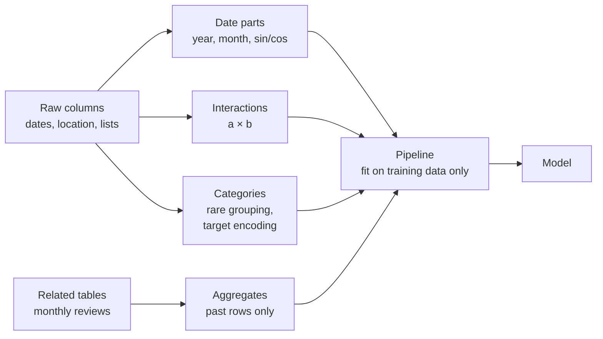

# Session 9 · Advanced feature engineering and leakage

> **Guiding question.** Which additional inputs make a model better, and how do we build them without leakage?

**Learning outcomes.** After this session you are able to

- construct features from dates, interactions, high-cardinality categories and related tables
- implement feature construction in pipelines without leakage

## Why this session matters

A model can only use the information it is given. Session 8 turned raw columns into model input with one-hot encoding, scaling and the `ColumnTransformer`; this session constructs new inputs from dates, combinations of columns, categories with many levels and related tables. New features are also the most common way to let leakage in, so every feature is built inside a pipeline and only from data known at prediction time, building on the grouped validation and leakage rules of Session 7. Your team project needs both: features from the customs decisions, and a record of the moment at which each one is known.

> This page is the teaching overview of the session. How to work with it (the ▶ links, the numbered notebooks, the extras) is explained once in the [course README](../../README.md#how-to-use-the-session-pages).

**Notes for this session**

- Session 9 has one block. It is taught on the same teaching day as Session 8, after its two blocks.
- Simple text statistics of the listing titles, part of this session in an earlier version, moved to Session 13 together with the other text features.

## Block 1 · Feature construction without leakage

### Theory (45 min)

**Why.** Feature engineering means constructing new input columns from the raw data so that a model can use information it could not see before. The running question is practical: what drives the nightly price of a Berlin Airbnb listing, and which constructed features help a price model? Each feature is built in a transformer that is fitted on the training data only, so the same code runs during cross-validation, on the test set and in production. Many useful features come from another table, and they are correct only if they use data that existed at the moment of each prediction; when that rule is broken the feature leaks the target, and every number in the notebook improves.

**Topics**

- **Features from dates and times.** A timestamp carries a trend, seasonal patterns and elapsed time, which a model cannot extract on its own. Cyclical encodings keep December and January close together.
- **Interactions between features.** Additive models such as linear and logistic regression miss effects that depend on another feature unless we add the product as a column.
- **Grouping rare categories.** Columns with many rare levels invite overfitting. Grouping them keeps the information of the frequent categories and handles unseen categories at prediction time.
- **Target encoding and its leakage risk.** One numeric column can replace hundreds of dummy columns, but the naive version leaks the row's own target. Smoothing and cross-fitting (`TargetEncoder`) fix this.
- **Custom transformers in scikit-learn pipelines.** `FunctionTransformer` and small transformer classes put feature code inside the pipeline, so it is fitted on the training folds only and saved together with the model.
- **Aggregation features from related tables.** Counts, recent activity and time since the last event, summarised per listing from the monthly reviews. They must be point-in-time correct: only rows known at the cut-off date may be used.
- **Target leakage.** Columns derived from the target, aggregates that include the target period and information written with or after the label. We detect them with "too good to be true" checks and the question of when each value is known.

▶ **Lecture:** [01-lecture-feature-construction-without-leakage.ipynb](workbooks/01-lecture-feature-construction-without-leakage.ipynb)

▶ **Worked examples**

- [02-case-study-airbnb-features.ipynb](workbooks/02-case-study-airbnb-features.ipynb): distance, amenity, date and interaction features and a target-encoded neighbourhood for the Berlin price model, each measured with host-grouped validation.
- [03-case-study-airbnb-leakage.ipynb](workbooks/03-case-study-airbnb-leakage.ipynb): past-only demand features from the monthly reviews, an out-of-time check, and the snapshot and revenue columns that leak the target.

### Exercises (30 min) and debrief (15 min)

▶ **Exercises:** [session-09-exercises.ipynb](workbooks/session-09-exercises.ipynb), part 1.

- **Is December far from January?** (Paper, 5 min). The cyclical encoding of the month, computed by hand.
- **Is a degree a degree?** (Paper, 5 min). Latitude against longitude in Berlin, and what that means for distances.
- **Target encoding of a category seen once** (Paper, 5 min). Why its naive encoding is a perfect leak.
- **Guests × room type** (Class, 5 min). Can a linear model capture the effect without an interaction term?
- **Spot the leak** (Paper, 10 min). Which of ten listing columns are not known on 1 July 2025?
- **The husky and the snow** (Class, 10 min). Which "snow" could hide in the Airbnb data?
- **Is demand growing or shrinking?** (Code, 25 min). A past-only trend feature for the demand model, checked by host-grouped cross-validation.
- **A count encoding that cannot leak** (Code, 20 min, stretch). A transformer that learns category counts in `fit`.

**Debrief.** For the leak, compare two lists and look for `availability_365` and `last_review`, which look harmless but describe the time after the cut-off. For the trend feature, check that both six-month windows end before the cut-off.

## Team project until the next teaching day

How the team will deal with rare headings; inputs documented with the moment at which each is known.

## Extras (optional, self-study)

| Notebook | Content | Block |
|---|---|---|
| [extras/01-time-related-feature-engineering.ipynb](workbooks/extras/01-time-related-feature-engineering.ipynb) | Calendar features, one-hot versus cyclical versus spline encodings, interactions (bike sharing demand) | 1 |
| [extras/02-target-encoder.ipynb](workbooks/extras/02-target-encoder.ipynb) | `TargetEncoder` compared with ordinal and one-hot encoding on wine reviews | 1 |
| [extras/03-target-encoder-cross-fitting.ipynb](workbooks/extras/03-target-encoder-cross-fitting.ipynb) | Why `TargetEncoder` cross-fits, and the leak of a naive encoding | 1 |
| [extras/04-column-transformer-mixed-types.ipynb](workbooks/extras/04-column-transformer-mixed-types.ipynb) | ColumnTransformer recap for mixed types (Titanic). Its feature-selection step is not part of the course | 1 |

## Before the session and further reading

**Before.** Re-read the Session 7 lecture notebook on grouped cross-validation and leakage ([01](../07-validation-and-tuning/workbooks/01-lecture-splits-cross-validation-and-leakage.ipynb)) and the first Session 8 lecture notebook on `Pipeline` and `ColumnTransformer` ([01](../08-classification-and-metrics/workbooks/01-lecture-classifiers-pipelines-and-confusion-matrix.ipynb)). Make sure the case-study data exist: `uv run python case-study/prepare_airbnb.py` (Inside Airbnb, Berlin).

**Further reading (optional)**

- scikit-learn developers. *Common pitfalls: data leakage*. https://scikit-learn.org/stable/common_pitfalls.html#data-leakage
- Kuhn, M. & Johnson, K. (2019). *Feature Engineering and Selection*, chapter 5 (categorical predictors), free online. https://bookdown.org/max/FES/
- Inside Airbnb. *Data assumptions*: how the occupancy and revenue columns are estimated, and why they must not explain the price. https://insideairbnb.com/data-assumptions/
- Kapoor, S. & Narayanan, A. (2023). Leakage and the reproducibility crisis in machine-learning-based science. *Patterns*, 4(9). https://doi.org/10.1016/j.patter.2023.100804

## Setup

Everything runs in the course environment (`uv sync` in the repository root, then `uv run jupyter lab`). The case-study data are created once with `uv run python case-study/prepare_airbnb.py`. The scikit-learn example notebooks in `extras/` download their data from OpenML on first run (internet needed). The own notebooks find `case-study/data/` from any working directory inside the repository; each runs in one to two minutes.

To regenerate the figure of the lecture notebook, run `uv run python sessions/09-feature-engineering/figures/make_figures.py`.

## Sources and licences

Keep the attribution when you reuse or share a file. Course-written material is licensed CC BY 4.0. Third-party notebooks keep their original licence.

**Course material (CC BY 4.0, course team)**

| File | Content |
|---|---|
| [01-lecture-feature-construction-without-leakage.ipynb](workbooks/01-lecture-feature-construction-without-leakage.ipynb) | Lecture notebook of the block |
| [session-09-exercises.ipynb](workbooks/session-09-exercises.ipynb) | Exercises of the block |
| [figures/make_figures.py](figures/make_figures.py) and its PNG (`cyclical_month_encoding.png`) | Cyclical month encoding |
| [02-case-study-airbnb-features.ipynb](workbooks/02-case-study-airbnb-features.ipynb) | Date, distance, interaction, category and amenity features for a Berlin Airbnb price model, host-grouped feature-group comparison |
| [03-case-study-airbnb-leakage.ipynb](workbooks/03-case-study-airbnb-leakage.ipynb) | Past-only demand features from monthly reviews, snapshot and revenue leaks |

**Third-party notebooks**

| File | Source | Licence | Downloaded | Changes |
|---|---|---|---|---|
| [extras/01-time-related-feature-engineering.ipynb](workbooks/extras/01-time-related-feature-engineering.ipynb) | [scikit-learn example gallery 1.9](https://scikit-learn.org/stable/_downloads/7012baed63b9a27f121bae611b8285c2/plot_cyclical_feature_engineering.ipynb) | [BSD-3-Clause](https://github.com/scikit-learn/scikit-learn/blob/main/COPYING) | 2026-10-01 | Renamed from `plot_cyclical_feature_engineering.ipynb`; content unchanged |
| [extras/02-target-encoder.ipynb](workbooks/extras/02-target-encoder.ipynb) | [scikit-learn example gallery 1.9](https://scikit-learn.org/stable/_downloads/7b414ce0c39e11cf961fd4fa23008246/plot_target_encoder.ipynb) | [BSD-3-Clause](https://github.com/scikit-learn/scikit-learn/blob/main/COPYING) | 2026-10-01 | Renamed from `plot_target_encoder.ipynb`; content unchanged |
| [extras/03-target-encoder-cross-fitting.ipynb](workbooks/extras/03-target-encoder-cross-fitting.ipynb) | [scikit-learn example gallery 1.9](https://scikit-learn.org/stable/_downloads/c3f95dc25241c64632f9c3378fd4e89b/plot_target_encoder_cross_val.ipynb) | [BSD-3-Clause](https://github.com/scikit-learn/scikit-learn/blob/main/COPYING) | 2026-10-01 | Renamed from `plot_target_encoder_cross_val.ipynb`; content unchanged |
| [extras/04-column-transformer-mixed-types.ipynb](workbooks/extras/04-column-transformer-mixed-types.ipynb) | [scikit-learn example gallery 1.9](https://scikit-learn.org/stable/_downloads/26f110ad6cff1a8a7c58b1a00d8b8b5a/plot_column_transformer_mixed_types.ipynb) | [BSD-3-Clause](https://github.com/scikit-learn/scikit-learn/blob/main/COPYING) | 2026-10-01 | Renamed from `plot_column_transformer_mixed_types.ipynb`; content unchanged |

Extras 01 (bike sharing demand), 02 (wine reviews) and 04 (Titanic) download their data from OpenML on first use. The class-imbalance material of the earlier three-block version of this session (a lecture notebook, a case study, two worked examples and three extras) moved to [Session 8](../08-classification-and-metrics/README.md), Block 2.

**Case-study data.** Inside Airbnb (2026), *Berlin, Germany*, snapshot of 26 June 2026, CC BY 4.0, prepared with `case-study/prepare_airbnb.py` (host names and other personal data removed).

<b>References cited in the lecture notebooks</b>

- Cheng, H.-T. et al. (2016). Wide & deep learning for recommender systems. *Proceedings of the 1st Workshop on Deep Learning for Recommender Systems*, 7–10. https://doi.org/10.1145/2988450.2988454
- Feast authors (2025). *Point-in-time joins*. Feast documentation. https://docs.feast.dev/getting-started/concepts/point-in-time-joins
- Galli, S. (2021). Feature-engine: a Python package for feature engineering for machine learning. *Journal of Open Source Software*, 6(65), 3642. https://doi.org/10.21105/joss.03642
- Hermann, J. & Del Balso, M. (2017). *Meet Michelangelo: Uber's machine learning platform*. Uber Engineering blog. https://www.uber.com/blog/michelangelo-machine-learning-platform/
- Inside Airbnb (2026). *Berlin, Germany: listings, calendar and reviews*, snapshot of 26 June 2026, CC BY 4.0; prepared with `case-study/prepare_airbnb.py` (host names and other personal data removed). https://insideairbnb.com/get-the-data/ · *Data assumptions*: https://insideairbnb.com/data-assumptions/
- Kapoor, S. & Narayanan, A. (2023). Leakage and the reproducibility crisis in machine-learning-based science. *Patterns*, 4(9), 100804. https://doi.org/10.1016/j.patter.2023.100804
- Kaufman, S., Rosset, S., Perlich, C. & Stitelman, O. (2012). Leakage in data mining: formulation, detection, and avoidance. *ACM TKDD*, 6(4), 15. https://doi.org/10.1145/2382577.2382579
- Kuhn, M. & Johnson, K. (2019). *Feature Engineering and Selection: A Practical Approach for Predictive Models*. CRC Press. https://bookdown.org/max/FES/
- Makridakis, S., Spiliotis, E. & Assimakopoulos, V. (2022). M5 accuracy competition: results, findings, and conclusions. *International Journal of Forecasting*, 38(4), 1346–1364. https://doi.org/10.1016/j.ijforecast.2021.11.013
- Micci-Barreca, D. (2001). A preprocessing scheme for high-cardinality categorical attributes in classification and prediction problems. *ACM SIGKDD Explorations*, 3(1), 27–32. https://doi.org/10.1145/507533.507538
- Pargent, F., Pfisterer, F., Thomas, J. & Bischl, B. (2022). Regularized target encoding outperforms traditional methods in supervised machine learning with high cardinality features. *Computational Statistics*, 37, 2671–2692. https://doi.org/10.1007/s00180-022-01207-6
- Prokhorenkova, L. et al. (2018). CatBoost: unbiased boosting with categorical features. *NeurIPS 31*. https://arxiv.org/abs/1706.09516
- Rendle, S. (2010). Factorization machines. *IEEE International Conference on Data Mining*, 995–1000. https://doi.org/10.1109/ICDM.2010.127
- Rosset, S., Perlich, C., Świrszcz, G., Melville, P. & Liu, Y. (2010). Medical data mining: insights from winning two competitions. *Data Mining and Knowledge Discovery*, 20, 439–468. https://doi.org/10.1007/s10618-009-0158-x

