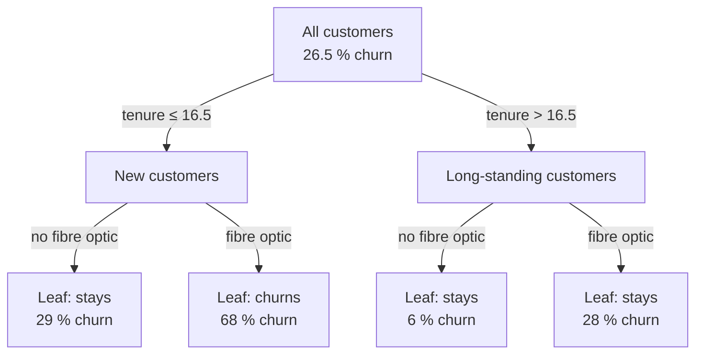
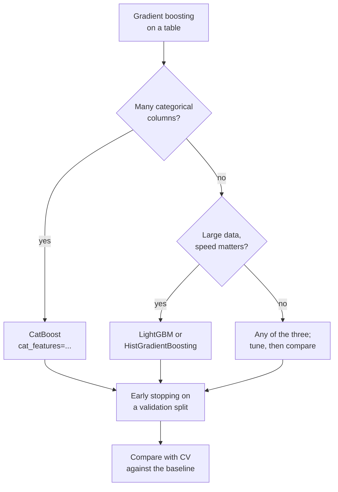

# Session 10 · Tree-based models

> **Guiding question.** Can a more flexible model do better, and what does it cost?

**Learning outcomes.** After this session you are able to

- explain how decision trees, random forests and gradient boosting predict
- train, tune and compare XGBoost, LightGBM and CatBoost
- interpret a tree ensemble

## Why this session matters

The linear models of Sessions 6 and 8 need hand-made features for non-linear effects and interactions. Decision trees find them by themselves, and ensembles of trees (random forests and gradient boosting) are the standard tools for tabular prediction in industry and in competitions. A more flexible model also costs something: it is harder to read, has more settings to tune and must beat the current model by more than the noise of the evaluation. This session uses the validation tools of Session 7 and the leakage checks of Session 9 to decide whether a tree ensemble is worth replacing the linear price model of Session 6. Later sessions build on these models: Session 11 adds cluster features to the gradient-boosting price model, and Session 12 uses tree models with lag features.

> This page is the teaching overview of the session. How to work with it (the ▶ links, the numbered notebooks, the extras) is explained once in the [course README](../../README.md#how-to-use-the-session-pages).

**Notes for this session**

- Sessions 10 and 11 are taught on the same teaching day.
- The lecture notebooks and the churn worked examples read the Telco data from GitHub; the exercises use the Airbnb data in `case-study/data/airbnb/`.

## Block 1 · From one tree to an ensemble

### Theory (45 min)

**Why.** A decision tree predicts by asking a sequence of yes/no questions about the features. Trees are the building block of every model in this session: random forests, gradient boosting, XGBoost, LightGBM and CatBoost all combine many of them. A single deep tree memorises its training data and changes a lot when the data change; averaging many trees (bagging, random forests) or adding small trees one after another (boosting) turns this weak point into the most accurate standard method for tables.

**Topics**

- **Splits and Gini impurity computed by hand.** Every tree-based model repeats this one operation thousands of times. Computing it once shows what the algorithm optimises, and why trees need no feature scaling and handle non-linear effects and interactions without feature engineering.
- **How a tree grows and how to read it.** Each path from the root to a leaf is an if-then rule. That is why small trees are used to describe segments, even when a more accurate model makes the predictions.
- **Tree depth, overfitting of deep trees and pruning.** Depth is a hyperparameter: a deep tree memorises the training data and its training score says nothing about performance. Limiting the growth (pre-pruning) or cost-complexity pruning controls this, with the limits chosen by cross-validation.
- **Bagging and random forests.** Averaging trees trained on bootstrap samples reduces variance, and choosing among a random subset of features at each split makes the trees more diverse. Random forests are accurate with almost no tuning and are the baseline any tabular model should beat. The out-of-bag score is a validation estimate that comes for free.
- **Gradient boosting.** Each small tree fits what the current model still gets wrong, scaled by a learning rate. Gradient-boosted trees are the most accurate standard method for tabular data in many benchmarks, but too many trees fit noise, so their number must be controlled.

▶ **Lecture:** [01-lecture-from-one-tree-to-an-ensemble.ipynb](workbooks/01-lecture-from-one-tree-to-an-ensemble.ipynb) covers all topics above on the Telco churn data.

▶ **Worked examples**

- [02-case-study-churn-decision-tree.ipynb](workbooks/02-case-study-churn-decision-tree.ipynb): a decision tree on the churn data, from the best first split by hand to depth curves, pruning with `ccp_alpha` and the drawn final tree.
- [03-ensemble-gradient-boosting.ipynb](workbooks/03-ensemble-gradient-boosting.ipynb): boosting as fitting residuals, step by step (INRIA MOOC).

### Exercises (30 min) and debrief (15 min)

▶ **Exercises:** [session-10-exercises.ipynb](workbooks/session-10-exercises.ipynb), part 1.

- **Gini by hand** (Paper, 10 min). The impurity of one node, then the best split of a table of ten listings.
- **Twenty questions** (Class, 10 min). Why is "Is it alive?" a good first question?
- **XOR** (Paper, 10 min). Which first split helps when no single split does?
- **Can a tree extrapolate?** (Predict and Code, 10 min). Predict the price a tree gives a listing for 16 guests, then check it on the Berlin data.
- **Wisdom of the crowd** (Class, 10 min). The class guesses the price of one listing; does the average beat the individuals?
- **Majority vote** (Paper, 10 min). How accurate is the vote of five independent 60 % models, and of five identical ones?
- **Boosting by hand** (Paper, 15 min). Two rounds of boosting on five prices.
- **Free validation** (Discussion, 5 min). Why does a random forest get an out-of-bag score for free?
- **A price tree and a forest** (Code, pairs, 20 min). Depth curve of a regression tree for the Berlin prices with host-grouped folds, then a random forest on the same folds. *Stretch:* how stable are the first splits of the chosen tree?

**Debrief.** Compare the weighted impurities of the candidate splits and look for the classic mistake: forgetting to weight the children by their size. In the code task, compare the chosen depths and check that every pair used host-grouped folds.

## Block 2 · Gradient boosting in practice and interpretation

### Theory (45 min)

**Why.** Three libraries, XGBoost, LightGBM and CatBoost, implement fast, regularised gradient boosting, and knowing their main parameters and few differences is enough for most projects. A boosted model with hundreds of trees cannot be read like the depth-2 tree of block 1. Yet we must know what it has learned: to check that it uses sensible information, to find leaks and bugs, and to explain it to the people who rely on it. Every model update also raises the question whether the new challenger is really better than the current model, by enough to replace it.

**Topics**

- **XGBoost, LightGBM and CatBoost.** All three fit gradient boosting with regularisation, row and column subsampling and native handling of missing values. They differ in how they grow trees and in their main complexity parameter. Which one wins on a given dataset is an empirical question, answered by cross-validation.
- **Categorical features.** The libraries can split a categorical column natively, which keeps the pipeline short. Each library expects categories in a specific form, and getting it wrong silently changes the model.
- **Class weights.** Weights move the predicted probabilities of the minority class upwards: recall rises, precision falls and ROC AUC hardly changes. They are a way of moving the decision rule, like lowering the threshold in Session 8.
- **Early stopping and tuning.** A validation set split off the training data decides the number of trees. Untuned boosting can be worse than a random forest; a randomised search over the few parameters that matter usually gains a little, and its best cross-validated score is optimistic, so a held-out score is reported next to it.
- **Impurity-based and permutation importance.** Impurity-based importance comes for free but favours features with many distinct values and also counts what the model used to fit noise. Permutation importance on held-out data shows what generalises.
- **SHAP values as a model-checking tool.** SHAP splits one prediction into additive contributions of the features. Used by the modeller, it finds leaks, bugs in the feature pipeline, data-quality problems in single rows and proxies.
- **Comparing the performance of models.** A challenger replaces the current model only if it is better on the same folds by more than the noise of the evaluation, and worth its extra cost.
- **The case study: what drives Berlin Airbnb prices, and do trees price better?** The Session 6 linear model is compared with LightGBM on everything the listing page offers, using host-grouped folds (Session 7) and keeping the leaky columns of Session 9 out.

▶ **Lecture:** [04-lecture-gradient-boosting-in-practice-and-interpretation.ipynb](workbooks/04-lecture-gradient-boosting-in-practice-and-interpretation.ipynb). Sections 1–5 cover the boosting libraries, Sections 6–9 interpretation and model comparison.

▶ **Worked examples**

- [05-case-study-churn-gradient-boosting.ipynb](workbooks/05-case-study-churn-gradient-boosting.ipynb): XGBoost, LightGBM and CatBoost on the churn data with the same folds, class weights, early stopping and a small randomised search.
- [06-case-study-airbnb-price-trees.ipynb](workbooks/06-case-study-airbnb-price-trees.ipynb): is a tree ensemble worth replacing the linear price model of Session 6? Five models on host-grouped folds, tuning, a paired comparison with a bootstrap interval, permutation importance, SHAP and a check that catches the revenue leak of Session 9. Runs in about three minutes.

### Exercises (30 min) and debrief (15 min)

▶ **Exercises:** [session-10-exercises.ipynb](workbooks/session-10-exercises.ipynb), part 2.

- **Class weights** (Predict, 5 min). What happens to ROC AUC, recall and precision when the churners get three times the weight?
- **A SHAP explanation in euros** (Paper, 10 min). Turn a base value and three SHAP contributions on the log scale into a price, and say which sentence about the listing would be wrong.
- **Replace the current model?** (Paper, 10 min). Read five paired fold errors and decide.
- **Native categories or one-hot?** (Code, 15 min). LightGBM on the Berlin prices with two encodings of district, room type and property type, on the same host-grouped folds.
- **Early stopping and the learning rate** (Code, 15 min). Validation curves of LightGBM for three learning rates on held-out hosts.
- **A random column** (Code, pairs, 15 min). *Stretch.* Add a column of random numbers and compare impurity-based and permutation importance.

**Debrief.** Compare the tables of the code tasks: were all models scored on the same folds, and was the early-stopping set taken from the training hosts only? In the SHAP task, look for the answer that adds the contributions on the euro scale.

## Team project until the next session

Interim review (10 minutes per team): data, validation plan, baselines, plan for Sessions 13–16. Sessions 10 and 11 share one teaching day, so the review covers the task of Session 11 as well.

## Extras (optional, self-study)

| Notebook | Content | Block |
|---|---|---|
| [extras/01-trees-classification.ipynb](workbooks/extras/01-trees-classification.ipynb) | The decision boundary of a tree on the penguins data (INRIA MOOC) | 1 |
| [extras/02-trees-hyperparameters.ipynb](workbooks/extras/02-trees-hyperparameters.ipynb) | The effect of `max_depth` and `min_samples_leaf` (INRIA MOOC) | 1 |
| [extras/03-tree-structure.ipynb](workbooks/extras/03-tree-structure.ipynb) | The arrays inside a fitted tree; decision path of one sample | 1 |
| [extras/04-cost-complexity-pruning.ipynb](workbooks/extras/04-cost-complexity-pruning.ipynb) | Cost-complexity pruning path | 1 |
| [extras/05-ensemble-bagging.ipynb](workbooks/extras/05-ensemble-bagging.ipynb) | Bootstrap samples and bagging step by step (INRIA MOOC) | 1 |
| [extras/06-ensemble-random-forest.ipynb](workbooks/extras/06-ensemble-random-forest.ipynb) | Random forests versus bagging on the Adult census data (INRIA MOOC) | 1 |
| [extras/07-hist-gradient-boosting.ipynb](workbooks/extras/07-hist-gradient-boosting.ipynb) | Histogram-based gradient boosting and its speed | 1 |
| [extras/08-islp-tree-based-methods-lab.ipynb](workbooks/extras/08-islp-tree-based-methods-lab.ipynb) | ISLP Chapter 8 lab: trees, bagging, random forests, boosting, BART. Needs `ISLP` | 1–2 |
| [extras/09-gradient-boosting-early-stopping.ipynb](workbooks/extras/09-gradient-boosting-early-stopping.ipynb) | Early stopping in scikit-learn's gradient boosting | 2 |
| [extras/10-gradient-boosting-categorical.ipynb](workbooks/extras/10-gradient-boosting-categorical.ipynb) | Native categorical support versus one-hot and ordinal encoding | 2 |
| [extras/11-ensemble-hyperparameters.ipynb](workbooks/extras/11-ensemble-hyperparameters.ipynb) | Tuning random forests and gradient boosting | 2 |
| [extras/12-catboost-tutorial.ipynb](workbooks/extras/12-catboost-tutorial.ipynb) | CatBoost's Python tutorial (Titanic): categorical features, CV, early stopping, tuning. Its data download from CatBoost's server failed in October 2026 (HTTP 500), so read it until the link works again | 2 |
| [extras/13-permutation-importance.ipynb](workbooks/extras/13-permutation-importance.ipynb) | Impurity importance versus permutation importance with random features | 2 |
| [extras/14-feature-importance.ipynb](workbooks/extras/14-feature-importance.ipynb) | Coefficients, impurity and permutation importance compared | 2 |
| [extras/15-shap-census-xgboost.ipynb](workbooks/extras/15-shap-census-xgboost.ipynb) | SHAP values for an XGBoost model on census income (outputs included) | 2 |
| [extras/16-shap-causal-caution.ipynb](workbooks/extras/16-shap-causal-caution.ipynb) | Why SHAP values are not causal effects. Read it with its stored outputs (needs `econml` and `graphviz` to run) | 2 |

## Before the session and further reading

**Before.** Re-read Session 7 on grouped cross-validation and `RandomizedSearchCV`, Session 6 on the linear price model, and Session 9 on leaking columns (the revenue leak). Make sure `case-study/data/airbnb/` exists (`uv run python case-study/prepare_airbnb.py`). Run the first code cell of [session-10-exercises.ipynb](workbooks/session-10-exercises.ipynb) once to check that the data load and that XGBoost, LightGBM and CatBoost import (see [Setup](#setup)).

**Further reading (optional)**

- James et al. (2023). *An Introduction to Statistical Learning with Applications in Python*, Chapter 8. Free PDF: https://www.statlearning.com/
- Molnar, C. *Interpretable Machine Learning*, chapters on permutation importance and SHAP. https://christophm.github.io/interpretable-ml-book/
- Amazon MLU. *MLU-Explain: Random Forest*, interactive article. https://mlu-explain.github.io/random-forest/
- INRIA. *scikit-learn MOOC*, module "Ensemble of models". https://inria.github.io/scikit-learn-mooc/ensemble/ensemble_module_intro.html

## Setup

The course environment (`uv sync`, then `uv run jupyter lab`) contains scikit-learn, XGBoost, LightGBM, CatBoost and SHAP.

- **macOS:** XGBoost and LightGBM need the OpenMP runtime. Install it once with `brew install libomp`; without it, `import xgboost` fails with an error about `libomp.dylib`.
- The notebooks that load the Telco data and the scikit-learn examples need an internet connection (GitHub, OpenML).
- [06-case-study-airbnb-price-trees.ipynb](workbooks/06-case-study-airbnb-price-trees.ipynb), Section 9 of the block 2 lecture and the exercises need the Inside Airbnb data (`uv run python case-study/prepare_airbnb.py`). The case study runs in about three minutes. Reference result: with host-grouped 5-fold CV, LightGBM on all features has an MAE of €46.5 a night against €56.9 for the Session 6 linear model.
- Some extras need more packages:

| Package | Needed by |
|---|---|
| `hyperopt` | extras 12 (CatBoost tutorial): `uv run --with hyperopt jupyter lab` |
| `ISLP` | extras 08 (ISLP lab): `uv run --with ISLP jupyter lab`, a large install because it pulls in PyTorch |
| `econml`, `graphviz` | extras 16 (SHAP causal caution), meant to be read with its stored outputs |

The INRIA notebooks read their data from `datasets/` in the session folder (`../../datasets/` from `workbooks/extras/`). To regenerate the figures of the lecture notebooks, run `uv run python sessions/10-tree-based-models/figures/make_figures.py`.

## Sources and licences

Keep the attribution when you reuse or share a file. Course-written material is licensed CC BY 4.0. Third-party notebooks keep their original licence.

**Course material (CC BY 4.0, course team)**

| File | Content |
|---|---|
| [01-lecture-from-one-tree-to-an-ensemble.ipynb](workbooks/01-lecture-from-one-tree-to-an-ensemble.ipynb), [04-lecture-gradient-boosting-in-practice-and-interpretation.ipynb](workbooks/04-lecture-gradient-boosting-in-practice-and-interpretation.ipynb) | Lecture notebooks of the two blocks |
| [figures/make_figures.py](figures/make_figures.py) and its PNGs (`tree_depth2_churn.png`, `tree_depth_vs_score.png`, `boosting_stages.png`, `price_model_interpretation.png`) | Depth-2 churn tree, depth versus training/CV accuracy, boosting stages, interpretation of the Berlin price model (permutation importance, SHAP of distance) |
| [02-case-study-churn-decision-tree.ipynb](workbooks/02-case-study-churn-decision-tree.ipynb) | Worked example of block 1: decision tree on the churn data |
| [05-case-study-churn-gradient-boosting.ipynb](workbooks/05-case-study-churn-gradient-boosting.ipynb) | Worked example of block 2: boosting libraries compared on the churn data |
| [06-case-study-airbnb-price-trees.ipynb](workbooks/06-case-study-airbnb-price-trees.ipynb) | Worked example of block 2: Berlin Airbnb price model: Session 6 linear model versus ridge, random forest, HistGradientBoosting and LightGBM on host-grouped folds, early stopping, randomised search, paired comparison with a cluster bootstrap, permutation importance, SHAP, leak check |
| [session-10-exercises.ipynb](workbooks/session-10-exercises.ipynb) | Exercises of both blocks |

**Third-party notebooks**

| File | Source | Licence | Downloaded | Changes |
|---|---|---|---|---|
| [03-ensemble-gradient-boosting.ipynb](workbooks/03-ensemble-gradient-boosting.ipynb) | [INRIA/scikit-learn-mooc](https://raw.githubusercontent.com/INRIA/scikit-learn-mooc/main/notebooks/ensemble_gradient_boosting.ipynb) | [CC BY 4.0](https://github.com/INRIA/scikit-learn-mooc/blob/main/LICENSE) | 2026-10-01 | Renamed from `ensemble_gradient_boosting.ipynb`; content unchanged |
| [extras/01-trees-classification.ipynb](workbooks/extras/01-trees-classification.ipynb) | [INRIA/scikit-learn-mooc](https://raw.githubusercontent.com/INRIA/scikit-learn-mooc/main/notebooks/trees_classification.ipynb) | [CC BY 4.0](https://github.com/INRIA/scikit-learn-mooc/blob/main/LICENSE) | 2026-10-01 | Renamed from `trees_classification.ipynb`; data path changed from `../datasets/` to `../../datasets/` for the `extras/` folder |
| [extras/02-trees-hyperparameters.ipynb](workbooks/extras/02-trees-hyperparameters.ipynb) | [INRIA/scikit-learn-mooc](https://raw.githubusercontent.com/INRIA/scikit-learn-mooc/main/notebooks/trees_hyperparameters.ipynb) | [CC BY 4.0](https://github.com/INRIA/scikit-learn-mooc/blob/main/LICENSE) | 2026-10-01 | Renamed from `trees_hyperparameters.ipynb`; data paths changed from `../datasets/` to `../../datasets/` for the `extras/` folder |
| [extras/03-tree-structure.ipynb](workbooks/extras/03-tree-structure.ipynb) | [scikit-learn example gallery 1.9](https://scikit-learn.org/stable/_downloads/f7a387851c5762610f4e8197e52bbbca/plot_unveil_tree_structure.ipynb) | [BSD-3-Clause](https://github.com/scikit-learn/scikit-learn/blob/main/COPYING) | 2026-10-01 | Renamed from `plot_unveil_tree_structure.ipynb`; content unchanged |
| [extras/04-cost-complexity-pruning.ipynb](workbooks/extras/04-cost-complexity-pruning.ipynb) | [scikit-learn example gallery 1.9](https://scikit-learn.org/stable/_downloads/29998264311e172e4afe243096ca2c93/plot_cost_complexity_pruning.ipynb) | [BSD-3-Clause](https://github.com/scikit-learn/scikit-learn/blob/main/COPYING) | 2026-10-01 | Renamed from `plot_cost_complexity_pruning.ipynb`; content unchanged |
| [extras/05-ensemble-bagging.ipynb](workbooks/extras/05-ensemble-bagging.ipynb) | [INRIA/scikit-learn-mooc](https://raw.githubusercontent.com/INRIA/scikit-learn-mooc/main/notebooks/ensemble_bagging.ipynb) | [CC BY 4.0](https://github.com/INRIA/scikit-learn-mooc/blob/main/LICENSE) | 2026-10-01 | Renamed from `ensemble_bagging.ipynb`; content unchanged |
| [extras/06-ensemble-random-forest.ipynb](workbooks/extras/06-ensemble-random-forest.ipynb) | [INRIA/scikit-learn-mooc](https://raw.githubusercontent.com/INRIA/scikit-learn-mooc/main/notebooks/ensemble_random_forest.ipynb) | [CC BY 4.0](https://github.com/INRIA/scikit-learn-mooc/blob/main/LICENSE) | 2026-10-01 | Renamed from `ensemble_random_forest.ipynb`; data path changed from `../datasets/` to `../../datasets/` for the `extras/` folder |
| [extras/07-hist-gradient-boosting.ipynb](workbooks/extras/07-hist-gradient-boosting.ipynb) | [INRIA/scikit-learn-mooc](https://raw.githubusercontent.com/INRIA/scikit-learn-mooc/main/notebooks/ensemble_hist_gradient_boosting.ipynb) | [CC BY 4.0](https://github.com/INRIA/scikit-learn-mooc/blob/main/LICENSE) | 2026-10-01 | Renamed from `ensemble_hist_gradient_boosting.ipynb`; content unchanged |
| [extras/08-islp-tree-based-methods-lab.ipynb](workbooks/extras/08-islp-tree-based-methods-lab.ipynb) | [intro-stat-learning/ISLP_labs](https://raw.githubusercontent.com/intro-stat-learning/ISLP_labs/main/Ch08-baggboost-lab.ipynb) | [BSD-2-Clause](https://github.com/intro-stat-learning/ISLP_labs/blob/main/LICENSE) | 2026-10-01 | Renamed from `Ch08-baggboost-lab.ipynb`; content unchanged |
| [extras/09-gradient-boosting-early-stopping.ipynb](workbooks/extras/09-gradient-boosting-early-stopping.ipynb) | [scikit-learn example gallery 1.9](https://scikit-learn.org/stable/_downloads/8452fc8dfe9850cfdaa1b758e5a2748b/plot_gradient_boosting_early_stopping.ipynb) | [BSD-3-Clause](https://github.com/scikit-learn/scikit-learn/blob/main/COPYING) | 2026-10-01 | Renamed from `plot_gradient_boosting_early_stopping.ipynb`; content unchanged |
| [extras/10-gradient-boosting-categorical.ipynb](workbooks/extras/10-gradient-boosting-categorical.ipynb) | [scikit-learn example gallery 1.9](https://scikit-learn.org/stable/_downloads/cd5de29451c4f8624f47d18def81839c/plot_gradient_boosting_categorical.ipynb) | [BSD-3-Clause](https://github.com/scikit-learn/scikit-learn/blob/main/COPYING) | 2026-10-01 | Renamed from `plot_gradient_boosting_categorical.ipynb`; content unchanged |
| [extras/11-ensemble-hyperparameters.ipynb](workbooks/extras/11-ensemble-hyperparameters.ipynb) | [INRIA/scikit-learn-mooc](https://raw.githubusercontent.com/INRIA/scikit-learn-mooc/main/notebooks/ensemble_hyperparameters.ipynb) | [CC BY 4.0](https://github.com/INRIA/scikit-learn-mooc/blob/main/LICENSE) | 2026-10-01 | Renamed from `ensemble_hyperparameters.ipynb`; content unchanged |
| [extras/12-catboost-tutorial.ipynb](workbooks/extras/12-catboost-tutorial.ipynb) | [catboost/tutorials](https://raw.githubusercontent.com/catboost/tutorials/master/python_tutorial.ipynb) | [Apache-2.0](https://github.com/catboost/tutorials/blob/master/LICENSE) | 2026-10-01 | Renamed from `python_tutorial.ipynb`; content unchanged |
| [extras/13-permutation-importance.ipynb](workbooks/extras/13-permutation-importance.ipynb) | [scikit-learn example gallery 1.9](https://scikit-learn.org/stable/_downloads/f99bb35c32eb8028063a1428c3999b84/plot_permutation_importance.ipynb) | [BSD-3-Clause](https://github.com/scikit-learn/scikit-learn/blob/main/COPYING) | 2026-10-01 | Renamed from `plot_permutation_importance.ipynb`; content unchanged |
| [extras/14-feature-importance.ipynb](workbooks/extras/14-feature-importance.ipynb) | [INRIA/scikit-learn-mooc](https://raw.githubusercontent.com/INRIA/scikit-learn-mooc/main/notebooks/dev_features_importance.ipynb) | [CC BY 4.0](https://github.com/INRIA/scikit-learn-mooc/blob/main/LICENSE) | 2026-10-01 | Renamed from `dev_features_importance.ipynb`; content unchanged |
| [extras/15-shap-census-xgboost.ipynb](workbooks/extras/15-shap-census-xgboost.ipynb) | [shap/shap](https://raw.githubusercontent.com/shap/shap/master/notebooks/tabular_examples/tree_based_models/Census%20income%20classification%20with%20XGBoost.ipynb) | [MIT](https://github.com/shap/shap/blob/master/LICENSE) | 2026-10-01 | Renamed from `Census income classification with XGBoost.ipynb`; content unchanged |
| [extras/16-shap-causal-caution.ipynb](workbooks/extras/16-shap-causal-caution.ipynb) | [shap/shap](https://raw.githubusercontent.com/shap/shap/master/notebooks/overviews/Be%20careful%20when%20interpreting%20predictive%20models%20in%20search%20of%20causal%20insights.ipynb) | [MIT](https://github.com/shap/shap/blob/master/LICENSE) | 2026-10-01 | Renamed from `Be careful when interpreting predictive models in search of causal insights.ipynb`; content unchanged |

**Data used by the INRIA notebooks** (copied unchanged from the [INRIA/scikit-learn-mooc datasets](https://github.com/INRIA/scikit-learn-mooc/tree/main/datasets), downloaded 2026-10-01, so the notebooks run without modification)

| File | Used by | Origin | Licence |
|---|---|---|---|
| [datasets/penguins_classification.csv](datasets/penguins_classification.csv), [datasets/penguins_regression.csv](datasets/penguins_regression.csv) | extras 01, 02 | palmerpenguins (Horst, Hill & Gorman, 2020) | [CC0-1.0](https://creativecommons.org/publicdomain/zero/1.0/) |
| [datasets/adult-census.csv](datasets/adult-census.csv) (5.4 MB) | extras 06 | UCI Adult dataset (Becker & Kohavi, 1996) | [CC BY 4.0](https://archive.ics.uci.edu/dataset/2/adult) |

**Case-study data.** IBM Telco customer churn sample data, https://github.com/IBM/telco-customer-churn-on-icp4d (Apache-2.0 repository), read from GitHub at run time. Inside Airbnb (2026), *Berlin, Germany*, snapshot of 26 June 2026, CC BY 4.0, prepared with `case-study/prepare_airbnb.py` (host names and other personal data removed), https://insideairbnb.com/get-the-data/.

<b>References cited in the lecture notebooks</b>

- Akiba, T., Sano, S., Yanase, T., Ohta, T. & Koyama, M. (2019). Optuna: a next-generation hyperparameter optimization framework. *Proceedings of KDD 2019*, 2623–2631. https://doi.org/10.1145/3292500.3330701
- Becker, B. & Kohavi, R. (1996). Adult [Dataset]. UCI Machine Learning Repository. https://doi.org/10.24432/C5XW20
- Belgiu, M. & Drăguţ, L. (2016). Random forest in remote sensing: a review of applications and future directions. *ISPRS Journal of Photogrammetry and Remote Sensing*, 114, 24–31. https://doi.org/10.1016/j.isprsjprs.2016.01.011
- Bernardi, L., Mavridis, T. & Estevez, P. (2019). 150 successful machine learning models: 6 lessons learned at Booking.com. *Proceedings of KDD 2019*, 1743–1751. https://doi.org/10.1145/3292500.3330744
- Board of Governors of the Federal Reserve System (2011). *SR 11-7: Guidance on Model Risk Management*. https://www.federalreserve.gov/supervisionreg/srletters/sr1107.htm
- Breiman, L. (1996). Bagging predictors. *Machine Learning*, 24, 123–140. https://doi.org/10.1007/BF00058655
- Breiman, L. (2001). Random forests. *Machine Learning*, 45, 5–32. https://doi.org/10.1023/A:1010933404324
- Breiman, L., Friedman, J. H., Olshen, R. A. & Stone, C. J. (1984). *Classification and Regression Trees*. Wadsworth.
- Burges, C. J. C. (2010). *From RankNet to LambdaRank to LambdaMART: an overview*. Microsoft Research Technical Report MSR-TR-2010-82.
- Chen, T. & Guestrin, C. (2016). XGBoost: a scalable tree boosting system. *Proceedings of KDD 2016*, 785–794. https://doi.org/10.1145/2939672.2939785
- Friedman, J. H. (2001). Greedy function approximation: a gradient boosting machine. *Annals of Statistics*, 29(5), 1189–1232. https://doi.org/10.1214/aos/1013203451
- Grinsztajn, L., Oyallon, E. & Varoquaux, G. (2022). Why do tree-based models still outperform deep learning on typical tabular data? *NeurIPS Datasets and Benchmarks*. https://arxiv.org/abs/2207.08815
- Horst, A. M., Hill, A. P. & Gorman, K. B. (2020). *palmerpenguins: Palmer Archipelago (Antarctica) penguin data*. R package version 0.1.0. https://allisonhorst.github.io/palmerpenguins/
- IBM (2019). *Telco customer churn sample data*. https://github.com/IBM/telco-customer-churn-on-icp4d
- Inside Airbnb (2026). *Berlin, Germany*, snapshot of 26 June 2026, CC BY 4.0. https://insideairbnb.com/get-the-data/
- James, G., Witten, D., Hastie, T., Tibshirani, R. & Taylor, J. (2023). *An Introduction to Statistical Learning with Applications in Python*. Springer. https://www.statlearning.com/
- Ke, G. et al. (2017). LightGBM: a highly efficient gradient boosting decision tree. *NeurIPS 30*. https://papers.nips.cc/paper_files/paper/2017/hash/6449f44a102fde848669bdd9eb6b76fa-Abstract.html
- Lundberg, S. M. & Lee, S.-I. (2017). A unified approach to interpreting model predictions. *NeurIPS 30*. https://arxiv.org/abs/1705.07874
- Lundberg, S. M. et al. (2018). Explainable machine-learning predictions for the prevention of hypoxaemia during surgery. *Nature Biomedical Engineering*, 2, 749–760. https://doi.org/10.1038/s41551-018-0304-0
- Lundberg, S. M. et al. (2020). From local explanations to global understanding with explainable AI for trees. *Nature Machine Intelligence*, 2, 56–67. https://doi.org/10.1038/s42256-019-0138-9
- Makridakis, S., Spiliotis, E. & Assimakopoulos, V. (2022). M5 accuracy competition: results, findings, and conclusions. *International Journal of Forecasting*, 38(4), 1346–1364. https://doi.org/10.1016/j.ijforecast.2021.11.013
- Molnar, C. (2025). *Interpretable Machine Learning*, 3rd edition. https://christophm.github.io/interpretable-ml-book/
- Prokhorenkova, L., Gusev, G., Vorobev, A., Dorogush, A. V. & Gulin, A. (2018). CatBoost: unbiased boosting with categorical features. *NeurIPS 31*. https://arxiv.org/abs/1706.09516
- Shotton, J. et al. (2011). Real-time human pose recognition in parts from single depth images. *CVPR 2011*, 1297–1304. https://doi.org/10.1109/CVPR.2011.5995316
- Stiell, I. G. et al. (1992). A study to develop clinical decision rules for the use of radiography in acute ankle injuries. *Annals of Emergency Medicine*, 21(4), 384–390. https://doi.org/10.1016/S0196-0644(05)82656-3
- Strobl, C., Boulesteix, A.-L., Zeileis, A. & Hothorn, T. (2007). Bias in random forest variable importance measures: illustrations, sources and a solution. *BMC Bioinformatics*, 8, 25. https://doi.org/10.1186/1471-2105-8-25

