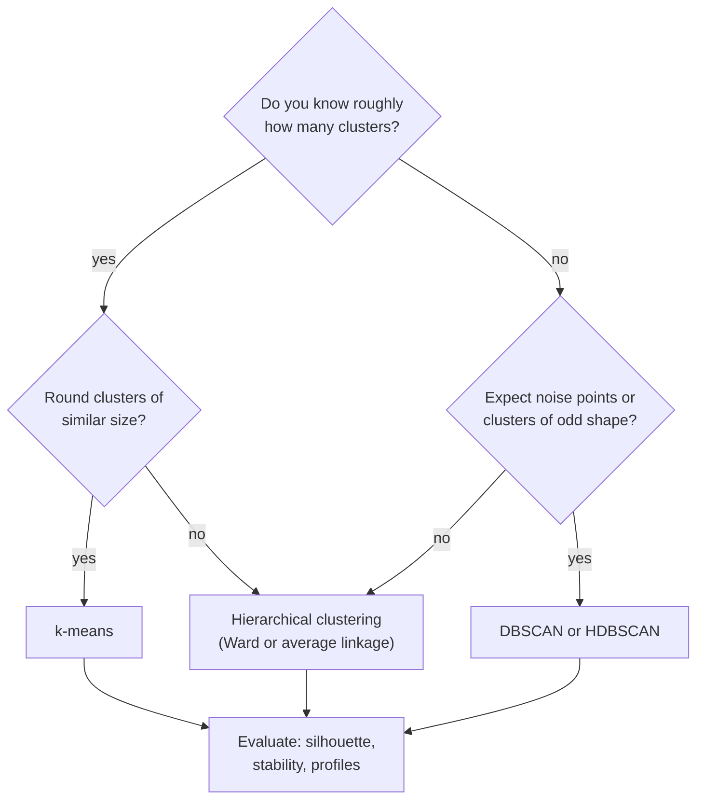
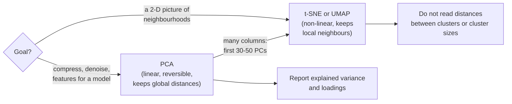

# Session 11 · Unsupervised learning

> **Guiding question.** What structure is in the data when there is no target to predict?

**Learning outcomes.** After this session you are able to

- distinguish unsupervised from supervised learning and explain why its evaluation is harder
- apply and evaluate k-means, hierarchical and density-based clustering
- reduce dimensionality with PCA, visualise high-dimensional data and detect anomalies

## Why this session matters

Until now every model in the course had a target: a price, a churn flag, a busy listing. Most data in organisations have no labels, and labelling costs time and money. Unsupervised methods give a first structure, such as segments, a map of the data or a list of suspicious rows, that people can then inspect, name and act on. This session uses the Telco customers of Sessions 6 and 8 without the churn label and the Berlin listings of Inside Airbnb. It continues the outlier detection of Session 4 with model-based detectors and tests whether clusters improve the gradient-boosting price model of Session 10. The text sessions later use the same tools: TF-IDF vectors (Session 13) and embeddings (Session 14) are clustered and mapped with these methods.

> This page is the teaching overview of the session. How to work with it (the ▶ links, the numbered notebooks, the extras) is explained once in the [course README](../../README.md#how-to-use-the-session-pages).

**Notes for this session**

- Sessions 10 and 11 are taught on the same teaching day.
- Both blocks share one Airbnb worked example, [03-case-study-airbnb-listing-segments.ipynb](workbooks/03-case-study-airbnb-listing-segments.ipynb): part A in block 1, parts B and C in block 2.

## Block 1 · Clustering

### Theory (45 min)

**Why.** Without a target there is no "correct" grouping to compare with, so we first need to know what unsupervised learning can and cannot deliver and how it is evaluated instead. Every distance-based method inherits the scale of the columns, so distances and scaling decide the result. k-means is the standard clustering method; hierarchical clustering and DBSCAN make other assumptions. A segmentation that changes with the random seed should not drive decisions, so evaluating a clustering matters as much as fitting it.

**Topics**

- **Supervised and unsupervised learning.** Unsupervised learning has only inputs and describes their structure: clusters, components or anomalies. Without a label, evaluation relies on internal criteria, stability and usefulness, and the label must stay out of the clustering.
- **Distance, similarity and scaling.** Without scaling, the column with the largest numbers decides the clusters, regardless of its importance. The choice of columns defines what "similar" means.
- **k-means computed by hand.** Assigning rows to the nearest centre and moving the centres to the means, step by step, shows why k-means prefers round clusters of similar size, why outliers pull the centres and why it depends on the start.
- **Choosing the number of clusters: elbow method and silhouette.** Both aids give evidence, not an answer; on real data k is also chosen by interpretability and purpose.
- **Hierarchical clustering and dendrograms.** The dendrogram shows structure at every level at once, so k need not be fixed in advance.
- **Density-based clustering: DBSCAN.** DBSCAN finds clusters of any shape and does not force every row into a cluster. Its one global density setting fails when clusters differ strongly in density; HDBSCAN addresses this.
- **Evaluating and interpreting clusters.** Separation (silhouette), stability under resampling and cluster profiles on the original scale, reported together, let a reader judge how much structure there really is.

▶ **Lecture:** [01-lecture-clustering.ipynb](workbooks/01-lecture-clustering.ipynb). The first sections use the Telco customers, the second half (from "From customers to listings") the Berlin listings.

▶ **Worked examples**

- [02-case-study-telco-segments.ipynb](workbooks/02-case-study-telco-segments.ipynb): k-means segments of the Telco customers, with elbow, silhouette, stability and a profile table.
- [03-case-study-airbnb-listing-segments.ipynb](workbooks/03-case-study-airbnb-listing-segments.ipynb), part A: what kinds of Airbnb offers exist in Berlin? k-means, Ward and DBSCAN on six numbers per listing, hot spots on the map, clusters described by district and room type.

### Exercises (30 min) and debrief (15 min)

▶ **Exercises:** [session-11-exercises.ipynb](workbooks/session-11-exercises.ipynb), part 1.

- **k-means with a bad start** (Paper, 15 min). Run k-means by hand on six numbers from two different starts.
- **Human k-means** (Class, 10 min). The room plays k-means with two students as centroids.
- **Age in years, income in euros** (Paper, 5 min). Nearest neighbours before and after scaling.
- **Draw where k-means fails** (Paper, 5 min). Two moons and concentric rings.
- **A family tree of languages** (Paper, pairs, 20 min). Edit distances between eight EU languages and a dendrogram built by hand.
- **Segments of the entire homes** (Code, 15 min). k-means on the entire homes only: which segments appear?
- **Hot spots with HDBSCAN** (Code, 15 min). HDBSCAN against DBSCAN on the map of listings.
- **Registration numbers per cluster** (Code, 10 min). *Stretch.* The share of listings with a registration number per cluster and hot spot.

**Debrief.** Compare the two k-means runs and their SSE: the mistake to look for is stopping after one iteration. In the code tasks, check that every pair standardised the features before clustering and described the clusters with variables that were not used to build them.

## Block 2 · Dimensionality reduction and anomaly detection

### Theory (45 min)

**Why.** Tables in practice have many columns, and people can only look at two or three at a time. Dimensionality reduction replaces many columns by a few new ones, for compact descriptions, pictures and model inputs. Data errors, fraud and genuinely new patterns appear as anomalies, and model-based detectors find unusual combinations that the column-by-column rules of Session 4 miss. Finally, clusters and components can be fed as features into a supervised model.

**Topics**

- **Principal component analysis: explained variance and loadings.** PCA summarises correlated columns in a few uncorrelated scores, which helps to plot, denoise and speed up later methods. It must run on standardised columns unless all columns share one unit.
- **t-SNE and UMAP for visualisation.** These non-linear methods draw 2-D maps that keep local neighbourhoods. Distances between groups, group sizes and empty space in such maps have no reliable meaning.
- **What do Airbnb listings offer? PCA of amenities.** Thousands of 0/1 amenity columns cannot be used directly; a few components with readable loadings are a compact description, and the loadings can also reveal how the data were collected.
- **Model-based anomaly detection: Isolation Forest and local outlier factor.** Univariate rules miss unusual combinations, and the Mahalanobis distance assumes one elliptical cloud. Isolation Forest isolates unusual rows with random splits; LOF compares the density around a row with that of its neighbours. No detector is best everywhere.
- **Clusters and components as features.** Cluster memberships, centroid distances, component scores and anomaly scores can be inputs to a supervised model. They are fitted preparation steps and belong inside the pipeline; whether they help is decided by comparing with and without under cross-validation.

▶ **Lecture:** [04-lecture-dimensionality-reduction-and-anomaly-detection.ipynb](workbooks/04-lecture-dimensionality-reduction-and-anomaly-detection.ipynb)

▶ **Worked examples**

- [03-case-study-airbnb-listing-segments.ipynb](workbooks/03-case-study-airbnb-listing-segments.ipynb), parts B and C: PCA of the amenities and a t-SNE map of the listings; implausible listings ranked with Isolation Forest, LOF and a price ratio; location clusters in the gradient-boosting price model of Session 10.
- [05-pca-intuitions.ipynb](workbooks/05-pca-intuitions.ipynb): the geometric intuition of PCA (INRIA MOOC).

### Exercises (30 min) and debrief (15 min)

▶ **Exercises:** [session-11-exercises.ipynb](workbooks/session-11-exercises.ipynb), part 2.

- **Height in cm and in inches** (Paper, 5 min). How many principal components does the table need?
- **The empty middle of a hypercube** (Paper, 5 min). What share of a 100-dimensional cube lies near a face?
- **Isolate the outlier** (Class, 10 min). Random cuts on a line of points: the idea of Isolation Forest.
- **PCA of the six listing features** (Code, 15 min). Explained variance, loadings and a map coloured by room type.
- **How stable is a LOF ranking?** (Code, 10 min). The top 20 implausible listings for three neighbourhood sizes.
- **Do location clusters help a linear model?** (Code, pairs, 20 min). The location-cluster comparison of the case study with ridge regression.
- **Amenities as a seventh clustering feature** (Code, 15 min). *Stretch.* How the segments change with the amenity score.

**Debrief.** In the PCA task, compare the names given to the components and check them against the loadings, not the plot. In the LOF and linear-model tasks, look for k-means or the scaler fitted outside the cross-validation.

## Team project until the next session

Open points from the interim review.

## Extras (optional, self-study)

| Notebook | Content | Block |
|---|---|---|
| [extras/01-pdsh-kmeans.ipynb](workbooks/extras/01-pdsh-kmeans.ipynb) | PDSH 5.11: k-means in depth, the expectation-maximisation view, its limits, digits and colour compression. Licence ND: use the file unchanged | 1 |
| [extras/02-kmeans-silhouette-analysis.ipynb](workbooks/extras/02-kmeans-silhouette-analysis.ipynb) | Silhouette plots for k = 2 to 6 | 1 |
| [extras/03-kmeans-assumptions.ipynb](workbooks/extras/03-kmeans-assumptions.ipynb) | Four situations in which k-means fails | 1 |
| [extras/04-agglomerative-dendrogram.ipynb](workbooks/extras/04-agglomerative-dendrogram.ipynb) | The dendrogram of an agglomerative clustering | 1 |
| [extras/05-linkage-comparison.ipynb](workbooks/extras/05-linkage-comparison.ipynb) | Single, average, complete and Ward linkage compared | 1 |
| [extras/06-dbscan.ipynb](workbooks/extras/06-dbscan.ipynb) | DBSCAN with core points, noise and evaluation metrics | 1 |
| [extras/07-hdbscan.ipynb](workbooks/extras/07-hdbscan.ipynb) | HDBSCAN for clusters of varying density | 1 |
| [extras/08-clustering-algorithms-compared.ipynb](workbooks/extras/08-clustering-algorithms-compared.ipynb) | Eleven clustering algorithms on six toy datasets | 1 |
| [extras/09-pca-as-preprocessing.ipynb](workbooks/extras/09-pca-as-preprocessing.ipynb) | Scaling before PCA, PCA in a pipeline (Ames housing) | 2 |
| [extras/10-pca-in-depth.ipynb](workbooks/extras/10-pca-in-depth.ipynb) | PDSH 5.09: PCA in depth, noise filtering, eigenfaces. Licence ND: use the file unchanged | 2 |
| [extras/11-pca-iris.ipynb](workbooks/extras/11-pca-iris.ipynb) | PCA of the iris data in 3-D | 2 |
| [extras/12-pca-components.ipynb](workbooks/extras/12-pca-components.ipynb) | Explained variance and the number of components (INRIA MOOC) | 2 |
| [extras/13-tsne-perplexity.ipynb](workbooks/extras/13-tsne-perplexity.ipynb) | How the perplexity changes a t-SNE map | 2 |
| [extras/14-manifold-learning.ipynb](workbooks/extras/14-manifold-learning.ipynb) | PDSH 5.10: manifold learning with MDS, LLE and Isomap. Licence ND: use the file unchanged | 2 |
| [extras/15-manifold-methods-compared.ipynb](workbooks/extras/15-manifold-methods-compared.ipynb) | Manifold methods including t-SNE on the S-curve | 2 |
| [extras/16-umap-parameters.ipynb](workbooks/extras/16-umap-parameters.ipynb) | UMAP parameters `n_neighbors`, `min_dist` and `metric` | 2 |
| [extras/17-anomaly-detection-compared.ipynb](workbooks/extras/17-anomaly-detection-compared.ipynb) | Four anomaly detectors on toy data | 2 |
| [extras/18-isolation-forest.ipynb](workbooks/extras/18-isolation-forest.ipynb) | The Isolation Forest decision boundary and path lengths | 2 |
| [extras/19-local-outlier-factor.ipynb](workbooks/extras/19-local-outlier-factor.ipynb) | Local outlier factor scores | 2 |
| [extras/20-outlier-detection-benchmark.ipynb](workbooks/extras/20-outlier-detection-benchmark.ipynb) | Isolation Forest and LOF on real benchmark data | 2 |
| [extras/21-islp-unsupervised-lab.ipynb](workbooks/extras/21-islp-unsupervised-lab.ipynb) | ISLP Chapter 12 lab: PCA, matrix completion, k-means and hierarchical clustering (review of the session). Needs `ISLP` | 1–2 |

## Before the session and further reading

**Before.** Read the first section of [01-lecture-clustering.ipynb](workbooks/01-lecture-clustering.ipynb). Make sure the Airbnb data exist in `case-study/data/airbnb/` (`uv run python case-study/prepare_airbnb.py`, see [case-study/README.md](../../case-study/README.md)).

**Further reading (optional)**

- James et al. (2023). *An Introduction to Statistical Learning with Applications in Python*, Chapter 12. https://www.statlearning.com/
- scikit-learn User Guide: [Clustering](https://scikit-learn.org/stable/modules/clustering.html), [Decomposition](https://scikit-learn.org/stable/modules/decomposition.html), [Outlier detection](https://scikit-learn.org/stable/modules/outlier_detection.html)
- Wattenberg, Viégas and Johnson (2016). *How to use t-SNE effectively*. Distill. https://distill.pub/2016/misread-tsne/
- Coenen and Pearce (2019). *Understanding UMAP*. Google PAIR. https://pair-code.github.io/understanding-umap/
- Inside Airbnb. *Data assumptions*: what the scraped listing data can and cannot show. https://insideairbnb.com/data-assumptions/

## Setup

Everything except the ISLP lab runs in the course environment (`uv sync` in the repository root, then `uv run jupyter lab`). It uses scikit-learn, scipy, matplotlib, seaborn and umap-learn.

- [extras/21-islp-unsupervised-lab.ipynb](workbooks/extras/21-islp-unsupervised-lab.ipynb) needs the `ISLP` package: `uv run --with ISLP jupyter lab`.
- The Telco data are read from GitHub, and some scikit-learn examples download datasets (`fetch_openml`, `fetch_lfw_people`, `fetch_kddcup99`) the first time they run.
- [03-case-study-airbnb-listing-segments.ipynb](workbooks/03-case-study-airbnb-listing-segments.ipynb) and the exercises read `case-study/data/airbnb/listings.parquet` and find the repository root by themselves; the case study runs in under a minute. Prepare the Airbnb data once from the repository root: `uv run python case-study/prepare_airbnb.py` (downloads the Inside Airbnb Berlin snapshot, about 100 MB).

The INRIA notebooks read `datasets/` in the session folder (`../datasets/` from `workbooks/`, `../../datasets/` from `extras/`). The PDSH notebooks show figures from `images/` next to the notebook (`workbooks/extras/images/` for extras 01, 10 and 14). To regenerate the figures of the lecture notebooks, run `uv run python sessions/11-unsupervised-learning/figures/make_figures.py`.

## Sources and licences

Keep the attribution when you reuse or share a file. Course-written material is licensed CC BY 4.0. Third-party notebooks keep their original licence; "ND" means the file must be shared unchanged, and "NC" means non-commercial use only. The PDSH notebooks [extras/01-pdsh-kmeans.ipynb](workbooks/extras/01-pdsh-kmeans.ipynb), [extras/10-pca-in-depth.ipynb](workbooks/extras/10-pca-in-depth.ipynb) and [extras/14-manifold-learning.ipynb](workbooks/extras/14-manifold-learning.ipynb) have a non-commercial, no-derivatives text licence (CC BY-NC-ND): use them unchanged.

**Course material (CC BY 4.0, course team)**

| File | Content |
|---|---|
| [01-lecture-clustering.ipynb](workbooks/01-lecture-clustering.ipynb), [04-lecture-dimensionality-reduction-and-anomaly-detection.ipynb](workbooks/04-lecture-dimensionality-reduction-and-anomaly-detection.ipynb) | Lecture notebooks of the two blocks |
| [figures/make_figures.py](figures/make_figures.py) and its PNGs (`kmeans_iterations.png`, `elbow_silhouette.png`, `dendrogram.png`, `pca_scree_biplot.png`, `amenities_pca.png`) | k-means iterations, elbow and silhouette, dendrogram, PCA scree plot and biplot, PCA of Airbnb amenities |
| [02-case-study-telco-segments.ipynb](workbooks/02-case-study-telco-segments.ipynb) | Worked example of block 1: k-means segmentation of the Telco customers |
| [03-case-study-airbnb-listing-segments.ipynb](workbooks/03-case-study-airbnb-listing-segments.ipynb) | Worked example of both blocks: segments and hot spots of Berlin Airbnb listings, PCA of amenities, t-SNE map, implausible listings, location clusters in a gradient-boosting price model |
| [session-11-exercises.ipynb](workbooks/session-11-exercises.ipynb) | Exercises of both blocks |

**Third-party notebooks**

| File | Source | Licence | Downloaded | Changes |
|---|---|---|---|---|
| [05-pca-intuitions.ipynb](workbooks/05-pca-intuitions.ipynb) | [INRIA/scikit-learn-mooc](https://raw.githubusercontent.com/INRIA/scikit-learn-mooc/main/notebooks/dimred_intuitions.ipynb) | [CC BY 4.0](https://github.com/INRIA/scikit-learn-mooc/blob/main/LICENSE) | 2026-09-26 | Renamed from `dimred_intuitions.ipynb`; content unchanged |
| [extras/01-pdsh-kmeans.ipynb](workbooks/extras/01-pdsh-kmeans.ipynb) | [jakevdp/PythonDataScienceHandbook](https://raw.githubusercontent.com/jakevdp/PythonDataScienceHandbook/master/notebooks/05.11-K-Means.ipynb) | [MIT (code)](https://github.com/jakevdp/PythonDataScienceHandbook/blob/master/LICENSE-CODE) / [CC BY-NC-ND 3.0 (text)](https://github.com/jakevdp/PythonDataScienceHandbook/blob/master/LICENSE-TEXT) **NC, ND** | 2026-10-01 | Renamed from `05.11-K-Means.ipynb`; content unchanged (ND: must stay unchanged) |
| [extras/02-kmeans-silhouette-analysis.ipynb](workbooks/extras/02-kmeans-silhouette-analysis.ipynb) | [scikit-learn example gallery 1.9](https://raw.githubusercontent.com/scikit-learn/scikit-learn.github.io/main/1.9/_downloads/2434f000f4405168e6285a3e410c709f/plot_kmeans_silhouette_analysis.ipynb) | [BSD-3-Clause](https://github.com/scikit-learn/scikit-learn/blob/main/COPYING) | 2026-10-01 | Renamed from `plot_kmeans_silhouette_analysis.ipynb`; content unchanged |
| [extras/03-kmeans-assumptions.ipynb](workbooks/extras/03-kmeans-assumptions.ipynb) | [scikit-learn example gallery 1.9](https://raw.githubusercontent.com/scikit-learn/scikit-learn.github.io/main/1.9/_downloads/b05e6cdf6d51481f37bf29b0bb92995e/plot_kmeans_assumptions.ipynb) | [BSD-3-Clause](https://github.com/scikit-learn/scikit-learn/blob/main/COPYING) | 2026-10-01 | Renamed from `plot_kmeans_assumptions.ipynb`; content unchanged |
| [extras/04-agglomerative-dendrogram.ipynb](workbooks/extras/04-agglomerative-dendrogram.ipynb) | [scikit-learn example gallery 1.9](https://raw.githubusercontent.com/scikit-learn/scikit-learn.github.io/main/1.9/_downloads/72d877fe6a0a97bfa8950a086a14a445/plot_agglomerative_dendrogram.ipynb) | [BSD-3-Clause](https://github.com/scikit-learn/scikit-learn/blob/main/COPYING) | 2026-10-01 | Renamed from `plot_agglomerative_dendrogram.ipynb`; content unchanged |
| [extras/05-linkage-comparison.ipynb](workbooks/extras/05-linkage-comparison.ipynb) | [scikit-learn example gallery 1.9](https://raw.githubusercontent.com/scikit-learn/scikit-learn.github.io/main/1.9/_downloads/be7e9c5a81790b318c3a8028ced647ff/plot_linkage_comparison.ipynb) | [BSD-3-Clause](https://github.com/scikit-learn/scikit-learn/blob/main/COPYING) | 2026-10-01 | Renamed from `plot_linkage_comparison.ipynb`; content unchanged |
| [extras/06-dbscan.ipynb](workbooks/extras/06-dbscan.ipynb) | [scikit-learn example gallery 1.9](https://raw.githubusercontent.com/scikit-learn/scikit-learn.github.io/main/1.9/_downloads/23a5a575578f08cc0071cc070953a655/plot_dbscan.ipynb) | [BSD-3-Clause](https://github.com/scikit-learn/scikit-learn/blob/main/COPYING) | 2026-10-01 | Renamed from `plot_dbscan.ipynb`; content unchanged |
| [extras/07-hdbscan.ipynb](workbooks/extras/07-hdbscan.ipynb) | [scikit-learn example gallery 1.9](https://raw.githubusercontent.com/scikit-learn/scikit-learn.github.io/main/1.9/_downloads/f92fcbee358b8c7063475033e6e9cde0/plot_hdbscan.ipynb) | [BSD-3-Clause](https://github.com/scikit-learn/scikit-learn/blob/main/COPYING) | 2026-10-01 | Renamed from `plot_hdbscan.ipynb`; content unchanged |
| [extras/08-clustering-algorithms-compared.ipynb](workbooks/extras/08-clustering-algorithms-compared.ipynb) | [scikit-learn example gallery 1.9](https://raw.githubusercontent.com/scikit-learn/scikit-learn.github.io/main/1.9/_downloads/803ca1bcd8dd2c364836a6784144355b/plot_cluster_comparison.ipynb) | [BSD-3-Clause](https://github.com/scikit-learn/scikit-learn/blob/main/COPYING) | 2026-10-01 | Renamed from `plot_cluster_comparison.ipynb`; content unchanged |
| [extras/09-pca-as-preprocessing.ipynb](workbooks/extras/09-pca-as-preprocessing.ipynb) | [INRIA/scikit-learn-mooc](https://raw.githubusercontent.com/INRIA/scikit-learn-mooc/main/notebooks/dimred_preprocessing.ipynb) | [CC BY 4.0](https://github.com/INRIA/scikit-learn-mooc/blob/main/LICENSE) | 2026-09-26 | Renamed from `dimred_preprocessing.ipynb`; content unchanged except the data path, changed from `../datasets/` to `../../datasets/` for the `extras/` folder |
| [extras/10-pca-in-depth.ipynb](workbooks/extras/10-pca-in-depth.ipynb) | [jakevdp/PythonDataScienceHandbook](https://raw.githubusercontent.com/jakevdp/PythonDataScienceHandbook/master/notebooks/05.09-Principal-Component-Analysis.ipynb) | [MIT (code)](https://github.com/jakevdp/PythonDataScienceHandbook/blob/master/LICENSE-CODE) / [CC BY-NC-ND 3.0 (text)](https://github.com/jakevdp/PythonDataScienceHandbook/blob/master/LICENSE-TEXT) **NC, ND** | 2026-09-26 | Renamed from `05.09-Principal-Component-Analysis.ipynb`; content unchanged |
| [extras/11-pca-iris.ipynb](workbooks/extras/11-pca-iris.ipynb) | [scikit-learn example gallery 1.9](https://raw.githubusercontent.com/scikit-learn/scikit-learn.github.io/main/1.9/_downloads/46b6a23d83637bf0f381ce9d8c528aa2/plot_pca_iris.ipynb) | [BSD-3-Clause](https://github.com/scikit-learn/scikit-learn/blob/main/COPYING) | 2026-09-26 | Renamed from `plot_pca_iris.ipynb`; content unchanged |
| [extras/12-pca-components.ipynb](workbooks/extras/12-pca-components.ipynb) | [INRIA/scikit-learn-mooc](https://raw.githubusercontent.com/INRIA/scikit-learn-mooc/main/notebooks/dimred_components.ipynb) | [CC BY 4.0](https://github.com/INRIA/scikit-learn-mooc/blob/main/LICENSE) | 2026-09-26 | Renamed from `dimred_components.ipynb`; content unchanged |
| [extras/13-tsne-perplexity.ipynb](workbooks/extras/13-tsne-perplexity.ipynb) | [scikit-learn example gallery 1.9](https://raw.githubusercontent.com/scikit-learn/scikit-learn.github.io/main/1.9/_downloads/8b98cea0e0ec1ca3cc503c13ddac0537/plot_t_sne_perplexity.ipynb) | [BSD-3-Clause](https://github.com/scikit-learn/scikit-learn/blob/main/COPYING) | 2026-10-01 | Renamed from `plot_t_sne_perplexity.ipynb`; content unchanged |
| [extras/14-manifold-learning.ipynb](workbooks/extras/14-manifold-learning.ipynb) | [jakevdp/PythonDataScienceHandbook](https://raw.githubusercontent.com/jakevdp/PythonDataScienceHandbook/master/notebooks/05.10-Manifold-Learning.ipynb) | [MIT (code)](https://github.com/jakevdp/PythonDataScienceHandbook/blob/master/LICENSE-CODE) / [CC BY-NC-ND 3.0 (text)](https://github.com/jakevdp/PythonDataScienceHandbook/blob/master/LICENSE-TEXT) **NC, ND** | 2026-09-26 | Renamed from `05.10-Manifold-Learning.ipynb`; content unchanged |
| [extras/15-manifold-methods-compared.ipynb](workbooks/extras/15-manifold-methods-compared.ipynb) | [scikit-learn example gallery 1.9](https://raw.githubusercontent.com/scikit-learn/scikit-learn.github.io/main/1.9/_downloads/c8db473878b6afea8e75e36dc828f109/plot_compare_methods.ipynb) | [BSD-3-Clause](https://github.com/scikit-learn/scikit-learn/blob/main/COPYING) | 2026-09-26 | Renamed from `plot_compare_methods.ipynb`; content unchanged |
| [extras/16-umap-parameters.ipynb](workbooks/extras/16-umap-parameters.ipynb) | [lmcinnes/umap](https://raw.githubusercontent.com/lmcinnes/umap/master/notebooks/UMAP%20usage%20and%20parameters.ipynb) | [BSD-3-Clause](https://github.com/lmcinnes/umap/blob/master/LICENSE.txt) | 2026-09-26 | Renamed from `UMAP usage and parameters.ipynb`; content unchanged. The text `../spectral.py:229: UserWarning` in one stored output is a warning printed by the umap-learn module `umap/spectral.py` when the authors ran the notebook; it is not a file the notebook needs |
| [extras/17-anomaly-detection-compared.ipynb](workbooks/extras/17-anomaly-detection-compared.ipynb) | [scikit-learn example gallery 1.9](https://raw.githubusercontent.com/scikit-learn/scikit-learn.github.io/main/1.9/_downloads/1916a2a88b97d84ae7b7fb44d3f5503b/plot_anomaly_comparison.ipynb) | [BSD-3-Clause](https://github.com/scikit-learn/scikit-learn/blob/main/COPYING) | 2026-09-26 | Renamed from `plot_anomaly_comparison.ipynb`; content unchanged |
| [extras/18-isolation-forest.ipynb](workbooks/extras/18-isolation-forest.ipynb) | [scikit-learn example gallery 1.9](https://raw.githubusercontent.com/scikit-learn/scikit-learn.github.io/main/1.9/_downloads/f39c19ddd9f1c49a604c054eff707568/plot_isolation_forest.ipynb) | [BSD-3-Clause](https://github.com/scikit-learn/scikit-learn/blob/main/COPYING) | 2026-09-26 | Renamed from `plot_isolation_forest.ipynb`; content unchanged |
| [extras/19-local-outlier-factor.ipynb](workbooks/extras/19-local-outlier-factor.ipynb) | [scikit-learn example gallery 1.9](https://raw.githubusercontent.com/scikit-learn/scikit-learn.github.io/main/1.9/_downloads/a91fcd567e6bc2540b34f44d599d3531/plot_lof_outlier_detection.ipynb) | [BSD-3-Clause](https://github.com/scikit-learn/scikit-learn/blob/main/COPYING) | 2026-09-26 | Renamed from `plot_lof_outlier_detection.ipynb`; content unchanged |
| [extras/20-outlier-detection-benchmark.ipynb](workbooks/extras/20-outlier-detection-benchmark.ipynb) | [scikit-learn example gallery 1.9](https://raw.githubusercontent.com/scikit-learn/scikit-learn.github.io/main/1.9/_downloads/eacb6a63c887dafcff02b3cee64854ef/plot_outlier_detection_bench.ipynb) | [BSD-3-Clause](https://github.com/scikit-learn/scikit-learn/blob/main/COPYING) | 2026-09-26 | Renamed from `plot_outlier_detection_bench.ipynb`; content unchanged |
| [extras/21-islp-unsupervised-lab.ipynb](workbooks/extras/21-islp-unsupervised-lab.ipynb) | [intro-stat-learning/ISLP_labs](https://raw.githubusercontent.com/intro-stat-learning/ISLP_labs/main/Ch12-unsup-lab.ipynb) | [BSD-2-Clause](https://github.com/intro-stat-learning/ISLP_labs/blob/main/LICENSE) | 2026-09-26 | Renamed from `Ch12-unsup-lab.ipynb`; content unchanged. Needs the package `ISLP` |

**Supporting files and data**

| File | Used by | Source | Licence | Downloaded | Changes |
|---|---|---|---|---|---|
| [workbooks/extras/images/](workbooks/extras/images) (`05.09-…`, `05.10-…`, `05.11-…`) | extras 01, 10 and 14 (Markdown images `images/…`) | [jakevdp/PythonDataScienceHandbook, `notebooks/figures/`](https://github.com/jakevdp/PythonDataScienceHandbook/tree/master/notebooks/figures) | [CC BY-NC-ND 3.0](https://github.com/jakevdp/PythonDataScienceHandbook/blob/master/LICENSE-TEXT) **NC, ND** | 2026-10-01 | Copied unchanged into `images/`, the folder name the notebooks reference |
| [datasets/penguins_classification.csv](datasets/penguins_classification.csv) | 05 | [INRIA/scikit-learn-mooc, `datasets/`](https://github.com/INRIA/scikit-learn-mooc/tree/main/datasets) | [CC BY 4.0](https://github.com/INRIA/scikit-learn-mooc/blob/main/LICENSE) (data: Palmer penguins, Gorman et al. 2014, CC0) | 2026-09-26 | Unchanged |
| [datasets/ames_housing_no_missing.csv](datasets/ames_housing_no_missing.csv) | extras 09 | [INRIA/scikit-learn-mooc, `datasets/`](https://github.com/INRIA/scikit-learn-mooc/tree/main/datasets) | [CC BY 4.0](https://github.com/INRIA/scikit-learn-mooc/blob/main/LICENSE) (data: De Cock 2011) | 2026-09-26 | Unchanged |

**Case-study data.** IBM (2019), *Telco customer churn sample data*, read from GitHub at run time. Inside Airbnb (2026), *Berlin, snapshot of 26 June 2026* (listings), CC BY 4.0, prepared by `case-study/prepare_airbnb.py` (personal data removed).

<b>References cited in the lecture notebooks</b>

- Ahlqvist, E. et al. (2018). Novel subgroups of adult-onset diabetes and their association with outcomes. *The Lancet Diabetes & Endocrinology*, 6(5), 361–369. https://doi.org/10.1016/S2213-8587(18)30051-2
- Becht, E. et al. (2019). Dimensionality reduction for visualizing single-cell data using UMAP. *Nature Biotechnology*, 37, 38–44. https://doi.org/10.1038/nbt.4314
- Breunig, M. M., Kriegel, H.-P., Ng, R. T. and Sander, J. (2000). LOF: identifying density-based local outliers. *Proc. ACM SIGMOD 2000*, 93–104. https://doi.org/10.1145/342009.335388
- Coates, A. and Ng, A. Y. (2012). Learning feature representations with k-means. In *Neural Networks: Tricks of the Trade*, 2nd ed., 561–580. Springer. https://doi.org/10.1007/978-3-642-35289-8_30
- Coenen, A. and Pearce, A. (2019). *Understanding UMAP*. Google PAIR. https://pair-code.github.io/understanding-umap/
- Dal Pozzolo, A., Caelen, O., Johnson, R. A. and Bontempi, G. (2015). Calibrating probability with undersampling for unbalanced classification. *IEEE Symposium Series on Computational Intelligence*. https://doi.org/10.1109/SSCI.2015.33
- Eisen, M. B., Spellman, P. T., Brown, P. O. and Botstein, D. (1998). Cluster analysis and display of genome-wide expression patterns. *PNAS*, 95(25), 14863–14868. https://doi.org/10.1073/pnas.95.25.14863
- Ester, M., Kriegel, H.-P., Sander, J. and Xu, X. (1996). A density-based algorithm for discovering clusters in large spatial databases with noise. *Proc. KDD-96*, 226–231. https://cdn.aaai.org/KDD/1996/KDD96-037.pdf
- Hennig, C. (2007). Cluster-wise assessment of cluster stability. *Computational Statistics & Data Analysis*, 52(1), 258–271. https://doi.org/10.1016/j.csda.2006.11.025
- Hyndman, R. J. (2026). *That's Weird: Anomaly Detection Using R*. OTexts. https://otexts.com/weird/
- IBM (2019). *Telco customer churn sample data*. https://github.com/IBM/telco-customer-churn-on-icp4d
- Inside Airbnb (2026). *Berlin, snapshot of 26 June 2026* (listings), prepared by `case-study/prepare_airbnb.py` (personal data removed). Creative Commons Attribution 4.0 International (CC BY 4.0). https://insideairbnb.com/get-the-data/
- James, G., Witten, D., Hastie, T., Tibshirani, R. and Taylor, J. (2023). *An Introduction to Statistical Learning with Applications in Python*. Springer. https://www.statlearning.com/
- Kaufman, L. and Rousseeuw, P. J. (1990). *Finding Groups in Data: An Introduction to Cluster Analysis*. Wiley. https://doi.org/10.1002/9780470316801
- Koren, Y., Bell, R. and Volinsky, C. (2009). Matrix factorization techniques for recommender systems. *Computer*, 42(8), 30–37. https://doi.org/10.1109/MC.2009.263
- Linde, Y., Buzo, A. and Gray, R. M. (1980). An algorithm for vector quantizer design. *IEEE Transactions on Communications*, 28(1), 84–95. https://doi.org/10.1109/TCOM.1980.1094577
- Litterman, R. and Scheinkman, J. (1991). Common factors affecting bond returns. *The Journal of Fixed Income*, 1(1), 54–61. https://doi.org/10.3905/jfi.1991.692347
- Liu, F. T., Ting, K. M. and Zhou, Z.-H. (2008). Isolation forest. *Proc. 8th IEEE ICDM*, 413–422. https://doi.org/10.1109/ICDM.2008.17
- McInnes, L., Healy, J. and Melville, J. (2018). UMAP: uniform manifold approximation and projection for dimension reduction. arXiv:1802.03426. https://arxiv.org/abs/1802.03426
- Novembre, J. et al. (2008). Genes mirror geography within Europe. *Nature*, 456, 98–101. https://doi.org/10.1038/nature07331
- OECD (2017). *PISA 2015 Technical Report*, Chapter 16 (the index of economic, social and cultural status, ESCS). OECD Publishing. https://www.oecd.org/pisa/data/2015-technical-report/
- Office for National Statistics (2014). *2011 Area Classification for Output Areas*. https://www.ons.gov.uk/methodology/geography/geographicalproducts/areaclassifications/2011areaclassifications
- Perou, C. M. et al. (2000). Molecular portraits of human breast tumours. *Nature*, 406, 747–752. https://doi.org/10.1038/35021093
- Rousseeuw, P. J. (1987). Silhouettes: a graphical aid to the interpretation and validation of cluster analysis. *Journal of Computational and Applied Mathematics*, 20, 53–65. https://doi.org/10.1016/0377-0427(87)90125-7
- scikit-learn developers (2026). *scikit-learn User Guide*, version 1.9. https://scikit-learn.org/stable/user_guide.html
- Tibshirani, R., Walther, G. and Hastie, T. (2001). Estimating the number of clusters in a data set via the gap statistic. *Journal of the Royal Statistical Society B*, 63(2), 411–423. https://doi.org/10.1111/1467-9868.00293
- Turk, M. and Pentland, A. (1991). Eigenfaces for recognition. *Journal of Cognitive Neuroscience*, 3(1), 71–86. https://doi.org/10.1162/jocn.1991.3.1.71
- van der Maaten, L. and Hinton, G. (2008). Visualizing data using t-SNE. *Journal of Machine Learning Research*, 9, 2579–2605. https://www.jmlr.org/papers/v9/vandermaaten08a.html
- VanderPlas, J. (2016). *Python Data Science Handbook*. O'Reilly. https://jakevdp.github.io/PythonDataScienceHandbook/
- Wattenberg, M., Viégas, F. and Johnson, I. (2016). How to use t-SNE effectively. *Distill*. https://doi.org/10.23915/distill.00002

