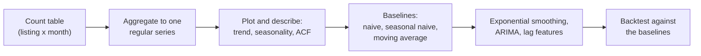
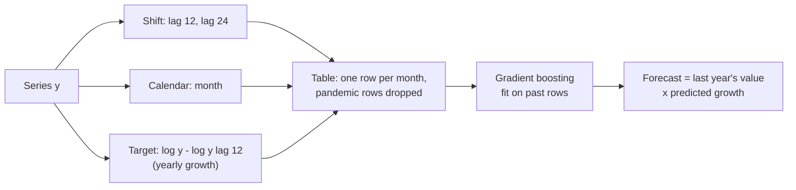

# Session 12 · Time series forecasting

> **Guiding question.** How much will happen next month, and how certain is the forecast?

**Learning outcomes.** After this session you are able to

- describe a time series and produce baseline forecasts
- fit an exponential smoothing model and a lag-feature model
- evaluate forecasts with backtesting and report prediction intervals

## Why this session matters

Many practical questions are about the future of one quantity: how many stays, how many requests, how much demand next month. Neighbouring months are not independent observations, so the random splits and ordinary cross-validation of Session 7 do not apply, and time series need their own methods. This session builds a forecast of Airbnb demand in Berlin from the monthly number of guest reviews, compares it with simple baselines, and brings forecasting back to the tree-based models of Session 10 through lag features. It also tests whether the daily Berlin weather from the Open-Meteo API, which `case-study/prepare_airbnb.py` downloads with the Airbnb data, improves the forecast.

> This page is the teaching overview of the session. How to work with it (the ▶ links, the numbered notebooks, the extras) is explained once in the [course README](../../README.md#how-to-use-the-session-pages).

**Notes for this session**

- Both blocks share one worked example, [02-case-study-airbnb-review-forecast.ipynb](workbooks/02-case-study-airbnb-review-forecast.ipynb): parts 1 and 2 in block 1, part 3 in block 2.

## Block 1 · Time series, baselines and exponential smoothing

### Theory (45 min)

**Why.** Before any model, three things have to be done: describe the series, build it correctly from count data, and compute the baselines that every later model must beat. The example is demand for short-term rentals in Berlin, measured by the number of guest reviews per month on Airbnb: a clear trend, a strong summer season and a deep break during the COVID-19 pandemic. Exponential smoothing extends the baselines to trend and seasonality, and its statistical form, ETS, gives prediction intervals: decisions depend on the range more than on the point.



**Topics**

- **Trend, seasonality and autocorrelation.** The components say what a forecasting model must capture. Autocorrelation is the reason neighbouring months cannot be treated as independent observations. STL separates trend, season and remainder, and its robust version keeps a one-off shock such as the pandemic from distorting the seasonal pattern.
- **Aggregating to regular time intervals with pandas.** The frequency is a modelling decision. Many forecasting errors start with a badly built series: missing periods, a partial last month, a definition that changes over time.
- **Baselines: naive, seasonal naive and moving average.** Without a baseline, a complex model can look useful while being worse than "same as last year".
- **Exponential smoothing.** Simple exponential smoothing, Holt and Holt–Winters average the past with weights that decrease with age. The model has no notion of "this period was exceptional", so we must decide whether to keep, cut or mark the pandemic months.
- **Prediction intervals.** ETS models give a range that should contain the future value with a stated probability, which is what a host, a cleaning company or a city office needs to plan.
- **ARIMA as an outlook.** ARIMA is the other classical family of forecasting models. Seasonal ARIMA can step over missing months, which offers a third way to handle the pandemic.

▶ **Lecture:** [01-lecture-time-series-baselines-and-exponential-smoothing.ipynb](workbooks/01-lecture-time-series-baselines-and-exponential-smoothing.ipynb)

▶ **Worked examples**

- [02-case-study-airbnb-review-forecast.ipynb](workbooks/02-case-study-airbnb-review-forecast.ipynb), parts 1 and 2: the monthly review series with its quality checks and baselines; exponential smoothing with a prediction interval, the treatment of the pandemic months and the airline ARIMA model.
- [03-exponential-smoothing.ipynb](workbooks/03-exponential-smoothing.ipynb): SES, Holt and Holt–Winters with damped trends in statsmodels.

### Exercises (30 min) and debrief (15 min)

▶ **Exercises:** [session-12-exercises.ipynb](workbooks/session-12-exercises.ipynb), part 1.

- **Which chart is real?** (Class, 5 min). One real series and three random walks.
- **Class forecast tournament** (Class, 15 min). Forecast three months of Berlin reviews by hand and compete with the seasonal naive rule.
- **Spurious correlation** (Code, 10 min). How often do two independent random walks correlate?
- **Exponential smoothing by hand** (Paper, 10 min). Four values, α = 0.5.
- **January against February** (Discussion, 5 min). Lower demand or a shorter month?
- **How much history for ETS?** (Code, 15 min). The same ETS model fitted from three different start months.
- **A lockdown dummy** (Code, 15 min). *Stretch.* Three ways to treat the pandemic in the airline model.

**Debrief.** Compare the hand forecasts with the seasonal naive rule and ask who used last year's growth. In the ETS task, look at how much the error and the interval move with the start month: a single hold-out year cannot settle it.

## Block 2 · Machine learning forecasts and backtesting

### Theory (45 min)

**Why.** A regression model can forecast once the series is turned into a table of lag features, which lets forecasting use everything from Sessions 8–10. To choose between the baselines, exponential smoothing, ARIMA and the machine-learning model, one hold-out year is not enough: forecast accuracy varies strongly from year to year. Rolling-origin backtesting repeats the test from several forecast origins, the forecasting version of the cross-validation of Session 7.



**Topics**

- **Machine learning with lag features.** Lags and calendar features turn the series into a table for the tree-based models of Session 10. A feature may only use information available when the forecast is made.
- **Rolling-origin backtesting.** Fit up to a forecast origin, forecast the next months, move the origin and repeat. It shows how often a model beats the baseline and how large its worst errors are.
- **Forecast metrics: MAE and MASE.** MAE is in the units of the series and easy to explain. MASE scales the error by the seasonal naive forecast, so it is comparable across series and folds. Coverage checks whether the prediction intervals are as wide as they claim.
- **Does the Berlin weather add anything?** A short test of an external regressor, the daily Berlin weather from the Open-Meteo API that `case-study/prepare_airbnb.py` stores next to the Airbnb data.
- **Recommending a model.** Read the backtest, choose a model with its interval, and state the assumptions and caveats next to the numbers.

▶ **Lecture:** [04-lecture-lag-features-and-backtesting.ipynb](workbooks/04-lecture-lag-features-and-backtesting.ipynb)

▶ **Worked examples**

- [02-case-study-airbnb-review-forecast.ipynb](workbooks/02-case-study-airbnb-review-forecast.ipynb), part 3: how many Airbnb stays should Berlin expect next year? A lag-feature model, a backtest from six forecast origins, the Berlin weather as a regressor, and a recommendation with its 12-month forecast and prediction interval.
- [05-lagged-features-gradient-boosting.ipynb](workbooks/05-lagged-features-gradient-boosting.ipynb): lag features with gradient boosting, quantile losses and `TimeSeriesSplit` on bike-sharing data (scikit-learn gallery).

### Exercises (30 min) and debrief (15 min)

▶ **Exercises:** [session-12-exercises.ipynb](workbooks/session-12-exercises.ipynb), part 2.

- **Shuffled k-fold on a time series** (Predict, 5 min). Why is the score too optimistic?
- **MASE of 1.2** (Paper, 3 min). What does it mean?
- **MASE by hand** (Paper, 5 min). The MASE of two quarterly forecasts.
- **Bookable nights are not demand** (Code, 15 min). The share of available nights per month from the calendar of the snapshot.
- **Backtest origins every month** (Code, pairs, 20 min). Sixteen origins instead of six for two baselines.
- **Level or growth as the target?** (Code, 20 min). *Stretch.* Why a tree cannot forecast above what it has seen.

**Debrief.** Compare the MASE scales: the common mistake is to compute the scale on the test data or with m = 1. In the backtest, ask how many of the sixteen folds are really independent.

## Team project until the next session

Open points from the interim review.

## Extras (optional, self-study)

| Notebook | Content | Block |
|---|---|---|
| [extras/01-stl-decomposition.ipynb](workbooks/extras/01-stl-decomposition.ipynb) | STL decomposition in statsmodels: robust fitting, seasonal and trend smoothers (CO₂ data) | 1 |
| [extras/02-ets-models.ipynb](workbooks/extras/02-ets-models.ipynb) | ETS state-space models with prediction intervals (`ETSModel`) | 1 |
| [extras/03-statsforecast-quickstart.ipynb](workbooks/extras/03-statsforecast-quickstart.ipynb) | StatsForecast quick start: data format, AutoARIMA, forecasts with intervals (air passengers). Needs the Nixtla packages (see [Setup](#setup)) | 1 |
| [extras/04-arima.ipynb](workbooks/extras/04-arima.ipynb) | ARIMA models in statsmodels: specification, trends, forecasting | 1 |
| [extras/05-time-related-feature-engineering.ipynb](workbooks/extras/05-time-related-feature-engineering.ipynb) | Calendar features: one-hot, cyclical (sine/cosine) and spline encodings (scikit-learn) | 2 |
| [extras/06-statsforecast-cross-validation.ipynb](workbooks/extras/06-statsforecast-cross-validation.ipynb) | Rolling-origin cross-validation of many series with StatsForecast (M4 hourly). Needs the Nixtla packages | 2 |
| [extras/07-mlforecast-walkthrough.ipynb](workbooks/extras/07-mlforecast-walkthrough.ipynb) | MLForecast end to end: lag features, target transforms, LightGBM, cross-validation, prediction intervals. Needs the Nixtla packages and LightGBM; saves its figures to `figs/` next to the notebook | 2 |

## Before the session and further reading

**Before.** Skim Chapter 2 (time series graphics) of *Forecasting: Principles and Practice, the Pythonic Way* and run part 1 of [02-case-study-airbnb-review-forecast.ipynb](workbooks/02-case-study-airbnb-review-forecast.ipynb). It needs the Airbnb data and the Berlin weather in `case-study/data/airbnb/` (see [case-study/README.md](../../case-study/README.md)).

**Further reading (optional)**

- Hyndman et al. (2026). *Forecasting: Principles and Practice, the Pythonic Way*. OTexts. Chapters 2–3, 5, 8–9. https://otexts.com/fpppy/
- Hyndman and Koehler (2006). Another look at measures of forecast accuracy. *International Journal of Forecasting*. https://doi.org/10.1016/j.ijforecast.2006.03.001
- Nixtla. *StatsForecast cross-validation tutorial* (https://nixtlaverse.nixtla.io/statsforecast/docs/tutorials/crossvalidation.html) and *MLForecast end-to-end walkthrough* (https://nixtlaverse.nixtla.io/mlforecast/docs/getting-started/end_to_end_walkthrough.html).
- statsmodels. *Time series analysis (`tsa`)*. https://www.statsmodels.org/stable/tsa.html
- Inside Airbnb. *Data assumptions*: how listings, calendars and reviews are scraped, and what the data cannot show. https://insideairbnb.com/data-assumptions/

## Setup

Prepare the Airbnb data once from the repository root (downloads the Berlin snapshot of Inside Airbnb, about 100 MB, and the daily Berlin weather from Open-Meteo):

```bash
uv run python case-study/prepare_airbnb.py
```

The lecture notebooks, the case study, the exercises and workbooks 03 and 05, as well as extras 01, 02, 04 and 05, run in the course environment: open them in VS Code with the `.venv` kernel (setup: [course README](../../README.md#setup)).

The Nixtla extras 03, 06 and 07 are not part of the course environment: the Nixtla packages (StatsForecast, MLForecast) do not support pandas 3 yet. Run them in a temporary environment of their own, which uv creates and caches on first use; from the repository root:

```bash
uv run --no-project --python 3.14 --with jupyterlab --with statsforecast --with mlforecast \
    --with datasetsforecast --with lightgbm --with window-ops jupyter lab sessions/12-time-series/workbooks/extras
```

This opens JupyterLab in the browser with its own Python 3.14 and pandas 2; the course environment is not changed. With the current library versions, one cell of extras 06 (a number format) and the error-metric cells of extras 07 (a duplicated `cutoff` column) fail; the rest runs.

Several notebooks download their example data (CO₂, air passengers, M4, bike sharing from OpenML) when they run. To regenerate the figures of the lecture notebooks, run `uv run python sessions/12-time-series/figures/make_figures.py` from the repository root.

## Sources and licences

Keep the attribution when you reuse or share a file. Course-written material is licensed CC BY 4.0. Third-party notebooks keep their original licence.

**Course material (CC BY 4.0, course team)**

| File | Content |
|---|---|
| [01-lecture-time-series-baselines-and-exponential-smoothing.ipynb](workbooks/01-lecture-time-series-baselines-and-exponential-smoothing.ipynb) | Trend, seasonality, autocorrelation; resampling and data quality of the Airbnb review series; naive, seasonal naive, moving average, seasonal naive times growth; exponential smoothing, choosing the history after a break, ETS prediction intervals, ARIMA outlook with missing months |
| [04-lecture-lag-features-and-backtesting.ipynb](workbooks/04-lecture-lag-features-and-backtesting.ipynb) | Lag features with gradient boosting, rolling-origin backtesting, MAE, MASE, coverage, the Berlin weather as a regressor, recommendation |
| [figures/make_figures.py](figures/make_figures.py) and its PNGs (`decomposition.png`, `acf.png`, `baselines.png`, `ets_interval.png`) | STL decomposition, ACF, baselines against actuals, ETS interval (monthly Airbnb reviews in Berlin) |
| [02-case-study-airbnb-review-forecast.ipynb](workbooks/02-case-study-airbnb-review-forecast.ipynb) | Worked example of both blocks: monthly Airbnb reviews in Berlin, baselines, ETS, airline model with the pandemic as missing months, lag model, rolling-origin backtest, Berlin weather in the lag and airline models, recommendation, 12-month forecast, twelve district series |
| [session-12-exercises.ipynb](workbooks/session-12-exercises.ipynb) | Exercises of both blocks |

**Third-party notebooks**

| File | Source | Licence | Downloaded | Changes |
|---|---|---|---|---|
| [03-exponential-smoothing.ipynb](workbooks/03-exponential-smoothing.ipynb) | [statsmodels examples](https://raw.githubusercontent.com/statsmodels/statsmodels/main/examples/notebooks/exponential_smoothing.ipynb) | [BSD-3-Clause](https://github.com/statsmodels/statsmodels/blob/main/LICENSE.txt) | 2026-10-01 | Renamed from `exponential_smoothing.ipynb`; content unchanged |
| [05-lagged-features-gradient-boosting.ipynb](workbooks/05-lagged-features-gradient-boosting.ipynb) | [scikit-learn example gallery 1.9](https://raw.githubusercontent.com/scikit-learn/scikit-learn.github.io/main/1.9/_downloads/6953689dfdc5dd401dda89604bbdaefb/plot_time_series_lagged_features.ipynb) | [BSD-3-Clause](https://github.com/scikit-learn/scikit-learn/blob/main/COPYING) | 2026-10-01 | Renamed from `plot_time_series_lagged_features.ipynb`; content unchanged |
| [extras/01-stl-decomposition.ipynb](workbooks/extras/01-stl-decomposition.ipynb) | [statsmodels examples](https://raw.githubusercontent.com/statsmodels/statsmodels/main/examples/notebooks/stl_decomposition.ipynb) | [BSD-3-Clause](https://github.com/statsmodels/statsmodels/blob/main/LICENSE.txt) | 2026-10-01 | Renamed from `stl_decomposition.ipynb`; content unchanged |
| [extras/02-ets-models.ipynb](workbooks/extras/02-ets-models.ipynb) | [statsmodels examples](https://raw.githubusercontent.com/statsmodels/statsmodels/main/examples/notebooks/ets.ipynb) | [BSD-3-Clause](https://github.com/statsmodels/statsmodels/blob/main/LICENSE.txt) | 2026-10-01 | Renamed from `ets.ipynb`; content unchanged |
| [extras/03-statsforecast-quickstart.ipynb](workbooks/extras/03-statsforecast-quickstart.ipynb) | [Nixtla/statsforecast](https://raw.githubusercontent.com/Nixtla/statsforecast/main/nbs/docs/getting-started/getting_Started_short.ipynb) | [Apache-2.0](https://github.com/Nixtla/statsforecast/blob/main/LICENSE) | 2026-10-01 | Renamed from `getting_Started_short.ipynb`; content unchanged |
| [extras/04-arima.ipynb](workbooks/extras/04-arima.ipynb) | [statsmodels examples](https://raw.githubusercontent.com/statsmodels/statsmodels/main/examples/notebooks/autoregressive_integrated_moving_average.ipynb) | [BSD-3-Clause](https://github.com/statsmodels/statsmodels/blob/main/LICENSE.txt) | 2026-10-01 | Renamed from `autoregressive_integrated_moving_average.ipynb`; content unchanged |
| [extras/05-time-related-feature-engineering.ipynb](workbooks/extras/05-time-related-feature-engineering.ipynb) | [scikit-learn example gallery 1.9](https://raw.githubusercontent.com/scikit-learn/scikit-learn.github.io/main/1.9/_downloads/7012baed63b9a27f121bae611b8285c2/plot_cyclical_feature_engineering.ipynb) | [BSD-3-Clause](https://github.com/scikit-learn/scikit-learn/blob/main/COPYING) | 2026-10-01 | Renamed from `plot_cyclical_feature_engineering.ipynb`; content unchanged |
| [extras/06-statsforecast-cross-validation.ipynb](workbooks/extras/06-statsforecast-cross-validation.ipynb) | [Nixtla/statsforecast](https://raw.githubusercontent.com/Nixtla/statsforecast/main/nbs/docs/tutorials/CrossValidation.ipynb) | [Apache-2.0](https://github.com/Nixtla/statsforecast/blob/main/LICENSE) | 2026-10-01 | Renamed from `CrossValidation.ipynb`; content unchanged |
| [extras/07-mlforecast-walkthrough.ipynb](workbooks/extras/07-mlforecast-walkthrough.ipynb) | [Nixtla/mlforecast](https://raw.githubusercontent.com/Nixtla/mlforecast/main/nbs/docs/getting-started/end_to_end_walkthrough.ipynb) | [Apache-2.0](https://github.com/Nixtla/mlforecast/blob/main/LICENSE) | 2026-10-01 | Renamed from `end_to_end_walkthrough.ipynb`. **Patched:** the 12 figure paths `../../figs/` (a folder of the Nixtla repository) replaced by `figs/`, and two lines added at the top of the first code cell (`import os; os.makedirs('figs', exist_ok=True)`) so that saving figures works next to the notebook |

**Considered but not included.** *Forecasting: Principles and Practice, the Pythonic Way* (Hyndman et al., 2026, https://otexts.com/fpppy/) is the main reading of this session. The website states no open licence (OTexts books are free to read online), and there is no official notebook repository; the book is therefore linked, not copied.

**Case-study data.** Inside Airbnb (2026), *Berlin, snapshot of 26 June 2026* (listings, calendar, reviews), aggregated to `case-study/data/airbnb/reviews_monthly.parquet` by `case-study/prepare_airbnb.py` (personal data removed), CC BY 4.0. Open-Meteo (2026), *Historical weather API*, daily Berlin weather since 2016, stored as `case-study/data/airbnb/weather_daily.parquet` by the same script, CC BY 4.0.

<details>
<summary><b>References cited in the lecture notebooks</b></summary>

- Bank of England (2026). *Monetary Policy Report* (fan charts of the inflation projection). https://www.bankofengland.co.uk/monetary-policy-report/monetary-policy-report
- Box, G. E. P., Jenkins, G. M., Reinsel, G. C. and Ljung, G. M. (2015). *Time Series Analysis: Forecasting and Control*, 5th ed. Wiley.
- Cleveland, R. B., Cleveland, W. S., McRae, J. E. and Terpenning, I. (1990). STL: a seasonal-trend decomposition procedure based on loess. *Journal of Official Statistics*, 6(1), 3–73.
- Eurostat (2020). *Guidance on time series treatment in the context of the COVID-19 crisis*. Methodological note, 26 March 2020 (treat the crisis months as outliers: additive outlier, transitory change or level shift). https://ec.europa.eu/eurostat/documents/10186/10693286/Time_series_treatment_guidance.pdf
- Gardner, E. S. (2006). Exponential smoothing: the state of the art, part II. *International Journal of Forecasting*, 22(4), 637–666. https://doi.org/10.1016/j.ijforecast.2006.03.005
- Hyndman, R. J., Athanasopoulos, G., Garza, A., Challu, C., Mergenthaler, M. and Olivares, K. G. (2026). *Forecasting: Principles and Practice, the Pythonic Way*. OTexts: Melbourne, Australia. https://otexts.com/fpppy/
- Hyndman, R. J. and Koehler, A. B. (2006). Another look at measures of forecast accuracy. *International Journal of Forecasting*, 22(4), 679–688. https://doi.org/10.1016/j.ijforecast.2006.03.001
- Inside Airbnb (2026). *Berlin, snapshot of 26 June 2026* (listings, calendar, reviews), aggregated to `case-study/data/airbnb/reviews_monthly.parquet` by `case-study/prepare_airbnb.py` (personal data removed). Creative Commons Attribution 4.0 International (CC BY 4.0). https://insideairbnb.com/get-the-data/
- Makridakis, S. and Hibon, M. (2000). The M3-competition: results, conclusions and implications. *International Journal of Forecasting*, 16(4), 451–476. https://doi.org/10.1016/S0169-2070(00)00057-1
- Makridakis, S., Spiliotis, E. and Assimakopoulos, V. (2020). The M4 competition: 100,000 time series and 61 forecasting methods. *International Journal of Forecasting*, 36(1), 54–74. https://doi.org/10.1016/j.ijforecast.2019.04.014
- Makridakis, S., Spiliotis, E. and Assimakopoulos, V. (2022). M5 accuracy competition: results, findings, and conclusions. *International Journal of Forecasting*, 38(4), 1346–1364. https://doi.org/10.1016/j.ijforecast.2021.11.013
- Meese, R. A. and Rogoff, K. (1983). Empirical exchange rate models of the seventies: do they fit out of sample? *Journal of International Economics*, 14(1–2), 3–24. https://doi.org/10.1016/0022-1996(83)90017-X
- Nixtla (2026). *StatsForecast* and *MLForecast* documentation. https://nixtlaverse.nixtla.io/
- Open-Meteo (2026). *Historical weather API* (archive of daily temperature, precipitation and sunshine for Berlin, 52.52° N, 13.41° E, since 2016), stored as `case-study/data/airbnb/weather_daily.parquet` by `case-study/prepare_airbnb.py`. Creative Commons Attribution 4.0 International (CC BY 4.0). https://open-meteo.com/en/docs/historical-weather-api
- pandas developers (2026). *Time series / date functionality*. https://pandas.pydata.org/docs/user_guide/timeseries.html
- Regulation (EU) 2024/1028 of the European Parliament and of the Council of 11 April 2024 on data collection and sharing relating to short-term accommodation rental services. https://eur-lex.europa.eu/eli/reg/2024/1028/oj
- scikit-learn developers (2026). *Time-related feature engineering* and *Lagged features for time series forecasting* (examples). https://scikit-learn.org/stable/auto_examples/applications/plot_cyclical_feature_engineering.html
- Seabold, S. and Perktold, J. (2010). statsmodels: econometric and statistical modeling with Python. *Proceedings of the 9th Python in Science Conference*. https://www.statsmodels.org/

</details>
