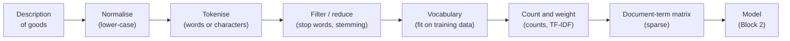
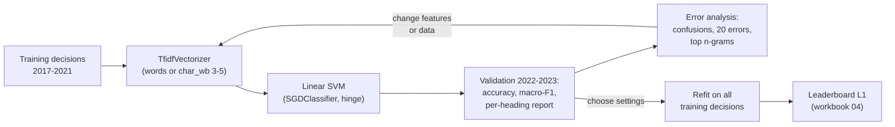

# Session 13 · Classical NLP: bag-of-words, TF-IDF and text classification

> **Guiding question.** What can a model learn from the words themselves?

**Learning outcomes.** After this session you are able to

- represent text as word counts and TF-IDF vectors
- train and evaluate a text classifier on high-dimensional data
- analyse the errors of a text model

## Why this session matters

A statistical model needs numbers, but a customs decision is a string of characters in one of 23 languages. This session turns documents into a table of counts and builds the first text classifier on it, using the linear models, metrics, validation and leakage checks of Sessions 6–9. The choices made here decide what any later model can and cannot see, and the TF-IDF classifier is the baseline every language model of Session 14 has to beat. The session also starts the EBTI case study of Sessions 13–16 and the first leaderboard round (L1).

**The case study from here on.** Sessions 13–16 work with the EU's Binding Tariff Information decisions (EBTI): a trader describes a product, customs states its code, and the Commission publishes the decision. The task is to suggest the four-digit HS heading of a new request from its description of goods, written in one of 23 languages. Models are trained on 309,529 decisions of 2017–2023 (experiments use a 50,000-decision sample) and tested on 113,188 later decisions: 2024 forms the public leaderboard, 2025–2026 the private one. The leaderboard has three rounds: L1 in this session (TF-IDF), L2 in Session 14 (embeddings or a language model) and L3 in Session 16 (after retraining with the released 2024 labels). Details: Block 2 below and [case-study/README.md](../../case-study/README.md).

> This page is the teaching overview of the session. How to work with it (the ▶ links, the numbered notebooks, the extras) is explained once in the [course README](../../README.md#how-to-use-the-session-pages).

## Block 1 · Text as data

### Theory (45 min)

**Why.** Every text model starts by turning documents into a table of numbers. This block covers the vocabulary of a corpus, the usual preprocessing steps and what they mean for a multilingual corpus, the bag-of-words representation computed by hand and with scikit-learn, TF-IDF weights and n-grams, the sparse matrices that make this representation fit into memory, and simple statistics of a text that need no vocabulary at all.



**Topics**

- **Documents, tokens and vocabulary.** Every text model splits text into tokens and maps them to numbers. A vocabulary learned from the wrong data leaks information from the test set, and its size sets the number of model parameters.
- **Preprocessing: lower-casing, stop words, stemming and lemmatisation.** These steps merge forms that mean the same thing but also remove information, and in a multilingual corpus every rule must exist once per language. Whether a step helps is tested on validation data.
- **Bag-of-words computed by hand.** Simple, fast and transparent: every column is a word you can read. Its blind spots (word order, synonyms, other languages) are the subject of the end of Block 2.
- **TF-IDF.** It down-weights frequent, uninformative words in every language without a stop-word list, and the row normalisation removes the effect of description length.
- **n-grams.** Short phrases and word pieces inside compounds can carry the decisive information. On the case study, character n-grams help and word bigrams do not: always measure.
- **Sparse, high-dimensional matrices.** Sparsity decides which models can be used: linear models work directly on sparse input, many others become slow or run out of memory.
- **Simple text statistics as features.** Length, digits and the upper-case share need no fitting and cannot leak. On the case study they say more about who wrote a description (language, country conventions) than about the goods.

▶ **Lecture:** [01-lecture-text-as-data.ipynb](workbooks/01-lecture-text-as-data.ipynb)

▶ **Worked examples**

- [02-case-study-vocabulary-and-dtm.ipynb](workbooks/02-case-study-vocabulary-and-dtm.ipynb): the vocabulary of the descriptions across languages, the document-term matrix, Zipf's law, preprocessing settings (including German stemming and compounds), and one description next to its English keywords and heading text.

### Exercises (30 min) and debrief (15 min)

▶ **Exercises:** [session-13-exercises.ipynb](workbooks/session-13-exercises.ipynb), part 1.

- **"Dog bites man" against "man bites dog"** (Paper, 5 min). Write both as bag-of-words vectors.
- **TF-IDF by hand** (Paper, 15 min). Find the highest-weighted word in three short product descriptions, then check with scikit-learn.
- **Predict the stemmer** (Predict, 5 min). What the Porter stemmer makes of eleven English words.
- **Remove the stop words** (Predict, 3 min). What "not compatible with" loses, and which negations scikit-learn's list removes.
- **Guess the language** (Class, then Code, 20 min). Guess the language of ten EBTI descriptions, then build a character-trigram language detector.
- **A text statistic of your own** (Code, 15 min). Design one more statistic, find the chapters where it is frequent and test it in the lecture's decision tree.
- **Shouting titles** (Code, 15 min). Three features of Airbnb listing titles (capitals, emojis, "!!!") and their prices.
- **Kraftfahrzeughaftpflichtversicherung** (Discussion, 5 min). What a word-level bag of words does with German compounds.
- **Edit distance by hand** (Paper, 15 min, *stretch*). The dynamic-programming table from *intention* to *execution*.

**Debrief.** Compare two TF-IDF tables: the textbook formula and scikit-learn's smoothed version can name a different "most important" word. In the language detector, check that the language profiles were not built from the ten quiz descriptions themselves.

## Block 2 · Text classification and error analysis

### Theory (45 min)

**Why.** A customs officer who receives a new request wants a suggestion: which heading is this product most likely in? This block sets up that task, builds the first model for it and shows how to evaluate a model with more than 1,000 classes honestly. A score tells us how often a model fails, not why, so the second half reads the errors, measures a leak that error analysis can hide and ends with the limits of word counts that motivate the language models of Session 14.



**Topics**

- **The EBTI task and the leaderboard.** We fix what a good answer is before choosing a method: which columns a request contains, a split by time, and one hidden test for all teams.
- **Linear models for text classification.** Fast on sparse input, little tuning, easy to inspect. A TF-IDF linear model is the baseline every more complex text model has to beat.
- **Accuracy and macro-F1 with more than 1,000 classes.** Accuracy is dominated by the frequent headings. Macro-F1 gives every heading the same weight and keeps the long tail visible.
- **Per-heading results and rare headings.** F1 depends strongly on how many training examples a heading has, which shows where to improve.
- **Validation by time versus a random split.** Renewed decisions, changing wording and the HS 2022 revision make a random split too optimistic. The leaderboard sides with the time split.
- **Error analysis of text models.** A confusion matrix for neighbouring headings and misclassified decisions read next to their keywords and heading texts. It prevents tuning hyperparameters when the real problem lies in the data or the task.
- **Leakage through the customs' justification.** The justification contains the answer but exists only after the decision. No validation scheme detects this; the only protection is to ask, for every column, whether it is available at prediction time.
- **The most informative n-grams per class.** About a quarter of the descriptions already quote their own heading number, which changes how we read the score.
- **Dimensionality reduction with truncated SVD.** It compresses the sparse matrix into a few dense dimensions for clustering, nearest-neighbour search and plots, and is the historical step towards the embeddings of Session 14.
- **The limits of word counts.** Synonyms, other languages, word order and unknown words explain part of the errors and set the expectations for language models.

▶ **Lecture:** [03-lecture-text-classification-and-error-analysis.ipynb](workbooks/03-lecture-text-classification-and-error-analysis.ipynb)

▶ **Worked examples**

- [04-case-study-tfidf-leaderboard.ipynb](workbooks/04-case-study-tfidf-leaderboard.ipynb): the first leaderboard submission (L1): an always-3926 baseline, word and character TF-IDF classifiers, a per-heading report, top-k accuracy, random versus time split, and `submission-L1-tfidf.csv`.
- [05-case-study-error-analysis.ipynb](workbooks/05-case-study-error-analysis.ipynb): 20 misclassified decisions read with their English keywords and heading texts, quoted heading numbers, the justification leak, and a first improvement.

### Exercises (30 min) and debrief (15 min)

▶ **Exercises:** [session-13-exercises.ipynb](workbooks/session-13-exercises.ipynb), part 2.

- **Naive Bayes by hand** (Paper, 15 min). Classify "predictable with no fun" with add-one smoothing.
- **Humans against the baseline** (Class, 15 min). Classify ten English descriptions into HS chapters and compare with the TF-IDF model.
- **The fallback heading of chapter 39** (Code, 15 min). Confusion matrix of the plastic articles 3923–3926; precision and recall of 3926.
- **Ten errors in another language** (Pairs, 15 min). Categorise ten misclassified French or Polish decisions and compare with the lecture's 20.
- **What does the model rely on for two other headings?** (Code, 10 min). The top n-grams of 2106 and 9405, and what they mean for a Greek description.
- **Humans write the classifier** (Paper, then Class, 10 min). Five positive and five negative words against a learned classifier.
- **Character n-grams for the rare languages** (Code, 20 min, *stretch*). Word against character model, accuracy per language.

**Debrief.** For chapter 39, look for the wrong precision computed from the 4 × 4 matrix alone, which ignores predictions of 3926 for decisions of other chapters. For the error categories, compare the counts across pairs rather than the label of a single decision.

## Team project until the next session

TF-IDF classifier on the team's validation scheme, error analysis, leaderboard round L1 (see [04-case-study-tfidf-leaderboard.ipynb](workbooks/04-case-study-tfidf-leaderboard.ipynb)). Record the submission in the team log: model, settings, validation accuracy and macro-F1, and leaderboard scores; rounds L2 (Session 14) and L3 (Session 16) are compared against it.

## Extras (optional, self-study)

| Notebook | Content | Block |
|---|---|---|
| [extras/01-data100-text-wrangling-regex.ipynb](workbooks/extras/01-data100-text-wrangling-regex.ipynb) | Data 100: string canonicalisation, regular expressions and text extraction (Polars). Reads the small files in [workbooks/data/](workbooks/data/) | 1 |
| [extras/02-sklearn-hashing-vs-dict-vectorizer.ipynb](workbooks/extras/02-sklearn-hashing-vs-dict-vectorizer.ipynb) | scikit-learn: DictVectorizer, FeatureHasher, HashingVectorizer, CountVectorizer and TfidfVectorizer compared; the hashing trick | 1 |
| [extras/03-sklearn-text-classification-sparse-features.ipynb](workbooks/extras/03-sklearn-text-classification-sparse-features.ipynb) | scikit-learn: linear classifiers on TF-IDF features (20 Newsgroups), confusion matrix, top features, benchmark | 2 |
| [extras/04-sklearn-document-clustering-lsa.ipynb](workbooks/extras/04-sklearn-document-clustering-lsa.ipynb) | scikit-learn: latent semantic analysis (truncated SVD) and k-means on news texts | 2 |

## Before the session and further reading

**Before.** Make sure `case-study/data/` exists (run `case-study/prepare_data.py`, see [case-study/README.md](../../case-study/README.md)). Revise logistic regression (Session 6), validation and leakage (Sessions 7 and 9), precision, recall, F1 and the confusion matrix (Session 8), backtesting by time (Session 12) and PCA (Session 11). Read the case-study description of the EBTI data in [case-study/README.md](../../case-study/README.md) and the WCO page *What is the Harmonized System?* (link below) to know what a heading is.

**Further reading (optional)**

- Jurafsky, D. and Martin, J. H. *Speech and Language Processing*, 3rd ed. draft, chapters on words and tokens, naive Bayes and sentiment, logistic regression. https://web.stanford.edu/~jurafsky/slp3/
- World Customs Organization. *What is the Harmonized System (HS)?* https://www.wcoomd.org/en/topics/nomenclature/overview/what-is-the-harmonized-system.aspx
- scikit-learn tutorial *Working with text data* (documentation of version 1.4; the tutorial is not part of later versions). https://scikit-learn.org/1.4/tutorial/text_analytics/working_with_text_data.html
- Manning, Raghavan and Schütze. *Introduction to Information Retrieval*, chapters 2 and 6 (tokens, TF-IDF). https://nlp.stanford.edu/IR-book/
- spaCy 101 (tokenisation and lemmatisation in many languages; outlook to linguistic methods in module 3.4). https://spacy.io/usage/spacy-101

## Setup

Everything runs in the course environment (`uv sync` at the repository root, then `uv run jupyter lab`); `nltk` (Snowball stemmers for German and French, no data download needed) is part of it.

```bash
# from the repository root
uv run jupyter lab
```

The models are trained on the 50,000-decision sample; lecture notebook 03 takes about seven minutes and the case-study notebooks 04 and 05 about 9 and 6 minutes on a laptop (the character n-gram model is the slow part). Extras 02, 03 and 04 download the 20 Newsgroups dataset (about 14 MB) on first use. Extra 01 reads the small files in [workbooks/data/](workbooks/data/). To regenerate the figures of the lecture notebooks, run `uv run python sessions/13-classical-nlp/figures/make_figures.py`.

## Sources and licences

Keep the attribution when you reuse or share a file. Course-written material is licensed CC BY 4.0. Third-party notebooks keep their original licence.

**Course material (CC BY 4.0, course team)**

| File | Content |
|---|---|
| [01-lecture-text-as-data.ipynb](workbooks/01-lecture-text-as-data.ipynb), [03-lecture-text-classification-and-error-analysis.ipynb](workbooks/03-lecture-text-classification-and-error-analysis.ipynb) | Lecture notebooks of the two blocks; the section on text statistics adapts the Session 9 page on text statistics to the EBTI descriptions; partly based on the course's earlier lecture notes and on the course's earlier pages on many-class metrics and leakage |
| [figures/make_figures.py](figures/make_figures.py) and its PNGs (`dtm_sketch.png`, `top_ngrams.png`, `confusion_matrix.png`) | Multilingual document-term matrix sketch, top words per heading (6403, 6404, 9503), footwear confusion matrix; EBTI case-study data |
| [02-case-study-vocabulary-and-dtm.ipynb](workbooks/02-case-study-vocabulary-and-dtm.ipynb) | Vocabulary, document-term matrix, Zipf's law, preprocessing on the EBTI decision sample |
| [04-case-study-tfidf-leaderboard.ipynb](workbooks/04-case-study-tfidf-leaderboard.ipynb) | Word and character TF-IDF classifiers, metrics for many classes (macro-F1, per-heading, top-k, time versus random split), leaderboard submission (round L1) |
| [05-case-study-error-analysis.ipynb](workbooks/05-case-study-error-analysis.ipynb) | Error analysis of 20 misclassified decisions, quoted heading numbers, the justification leak, improvements |
| [session-13-exercises.ipynb](workbooks/session-13-exercises.ipynb) | Exercises of both blocks (hand-outs and starter code); several hand-outs come from the sources named in each exercise |

**Third-party notebooks and data**

| File | Source | Licence | Downloaded | Changes |
|---|---|---|---|---|
| [extras/01-data100-text-wrangling-regex.ipynb](workbooks/extras/01-data100-text-wrangling-regex.ipynb) | [DS-100/course-notes, `content/regex/regex.ipynb`](https://raw.githubusercontent.com/DS-100/course-notes/main/content/regex/regex.ipynb) | [BSD-3-Clause](https://github.com/DS-100/course-notes/blob/main/LICENSE) | 2026-10-01 | Renamed from `regex.ipynb`; content unchanged except the data paths, changed from `data/` to `../data/` for the `extras/` folder |
| [data/county_and_state.csv](workbooks/data/county_and_state.csv), [county_and_population.csv](workbooks/data/county_and_population.csv), [log.txt](workbooks/data/log.txt) | [DS-100/course-notes, `content/regex/data/`](https://github.com/DS-100/course-notes/tree/main/content/regex/data) | [BSD-3-Clause](https://github.com/DS-100/course-notes/blob/main/LICENSE) | 2026-10-01 | Unchanged; small data files used by extra 01 |
| [extras/02-sklearn-hashing-vs-dict-vectorizer.ipynb](workbooks/extras/02-sklearn-hashing-vs-dict-vectorizer.ipynb) | [scikit-learn example gallery 1.9](https://raw.githubusercontent.com/scikit-learn/scikit-learn.github.io/main/1.9/_downloads/06cfc926acb27652fb2aa5bfc583e7cb/plot_hashing_vs_dict_vectorizer.ipynb) | [BSD-3-Clause](https://github.com/scikit-learn/scikit-learn/blob/main/COPYING) | 2026-10-01 | Renamed from `plot_hashing_vs_dict_vectorizer.ipynb`; content unchanged |
| [extras/03-sklearn-text-classification-sparse-features.ipynb](workbooks/extras/03-sklearn-text-classification-sparse-features.ipynb) | [scikit-learn example gallery 1.9](https://raw.githubusercontent.com/scikit-learn/scikit-learn.github.io/main/1.9/_downloads/7ff1697c60d48929305821f39296dbb9/plot_document_classification_20newsgroups.ipynb) | [BSD-3-Clause](https://github.com/scikit-learn/scikit-learn/blob/main/COPYING) | 2026-10-01 | Renamed from `plot_document_classification_20newsgroups.ipynb`; content unchanged |
| [extras/04-sklearn-document-clustering-lsa.ipynb](workbooks/extras/04-sklearn-document-clustering-lsa.ipynb) | [scikit-learn example gallery 1.9](https://raw.githubusercontent.com/scikit-learn/scikit-learn.github.io/main/1.9/_downloads/751db3d5e6b909ff00972495eaae53df/plot_document_clustering.ipynb) | [BSD-3-Clause](https://github.com/scikit-learn/scikit-learn/blob/main/COPYING) | 2026-10-01 | Renamed from `plot_document_clustering.ipynb`; content unchanged |

**Case-study data.** European Commission, *European Binding Tariff Information (EBTI)* database, full export, reuse with acknowledgement under Commission Decision 2011/833/EU; datasets/harmonized-system, *Harmonized System nomenclature (HS 2022)*, ODC Public Domain Dedication and Licence. Prepared with `case-study/prepare_data.py`.

**Linked, not copied.** spaCy (https://spacy.io/usage/linguistic-features) and NLTK (https://www.nltk.org/, Snowball stemmers) documentation; Jurafsky and Martin, *Speech and Language Processing*; the WCO page on the Harmonized System.

<details>
<summary><b>References cited in the lecture notebooks</b></summary>

- Blei, D. M., Ng, A. Y. and Jordan, M. I. (2003). Latent Dirichlet allocation. *Journal of Machine Learning Research*, 3, 993–1022.
- Cavnar, W. B. and Trenkle, J. M. (1994). N-gram-based text categorization. *Proceedings of SDAIR-94*, 161–175.
- datasets/harmonized-system: *Harmonized System nomenclature (HS 2022)*, ODC Public Domain Dedication and Licence. https://github.com/datasets/harmonized-system
- Deerwester, S., Dumais, S. T., Furnas, G. W., Landauer, T. K. and Harshman, R. (1990). Indexing by latent semantic analysis. *Journal of the American Society for Information Science*, 41(6), 391–407.
- European Commission. *European Binding Tariff Information (EBTI)* database, full export (case-study data). Reuse with acknowledgement under Commission Decision 2011/833/EU. https://ec.europa.eu/taxation_customs/dds2/ebti/ebti_consultation.jsp?Lang=en
- Graham, P. (2002). *A Plan for Spam*. https://paulgraham.com/spam.html
- Joulin, A., Grave, E., Bojanowski, P. and Mikolov, T. (2017). Bag of tricks for efficient text classification. *Proceedings of EACL 2017*, 427–431.
- Jurafsky, D. and Martin, J. H. (2026). *Speech and Language Processing*, 3rd ed. draft. https://web.stanford.edu/~jurafsky/slp3/ (linked only)
- Kapoor, S. and Narayanan, A. (2023). Leakage and the reproducibility crisis in machine-learning-based science. *Patterns*, 4(9), 100804. https://doi.org/10.1016/j.patter.2023.100804
- Kaufman, S., Rosset, S., Perlich, C. and Stitelman, O. (2012). Leakage in data mining: formulation, detection, and avoidance. *ACM Transactions on Knowledge Discovery from Data*, 6(4), 15.
- Landauer, T. K. and Dumais, S. T. (1997). A solution to Plato's problem: the latent semantic analysis theory of acquisition, induction, and representation of knowledge. *Psychological Review*, 104(2), 211–240.
- Manning, C. D., Raghavan, P. and Schütze, H. (2008). *Introduction to Information Retrieval*. Cambridge University Press. https://nlp.stanford.edu/IR-book/
- Mosteller, F. and Wallace, D. L. (1964). *Inference and Disputed Authorship: The Federalist*. Addison-Wesley.
- Ng, A. (2018). *Machine Learning Yearning*. deeplearning.ai.
- Northcutt, C. G., Athalye, A. and Mueller, J. (2021). Pervasive label errors in test sets destabilize machine learning benchmarks. *NeurIPS 2021 Datasets and Benchmarks Track*. https://arxiv.org/abs/2103.14749
- Pedregosa, F. et al. (2011). Scikit-learn: machine learning in Python. *Journal of Machine Learning Research*, 12, 2825–2830.
- Porter, M. F. (1980). An algorithm for suffix stripping. *Program*, 14(3), 130–137.
- Ribeiro, M. T., Singh, S. and Guestrin, C. (2016). "Why should I trust you?": explaining the predictions of any classifier. *Proceedings of KDD 2016*, 1135–1144.
- Rosenthal, S., Farra, N. and Nakov, P. (2017). SemEval-2017 Task 4: sentiment analysis in Twitter. *Proceedings of SemEval-2017*, 502–518.
- Slapin, J. B. and Proksch, S.-O. (2008). A scaling model for estimating time-series party positions from texts. *American Journal of Political Science*, 52(3), 705–722.
- Spärck Jones, K. (1972). A statistical interpretation of term specificity and its application in retrieval. *Journal of Documentation*, 28(1), 11–21.
- Wang, S. and Manning, C. D. (2012). Baselines and bigrams: simple, good sentiment and topic classification. *Proceedings of ACL 2012*, 90–94.
- Weinberger, K., Dasgupta, A., Langford, J., Smola, A. and Attenberg, J. (2009). Feature hashing for large scale multitask learning. *Proceedings of ICML 2009*, 1113–1120.
- World Customs Organization. *What is the Harmonized System (HS)?* https://www.wcoomd.org/en/topics/nomenclature/overview/what-is-the-harmonized-system.aspx (linked only)
- Zech, J. R. et al. (2018). Variable generalization performance of a deep learning model to detect pneumonia in chest radiographs: a cross-sectional study. *PLOS Medicine*, 15(11), e1002683.
- Zipf, G. K. (1949). *Human Behavior and the Principle of Least Effort*. Addison-Wesley.

</details>
