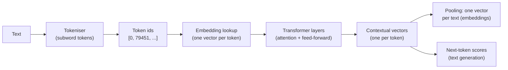
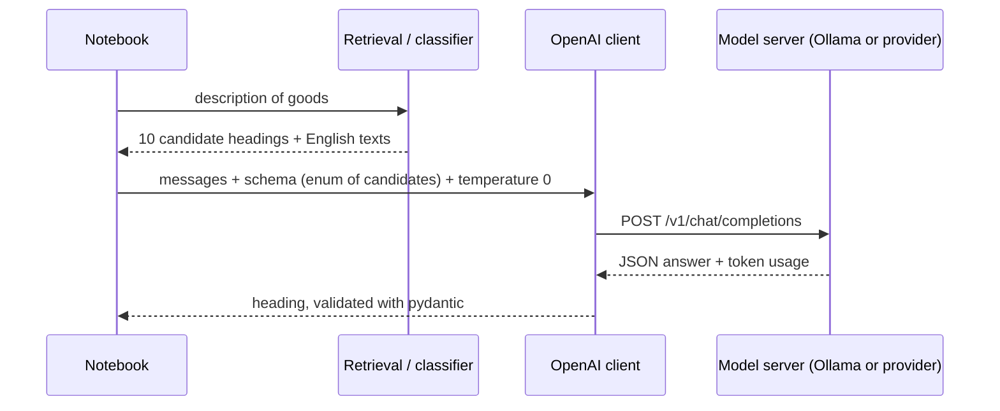

# Session 14 · Large language models I: transformer models, embeddings and their applications

> **Guiding question.** How do language models represent and generate text, and what can we use them for?

**Learning outcomes.** After this session you are able to

- explain the transformer idea and the difference between encoder, decoder and encoder–decoder models
- use embedding models for semantic search, clustering and as features for classification
- use a generative model through an API for classification with structured output and compare it with a trained model

## Why this session matters

Session 13 ended with the limits of word counts: "Spielzeug", "jouet" and "toy" share no column, and word order is mostly lost. Language models address both by representing text as dense vectors learned from very large amounts of unlabelled text, in many languages at once. This session shows what these models do, what goes in and what comes out, and tests on the EBTI case study whether embeddings or a generative model actually improve on the TF-IDF classifier of Session 13. The answer feeds the second leaderboard round (L2), and the embeddings and API calls of this session are the building blocks of retrieval-augmented generation in Session 15. Neural-network theory stays conceptual here; module 3.4 covers it in depth.

> This page is the teaching overview of the session. How to work with it (the ▶ links, the numbered notebooks, the extras) is explained once in the [course README](../../README.md#how-to-use-the-session-pages).

**Notes for this session**

- The first run downloads the embedding model and the tokeniser files (about 475 MB, see [Before the session](#before-the-session-and-further-reading)).
- The cells of Block 2 that call a language model need a local model server (Ollama) or an API key. Without one they print a message and are skipped; everything else runs without them.

## Block 1 · Embeddings: from words to vectors, and what they are good for

### Theory (45 min)

**Why.** To use language models responsibly we need to understand, at a conceptual level, how they turn text into vectors: subword tokens, embeddings, attention and pre-training. Sentence-embedding models turn a whole description of goods into one vector that can be compared across languages. Whether those vectors help is an empirical question, so every application is compared with the TF-IDF representation of Session 13 on the same data: on the case study, embeddings are clearly better for search across languages, useful for exploration, and worse than TF-IDF as classification features.



**Topics**

- **Tokens.** Tokens are the unit of everything that follows: the context window, the price of an API call and the processing time are all counted in tokens. The same content needs more tokens in some languages than in others.
- **Embeddings.** Once texts are vectors, finding similar decisions, grouping them and using text as a feature become standard operations on vectors, measured with cosine similarity.
- **Attention and pre-training (conceptual).** Attention makes the representation of a word depend on its context. Pre-training on unlabelled text in many languages is why these models work with few labelled examples and across languages.
- **Encoder, decoder and encoder–decoder models.** Choosing the family decides cost and fit: an encoder embeds texts on a laptop, a decoder needs a GPU server or a paid API and returns text that must be parsed.
- **Embedding models (sentence-transformers).** Sentence embeddings compare meaning rather than shared words, across languages, if the input limit and the model's prefixes are respected.
- **The Hugging Face libraries (worked example).** Almost every open model is used with one pattern: tokeniser, model, outputs, post-processing; `pipeline()` bundles it per task and sentence-transformers per embedding model, so a new model is usually a change of one name.
- **Semantic search.** A customs officer can find how other member states classified similar goods, whatever the language of their decisions. It is also the retrieval step of Session 15.
- **Clustering decisions.** k-means and UMAP from Session 11 on embeddings show what a large text collection is about. Clusters must be checked for whether they reflect goods or only languages.
- **Embedding features versus TF-IDF.** Pre-trained embeddings are expected to help when labelled data are scarce; in tariff classification the decisive information is often one word or one number that an averaged vector blurs.

▶ **Lecture:** [01-lecture-embeddings-from-words-to-vectors.ipynb](workbooks/01-lecture-embeddings-from-words-to-vectors.ipynb)

▶ **Worked examples** (the lecturer asked for the Hugging Face notebook in addition to the two case studies; take it first, and the case studies as time allows)

- [02-hugging-face-in-one-pattern.ipynb](workbooks/02-hugging-face-in-one-pattern.ipynb): the basic syntax of the Hugging Face libraries: Hub names, model cards, licences and the cache; `AutoTokenizer` and `AutoModel`; `pipeline()` for sentiment, zero-shot classification and fill-mask; sentence-transformers.
- [03-case-study-tokens-and-similarity.ipynb](workbooks/03-case-study-tokens-and-similarity.ipynb): token counts per language on 2,000 descriptions, and embedding versus TF-IDF similarity for the same goods in three languages.
- [04-case-study-embeddings-vs-tfidf.ipynb](workbooks/04-case-study-embeddings-vs-tfidf.ipynb): embedding features, TF-IDF and both with one classifier, a learning curve, and cross-lingual nearest-neighbour search.

### Exercises (30 min) and debrief (15 min)

▶ **Exercises:** [session-14-exercises.ipynb](workbooks/session-14-exercises.ipynb), part 1.

- **What is tezgüino?** (Paper, 5 min). Guess the meaning of an unknown word from the sentences around it.
- **Cosine similarity by hand** (Paper, 10 min). Find the closest pair of three two-dimensional embeddings, then see why cosine ignores the length of a vector.
- **Tokens per language** (Predict, then Code, 10 min). Predict and count the tokens of one product description in English, German, Hungarian and Greek.
- **Swap the model name** (Code, 10 min). Tokenise a German and a French description with the tokenisers of three models by changing only the name, and compare the pieces.
- **Same goods, different languages** (Code, 10 min). Compare the similarity of decisions with the same heading in different languages with that of decisions in the same language with different headings.
- **Search the French decisions** (Pairs, 15 min). Search the French decisions with German and English queries, with embeddings and with TF-IDF, and find a query where TF-IDF wins.
- **Clusters of toys** (Code, 15 min, *stretch*). Cluster chapter 95 on embeddings and check whether the clusters follow headings or languages.

**Debrief.** Compare the similarity tables of two pairs: did language or goods dominate, and did anyone compare similarities against a fixed threshold such as 0.5 instead of with each other? For the search, collect the queries where TF-IDF won and look for what they share (brand names, codes, loan words).

## Block 2 · Generative models through an API

### Theory (45 min)

**Why.** Through an API, a decoder model can solve tasks we have so far solved with trained classifiers: we describe the task in a prompt and read the answer. Tariff classification needs a trick, because a prompt cannot list all 1,229 headings, so the model chooses among candidate headings. Whether such an LLM is worth using depends on measured quality, cost, latency and data protection, not on which model is newest, and a model that abstains on unsure cases can already do useful work.



**Topics**

- **Temperature, context window and costs.** Tokens decide what fits into a request and what it costs; temperature decides how repeatable the answers are.
- **Prompts and the chat API.** The prompt is the model's only specification of the task. Reading the configuration from environment variables keeps keys out of the code and lets the same notebook run against a local Ollama server or a hosted model.
- **Zero-shot and few-shot classification with structured output.** A schema turns the LLM into a function with a fixed output type. Restricting the answer to the candidates means the model cannot invent a heading.
- **Comparison with a trained model.** Quality, cost, latency and data protection decide the choice. A new request contains confidential business information, so we record where the data go.
- **Abstention.** A classifier that routes unsure requests to a customs officer handles most requests at high accuracy and shows where an LLM is worth its cost.

▶ **Lecture:** [05-lecture-generative-models-through-an-api.ipynb](workbooks/05-lecture-generative-models-through-an-api.ipynb)

▶ **Worked examples**

- [06-case-study-llm-vs-trained-classifier.ipynb](workbooks/06-case-study-llm-vs-trained-classifier.ipynb): an LLM choosing among ten candidate headings with structured output (zero-shot and few-shot) against the trained classifier on 200 decisions, with the quality, cost and latency table. The LLM cells need a model server.

### Exercises (30 min) and debrief (15 min)

▶ **Exercises:** [session-14-exercises.ipynb](workbooks/session-14-exercises.ipynb), part 2.

- **Be the language model** (Class, 10 min). The room generates a sentence word by word, first always choosing the most likely word, then rolling a die.
- **Bill the class** (Paper, 5 min). Estimate the cost of classifying the test set through a paid API and compare it with TF-IDF.
- **Write the ambiguous case** (Pairs, 10 min). Write a product description that a zero-shot prompt will misclassify and explain the trap.
- **Abstention at another price of an error** (Code, 15 min). Choose the abstention threshold for other error costs and see whose requests reach an officer.
- **A recommendation for the head of unit** (Pairs, 10 min). Write five sentences on which method to deploy as a suggestion tool, from the measured numbers.
- **A local model on footwear** (Code, 15 min, *stretch*, needs Ollama). Let the local model choose among six footwear headings and compare it with TF-IDF.

**Debrief.** Compare two cost estimates (one usually forgets the output tokens or the price per *million*) and two thresholds: does a higher error cost raise or lower the threshold, and why? Read one recommendation that ignores data protection.

## Team project until the next session

Decide with evidence whether embeddings or a language model improve the model; leaderboard round L2. ▶ [07-case-study-leaderboard-l2.ipynb](workbooks/07-case-study-leaderboard-l2.ipynb) places the multilingual embeddings next to the TF-IDF features, compares the result with your L1 model with a paired bootstrap and writes the L2 submission; with a model server it can also let an LLM choose among the candidates for the unsure requests, with the trained model as fallback. Its last section lists the tasks for the team log. With a model server, also fill in the LLM rows of the comparison table in [case study 06](workbooks/06-case-study-llm-vs-trained-classifier.ipynb).

## Extras (optional, self-study)

| Notebook | Content | Block |
|---|---|---|
| [extras/01-hf-course-tokenizers.ipynb](workbooks/extras/01-hf-course-tokenizers.ipynb) | Hugging Face course: loading tokenisers, encoding and decoding | 1 |
| [extras/02-hf-course-bpe-tokenization.ipynb](workbooks/extras/02-hf-course-bpe-tokenization.ipynb) | Hugging Face course: byte-pair encoding implemented step by step | 1 |
| [extras/03-hf-course-transformer-pipelines.ipynb](workbooks/extras/03-hf-course-transformer-pipelines.ipynb) | Hugging Face course: encoder, decoder and encoder–decoder models via `pipeline()`. Downloads several models, some larger than 1 GB: run it on Colab or pick the small models named in its cells | 1 |
| [extras/04-sbert-retrieve-rerank-wikipedia.ipynb](workbooks/extras/04-sbert-retrieve-rerank-wikipedia.ipynb) | sentence-transformers: semantic search with a bi-encoder, cross-encoder re-ranking and BM25 (Simple Wikipedia). Upstream bug: the search function moves the query to the GPU when *no* GPU is available (`if not torch.cuda.is_available(): … .cuda()`); delete those two lines before running it on a laptop | 1 |
| [extras/05-openai-cookbook-clustering.ipynb](workbooks/extras/05-openai-cookbook-clustering.ipynb) | OpenAI Cookbook: k-means on precomputed embeddings of food reviews (third-party data), t-SNE plot. The last part needs an OpenAI key | 1 |
| [extras/06-openai-cookbook-structured-outputs.ipynb](workbooks/extras/06-openai-cookbook-structured-outputs.ipynb) | OpenAI Cookbook: structured outputs with JSON schema and pydantic. Needs an OpenAI key, or adapt `base_url` | 2 |

The Hugging Face and sentence-transformers extras (01–04) start with `pip install` cells written for Google Colab; in the course environment skip those cells. The extras download their models and data from the internet.

## Before the session and further reading

**Before.**

- Run the first code cells of [03-case-study-tokens-and-similarity.ipynb](workbooks/03-case-study-tokens-and-similarity.ipynb) once before class to save time: they download the multilingual model `intfloat/multilingual-e5-small` (about 470 MB, cached by Hugging Face) and the GPT-4o tokeniser file of `tiktoken` (about 3.6 MB).
- [02-hugging-face-in-one-pattern.ipynb](workbooks/02-hugging-face-in-one-pattern.ipynb) downloads three further small models on its first run (about 1.3 GB in total); run it once before class if the network in the room is slow.
- For Block 2, install [Ollama](https://ollama.com) and run `ollama pull qwen2.5:3b` (about 2 GB; `llama3.2:3b` also works). Without it, the notebooks run but skip the LLM calls.
- Read Alammar's *The Illustrated Transformer* (link below), sections on self-attention.
- Revise TF-IDF, the metrics for many classes and the error analysis of Session 13 (bring your validation and leaderboard scores of round L1), k-means and UMAP of Session 11, the bootstrap of Session 7 and the decision threshold of Session 8.

**Further reading (optional)**

- Alammar, J. *The Illustrated Transformer*. https://jalammar.github.io/illustrated-transformer/
- Hugging Face *LLM Course*, chapters 1, 2 and 6. https://huggingface.co/learn/llm-course
- Sentence-Transformers documentation (semantic search, clustering, multilingual models). https://sbert.net/
- 3Blue1Brown, *Transformers, the tech behind LLMs* (video lessons on embeddings and attention). https://www.3blue1brown.com/lessons/gpt
- Jurafsky and Martin, *Speech and Language Processing*, 3rd ed. draft, chapters on transformers and large language models. https://web.stanford.edu/~jurafsky/slp3/

## Setup

All packages of this session are in the course environment (root `pyproject.toml`, installed with `uv sync`; setup: [course README](../../README.md#setup)): `sentence-transformers` with PyTorch and `transformers` (Block 1), `tiktoken` (token counts), `umap-learn` (the figures), and `openai`, `pydantic` and `httpx` (Block 2). Open the notebooks in VS Code or JupyterLab with the `.venv` kernel.

A model server is needed only for the LLM cells of Block 2: [Ollama](https://ollama.com) with `qwen2.5:3b` or `llama3.2:3b`, or any OpenAI-compatible provider via the environment variables `LLM_BASE_URL`, `LLM_MODEL` and `LLM_API_KEY`:

```bash
# Block 2 with a hosted provider instead of Ollama (example; the key stays in the shell)
export LLM_BASE_URL="https://api.openai.com/v1" LLM_MODEL="gpt-4o-mini" LLM_API_KEY="..."
```

Never write a key into a notebook. The L2 notebook encodes all 163,188 sample and test descriptions once: about 6 minutes with a GPU, 20–40 minutes on a laptop CPU. The vectors are cached in `workbooks/embeddings_cache/` (about 250 MB, ignored by git), and later runs take a few minutes; LLM answers of case study 06 are cached in `workbooks/llm_results/`. To regenerate the figures of the lecture notebooks, run `uv run python sessions/14-llms-and-embeddings/figures/make_figures.py`.

## Sources and licences

Keep the attribution when you reuse or share a file. Course-written material is licensed CC BY 4.0. Third-party notebooks keep their original licence.

**Course material (CC BY 4.0, course team)**

| File | Content |
|---|---|
| [01-lecture-embeddings-from-words-to-vectors.ipynb](workbooks/01-lecture-embeddings-from-words-to-vectors.ipynb), [05-lecture-generative-models-through-an-api.ipynb](workbooks/05-lecture-generative-models-through-an-api.ipynb) | Lecture notebooks of the two blocks; partly based on the course's earlier lecture notes; the abstention section reuses the course's earlier page on decision thresholds |
| [figures/make_figures.py](figures/make_figures.py) and its PNGs (`tokenisation.png`, `attention.png`, `embedding_space.png`, `coverage_accuracy.png`) | Tokenisation example (SentencePiece and BPE, English and German), illustrative attention weights, 2-D UMAP projection of 1,500 EBTI decisions embedded with multilingual-e5-small, coverage–accuracy curve of a TF-IDF classifier on the EBTI decisions (abstention) |
| [02-hugging-face-in-one-pattern.ipynb](workbooks/02-hugging-face-in-one-pattern.ipynb) | The basic syntax of `huggingface_hub`, `transformers` (the tokeniser, model, outputs pattern and `pipeline()`) and `sentence-transformers` |
| [03-case-study-tokens-and-similarity.ipynb](workbooks/03-case-study-tokens-and-similarity.ipynb) | Token counts per language and cross-lingual semantic similarity on the EBTI decision sample |
| [04-case-study-embeddings-vs-tfidf.ipynb](workbooks/04-case-study-embeddings-vs-tfidf.ipynb) | Embedding features vs TF-IDF, learning curve, cross-lingual nearest-neighbour search |
| [06-case-study-llm-vs-trained-classifier.ipynb](workbooks/06-case-study-llm-vs-trained-classifier.ipynb) | Zero/few-shot LLM choosing among ten candidate headings with structured output vs trained classifier on 200 decisions |
| [07-case-study-leaderboard-l2.ipynb](workbooks/07-case-study-leaderboard-l2.ipynb) | Leaderboard round L2: TF-IDF plus multilingual embeddings with a paired bootstrap against round L1; optional LLM choice for unsure requests with the trained model as fallback |
| [session-14-exercises.ipynb](workbooks/session-14-exercises.ipynb) | Exercises of both blocks; the product description of exercise 1.3 was translated by the course team. Exercise sources are named in the notebook |

**Third-party notebooks**

| File | Source | Licence | Downloaded | Changes |
|---|---|---|---|---|
| [extras/01-hf-course-tokenizers.ipynb](workbooks/extras/01-hf-course-tokenizers.ipynb) | [huggingface/notebooks, `course/en/chapter2/section4_pt.ipynb`](https://raw.githubusercontent.com/huggingface/notebooks/main/course/en/chapter2/section4_pt.ipynb) | [Apache-2.0](https://github.com/huggingface/notebooks/blob/main/LICENSE) | 2026-10-01 | Renamed from `section4_pt.ipynb`; content unchanged |
| [extras/02-hf-course-bpe-tokenization.ipynb](workbooks/extras/02-hf-course-bpe-tokenization.ipynb) | [huggingface/notebooks, `course/en/chapter6/section5.ipynb`](https://raw.githubusercontent.com/huggingface/notebooks/main/course/en/chapter6/section5.ipynb) | [Apache-2.0](https://github.com/huggingface/notebooks/blob/main/LICENSE) | 2026-10-01 | Renamed from `section5.ipynb`; content unchanged |
| [extras/03-hf-course-transformer-pipelines.ipynb](workbooks/extras/03-hf-course-transformer-pipelines.ipynb) | [huggingface/notebooks, `course/en/chapter1/section3.ipynb`](https://raw.githubusercontent.com/huggingface/notebooks/main/course/en/chapter1/section3.ipynb) | [Apache-2.0](https://github.com/huggingface/notebooks/blob/main/LICENSE) | 2026-10-01 | Renamed from `section3.ipynb`; content unchanged |
| [extras/04-sbert-retrieve-rerank-wikipedia.ipynb](workbooks/extras/04-sbert-retrieve-rerank-wikipedia.ipynb) | [huggingface/sentence-transformers, `examples/sentence_transformer/applications/retrieve_rerank/retrieve_rerank_simple_wikipedia.ipynb`](https://raw.githubusercontent.com/huggingface/sentence-transformers/main/examples/sentence_transformer/applications/retrieve_rerank/retrieve_rerank_simple_wikipedia.ipynb) | [Apache-2.0](https://github.com/huggingface/sentence-transformers/blob/main/LICENSE) | 2026-10-01 | Renamed from `retrieve_rerank_simple_wikipedia.ipynb`; content unchanged |
| [extras/05-openai-cookbook-clustering.ipynb](workbooks/extras/05-openai-cookbook-clustering.ipynb) | [openai/openai-cookbook, `examples/Clustering.ipynb`](https://raw.githubusercontent.com/openai/openai-cookbook/main/examples/Clustering.ipynb) | [MIT](https://github.com/openai/openai-cookbook/blob/main/LICENSE) | 2026-10-01 | Renamed from `Clustering.ipynb`. Patched one line: the data path `./data/fine_food_reviews_with_embeddings_1k.csv` was replaced by the raw GitHub URL of the same file in the cookbook repository (35 MB, not copied into this repository) |
| [extras/06-openai-cookbook-structured-outputs.ipynb](workbooks/extras/06-openai-cookbook-structured-outputs.ipynb) | [openai/openai-cookbook, `examples/Structured_Outputs_Intro.ipynb`](https://raw.githubusercontent.com/openai/openai-cookbook/main/examples/Structured_Outputs_Intro.ipynb) | [MIT](https://github.com/openai/openai-cookbook/blob/main/LICENSE) | 2026-10-01 | Renamed from `Structured_Outputs_Intro.ipynb`; content unchanged |

**Models used** (downloaded at run time, not stored here): `intfloat/multilingual-e5-small` (MIT, https://huggingface.co/intfloat/multilingual-e5-small); optionally `sentence-transformers/paraphrase-multilingual-MiniLM-L12-v2` (Apache-2.0); in notebook 02 `distilbert/distilbert-base-uncased-finetuned-sst-2-english` (Apache-2.0, https://huggingface.co/distilbert/distilbert-base-uncased-finetuned-sst-2-english), `MoritzLaurer/mDeBERTa-v3-base-mnli-xnli` (MIT, https://huggingface.co/MoritzLaurer/mDeBERTa-v3-base-mnli-xnli) and `google-bert/bert-base-german-cased` (MIT, https://huggingface.co/google-bert/bert-base-german-cased); via Ollama `qwen2.5:3b` (Qwen research licence, see https://ollama.com/library/qwen2.5) or `llama3.2:3b` (Llama 3.2 Community License, see https://ollama.com/library/llama3.2). Check the model licence before using a model in a project.

**Case-study data.** European Commission, *European Binding Tariff Information (EBTI)* database, full export, reuse with acknowledgement under Commission Decision 2011/833/EU; datasets/harmonized-system, *Harmonized System nomenclature (HS 2022)*, ODC-PDDL.

<details>
<summary><b>References cited in the lecture notebooks</b></summary>

- Alammar, J. (2018). *The Illustrated Transformer*. https://jalammar.github.io/illustrated-transformer/ (linked only)
- Bolukbasi, T., Chang, K.-W., Zou, J., Saligrama, V. and Kalai, A. (2016). Man is to computer programmer as woman is to homemaker? Debiasing word embeddings. *NeurIPS 2016*.
- Brown, T. et al. (2020). Language models are few-shot learners. *NeurIPS 2020*. https://arxiv.org/abs/2005.14165
- datasets/harmonized-system: *Harmonized System nomenclature (HS 2022)*, ODC-PDDL. https://github.com/datasets/harmonized-system
- European Commission. *European Binding Tariff Information (EBTI)* database, full export (case-study data). Reuse with acknowledgement under Commission Decision 2011/833/EU. https://ec.europa.eu/taxation_customs/dds2/ebti/ebti_consultation.jsp?Lang=en
- Firth, J. R. (1957). A synopsis of linguistic theory 1930–1955. In *Studies in Linguistic Analysis*. Blackwell.
- Gilardi, F., Alizadeh, M. and Kubli, M. (2023). ChatGPT outperforms crowd workers for text-annotation tasks. *PNAS*, 120(30), e2305016120.
- Grbovic, M. and Cheng, H. (2018). Real-time personalization using embeddings for search ranking at Airbnb. *Proceedings of KDD 2018*.
- Grootendorst, M. (2022). BERTopic: neural topic modeling with a class-based TF-IDF procedure. arXiv:2203.05794.
- Hugging Face (2025). *LLM Course*. https://huggingface.co/learn/llm-course (course notebooks: https://github.com/huggingface/notebooks, Apache-2.0)
- Jain, S. and Wallace, B. C. (2019). Attention is not explanation. *Proceedings of NAACL 2019*.
- Liu, N. F. et al. (2024). Lost in the middle: how language models use long contexts. *Transactions of the ACL*, 12, 157–173.
- Mikolov, T., Chen, K., Corrado, G. and Dean, J. (2013). Efficient estimation of word representations in vector space. arXiv:1301.3781.
- Muennighoff, N., Tazi, N., Magne, L. and Reimers, N. (2023). MTEB: massive text embedding benchmark. *Proceedings of EACL 2023*.
- OpenAI. *OpenAI Cookbook*. https://cookbook.openai.com/ (MIT)
- Petrov, A., La Malfa, E., Torr, P. H. S. and Bibi, A. (2023). Language model tokenizers introduce unfairness between languages. *NeurIPS 2023*.
- Reimers, N. and Gurevych, I. (2019). Sentence-BERT: sentence embeddings using Siamese BERT-networks. *Proceedings of EMNLP-IJCNLP 2019*. https://sbert.net/
- Sennrich, R., Haddow, B. and Birch, A. (2016). Neural machine translation of rare words with subword units. *Proceedings of ACL 2016*.
- Thakur, N., Reimers, N., Rücklé, A., Srivastava, A. and Gurevych, I. (2021). BEIR: a heterogeneous benchmark for zero-shot evaluation of information retrieval models. *NeurIPS 2021 Datasets and Benchmarks*.
- Tunstall, L. et al. (2022). Efficient few-shot learning without prompts (SetFit). arXiv:2209.11055.
- Vaswani, A. et al. (2017). Attention is all you need. *NeurIPS 2017*. https://arxiv.org/abs/1706.03762
- Wang, L., Yang, N., Huang, X., Yang, L., Majumder, R. and Wei, F. (2024). Multilingual E5 text embeddings: a technical report. arXiv:2402.05672.
- Xiong, M. et al. (2024). Can LLMs express their uncertainty? An empirical evaluation of confidence elicitation in LLMs. *ICLR 2024*. https://arxiv.org/abs/2306.13063
- Court and regulatory cases cited in lecture notebook 05: *Mata v. Avianca, Inc.*, No. 22-cv-1461 (S.D.N.Y. 2023); *Moffatt v. Air Canada*, 2024 BCCRT 149; Garante per la protezione dei dati personali, provision of 30 March 2023 on ChatGPT.

</details>
