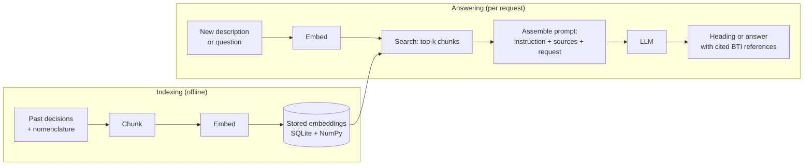
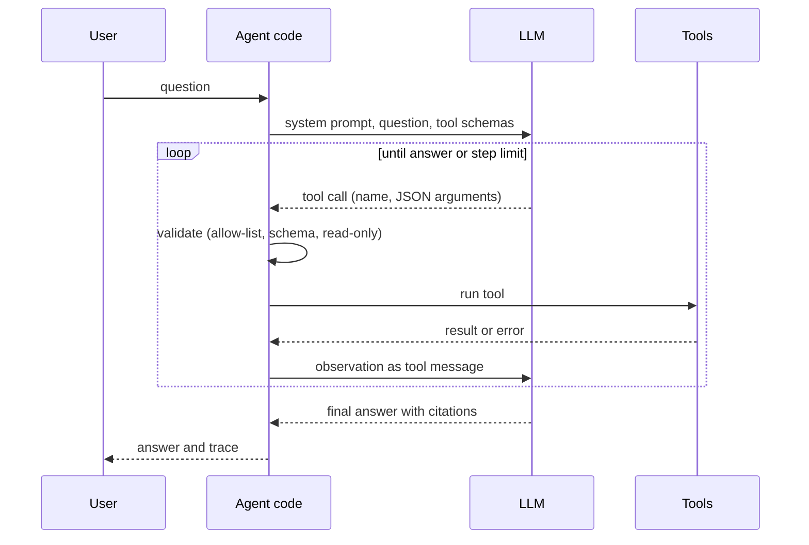

# Session 15 · Retrieval-augmented generation and agents

> **Guiding question.** How do we let a language model answer from our own data and use tools, and how do we evaluate the result?

**Learning outcomes.** After this session you are able to

- build a retrieval-augmented generation pipeline over a document collection
- evaluate retrieval and answers with a labelled test set
- build a simple agent with tool calling and assess its risks

## Why this session matters

In Session 14 you used embeddings and a language model on their own. A language model answers from what it learned in training: it knows nothing after its knowledge cut-off, has never seen private documents, and can produce confident statements that no source supports. This session lets the model answer from our own documents, the past customs decisions of the case study, with citations that a reader can check, and shows how to measure whether retrieval and answers are good. It then lets the model choose its own steps with tools, and shows the risks and the guardrails that come with that. Session 16 then shows how a model reaches its users and how it is monitored, and the team project can add an optional language-model component with its evaluation.

> This page is the teaching overview of the session. How to work with it (the ▶ links, the numbered notebooks, the extras) is explained once in the [course README](../../README.md#how-to-use-the-session-pages).

**Notes for this session**

- [`workspace/`](workspace/README.md) holds the same system as tested software (package `bti_assistant`). Each block names the workspace exercises that belong to it; they are team work or self-study after class.
- A few cells call a language model through Ollama or another OpenAI-compatible server. Without one they print a short message, and everything else runs (see [Setup](#setup)).

## Block 1 · Retrieval-augmented generation and its evaluation

### Theory (45 min)

**Why.** For questions about our own documents, what the model learned in training is not enough. Retrieval finds the relevant documents first and places them in the prompt, so the model answers from text it can see and each statement can be traced to a source. A prototype that answers three hand-picked requests well proves little, though: a RAG system is evaluated like any other model, with a fixed test set and metrics for its two halves, retrieval and answers.

The whole pipeline at a glance. The upper part runs once (or whenever documents change); the lower part runs for every request.

**Topics**

- **Why retrieval: knowledge cut-off, hallucination, sources.** These are the three limits of a language model on specific documents. Retrieval addresses all three and lets us update what the system knows by adding documents, without retraining.
- **Chunking.** Long documents are split into shorter pieces before embedding, because embedding models read a limited number of tokens and one vector for a long text blurs its topics. Chunk size is the first design decision of a RAG system.
- **Embedding and semantic search.** Every chunk and every query is embedded with the same model and normalised, so that cosine similarity is a dot product. Semantic search finds decisions that describe the same goods in other words or other languages.
- **Vector search over stored embeddings: SQLite and NumPy.** The decisions, their metadata and their embeddings (as BLOBs) live in one SQLite table; SQL selects the rows, for example one HS chapter, and NumPy ranks them. Exact search over 10^4 to 10^5 vectors takes milliseconds; approximate indexes are for much larger collections.
- **Prompt assembly and answers with citations.** The prompt combines an instruction, labelled sources and the request. Cheap automatic checks catch citations of decisions the model never saw before the answer reaches a user.
- **Evaluating RAG: a test set and recall@k.** Requests with relevance judgements, fixed before tuning; in the case study a decision of 2022–2023 plays a new request and its heading is the label. Recall@k, hit@k, reciprocal rank and heading hit@k measure retrieval without any LLM call.
- **Groundedness and human ratings.** An answer is grounded when every statement is supported by its sources. Some checks are automatic; the rest needs people with a rubric, and Cohen's kappa shows whether two raters agree.
- **Improving retrieval: chunk size, hybrid search, re-ranking.** Chunk size, metadata filters, hybrid search with BM25 and reciprocal rank fusion, and re-ranking with a cross-encoder each have a cost. Measuring each change on the same test set shows which costs are worth paying.

▶ **Lecture:** [01-lecture-retrieval-augmented-generation-and-evaluation.ipynb](workbooks/01-lecture-retrieval-augmented-generation-and-evaluation.ipynb)

▶ **Worked examples**

- [02-case-study-semantic-search-sqlite.ipynb](workbooks/02-case-study-semantic-search-sqlite.ipynb): semantic search over 10,000 past decisions in 22 languages, stored in an SQLite file, with multilingual queries and a chapter filter in SQL.
- [03-case-study-rag-evaluation.ipynb](workbooks/03-case-study-rag-evaluation.ipynb): a RAG classification assistant that proposes a heading with cited BTI references, evaluated with heading hit@5 on ten labelled requests and 500 more, with retrieval variants and a similarity-vote baseline.

### Exercises (30 min) and debrief (15 min)

▶ **Exercises:** [session-15-exercises.ipynb](workbooks/session-15-exercises.ipynb), part 1.

- **Human retrieval** (Class, 15 min). From twenty past decisions, each team picks the three most similar to one request and computes recall@3 against the true heading.
- **The chunk-boundary bug** (Paper, 5 min). What does the model see when the answer is split across two chunks?
- **Lost in the middle** (Predict, 5 min). Sketch how accuracy depends on the position of the one relevant decision among twenty.
- **Keyword stuffing against BM25** (Paper, 10 min). Compare raw term counts with BM25's term-frequency part for a word that appears once and ten times.
- **Semantic search with a filter in SQL** (Code, 15 min). Select decisions by issuing country or year in SQLite, rank them in NumPy, and judge which filter could hide the right answer.
- *Stretch:* **Heading hit@k by language** (Code, 15 min). Evaluate dense retrieval separately for German requests and for requests in other languages.

**Debrief.** Compare the recall@3 of two teams with the ranking of the dense retriever, and two filtered searches. Look for recall computed against one decision instead of all decisions with the true heading, and for a filter that silently removes the right heading.

**Workspace (team work or self-study).** Exercise 1 (the chapter filter in `SQLiteVectorStore.search`) and exercise 2 (sentence chunks and a chunk-size comparison) in the [workspace](workspace/README.md).

## Block 2 · Agents and guardrails

### Theory (45 min)

**Why.** A RAG pipeline always runs the same steps. Some questions need a count from a database, a search and a look-up, in an order that depends on the question. An agent lets the language model choose the steps. Letting a model act brings new risks, and guardrails in our code limit what a wrong or manipulated model can do.

The loop of planning, acting and observing:

**Topics**

- **Tool calling and function schemas.** The model replies with a tool name and JSON arguments, and our code decides whether to run it. Tools give the model exact, current and private information, and the schema is a contract our code can check.
- **The loop of planning, acting and observing.** The agent repeats these steps until it answers or reaches a step limit. The trace of every call and observation makes the agent's work inspectable for debugging and evaluation.
- **Risks: error propagation, cost and prompt injection.** Errors in early steps carry through, the input grows with every step, and text inside the data can try to give the model new instructions. With tools, an injection can cause actions, not only wrong words.
- **Guardrails.** Allow-lists, schema validation, least privilege (a read-only SQLite connection), step limits and token budgets, human confirmation and output checks move the key safety properties out of the model and into code that is tested like any other code.

▶ **Lecture:** [04-lecture-agents-and-guardrails.ipynb](workbooks/04-lecture-agents-and-guardrails.ipynb)

▶ **Worked examples**

- [05-case-study-agent.ipynb](workbooks/05-case-study-agent.ipynb): an agent with three tools (an SQL query over the decisions in SQLite, the similar-decision search, a nomenclature look-up), evaluated on ten tasks, and a prompt injection inside a description stopped by two guardrails. Without a model server, a scripted stand-in replays the plans.

### Exercises (30 min) and debrief (15 min)

▶ **Exercises:** [session-15-exercises.ipynb](workbooks/session-15-exercises.ipynb), part 2.

- **Trace the agent loop** (Paper, 10 min). Plan, act and observe with three tools for one task, and find where the loop could run forever.
- **Agent costs grow quadratically** (Paper, 5 min). Count the input tokens of ten steps when every step re-sends the whole conversation.
- **Design a tool schema** (Paper, 10 min). Write the schema of a nomenclature look-up tool and test it on a neighbour.
- **Red-team each other** (Pairs, 15 min). Write a description with a prompt injection, then design the guardrail that blocks it.
- **A tool with a fixed query** (Code, 15 min). Write a tool `count_decisions(heading, year)` with a parameterised SQL query and a JSON Schema, and test which calls reach the database.
- *Stretch:* **Test an injection filter on real data** (Code, 15 min). Measure false alarms of an instruction filter on 2,000 real descriptions and misses on planted ones.

**Debrief.** Read two injections from the red-team exercise aloud and walk them through the guardrails of the lecture. Look for a guardrail that only asks the model to behave, and for a token count that forgets that each step re-sends the earlier steps.

**Workspace (team work or self-study).** Exercises 3 (token budget), 4 (a fourth tool) and 5 (evaluate the agent with a real model) in the [workspace](workspace/README.md). With a local model, run the evaluation of [05-case-study-agent.ipynb](workbooks/05-case-study-agent.ipynb) again and classify the failures.

## Team project until the next session

Optional language-model component (for example a classification assistant with retrieval), with its evaluation.

## Extras (optional, self-study)

These notebooks are from the OpenAI and Hugging Face cookbooks. They list their own dependencies in their first cells, and several need an OpenAI key or a Hugging Face token.

| Notebook | Content | Block |
|---|---|---|
| [extras/01-question-answering-using-embeddings.ipynb](workbooks/extras/01-question-answering-using-embeddings.ipynb) | OpenAI Cookbook: search-then-ask question answering with embeddings; costs. Needs an OpenAI key. Reads `data/winter_olympics_2022.csv` relative to the notebook (not included; about 200 MB, from the OpenAI Cookbook repository) | 1 |
| [extras/02-advanced-rag.ipynb](workbooks/extras/02-advanced-rag.ipynb) | Hugging Face Cookbook: chunking, vector index, retrieval, re-ranking and generation with LangChain. Read only: it loads a 7-billion-parameter model on an NVIDIA GPU and needs LangChain, which the course environment does not include | 1 |
| [extras/03-rag-evaluation.ipynb](workbooks/extras/03-rag-evaluation.ipynb) | Hugging Face Cookbook: synthetic test set, critique agents and LLM-as-judge evaluation. Writes indexes to `./data/indexes/` and results to `./output/` relative to the notebook | 1 |
| [extras/04-search-reranking-with-cross-encoders.ipynb](workbooks/extras/04-search-reranking-with-cross-encoders.ipynb) | OpenAI Cookbook: re-ranking search results. Needs an OpenAI key | 1 |
| [extras/05-function-calling-with-chat-models.ipynb](workbooks/extras/05-function-calling-with-chat-models.ipynb) | OpenAI Cookbook: function schemas, tool calls and an SQL tool. Reads `data/Chinook.db` relative to the notebook (not included; the Chinook sample database) | 2 |
| [extras/06-agent-text-to-sql.ipynb](workbooks/extras/06-agent-text-to-sql.ipynb) | Hugging Face Cookbook: text-to-SQL agent with automatic error correction (smolagents) | 2 |
| [extras/07-how-to-use-guardrails.ipynb](workbooks/extras/07-how-to-use-guardrails.ipynb) | OpenAI Cookbook: input and output guardrails | 2 |

## Before the session and further reading

**Before.** Re-read the embeddings part of Session 14. Optionally install [Ollama](https://ollama.com/) and run `ollama pull llama3.2` (about 2 GB) for a local language model; without it, the notebooks skip the model cells or use a scripted stand-in.

**Further reading (optional, free)**

- Anthropic (2024): [Building effective agents](https://www.anthropic.com/engineering/building-effective-agents)
- Hamel Husain (2024): [Your AI Product Needs Evals](https://hamel.dev/blog/posts/evals/)
- DataTalksClub: [LLM Zoomcamp](https://github.com/DataTalksClub/llm-zoomcamp) (RAG, vector search and evaluation, with exercises)
- OWASP: [Top 10 for LLM Applications](https://genai.owasp.org/llm-top-10/)
- Hugging Face: [Agents Course](https://huggingface.co/learn/agents-course)

## Setup

All notebooks of this session run in the course environment: open them in VS Code with the `.venv` kernel (setup: [course README](../../README.md#setup)). The databases are SQLite (`sqlite3`, part of Python): nothing to install or start. Cached embeddings and the SQLite file of the semantic-search case study are written to `workbooks/embeddings_cache/`, which git ignores. The case-study notebooks and the exercises import the workspace package from `workspace/src`.

Language model access (optional; notebooks and workspace): `LLM_BASE_URL` (default `http://localhost:11434/v1`, Ollama), `LLM_MODEL` (default `llama3.2`), `LLM_API_KEY` (only for commercial providers; never commit it). Without a reachable server, the model cells print a message and the rest runs. The embedding model `intfloat/multilingual-e5-small` (about 470 MB) and the English cross-encoder `cross-encoder/ms-marco-MiniLM-L-6-v2` (about 90 MB, lecture notebook 01) are downloaded on first use.

Workspace: `cd workspace && uv run pytest -q` (see [workspace/README.md](workspace/README.md)). The extras list their own dependencies in their first cells; several need an OpenAI key or a Hugging Face token.

To regenerate the figures of the lecture notebook, run `uv run --with sentence-transformers python sessions/15-rag-and-agents/figures/make_figures.py`.

## Sources and licences

Keep the attribution when you reuse or share a file. Course-written material is licensed CC BY 4.0. Third-party notebooks keep their original licence.

**Course material (course team)**

| File | Content | Licence |
|---|---|---|
| [01-lecture-retrieval-augmented-generation-and-evaluation.ipynb](workbooks/01-lecture-retrieval-augmented-generation-and-evaluation.ipynb), [04-lecture-agents-and-guardrails.ipynb](workbooks/04-lecture-agents-and-guardrails.ipynb) | Lecture notebooks of the two blocks. Parts reuse the earlier course notes (course team) | CC BY 4.0 |
| [figures/make_figures.py](figures/make_figures.py) and its PNGs (`recall-at-k.png`, `embedding-map.png`) | Figures of the block 1 lecture notebook (EBTI case-study data, multilingual-e5-small, ms-marco cross-encoder) | CC BY 4.0 |
| [02-case-study-semantic-search-sqlite.ipynb](workbooks/02-case-study-semantic-search-sqlite.ipynb) | Worked example, block 1: semantic search over decisions with SQLite and NumPy | CC BY 4.0 |
| [03-case-study-rag-evaluation.ipynb](workbooks/03-case-study-rag-evaluation.ipynb) | Worked example, block 1: ten labelled requests (decisions of 2022–2023 with their headings) and 500 more | CC BY 4.0 |
| [05-case-study-agent.ipynb](workbooks/05-case-study-agent.ipynb) | Worked example, block 2: agent with three tools, ten tasks, prompt-injection demo | CC BY 4.0 |
| [session-15-exercises.ipynb](workbooks/session-15-exercises.ipynb) | Exercises of both blocks | CC BY 4.0 |
| [workspace/](workspace/README.md) | Package `bti_assistant` with tests, exercises and solutions | Code: MIT; text: CC BY 4.0 |

**Third-party notebooks**

| File | Source | Licence | Downloaded | Changes |
|---|---|---|---|---|
| [extras/01-question-answering-using-embeddings.ipynb](workbooks/extras/01-question-answering-using-embeddings.ipynb) | [openai/openai-cookbook](https://raw.githubusercontent.com/openai/openai-cookbook/main/examples/Question_answering_using_embeddings.ipynb) | [MIT](https://github.com/openai/openai-cookbook/blob/main/LICENSE) | 2026-10-01 | Renamed from `Question_answering_using_embeddings.ipynb`; content unchanged |
| [extras/02-advanced-rag.ipynb](workbooks/extras/02-advanced-rag.ipynb) | [huggingface/cookbook](https://raw.githubusercontent.com/huggingface/cookbook/main/notebooks/en/advanced_rag.ipynb) | [Apache-2.0](https://github.com/huggingface/cookbook/blob/main/LICENSE) | 2026-10-01 | Renamed from `advanced_rag.ipynb`; content unchanged |
| [extras/03-rag-evaluation.ipynb](workbooks/extras/03-rag-evaluation.ipynb) | [huggingface/cookbook](https://raw.githubusercontent.com/huggingface/cookbook/main/notebooks/en/rag_evaluation.ipynb) | [Apache-2.0](https://github.com/huggingface/cookbook/blob/main/LICENSE) | 2026-10-01 | Renamed from `rag_evaluation.ipynb`; content unchanged |
| [extras/04-search-reranking-with-cross-encoders.ipynb](workbooks/extras/04-search-reranking-with-cross-encoders.ipynb) | [openai/openai-cookbook](https://raw.githubusercontent.com/openai/openai-cookbook/main/examples/Search_reranking_with_cross-encoders.ipynb) | [MIT](https://github.com/openai/openai-cookbook/blob/main/LICENSE) | 2026-10-01 | Renamed from `Search_reranking_with_cross-encoders.ipynb`; content unchanged |
| [extras/05-function-calling-with-chat-models.ipynb](workbooks/extras/05-function-calling-with-chat-models.ipynb) | [openai/openai-cookbook](https://raw.githubusercontent.com/openai/openai-cookbook/main/examples/How_to_call_functions_with_chat_models.ipynb) | [MIT](https://github.com/openai/openai-cookbook/blob/main/LICENSE) | 2026-10-01 | Renamed from `How_to_call_functions_with_chat_models.ipynb`; content unchanged |
| [extras/06-agent-text-to-sql.ipynb](workbooks/extras/06-agent-text-to-sql.ipynb) | [huggingface/cookbook](https://raw.githubusercontent.com/huggingface/cookbook/main/notebooks/en/agent_text_to_sql.ipynb) | [Apache-2.0](https://github.com/huggingface/cookbook/blob/main/LICENSE) | 2026-10-01 | Renamed from `agent_text_to_sql.ipynb`; content unchanged |
| [extras/07-how-to-use-guardrails.ipynb](workbooks/extras/07-how-to-use-guardrails.ipynb) | [openai/openai-cookbook](https://raw.githubusercontent.com/openai/openai-cookbook/main/examples/How_to_use_guardrails.ipynb) | [MIT](https://github.com/openai/openai-cookbook/blob/main/LICENSE) | 2026-10-01 | Renamed from `How_to_use_guardrails.ipynb`; content unchanged |

FAISS, sqlite-vec, pgvector, LlamaIndex and LangChain are referenced only as links. Models used at run time (not stored here): `intfloat/multilingual-e5-small` (MIT), `cross-encoder/ms-marco-MiniLM-L-6-v2` (Apache-2.0).

**Case-study data.** European Commission, *European Binding Tariff Information (EBTI)* database, full export; reuse with acknowledgement under Commission Decision 2011/833/EU. Nomenclature texts: datasets/harmonized-system, *Harmonized System nomenclature (HS 2022)*, ODC-PDDL.

<b>References cited in the lecture notebooks</b>

- Anthropic (2024). *Building effective agents*. https://www.anthropic.com/engineering/building-effective-agents
- Anthropic (2024). *Introducing Contextual Retrieval*. https://www.anthropic.com/news/contextual-retrieval
- Cormack, G. V., Clarke, C. L. A. and Büttcher, S. (2009). Reciprocal rank fusion outperforms Condorcet and individual rank learning methods. *SIGIR 2009*. https://doi.org/10.1145/1571941.1572114
- Es, S., James, J., Espinosa-Anke, L. and Schockaert, S. (2024). RAGAs: Automated evaluation of retrieval augmented generation. *EACL 2024 System Demonstrations*. https://arxiv.org/abs/2309.15217
- Greshake, K., Abdelnabi, S., Mishra, S., Endres, C., Holz, T. and Fritz, M. (2023). Not what you've signed up for: Compromising real-world LLM-integrated applications with indirect prompt injection. *AISec 2023*. https://arxiv.org/abs/2302.12173
- European Commission. *European Binding Tariff Information (EBTI)* database, full export (case-study data). Reuse with acknowledgement under Commission Decision 2011/833/EU. https://ec.europa.eu/taxation_customs/dds2/ebti/ebti_consultation.jsp?Lang=en
- datasets/harmonized-system: *Harmonized System nomenclature (HS 2022)*, ODC-PDDL. https://github.com/datasets/harmonized-system
- Husain, H. (2024). *Your AI Product Needs Evals*. https://hamel.dev/blog/posts/evals/
- Lewis, P. et al. (2020). Retrieval-augmented generation for knowledge-intensive NLP tasks. *NeurIPS 2020*. https://arxiv.org/abs/2005.11401
- Magesh, V., Surani, F., Dahl, M., Suzgun, M., Manning, C. D. and Ho, D. E. (2024). Hallucination-free? Assessing the reliability of leading AI legal research tools. https://arxiv.org/abs/2405.20362
- Manning, C. D., Raghavan, P. and Schütze, H. (2008). *Introduction to Information Retrieval*. Cambridge University Press. https://nlp.stanford.edu/IR-book/
- OWASP Foundation (2025). *OWASP Top 10 for LLM Applications*. https://genai.owasp.org/llm-top-10/
- Reimers, N. and Gurevych, I. (2019). Sentence-BERT: Sentence embeddings using Siamese BERT-networks. *EMNLP 2019*. https://arxiv.org/abs/1908.10084
- Robertson, S. and Zaragoza, H. (2009). The probabilistic relevance framework: BM25 and beyond. *Foundations and Trends in Information Retrieval* 3(4). https://doi.org/10.1561/1500000019
- Thakur, N., Reimers, N., Rücklé, A., Srivastava, A. and Gurevych, I. (2021). BEIR: A heterogeneous benchmark for zero-shot evaluation of information retrieval models. *NeurIPS Datasets and Benchmarks*. https://arxiv.org/abs/2104.08663
- Wang, L., Yang, N., Huang, X., Yang, L., Majumder, R. and Wei, F. (2024). Multilingual E5 text embeddings: a technical report. arXiv:2402.05672. https://arxiv.org/abs/2402.05672
- Yao, S. et al. (2023). ReAct: Synergizing reasoning and acting in language models. *ICLR 2023*. https://arxiv.org/abs/2210.03629
- Zheng, L. et al. (2023). Judging LLM-as-a-judge with MT-Bench and Chatbot Arena. *NeurIPS 2023 Datasets and Benchmarks*. https://arxiv.org/abs/2306.05685

