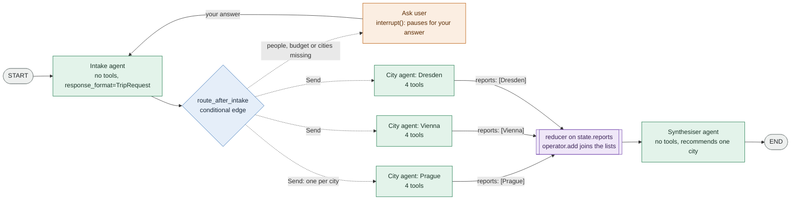

# Trip planner app: a team of agents, live

A small web page that runs the trip planner of workbook 05 as one LangGraph graph with three agents, and shows how the graph works while it runs.

## What the planner does

**The outcome.** One recommended city for a short, cheap trip from Berlin **this coming weekend**. For each city you compare, it shows the travel, the bed, the money left per person and the weather.

**What it needs from you.**

| Input | Required | If it is missing |
|---|---|---|
| people: how many travel | yes | the graph pauses and asks you |
| budget: in euros, for the whole group | yes | the graph pauses and asks you |
| cities: one to four cities to compare | yes | the graph asks you, and names the cities of the travel guide: Prague, Vienna, Dresden |
| nights | no | 1 night |

The dates are always the coming weekend. The planner never guesses people, budget or cities: the intake agent writes down only what you said, and the Python function `missing_items` decides what is missing. More than four cities? The graph asks you to choose four.

**One city or several.** The graph starts one city agent per city, all at the same time. With one city, the synthesiser agent says whether the trip fits the budget; with several, it recommends one. Only Prague, Vienna and Dresden have prices in the travel guide. Another city gets the weather, but its prices are unknown, so it cannot be checked against the budget.

## The graph



| Colour | What it is |
|---|---|
| green | an **agent**, built with `create_agent` |
| orange | **Ask user**: not an agent; `interrupt()` pauses the graph until you answer |
| blue | the **conditional edge** `route_after_intake`: a function, not a node |
| purple | the **reducer** on `state.reports`: a rule on the state, not a node |

The diagram shows three cities; the number of city agents is the number of cities in your request.

| Part | In the code | From workbook 05 |
|---|---|---|
| Intake agent | node `intake_agent`; `create_agent(..., response_format=TripRequest)` | the orchestrator agent of Step 8 |
| Conditional edge | `route_after_intake`: `"ask_user"` or one `Send("city_agent", CityJob(...))` per city | Lesson 2 of Step 8 |
| Ask user | node `ask_user`; `interrupt()` and `Command(resume=answer)` | new: human in the loop |
| City agent | node `city_agent`; the four tools of Part 1 | Step 8 |
| Reducer | `reports: Annotated[list[CityReport], operator.add]` | Lesson 1 of Step 8 |
| Synthesiser agent | node `synthesiser_agent`; no tools | Step 8 |

## The page

The page has four numbered panels:

1. **Chat**: your request, the questions of the graph, and the recommendation.
2. **Graph**: each node lights up while it runs; a dot travels along every edge the run takes. Click a node to see its code and its last input and output.
3. **Timeline**: one row per task, grouped by step. The city agents share a step, so their bars overlap.
4. **Inside the graph**: the shared state (with the reducer line `reports = [...] + [...]`), each agent's trace of model and tool calls, and the selected node.

## Run it

The folder is its own uv project, with its own `pyproject.toml` and `uv.lock`. In this folder:

```bash
cp .env.example .env        # then paste your key; or use the .env of the notebooks one folder up
uv run app.py
```

Open http://127.0.0.1:8000. If the port is taken: `uv run app.py --port 8765`.

Try *"Three of us want to get out of Berlin this weekend. Ideas?"*: the budget and the cities are missing, so the graph pauses at Ask user and names the cities of the travel guide. Answer *"450 EUR in total, compare all three"*, and three city agents start at the same time.

**No API key?** Click **Watch a recorded run**: the page plays back that run, recorded on 4 November 2026 with Claude Haiku 5.5 (`recorded_run.json`), event by event. The server still has to run.

## Files

| File | What it does |
|---|---|
| `trip_graph.py` | the tools, the three agents, the state, `missing_items` and the graph |
| `app.py` | FastAPI server: runs the graph with `graph.stream(..., stream_mode=["tasks", "updates"], subgraphs=True)` and sends one JSON event per line to the page |
| `index.html` | the page, in plain HTML, CSS and JavaScript |
| `recorded_run.json` | the recorded run for the replay button |
| `pyproject.toml`, `uv.lock` | the packages of this app |

The prices in the travel guide are example values written for the course, not real offers. The weather comes from Open-Meteo (CC BY 4.0).
