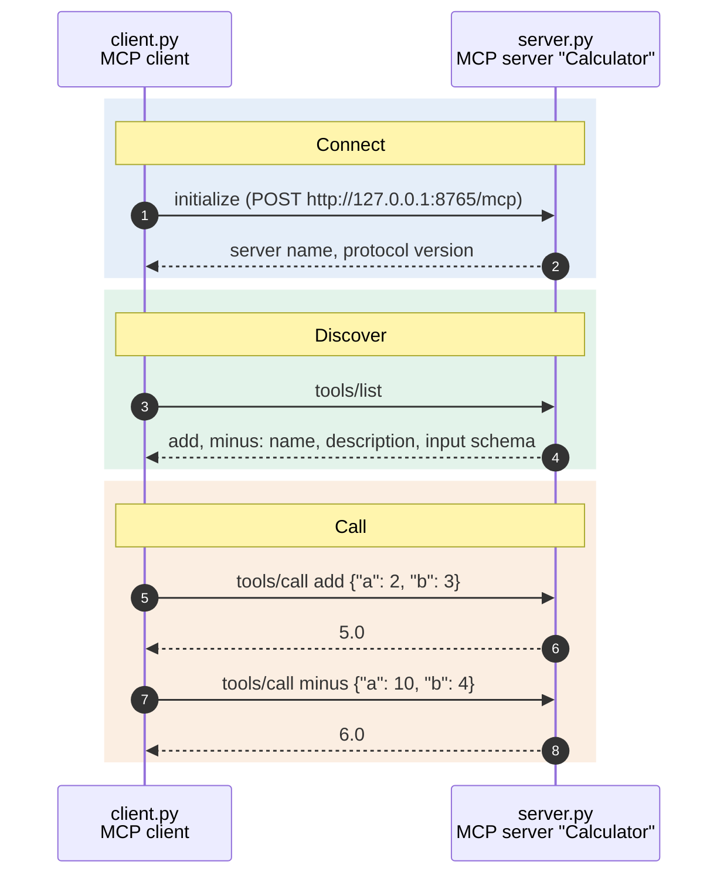

# MCP calculator: the smallest server and client

An **MCP server** offers tools. An **MCP client** connects to it, asks which tools exist, and calls them. Here the two are separate programs in separate terminals, and the only thing the client knows is the server's URL.

## How the two talk



| Colour | Step | In the code |
|---|---|---|
| blue | **Connect**: the client opens a session with the server | `async with Client(MCP_URL) as client:` |
| green | **Discover**: the server describes its tools | `await client.list_tools()` |
| orange | **Call**: the server runs a tool and sends back the result | `await client.call_tool("add", {"a": 2, "b": 3})` |

Every message is JSON-RPC over HTTP, the **Streamable HTTP** transport.

## Run it

The folder is its own uv project, with its own `pyproject.toml` and `uv.lock`. Open two terminals in this folder.

```bash
# terminal 1: the server keeps running and waits for clients
uv run server.py

# terminal 2: the client connects, prints, and stops
uv run client.py
```

The client prints:

```text
add: Add two numbers. | schema={'type': 'object', 'additionalProperties': False, 'properties': {'a': {'type': 'number'}, 'b': {'type': 'number'}}, 'required': ['a', 'b']}
minus: Subtract b from a. | schema={'type': 'object', 'additionalProperties': False, 'properties': {'a': {'type': 'number'}, 'b': {'type': 'number'}}, 'required': ['a', 'b']}
5.0
6.0
```

Stop the server with `Ctrl+C`. If port 8765 is taken, change the port in both files.

## Where the schema comes from

`@mcp.tool` reads the function and builds the tool description that the client receives:

| Part of the tool | Taken from |
|---|---|
| name `add` | the function name |
| description `Add two numbers.` | the docstring |
| input schema `a: number, b: number`, both required | the type hints `a: float, b: float` |

A model sees exactly this description when an agent uses the server, so the docstring and the type hints are the instructions for the model.

## Files

| File | What it does |
|---|---|
| `server.py` | `FastMCP("Calculator")`, two tools, `mcp.run(transport="http", ...)` |
| `client.py` | `Client(MCP_URL)`, `list_tools()`, `call_tool()` |
| `pyproject.toml`, `uv.lock` | one package: `fastmcp` |

## Beyond this computer

`127.0.0.1` accepts connections from this computer only. To serve other machines, for example from a container in the cloud, the server listens on `0.0.0.0`, and the client points `MCP_URL` at the server's address, for example `https://mcp.example.com/mcp`. A public server needs authentication: the client sends a token with `Client(MCP_URL, auth="<token>")`, and the server checks it with an auth provider.
