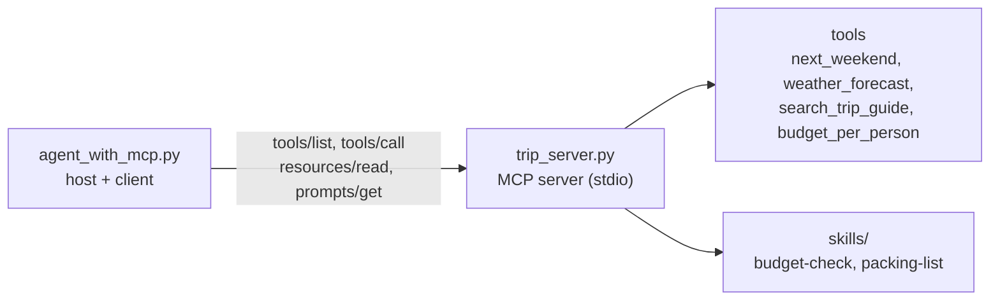

# MCP demo: the trip tools as a local MCP server

In the app, the four trip tools are Python functions inside `trip_graph.py`. Here the same tools live in a separate **MCP server**. An agent finds them by asking the server, so one server can serve any host: this app, a notebook, or an IDE.



## What the server offers

| Kind | Names | Who decides to use it |
|---|---|---|
| tools | `next_weekend`, `weather_forecast`, `search_trip_guide`, `budget_per_person` | the model |
| tools for skills | `list_skills`, `load_skill` | the model |
| resources | `trip://guide`, `skill://{name}` (a template: fill in the name) | the application |
| prompts | `plan_weekend_trip(city, people, budget_eur)` | the user |

## Skill discovery

A **skill** is a folder `skills/<name>/SKILL.md`: a header with `name` and `description`, then instructions. MCP has no skill type of its own, so this server offers skills with two tools and a resource.

1. **Discover**: the agent calls `list_skills` and gets only each name and description. These few lines go into the system prompt.
2. **Load**: when a description fits the task, the agent calls `load_skill("budget-check")` and reads the full instructions.
3. **Follow**: the instructions say which tools to call and how to report.

Only the headers cost context at the start. A body costs context only when the agent loads it. Add a skill by adding a folder: no code changes.

## Run it

In the folder `workspace/trip_planner_app`:

```bash
uv sync
uv run mcp_demo/discover.py          # no key, no model: lists tools, resources, prompts, skills; calls one tool
uv run mcp_demo/agent_with_mcp.py    # needs ANTHROPIC_API_KEY and an internet connection (weather)
uv run mcp_demo/agent_with_mcp.py "Can 4 of us do Dresden this weekend with 300 EUR in total?"
```

The server itself can run alone, over HTTP, on this computer only:

```bash
uv run mcp_demo/trip_server.py --http --port 8765
```

Try it with the MCP Inspector (needs Node.js): `npx @modelcontextprotocol/inspector uv run mcp_demo/trip_server.py`. It shows the same lists as `discover.py` in a browser.

## What to look for in the output of `agent_with_mcp.py`

- The first model message calls `load_skill`, then the tools that the skill names. The Python file of the agent has no tool code at all.
- The tool descriptions and input schemas the model sees come from the server. Change a docstring in `trip_server.py` and the agent changes with it.
- A tool description is text that the model reads as an instruction. Only connect servers you trust (see workbook 06, "Security: a tool description is an instruction").

## Files

| File | What it does |
|---|---|
| `trip_server.py` | the MCP server, built with FastMCP: tools, resources, a prompt, skill discovery |
| `skills/budget-check/SKILL.md` | instructions: check a trip against the budget |
| `skills/packing-list/SKILL.md` | instructions: turn a forecast into a packing list |
| `discover.py` | a client without a model: lists what the server offers and calls one tool |
| `agent_with_mcp.py` | a LangChain agent whose tools and skills come from the server |

The prices in the server's guide are example values written for the course, not real offers. The weather comes from Open-Meteo (CC BY 4.0). For a first MCP server step by step, see workbook 06.
