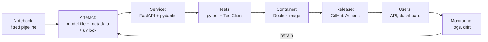
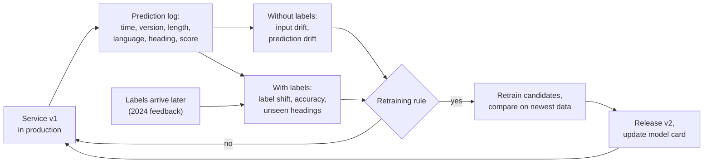

# Session 16 · Web APIs, deployment, monitoring and maintenance

> **Guiding question.** How does a model or dashboard reach its users, and how does it stay useful?

**Learning outcomes.** After this session you are able to

- request data from a web API and serve a model as a tested web API in a container, released with CI/CD
- describe the architecture of a data application (front end, back end, database) and the cloud services used to deploy it
- monitor a deployed model for data drift and label shift, decide on retraining and document the model in a model card

## Why this session matters

A model in a notebook helps only the person who runs the notebook. This session starts on the client side of a web API, requesting data that exist only behind an API, and then turns the case-study model into a service that answers requests from other programs, is tested, versioned, packaged in a container and released automatically. It builds on the tests and the continuous integration of Session 2 and on the SQL databases of Session 3. A deployed model starts to age on its first day, so the second block shows where the parts of a data application run, how to notice drift, decide on retraining and document the model in a model card. The team project ends here with a tested service and dashboard released through CI/CD, a monitoring plan, a model card and the final leaderboard round L3.

> This page is the teaching overview of the session. How to work with it (the ▶ links, the numbered notebooks, the extras) is explained once in the [course README](../../README.md#how-to-use-the-session-pages).

**Notes for this session**

- Each block has two lecture notebooks: 01 and 02 in Block 1, 04 and 05 in Block 2. The theory of Block 1 is dense; the lecturer moves quickly through the parts the students know from Sessions 2 and 3 (HTTP basics, tests, SQL).
- [`workspace/`](workspace/README.md) holds the complete tariff heading service (package `tariff_service`), its own uv project. Running service and dashboard together with Docker Compose and releasing through the CI/CD workflow is part of the team project, not of the 30-minute exercises.
- The cells of [01-lecture-web-apis.ipynb](workbooks/01-lecture-web-apis.ipynb) and [03-case-study-weather-api.ipynb](workbooks/03-case-study-weather-api.ipynb) marked *live* send requests to the real APIs.

## Block 1 · Web APIs and a released service

### Theory (45 min)

**Why.** Some data exist only behind an API: the weather of every day, prices, a company's own systems. And to reach its users, a model must itself become a service: a program that runs without us, answers requests from other programs, and can be tested, versioned and replaced. Most failures after deployment are not statistical but practical: a missing preprocessing step, a different library version, a hard-coded path. This block covers both sides of an API and removes these causes step by step.

The path of a model from a notebook to its users, and what this session adds at each step:

**Topics**

- **How web APIs work.** A client sends an HTTP request (method, URL with query parameters, headers) and receives a status code and a JSON body. Authentication, pagination and rate limits decide how a client must behave so that it is not blocked.
- **Requesting data with httpx.** A small client class with a timeout, retries for `429` and `5xx`, and validated records keeps the details of one API in one place. `httpx.MockTransport` tests it without a network.
- **From notebook to artefact: saving pipelines.** The whole fitted pipeline is saved with joblib or skops, together with metadata. Using one preprocessing function for training and serving avoids training–serving skew, and skops avoids running code from an unknown pickle.
- **Versioning and pinned dependencies.** Model, code and data are versioned together with semantic versioning, and a lock file records the exact version of every package, so that every prediction can be traced and the previous model restored.
- **A prediction API with FastAPI and pydantic, and its tests.** Input validation keeps malformed requests away from the model and gives clear errors instead of crashes. pytest and FastAPI's TestClient check the contract, the validation and a few obvious cases on every change.
- **Containers with Docker.** An image bundles the service with Python, the locked packages, the code and the model file. The same image that passed the tests in CI runs in production.
- **Continuous delivery with GitHub Actions.** Every change is tested on a clean machine, and a release is one deliberate action: pushing a version tag. A rollback means redeploying the image of the previous tag.

▶ **Lecture:** [01-lecture-web-apis.ipynb](workbooks/01-lecture-web-apis.ipynb) (web APIs, httpx), then [02-lecture-from-notebook-to-service.ipynb](workbooks/02-lecture-from-notebook-to-service.ipynb) (artefact, versions, FastAPI, tests, Docker, CD)

▶ **Worked examples**

- [03-case-study-weather-api.ipynb](workbooks/03-case-study-weather-api.ipynb): ten years of Berlin weather from the Open-Meteo API, one year per request, parsed into validated records, tested offline, and a first look at weather and Airbnb demand.

### Exercises (30 min) and debrief (15 min)

▶ **Exercises:** [session-16-exercises.ipynb](workbooks/session-16-exercises.ipynb), part 1.

- **Tomorrow's weather in JSON** (Paper, 5 min). Write the expressions for tomorrow's maximum temperature and the rainiest day in a printed Open-Meteo response.
- **API arithmetic** (Paper, 10 min). Count the yearly requests and the API calls for three cities over three and a half years, and find the limit a notebook that downloads on every run reaches first.
- **Capacity in your head** (Paper, 5 min). How many workers does a service with 100 requests per second and 50 ms per prediction need?
- **"Works on my machine"** (Pairs, 10 min). Five reasons why a notebook fails on another computer, and what in the workspace prevents each.
- **The pickle mismatch** (Predict, then Code, 10 min). What happens when a pipeline saved with one scikit-learn version is loaded with another?
- **An endpoint for heading texts** (Code, 15 min). A FastAPI endpoint `GET /headings/{heading}` with 404 and 422, tested with TestClient.
- *Stretch:* **A server that fails** (Code, 15 min). Test the retries of the weather client with a mock server that answers `503`.

**Debrief.** Compare two JSON expressions (one that looks for a list of days instead of columns aligned by position) and two request counts (one that forgets the leap year or starts 2022 in January). For the endpoint, look for `heading: int`, which turns `0101` into `101`.

## Block 2 · Architecture in the cloud, monitoring and maintenance

### Theory (45 min)

**Why.** Data scientists rarely set up cloud infrastructure alone, but they take part in the decisions about where the model runs and where the data live, and an architecture sketch is the common language for these discussions. Once deployed, the model ages: the requests change, the member states that send them change, and the nomenclature is revised every five years. Labels arrive late or never, so we need signals that work without them, a written rule for when to retrain, and documentation that travels with the model. The case study provides real examples: after Brexit the United Kingdom issues no more decisions, and the share of chapter 85 falls between 2023 and 2024.

Monitoring is a loop around the deployed model:

**Topics**

- **System design.** Most data applications have a front end (the dashboard), a back end (the model API) and a database. Docker Compose runs dashboard and API together locally; the prediction log is a SQLite file on a volume that only the API can reach.
- **Cloud services on AWS, by example.** A container registry (ECR), container hosting (ECS with Fargate), a managed database (RDS), file storage (S3) and monitoring (CloudWatch) run the same parts in the cloud. The sketch also shows the one place where confidential requests are stored.
- **Publishing a dashboard (optional).** Streamlit and several hosting options make results available to people who want to explore them. Where to publish is a decision about cost, maintenance and data protection.
- **Data drift: the KS test and the population stability index.** Both compare recent inputs with the reference data. Input drift is the earliest warning that the model is used on data unlike its training data.
- **Prediction drift and label shift.** Prediction drift can be measured at once; label shift and concept drift (such as a nomenclature revision) only when labels arrive. The type of shift determines the response.
- **Retraining triggers and versioning.** A written rule says when a new model is trained, and candidates are compared fairly on the newest labelled data. The case study shows that a rule that waits for a drop can miss an improvement.
- **Documenting a model in a model card.** A model card states intended and out-of-scope uses and results per factor. In the case study, the overall accuracy hides large differences between languages.

▶ **Lecture:** [04-lecture-architecture-in-the-cloud.ipynb](workbooks/04-lecture-architecture-in-the-cloud.ipynb) (system design, AWS, dashboards), then [05-lecture-monitoring-and-maintenance.ipynb](workbooks/05-lecture-monitoring-and-maintenance.ipynb) (drift, retraining, model card)

▶ **Worked examples**

- [06-case-study-drift-and-retraining.ipynb](workbooks/06-case-study-drift-and-retraining.ipynb): the 2024 labels released as feedback data; detect the shifts (no GB decisions after Brexit, chapter 85 from 14 % to 12 %, a few headings never seen), compare retraining candidates, retrain and make the final leaderboard submission (L3), ranked on the 2025–2026 decisions. The teams run it for their own L3 submission.

### Exercises (30 min) and debrief (15 min)

▶ **Exercises:** [session-16-exercises.ipynb](workbooks/session-16-exercises.ipynb), part 2.

- **Draw the architecture from memory** (Paper, 10 min). Front end, back end and database with the protocols between them, and the AWS service for each part.
- **PSI by hand** (Paper, 10 min). The population stability index of three country groups when the United Kingdom drops to zero.
- **Country drift, one period later** (Code, 15 min). The country PSI for 2025–2026, and for both periods without GB.
- **Feedback loops** (Class, 5 min). What happens to next year's labels when officers accept the model's suggestions?
- *Stretch:* **Results per country for the model card** (Code, 15 min). Accuracy of version 1 per issuing country on the 2024 labels.

**Debrief.** In the PSI, look for a share of zero: ln(0) has no value, and the result depends on the small number put in its place, which must be stated. Compare a drift conclusion based on the p-value with one based on the size of the shift.

## Team project until the final presentations

Service and dashboard run together with Docker Compose and are released through the CI/CD workflow (workspace exercise 3). Release: tested service, monitoring plan and model card; retraining with the 2024 labels and final leaderboard round L3; repository tagged. The [workspace](workspace/README.md) has the longer exercises: version 1 and the batch endpoint (after Block 1), the drift report and version 2 with its model card (after Block 2).

## Extras (optional, self-study)

| Notebook | Content | Block |
|---|---|---|
| [extras/01-evidently-data-drift-report.ipynb](workbooks/extras/01-evidently-data-drift-report.ipynb) | Evidently: data drift and data summary reports (`DataDriftPreset`, `DataSummaryPreset`) on the Adult dataset; downloads the data from OpenML. Evidently is not in the course environment (it needs an older Plotly); open it in a temporary environment of its own: `uv run --no-project --python 3.14 --with jupyterlab --with "evidently>=0.7" --with scikit-learn jupyter lab sessions/16-deployment-and-monitoring/workbooks/extras` | 2 |

## Before the session and further reading

**Before.** Re-read the tests and CI parts of Session 2. Run `cd workspace && uv sync && uv run pytest -q` once to check that the workspace environment works. Docker Desktop (or Podman) is needed for the Compose part of the team project; the tests, the notebooks and the exercises do not need it.

**Lecturer.** Before Block 2, run `uv run python sessions/16-deployment-and-monitoring/workbooks/make_feedback_2024.py` and share `case-study/data/feedback_2024.csv` (labels of the 40,369 decisions of 2024 only, columns `id,heading`) with the students. `--out PATH` writes the file elsewhere.

**Further reading (optional, free)**

- MDN Web Docs: [An overview of HTTP](https://developer.mozilla.org/en-US/docs/Web/HTTP) and the [HTTPX documentation](https://www.python-httpx.org/)
- FastAPI: [Tutorial – User Guide](https://fastapi.tiangolo.com/tutorial/) and [FastAPI in Containers](https://fastapi.tiangolo.com/deployment/docker/)
- Goku Mohandas: [Made With ML](https://madewithml.com/) (testing, CI/CD and serving of one project)
- Christian Kästner: [Machine Learning in Production](https://mlip-cmu.github.io/book/) (open textbook)
- Mitchell et al. (2019): [Model Cards for Model Reporting](https://arxiv.org/abs/1810.03993)
- Evidently: [ML observability course](https://www.evidentlyai.com/ml-observability-course)

## Setup

All notebooks of this session run in the course environment: open them in VS Code with the `.venv` kernel (setup: [course README](../../README.md#setup)). The weather notebooks import the helper module [workbooks/weather.py](workbooks/weather.py) from their own folder.

The workspace has its own locked environment: `cd workspace && uv sync` (FastAPI, uvicorn, pydantic, scikit-learn, joblib, scipy, pandas; dev: pytest, ruff, httpx2). Optional extras: `--extra skops`, `--extra dashboard` (Streamlit). The prediction log uses SQLite through Python's built-in `sqlite3`; nothing else is installed for the database.

[06-case-study-drift-and-retraining.ipynb](workbooks/06-case-study-drift-and-retraining.ipynb) writes `submission_L3.csv` next to itself (do not commit it) and reads the feedback file from `case-study/data/feedback_2024.csv` or from the path in `FEEDBACK_PATH`. Run time about two minutes. The Evidently notebook in `extras/` is not part of the course environment; open it in a temporary environment of its own (command in the Extras table).

To regenerate the figures of the lecture notebooks (needs the feedback file), run `uv run python sessions/16-deployment-and-monitoring/figures/make_figures.py`.

## Sources and licences

Keep the attribution when you reuse or share a file. Course-written material is licensed CC BY 4.0. Third-party notebooks keep their original licence.

**Course material (course team)**

| File | Content | Licence |
|---|---|---|
| [01-lecture-web-apis.ipynb](workbooks/01-lecture-web-apis.ipynb) | Lecture, Block 1: why analysts need APIs; HTTP, JSON, authentication, pagination, rate limits, httpx, mocked tests. Moved from Session 2 (where it also covered a minimal FastAPI app, now part of notebook 02) | CC BY 4.0 |
| [02-lecture-from-notebook-to-service.ipynb](workbooks/02-lecture-from-notebook-to-service.ipynb), [04-lecture-architecture-in-the-cloud.ipynb](workbooks/04-lecture-architecture-in-the-cloud.ipynb), [05-lecture-monitoring-and-maintenance.ipynb](workbooks/05-lecture-monitoring-and-maintenance.ipynb) | Lecture notebooks: artefact, versions, FastAPI, tests, Docker and CD (Block 1); system design, AWS and dashboards; monitoring, retraining and model cards (Block 2). Parts reuse the earlier course notes (course team) | CC BY 4.0 |
| [03-case-study-weather-api.ipynb](workbooks/03-case-study-weather-api.ipynb) | Worked example, Block 1: live Open-Meteo requests, errors, rate limits, paging by year, validated parsing, weather and monthly reviews, MockTransport test; optional VBB departures. Moved from Session 2 | CC BY 4.0 |
| [workbooks/weather.py](workbooks/weather.py) | Open-Meteo client (`WeatherClient`, `DailyWeather`, `parse_daily`, `yearly_chunks`) used by notebooks 01 and 03. From the Session 2 workspace (`listingtools.weather`), made self-contained | MIT |
| [06-case-study-drift-and-retraining.ipynb](workbooks/06-case-study-drift-and-retraining.ipynb) | Worked example, Block 2: drift, label shift, retraining candidates, final submission (L3) | CC BY 4.0 |
| [session-16-exercises.ipynb](workbooks/session-16-exercises.ipynb) | Exercises of both blocks (hand-outs and starter code) | CC BY 4.0 |
| [figures/make_figures.py](figures/make_figures.py) and its PNGs (`drift-histogram.png`, `psi-explained.png`) | Figures from the EBTI case-study data (issuing-country drift, chapter label shift with the released 2024 labels, PSI per country) | CC BY 4.0 |
| [workbooks/make_feedback_2024.py](workbooks/make_feedback_2024.py) | Lecturer script: releases the 2024 labels (`--out` for another path) | MIT |
| [workspace/](workspace/README.md) | Package `tariff_service`, tests, Dockerfile, `compose.yaml`, workflows, model card template, dashboard and its Dockerfile | Code: MIT; text: CC BY 4.0 |

**Third-party notebooks**

| File | Source | Licence | Downloaded | Changes |
|---|---|---|---|---|
| [extras/01-evidently-data-drift-report.ipynb](workbooks/extras/01-evidently-data-drift-report.ipynb) | [evidentlyai/evidently](https://raw.githubusercontent.com/evidentlyai/evidently/main/examples/classic_ml_validation.ipynb) | [Apache-2.0](https://github.com/evidentlyai/evidently/blob/main/LICENSE) | 2026-10-01 | Renamed from `examples/classic_ml_validation.ipynb`; content unchanged |

FastAPI documentation (MIT), HTTPX documentation, MDN Web Docs, Made With ML (MIT), Streamlit documentation, the Docker and Docker Compose documentation, the SQLite documentation and the AWS documentation are referenced as links only; no files were copied.

**Data**

| Data | Used in | Source | Licence |
|---|---|---|---|
| Daily Berlin weather (temperature, precipitation, sunshine), requested live | `weather.py`, notebooks 01 and 03, exercises 1.1 and 1.7 (printed and mocked responses) | [Open-Meteo](https://open-meteo.com/) archive and forecast APIs | [CC BY 4.0](https://creativecommons.org/licenses/by/4.0/); free API for non-commercial use (fewer than 10,000 calls per day) |
| Monthly reviews and stored daily weather (`reviews_monthly.parquet`, `weather_daily.parquet`) | notebook 03 | Inside Airbnb, Berlin snapshot of 26 June 2026 (`case-study/prepare_airbnb.py`); weather from Open-Meteo | [CC BY 4.0](https://creativecommons.org/licenses/by/4.0/) |
| Live departures at S+U Alexanderplatz (optional extra of notebook 03) | notebook 03 | [v6.vbb.transport.rest](https://v6.vbb.transport.rest/), community-run, data of VBB | Not stored; requested live only |
| Customs decisions and nomenclature texts | notebooks 02, 05, 06, exercises, workspace | European Commission, *European Binding Tariff Information (EBTI)* database, full export; reuse with acknowledgement under Commission Decision 2011/833/EU. Nomenclature texts: datasets/harmonized-system, *Harmonized System nomenclature (HS 2022)* | EBTI: Decision 2011/833/EU; HS texts: ODC-PDDL |

<b>References cited in the lecture notebooks</b>

- Breck, E., Cai, S., Nielsen, E., Salib, M. and Sculley, D. (2017). The ML test score: A rubric for ML production readiness and technical debt reduction. *IEEE International Conference on Big Data 2017*. https://research.google/pubs/the-ml-test-score-a-rubric-for-ml-production-readiness-and-technical-debt-reduction/
- Dong, E., Du, H. and Gardner, L. (2020). An interactive web-based dashboard to track COVID-19 in real time. *The Lancet Infectious Diseases* 20(5), 533–534. https://doi.org/10.1016/S1473-3099(20)30120-1
- Encode / httpx contributors (2026). *HTTPX documentation: Quickstart; Timeouts; Transports (MockTransport)*. https://www.python-httpx.org/
- Heaven, W. D. (2020). Our weird behavior during the pandemic is messing with AI models. *MIT Technology Review*, 11 May 2020. https://www.technologyreview.com/2020/05/11/1001563/covid-pandemic-broken-ai-machine-learning-amazon-retail-fraud-humans-in-the-loop/
- European Commission. *European Binding Tariff Information (EBTI)* database, full export (case-study data). Reuse with acknowledgement under Commission Decision 2011/833/EU. https://ec.europa.eu/taxation_customs/dds2/ebti/ebti_consultation.jsp?Lang=en
- European Commission. *Harmonized System*. https://taxation-customs.ec.europa.eu/customs/common-customs-tariff-cct/tariff-classification-goods/harmonized-system_en (linked only)
- datasets/harmonized-system: *Harmonized System nomenclature (HS 2022)*, ODC-PDDL. https://github.com/datasets/harmonized-system
- Inside Airbnb (2026). *Berlin, 26 June 2026 snapshot*. CC BY 4.0. https://insideairbnb.com/get-the-data/
- Kästner, C. *Machine Learning in Production: From Models to Products*. Open textbook. https://mlip-cmu.github.io/book/
- Lazer, D., Kennedy, R., King, G. and Vespignani, A. (2014). The parable of Google Flu: Traps in big data analysis. *Science* 343(6176), 1203–1205. https://doi.org/10.1126/science.1248506
- Lipton, Z. C., Wang, Y.-X. and Smola, A. (2018). Detecting and correcting for label shift with black box predictors. *ICML 2018*. https://arxiv.org/abs/1802.03916
- Mitchell, M., Wu, S., Zaldivar, A., Barnes, P., Vasserman, L., Hutchinson, B., Spitzer, E., Raji, I. D. and Gebru, T. (2019). Model cards for model reporting. *Proceedings of the Conference on Fairness, Accountability, and Transparency (FAT\*)*, 220–229. https://doi.org/10.1145/3287560.3287596
- Mohandas, G. *Made With ML*. https://madewithml.com/ (MIT licence)
- Mozilla (2026). *MDN Web Docs: An overview of HTTP; HTTP response status codes*. https://developer.mozilla.org/en-US/docs/Web/HTTP
- Open-Meteo (2026). *Historical Weather API*; *Weather Forecast API*; *Terms of use*. CC BY 4.0. https://open-meteo.com/en/docs/historical-weather-api
- Ribeiro, M. T., Wu, T., Guestrin, C. and Singh, S. (2020). Beyond accuracy: Behavioral testing of NLP models with CheckList. *ACL 2020*. https://arxiv.org/abs/2005.04118
- Sculley, D. et al. (2015). Hidden technical debt in machine learning systems. *NeurIPS 2015*. https://papers.nips.cc/paper_files/paper/2015/hash/86df7dcfd896fcaf2674f757a2463eba-Abstract.html
- Siddiqi, N. (2006). *Credit Risk Scorecards: Developing and Implementing Intelligent Credit Scoring*. Wiley.
- SQLite. *Appropriate uses for SQLite*. https://www.sqlite.org/whentouse.html
- Wiggins, A. (2017). *The Twelve-Factor App*. https://12factor.net/
- FastAPI documentation (Ramírez, S. and contributors), MIT licence. https://fastapi.tiangolo.com/
- skops documentation. https://skops.readthedocs.io/

