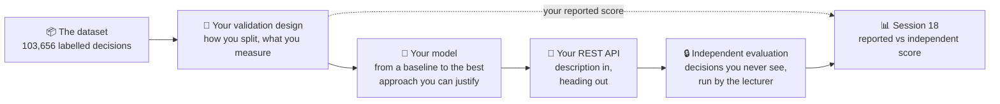
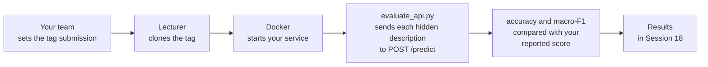

# Final project · Suggest the customs heading of a product

Every product that enters the EU needs a customs code, which decides the duty. When traders are unsure, customs experts classify the product in a **Binding Tariff Information (BTI) decision**. Your team builds a service that reads a product description, in any of 23 languages, and suggests its four-digit **heading**, so that a customs officer can check it faster.

All teams work on the same task and present it in Session 17 or 18. The project is 100 % of the module grade, and **every member is graded individually** ([Presentation and assessment](#presentation-and-assessment), the only place where the grading rule is written down).



## The goal

> Build a **REST API** that returns the four-digit heading of a product description, **report how well it works**, and show that your report can be trusted.

After the code freeze the lecturer runs every API on an **independent evaluation set** that no team sees. A reported score close to the independent one means your validation design worked; a large gap means it overestimated the model, and you explain why.

## Rules

- **Teams of two or three.** Each member states in their paper what they did.
- **Agentic engineering, owned code.** Build with AI coding agents, as taught in this course ([Session 1](../01-careers-and-python/workbooks/01-lecture-data-careers.ipynb)). You do not have to type every line, but **you own every line merged under your name**: you can explain it, it is tested, and you reviewed it.
- **Reproducible with Docker.** Anyone can rebuild the model and start the service from your tagged repository by following the README.
- **Collaborate through GitHub:** branches, pull requests from your own account, reviews before merging.
- **The description is the only input.** The other columns of the dataset are not available when a request arrives.
- **Train only on the dataset you are given,** and **predict, never look up**: no decisions from the public EBTI database, which holds the evaluation decisions too.
- **No artefacts or sensitive information in Git:** no data, no trained models, no credentials.

## The dataset

103,656 labelled decisions (`decisions.parquet`) and the EU goods nomenclature, on the course drive. Read [Getting the data](../../case-study/README.md#getting-the-data) and [the introduction to the EBTI data](../../case-study/ebti/README.md). There is **no ready-made split**: how you divide the decisions is your first design decision.

## What you deliver

| Deliverable | What it is |
|---|---|
| **A REST API** | `POST /predict` with a description, answering a heading ([interface](#a--the-api-interface)) |
| **The repository** | `README.md` (rebuild and start with Docker; your reported score), `docs/charter.md` (your plan and who does what), `MODEL_CARD.md` ([template](../16-deployment-and-monitoring/workspace/MODEL_CARD.md)) |
| **One paper per member** | written alone with the [individual paper template](individual-paper.md): the project as a whole, then your contribution |
| **A presentation** | 15 minutes per team with a live demonstration, in Session 17 or 18 |

**Submission:** a Git tag named `submission` on `main`, pushed before the code freeze, the day before Session 17 ([how](#how-to-submit-the-submission-tag)). Only the tagged commit is evaluated and graded.

**Feedback along the way:** nothing is graded before the presentation. Present intermediate results in class or write to the lecturer for advice.

## How the evaluation works



The evaluation set is a random sample held back before the dataset was handed out, with the same mix of headings and languages as yours. Run the same check on your own validation decisions before you submit ([how](#b--check-your-api-yourself)).

## Presentation and assessment

This is the complete grading rule; other documents only link here.

- **Individual grades,** from your own presentation, paper and code at the `submission` tag.
- **You own your code:** code written with AI tools counts as yours when you merged it from your own account and can explain it.
- **The score is not a mark:** a well-validated, well-explained 0.84 can earn more than an unexplained 0.88.

Points are given in **steps of 10**. The total of 100 is converted into a grade with the module's grading table, announced at the start of the semester.

| Criterion | Points | Full points when |
|---|---:|---|
| **P1 · Presentation** | 10 | You present your part clearly: the problem, your choices, your results with their uncertainty, their limits. |
| **P2 · Questions** | 10 | You answer the questions about your work correctly, in your own words. |
| **C1 · Problem** | 10 | Paper section 1: who uses the suggestions, what a wrong one costs, and how this leads to the metric and the baseline. |
| **C2 · Approach and results** | 20 | Paper sections 2–3: data, validation design, models and their theory, with sources; results against a baseline, with uncertainty and error analysis. Honest measurement counts, not a high score. |
| **C3 · Reproducibility** | 30 | Following the README at the tag rebuilds the model from the dataset and starts the service with Docker, and the service answers the evaluation. See the scale below. |
| **C4 · Your code** | 10 | The code you merged works, is tested and readable, and you can explain it. |
| **C5 · Contribution and collaboration** | 10 | Paper part 2 and appendix: what you did, challenges, lessons, AI use with the HTW declaration; your work reached `main` through pull requests from your own account, and you reviewed your teammates' pull requests. |

**C3, the scale** (the largest criterion: a result that cannot be rerun cannot be trusted):

| Points | When |
|---:|---|
| 30 | The README alone is enough: the model is rebuilt from the dataset, the service starts with Docker, and the evaluation runs without failed requests. |
| 20 | It works after a small fix that the README does not mention (a missing step, a wrong path). |
| 10 | The service starts with Docker, but the model cannot be rebuilt from the dataset. |
| 0 | The service does not start from the tag. |

**Who did what** is read from the GitHub account that opened each pull request. Work done together counts for both only with the commit trailer `Co-authored-by: Name <email>`. If a teammate does not contribute, tell the lecturer early.

## Questions and answers

**Must I write every line myself?** No. Work with agents as taught in the course; what is graded is that you own the code merged under your name.

**Do I have to use a language model?** No. Tuned TF-IDF reaches about 0.88 ([reference values](../../case-study/README.md#reference-values)); add embeddings or an LLM only if your validation shows they help.

**What do I report as the score?** Accuracy and macro-F1 of the submitted design on decisions that played no part in building or tuning it, with an interval.

**What if the live demonstration fails?** Have a recording ready; the evaluation uses your tag, not the demonstration.

---

## Appendix

### A · The API interface

The Session 16 workspace implements it; you may extend it, not change it.

```http
POST /predict
Content-Type: application/json

{"description": "Damenstiefel mit Oberteil aus Rindleder und Laufsohle aus Gummi"}
```

```json
{
  "heading": "6403",
  "top": [
    {"heading": "6403", "score": 2.1},
    {"heading": "6405", "score": 0.4},
    {"heading": "6402", "score": 0.1}
  ]
}
```

- Input: `description` only.
- Output: `heading` (four digits, scored); `top` (your three best headings, shown in the demonstration); other fields are allowed.
- `GET /health` answers `{"status": "ok"}` when the model is loaded.
- Port 8000, no internet access needed, 95 % of answers within two seconds.

### B · Check your API yourself

The lecturer scores every service with `case-study/evaluate_api.py` of the course repository. Run it on your own validation decisions first.

1. Save your validation decisions (a pandas DataFrame `validation`, rows your model was not trained on) next to your project data, outside Git; `heading` is text with four digits:

   ```python
   validation[["description", "heading"]].to_parquet("data/my_validation.parquet")
   ```

2. Start your service. In a second terminal, go to the course repository and run the script (add `--limit 200` for a quick check):

   ```bash
   cd path/to/course-repository
   uv run python case-study/evaluate_api.py --url http://localhost:8000 --data path/to/my_validation.parquet
   ```

```text
decisions          14,808
failed requests    0
accuracy           0.8810
macro-F1           0.7120
latency P95        0.042 s
```

| Line | Meaning |
|---|---|
| `failed requests` | errors, timeouts (10 seconds) or answers without `heading`; each counts as wrong |
| `accuracy` | share of right headings: the main metric |
| `macro-F1` | F1 averaged over headings, so rare headings count equally |
| `latency P95` | 95 % of the answers came faster than this; it must stay under two seconds |

### How to submit: the `submission` tag

A tag is a fixed name for one commit ([Session 2](../02-software-engineering/workbooks/02-lecture-notebook-to-application-git-and-ci.ipynb)). The lecturer announces the exact time of the code freeze.

1. Merge everything into `main`; CI is green.
2. Clone the repository into a new folder, follow the README to the running service, and run the check of appendix B.
3. Tag and push:

   ```bash
   git switch main
   git pull
   git tag -a submission -m "Final project submission"
   git push origin submission                # a plain git push does not send tags
   ```

4. Check on GitHub (*Code → Tags*) that `submission` points to the right commit.

Wrong commit before the freeze? `git tag -d submission`, `git push origin --delete submission`, then step 3. After the freeze the tag must not change; no tag means no submission.
