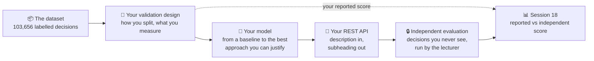
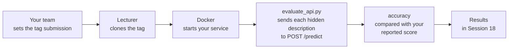

# Final project · Suggest the customs subheading of a product

Every product that enters the EU needs a customs code, which decides the duty. When traders are unsure, customs experts classify the product in a **Binding Tariff Information (BTI) decision**. Your team builds a service that reads a product description, in any of 23 languages, and suggests its six-digit **subheading** (the HS6 code), so that a customs officer can check it faster. The first four digits of a subheading form its **heading**, the first two its **chapter**.

All teams work on the same task and present it in Session 17 or 18. The project is 100 % of the module grade, and **every member is graded individually** ([Presentation and assessment](#presentation-and-assessment), the only place where the grading rule is written down).



## The goal

> Build a **REST API** that returns the six-digit subheading of a product description, **report how well it works**, and show that your report can be trusted.

After the submission deadline the lecturer runs every API on an **independent evaluation set** that no team sees. A reported score close to the independent one means your validation design worked; a large gap means it overestimated the model, and you explain why.

## Rules

- **Teams of two or three.** Each member states in their paper what they did.
- **Agentic engineering, owned code.** Build with AI coding agents, as taught in this course ([Session 1](../01-careers-and-python/workbooks/01-lecture-data-careers.ipynb)). You do not have to type every line, but **you own every line merged under your name**: you can explain it, it is tested, and you reviewed it.
- **Reproducible with Docker.** Anyone can rebuild the model and start the service from your tagged repository by following the README.
- **Collaborate through GitHub:** branches, pull requests from your own account, reviews before merging.
- **The description is the only input.** The other columns of the dataset are not available when a request arrives.
- **Train only on the dataset you are given,** and **predict, never look up**: no decisions from the public EBTI database, which holds the evaluation decisions too.
- **No data and no credentials in Git.** The trained model is the one exception: you upload it with Git LFS ([how](#c--starter-files-model-upload-and-docker)).

## The dataset

103,656 labelled decisions (`decisions.parquet`) and the EU goods nomenclature, in `case-study/final-challenge/data/`. Read [Getting the data](../../case-study/README.md#getting-the-data) and [the introduction to the EBTI data](../../case-study/final-challenge/README.md). The label is `subheading`; `heading` (its first four digits) and `chapter` are also in the file, but not available for a new request. There is **no ready-made split**: how you divide the decisions is your first design decision.

## Timeline

| When | What |
|---|---|
| Fri 12 Feb 2027 | **Presentation day** · every team presents |
| Fri 12 Feb 2027, 23:59 | **Submission deadline** · the paper of every member and the code of the team |
| Fri 26 Feb 2027, 15:30–18:00 | **Second examination period** · presentation slot, in the same format as the first, so that both periods are comparable |
| Fri 26 Feb 2027, 23:59 | **Submission deadline, second examination period** · the written report and the code (tag `submission`), on the same day at the latest |

- **The code** is counted by the Git tag `submission` ([how to submit](#how-to-submit-the-submission-tag)): the commit the tag points to at the deadline is the one that is evaluated and graded.
- **The paper** is at most 10 pages, not counting the appendix (use of AI tools and references). It is submitted as a **PDF** by e-mail to ledan@htw-berlin.de, with the HTW declaration on the use of AI tools attached, by the deadline.

## What you deliver

| Deliverable | What it is |
|---|---|
| **A REST API** | `POST /predict` with a description, answering a subheading ([interface](#a--the-api-interface)) |
| **The repository** | `README.md` (rebuild and start with Docker; your reported score), `MODEL_CARD.md` ([template](../16-deployment-and-monitoring/workspace/MODEL_CARD.md)), the trained model in `models/` ([Git LFS](#c--upload-your-model-checkpoint)) |
| **One paper per member** | written alone with the [individual paper template](individual-paper.md): the project as a whole, then your contribution |
| **A presentation** | 15 minutes per team with a live demonstration, in Session 17 or 18 |

### How the repository is laid out

The [Session 16 workspace](../16-deployment-and-monitoring/workspace/README.md) is a model for it. The data are never in Git; the trained model is, through Git LFS, so that the service starts from a fresh clone. The README must also say how to rebuild the model:

```text
your-repository/
  README.md          the steps below, and your reported score
  MODEL_CARD.md
  docs/              anything else you want to document (optional)
  pyproject.toml     with uv.lock: the exact versions
  .gitattributes     sends the files in models/ to Git LFS (ready-made file in Appendix C)
  Dockerfile         copies models/ into the image (template in Appendix C)
  compose.yaml       docker compose up --build (template in Appendix C)
  src/               the code, including the training script
  tests/
  models/            the trained model (Git LFS): the training script writes it here, you commit it
```

What a model folder contains: [`evaluate-api/example_model/`](evaluate-api/README.md#an-example-model-folder).

The steps in the README, in this order (the names after `-m` are those of your own package):

```bash
# 1. get the model in models/: fetch the committed checkpoint ...
git lfs pull
# ... or rebuild it from the dataset (this is how it was made)
uv run python -m your_package.train --data path/to/decisions.parquet

# 2. build the image and start the service on port 8000
docker compose up --build

# 3. check it with the evaluation script of the course repository (Appendix B)
cd path/to/course-repository/sessions/17-18-final-presentations/evaluate-api
uv run evaluate_api.py --url http://localhost:8000 --data path/to/my_validation.csv
```

A reader who runs these three steps, and nothing else, must end with a working service: this is what the reproducibility mark checks. The training command stays in the README so that anyone can rebuild the checkpoint.

**Submission:** a Git tag named `submission` on `main`, pushed by the submission deadline in the [timeline](#timeline) ([how](#how-to-submit-the-submission-tag)). Only the tagged commit is evaluated and graded.

**Feedback along the way:** nothing is graded before the presentation. Present intermediate results in class or write to the lecturer for advice.

## How the evaluation works



The evaluation set is a random sample held back before the dataset was handed out, with the same mix of subheadings and languages as yours. Run the same check on your own validation decisions before you submit ([how](#b--check-your-api-yourself)).

## Presentation and assessment

This is the complete grading rule; other documents only link here.

- **Individual grades,** from your own presentation, paper and code at the `submission` tag.
- **You own your code:** code written with AI tools counts as yours when you merged it from your own account and can explain it.
- **The score is not a mark:** a well-validated, well-explained 0.84 can earn more than an unexplained 0.88.

Points are given in **steps of 5**. The total of 100 is converted into a grade with the module's grading table, announced at the start of the semester.

**Presentation** (20 points)

| Criterion | Points | Full points when |
|---|---:|---|
| **Presentation** | 10 | You present your part clearly: the problem, your choices, your results with their uncertainty, their limits. |
| **Questions** | 10 | You answer the questions about your work correctly, in your own words. |

**Paper** (30 points)

| Criterion | Points | Full points when |
|---|---:|---|
| **Problem statement** | 10 | Paper section 1 frames the problem before any model: who uses the suggestions, what a wrong suggestion costs, and how this leads to the metric you optimise and the baseline you compare against. |
| **Approach and results** | 20 | Paper sections 2–3: data, validation design, models and their theory, with sources; results against a baseline, with uncertainty and error analysis. Honest measurement counts, not a high score. |

**Code** (50 points)

| Criterion | Points | Full points when |
|---|---:|---|
| **Reproducibility** | 30 | Following the README at the tag rebuilds the model from the dataset and starts the service with Docker, and the service answers the evaluation. See the scale below. |
| **Clean code** | 10 | The code you merged meets the standards below, and you can explain it. |
| **Collaboration** | 10 | Your work reached `main` through pull requests from your own account, and you reviewed your teammates' pull requests. |

**Clean code, the standards:**

- **README:** what the project does, how to install, run, test and call the service, in the order a newcomer needs.
- **Clear directory structure:** source, tests, data scripts and configuration each in their own place; names that say what is inside.
- **No redundant files:** no dead code, commented-out blocks, copies (`final_v2.py`), notebook checkpoints, caches or data in Git (`.gitignore` is set).
- **Readable names and small functions:** each function does one thing; names say what a value is (`validation_decisions`, not `df2`).
- **Tests:** the main functions are tested, and CI runs the tests on every pull request.
- **Pinned dependencies:** one lock file; no hidden global setup.
- **No secrets and no absolute paths:** configuration through arguments or environment variables.
- **Formatter and linter** (for example `ruff`) pass without errors.

**Reproducibility, the scale** (the largest criterion: a result that cannot be rerun cannot be trusted):

| Points | When |
|---:|---|
| 30 | It runs from the README alone. |
| 15 | It runs, but only after extra steps that the README does not mention. |
| 0 | It does not run. |

**Who did what** is read from the GitHub account that opened each pull request. Work done together counts for both only with the commit trailer `Co-authored-by: Name <email>`. If a teammate does not contribute, tell the lecturer early.

## Questions and answers

**Must I write every line myself?** No. Work with agents as taught in the course; what is graded is that you own the code merged under your name.

**Do I have to use a language model?** No. A well-tuned classical method is a strong start ([reference values](../../case-study/README.md#reference-values)); add embeddings or an LLM only if your validation shows they help.

**My laptop has little memory. Can I train a model with 3,000 classes?** Working within limited hardware is part of the task, and your paper should show how you dealt with it. Options: break the prediction into several steps, reduce the training set, or use a simpler technique and accept the trade-off. You are not graded on the accuracy you reach, but on how you handle a constraint like your own and how clearly your report shows it.

**What do I report as the score?** The accuracy of the six-digit subheading, on decisions that played no part in building or tuning the model, with an interval: this one is a must. Everything else is your choice: add the metrics that support your story (for example heading accuracy, top-3 accuracy, scores for rare subheadings or by language, memory, time).

**What if the live demonstration fails?** Have a recording ready; the evaluation uses your tag, not the demonstration.

---

## Appendix

### A · The API interface

The Session 16 workspace implements it; you may extend it, not change it.

```http
POST /predict
Content-Type: application/json

{"description": "Damenstiefel mit Oberteil aus Rindleder und Laufsohle aus Gummi"}
```

```json
{
  "subheading": "640359",
  "top": [
    {"subheading": "640359", "score": 2.1},
    {"subheading": "640399", "score": 0.4},
    {"subheading": "640319", "score": 0.1}
  ]
}
```

- Input: `description` only.
- Output: `subheading` (six digits, as text, scored); `top` (your three best subheadings, shown in the demonstration); other fields are allowed. The lecturer also reports the accuracy of the heading, the first four digits of your `subheading`.
- `GET /health` answers `{"status": "ok"}` when the model is loaded.
- Port 8000, no internet access needed, 95 % of answers within two seconds.

### B · Check your API yourself

The lecturer scores every service with the script in [`evaluate-api/`](evaluate-api/README.md), which has its own README and its own `uv` environment. Run it on your own validation decisions first: it shows your accuracy and **which `id` went wrong**.

```bash
cd sessions/17-18-final-presentations/evaluate-api
uv run evaluate_api.py --url http://localhost:8000 --data path/to/my_validation.csv
```

The input is a CSV with the columns `id`, `description` and `subheading`; the output is a summary on the screen and `evaluation_results.csv` with one row per `id`. The README of the folder explains both, with an [example input](evaluate-api/example_validation.csv) and an [example output](evaluate-api/example_results.csv).

### C · Starter files: model upload and Docker

Copy the files in [`evaluate-api/repository-starter/`](evaluate-api/repository-starter/) to the root of your repository: `.gitattributes` (Git LFS), `Dockerfile`, `compose.yaml` and `.dockerignore`. In the `Dockerfile`, change only the last line to the module and FastAPI object of your service; `docker compose up --build` then builds the image and starts it on port 8000.

**Model upload.** The checkpoint is the file(s) your training script writes to `models/` (an example: [`evaluate-api/example_model/`](evaluate-api/README.md#an-example-model-folder)). It is too large for normal Git, so it goes through **Git LFS**. The ready-made `.gitattributes` already lists the usual model file types.

```bash
# once per computer
git lfs install

# once per repository: copy the starter files to the root of your repository
cp -r path/to/course-repository/sessions/17-18-final-presentations/evaluate-api/repository-starter/. .

# after training: commit the checkpoint like any other file, in a pull request
git add .gitattributes models/
git lfs ls-files                  # must list your model file(s)
git commit -m "Add trained model"
git push
```

Also change the `models/*` line of your `.gitignore` so that Git does not ignore the checkpoint. Check on GitHub that the file shows *Stored with Git LFS*, and that a fresh `git clone` followed by `git lfs pull` gives you the model.

Keep the checkpoint small: GitHub gives each account a limited LFS storage and download quota, and every clone of your tag by the lecturer counts. Commit only the final model, not every experiment; write the model size in your `MODEL_CARD.md`.

### How to submit: the `submission` tag

A tag is a fixed name for one commit ([Session 2](../02-software-engineering/workbooks/02-lecture-notebook-to-application-git-and-ci.ipynb)). The deadline is in the [timeline](#timeline); the commit that `submission` points to at that time is the one that counts.

1. Merge everything into `main`; CI is green.
2. Clone the repository into a new folder (`git lfs pull` brings the checkpoint), follow the README to the running service, and run the check of appendix B.
3. Tag and push:

   ```bash
   git switch main
   git pull
   git tag -a submission -m "Final project submission"
   git push origin submission                # a plain git push does not send tags
   ```

4. Check on GitHub (*Code → Tags*) that `submission` points to the right commit.

Wrong commit before the deadline? `git tag -d submission`, `git push origin --delete submission`, then step 3. After the deadline the tag must not change; no tag means no submission.
